# 01 · Các luồng nghiệp vụ chính và sơ đồ

> **Baseline:** Master Spec v4 — 4 actor nội bộ (MANAGER, WAITER, KITCHEN, CASHIER) + SePay; 48 bảng; 27 nhóm chức năng. Tài liệu mô tả **schema v4.1 bản chốt**, đã áp dụng các quyết định QĐ-1…QĐ-8 (xem [02 §11](02-danh-gia-database.md)).
> Ký hiệu ghi CSDL: **C** = tạo dòng, **U** = cập nhật, **D** = xóa, **R** = đọc. Chi tiết đọc/ghi từng nhóm chức năng ở [03-luong-du-lieu-chuc-nang.md](03-luong-du-lieu-chuc-nang.md); kiểm toán từng hàm `rc_*` ở [07-kiem-toan-ham-rc.md](07-kiem-toan-ham-rc.md).

## 1. Bảy luồng chính

Xếp theo trình tự một ngày vận hành: thiết lập → chuẩn bị → bán → thu tiền → chốt sổ.

| Mã | Luồng | Nhóm chức năng | Actor | Bảng lõi |
| --- | --- | --- | --- | --- |
| **L1** | Nhân sự, tài khoản, ca, chấm công | 1.1–1.4 | MANAGER | `employees`, `accounts`, `shift_assignments`, `attendances` |
| **L2** | Thực đơn ngày và khả dụng món | 2.1–2.4 | MANAGER, KITCHEN | `menu_items`, `recipes`, `daily_menu_items` |
| **L3** | Cung ứng nguyên liệu: nhập → xuất → nhận → sơ chế | 4.1–4.5 | MANAGER, KITCHEN | `inventory_batches`, `stock_issue_items`, `kitchen_batches`, `stock_movements` |
| **L4** | Phục vụ tại bàn: mở bàn → gọi món → bếp → trả món; hủy món (thường / ngoại lệ) | 3.1–3.4, 4.6 | WAITER, KITCHEN, MANAGER (hủy ngoại lệ) | `table_sessions`, `order_items`, `stock_reservations` |
| **L5** | Chốt hóa đơn và thanh toán CASH/QR; khách bỏ về chưa thanh toán | 3.1, 3.5–3.7 | CASHIER, SePay, MANAGER (bỏ về) | `invoices`, `payment_requests`, `payments` |
| **L6** | Ngoại lệ kho: hoàn trả, hư hỏng, kiểm kê | 4.3 (hoàn trả), 4.7 | KITCHEN, MANAGER | `stock_returns`, `stock_adjustments`, `stock_counts` |
| **L7** | Tài chính cuối ngày và báo cáo | 5.1–5.5 | MANAGER, CASHIER | `operating_expenses`, `payments`, `daily_cash_reconciliations` |

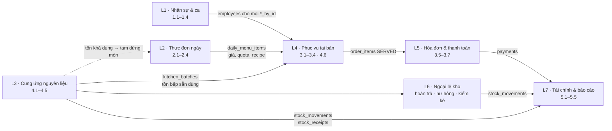

**Hai dòng chảy tách biệt** (spec F): *dòng vật tư* L3 → L4 (COOK) → L6 ghi `stock_movements`; *dòng tiền* L5 → L7 ghi `payments`, `operating_expenses`. Hai dòng chỉ gặp nhau ở báo cáo — nhận hàng không tự sinh khoản chi, hóa đơn không đọc kho.

## 2. Sơ đồ ngữ cảnh (DFD mức 0)

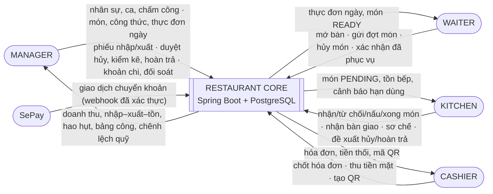

Khách hàng và nhà cung cấp không đăng nhập hệ thống: khách giao tiếp qua WAITER/CASHIER, nhà cung cấp chỉ xuất hiện dưới dạng `stock_receipts.supplier_name`.

## 3. DFD mức 1 — tiến trình và kho dữ liệu

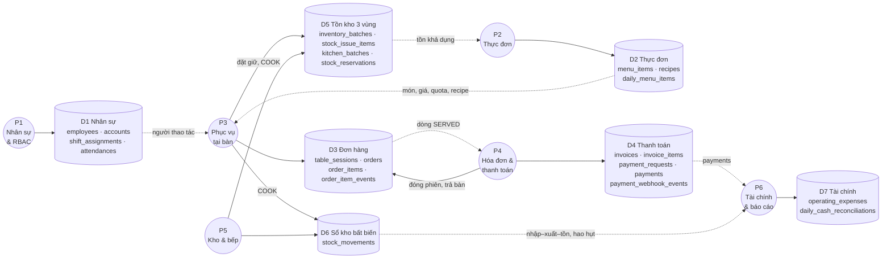

P3 ghi cả kho dữ liệu kho (D5, D6) vì đặt giữ và tiêu hao nằm **trong cùng transaction** với việc đổi trạng thái món (nhóm 3.4 ≡ 4.6). Mọi tiến trình đều đọc D1 để lấy người thao tác; sơ đồ chỉ vẽ một cạnh đại diện.

## 4. L1 · Nhân sự, tài khoản, ca, chấm công

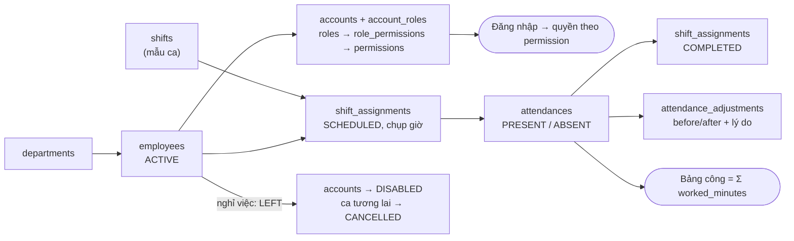

- Phân ca **chụp** giờ bắt đầu/kết thúc/nghỉ từ mẫu ca → sửa mẫu không làm sai lịch cũ.
- Chấm công 1–1 với phân ca; mọi sửa đổi sinh 1 dòng `attendance_adjustments`, không ghi đè lịch sử.
- Core không tính lương; bảng công là truy vấn tổng hợp.

## 5. L2 · Thực đơn ngày và khả dụng món

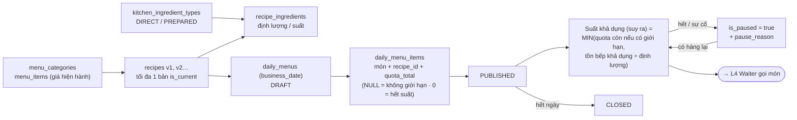

- Công thức trỏ tới **loại nguyên liệu bếp** (`kitchen_ingredient_types`), không trỏ nguyên liệu thô → món dùng "bò đã thái" trừ đúng lô PREPARED.
- Publish **không** giữ nguyên liệu; chỉ khi Kitchen nhận món (L4) mới tạo `stock_reservations`.
- Số đã bán, quota còn, suất khả dụng đều **suy ra**, không lưu.
- **QĐ-1 — hạn mức suất:** `quota_total = NULL` là không giới hạn suất bán; `0` là không còn suất được bán; `> 0` là trần trong ngày. Không giới hạn suất **không** có nghĩa bỏ kiểm tra nguyên liệu: Kitchen chỉ nhận món khi đủ tồn khả dụng theo công thức.
- Không hạ `quota_total` xuống dưới số suất đã chiếm (trigger); đã có món gọi thì không đổi món/công thức của dòng thực đơn ngày.

### 5.1 Quota chiếm khi nào (QĐ-8)

| Trạng thái dòng món | Chiếm quota? | Ghi chú |
| --- | :-: | --- |
| `PENDING` | không | Waiter gửi món chưa chiếm suất; `rc_submit_batch` chỉ báo sớm khi đã hết suất |
| `ACCEPTED` | **có** | Kitchen nhận: kiểm quota + đặt giữ nguyên liệu trong **một** transaction |
| `REJECTED` | không | Bị từ chối (thiếu suất/nguyên liệu/món tạm dừng) không bao giờ chiếm |
| `CANCELLED` **trước** `COOKING` | không | Giải phóng đúng một lần (dòng rời tập "đã chiếm"; số chiếm là giá trị suy ra nên không thể giải phóng hai lần) |
| `COOKING`, `READY`, `SERVED` | **có** | Nguyên liệu đã tiêu hao |
| `CANCELLED` **sau** `COOKING` (Manager hủy ngoại lệ, khách bỏ về) | **có** | Không hoàn suất vì không hoàn nguyên liệu |

Hai Kitchen nhận suất cuối cùng một lúc: `rc_accept_item` khóa dòng `daily_menu_items` nên lần nhận sau luôn thấy số đã chiếm mới (kiểm chứng bằng hai kết nối thật ở [06](06-test-concurrency-v4.1.mjs), ca C1).

## 6. L3 · Cung ứng nguyên liệu

### 6.1 Quy trình

```mermaid
flowchart TB
    subgraph M["MANAGER"]
        M1["Lập phiếu nhập DRAFT<br/>stock_receipts + stock_receipt_items"] --> M2["rc_confirm_receipt<br/>mỗi dòng → 1 lô RAW + sổ RECEIPT"]
        M2 --> M3["Lập phiếu xuất DRAFT<br/>chọn lô FEFO · DIRECT/PREPARE từng dòng"]
        M3 --> M4["rc_issue_stock<br/>trừ RAW + sổ ISSUE_OUT"]
        M5["rc_cancel_issue<br/>hoàn RAW + sổ ISSUE_REVERSAL"]
    end
    subgraph K["KITCHEN"]
        K1{"Hàng đến<br/>đủ, đúng?"}
        K2["rc_receive_issue"]
        K3["PREPARE: WIP += số lượng<br/>sổ ISSUE_RECEIVED"]
        K4["DIRECT: tạo kitchen_batches<br/>sổ DIRECT_IN"]
        K5["Lập phiếu sơ chế DRAFT<br/>nhiều đầu ra"]
        K6["rc_confirm_preparation<br/>WIP − input: PREP_INPUT<br/>lô PREPARED: PREP_OUTPUT"]
    end
    M4 --> K1
    K1 -- đủ --> K2
    K1 -- "thiếu / sai" --> M5
    K2 --> K3 --> K5 --> K6
    K2 --> K4
    K4 --> USE(["Lô bếp sẵn dùng → L4"])
    K6 --> USE
```

### 6.2 Ba vùng số lượng và loại biến động sổ kho

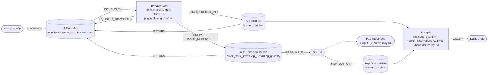

- **Chuyển vị trí ≠ tiêu hao**: chỉ COOK (và WASTE ở L6) làm hàng rời khỏi hệ thống; các bước khác chỉ đổi vùng.
- Đặt giữ không phải biến động vật lý → không có dòng `stock_movements`.
- Hao hụt sơ chế là phép trừ trên phiếu sơ chế, **không** ghi thêm movement âm.

### 6.3 Trạng thái phiếu xuất kho

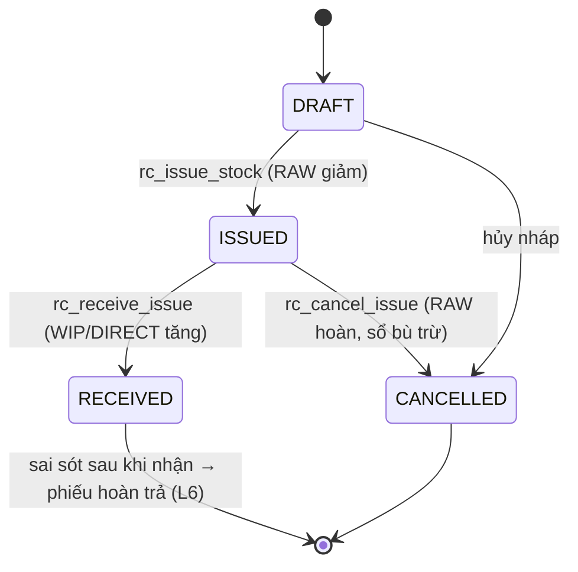

## 7. L4 · Phục vụ tại bàn

### 7.1 Luồng thao tác

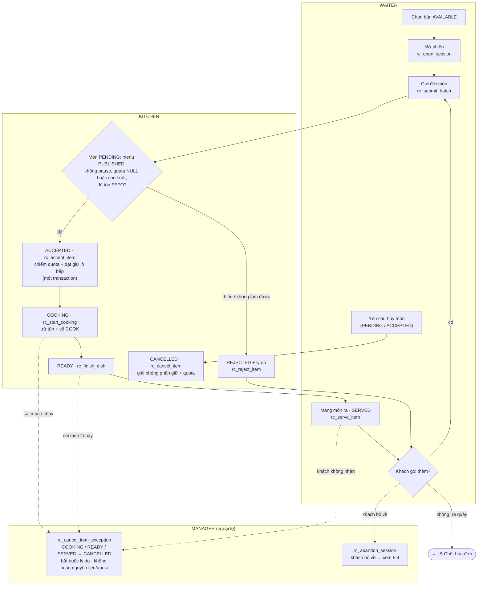

### 7.2 Mỗi bước ghi gì vào CSDL

| Bước | Hàm | Ghi CSDL (một transaction) |
| --- | --- | --- |
| Mở phiên | `rc_open_session` | C `table_sessions` (OPEN, `opened_by_id`) · C `orders` (OPEN) · U `dining_tables` → OCCUPIED |
| Gửi đợt món | `rc_submit_batch` | C `order_batches` · C `order_items` (PENDING, chụp tên + giá) · C `order_item_events` |
| Nhận món | `rc_accept_item` | U `order_items` → ACCEPTED · C `stock_reservations` (ACTIVE) · U `kitchen_batches.reserved_quantity` (+) · C `order_item_events` |
| Từ chối | `rc_reject_item` (hoặc `rc_accept_item` tự từ chối khi thiếu tồn/vượt quota) | U `order_items` → REJECTED · C `order_item_events` (lý do) |
| Bắt đầu nấu | `rc_start_cooking` | U `order_items` → COOKING · U `stock_reservations` → CONSUMED · U `kitchen_batches` (`quantity_on_hand` −, `reserved_quantity` −) · C `stock_movements` (COOK) · C `order_item_events` |
| Xong món | `rc_finish_dish` | U `order_items` → READY · C `order_item_events` |
| Đã phục vụ | `rc_serve_item` | U `order_items` → SERVED · C `order_item_events` |
| Hủy trước nấu (QĐ-2) | `rc_cancel_item` (Kitchen/Waiter theo quyền, bắt buộc lý do) | U `order_items` → CANCELLED · U `stock_reservations` → RELEASED (`ITEM_CANCELLED`) · U `kitchen_batches.reserved_quantity` (−) · C `order_item_events` (người + lý do) |
| Hủy ngoại lệ từ COOKING (QĐ-2) | `rc_cancel_item_exception` — **chỉ MANAGER** (kiểm vai trò trong DB), bắt buộc lý do | U `order_items` → CANCELLED · C `order_item_events` (từ COOKING/READY/SERVED, người, lý do) · nếu hóa đơn DRAFT: D `invoice_items` + U `invoices.total`. **Không** ghi sổ kho, **không** đổi `kitchen_batches`/`stock_reservations` |
| Khách bỏ về (QĐ-3) | `rc_abandon_session` — **chỉ MANAGER**, bắt buộc lý do | xem 8.4 |
| Đóng phiên trống | `rc_close_empty_session` | U `orders` → CANCELLED · U `table_sessions` → CLOSED (`closed_by_id`) · U `dining_tables` → AVAILABLE |

### 7.3 Trạng thái dòng món

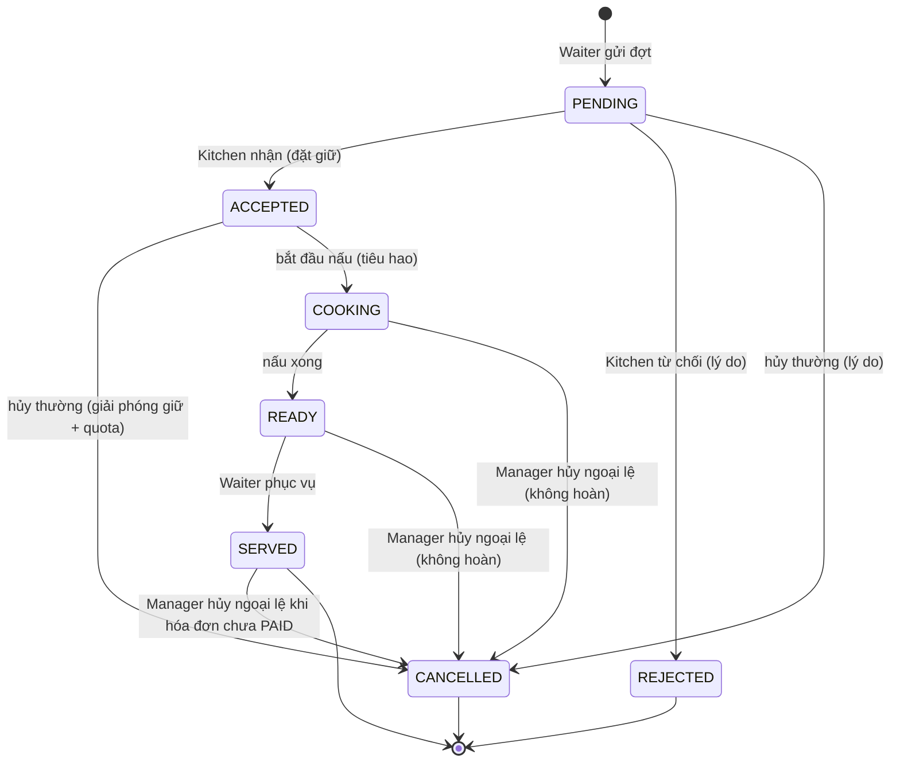

Từ `COOKING` trở đi chỉ còn đường hủy **ngoại lệ**: Manager, bắt buộc lý do, lưu `order_item_events` (trạng thái cũ → CANCELLED, `actor_id`, `reason`), không hoàn nguyên liệu đã tiêu hao, không hoàn quota, và món không được tính tiền. Hóa đơn `PAYMENT_PENDING` phải mở lại (`rc_reopen_invoice`) trước; sau khi `PAID` thì không hủy được. Hủy một phần số lượng của một dòng không có (QĐ-5): hủy cả dòng rồi gửi lại số đúng.

## 8. L5 · Chốt hóa đơn và thanh toán

### 8.1 Luồng tại quầy

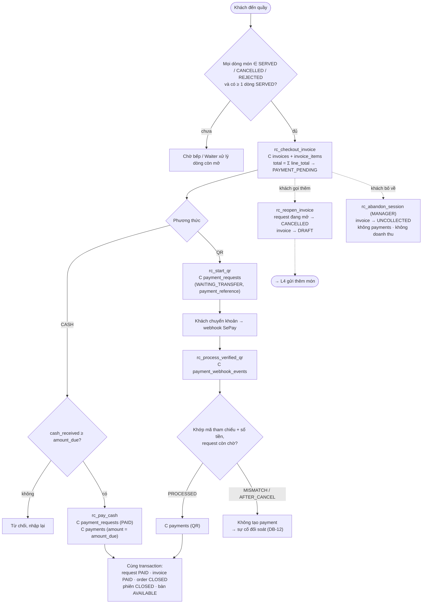

Quy tắc chốt hóa đơn (QĐ-4): Cashier chốt khi khách thanh toán tại quầy; hàm **tự tính** tổng từ `invoice_items` (client không gửi tổng), đối chiếu từng dòng với đơn hàng (đúng tập dòng SERVED, cùng tên/số lượng/đơn giá) rồi chuyển `PAYMENT_PENDING`. Từ lúc đó Waiter không gửi thêm món vào phiên (`rc_submit_batch` từ chối). Muốn thay đổi trước khi thu tiền phải đi qua `rc_reopen_invoice`: nó hủy yêu cầu thanh toán đang mở (ghi lý do, người, giờ) rồi trả hóa đơn về `DRAFT`. Gọi món, chốt hóa đơn và thanh toán cùng khóa `orders → invoices → payment_requests` nên không tranh chấp nhau.

### 8.2 Tương tác QR / SePay

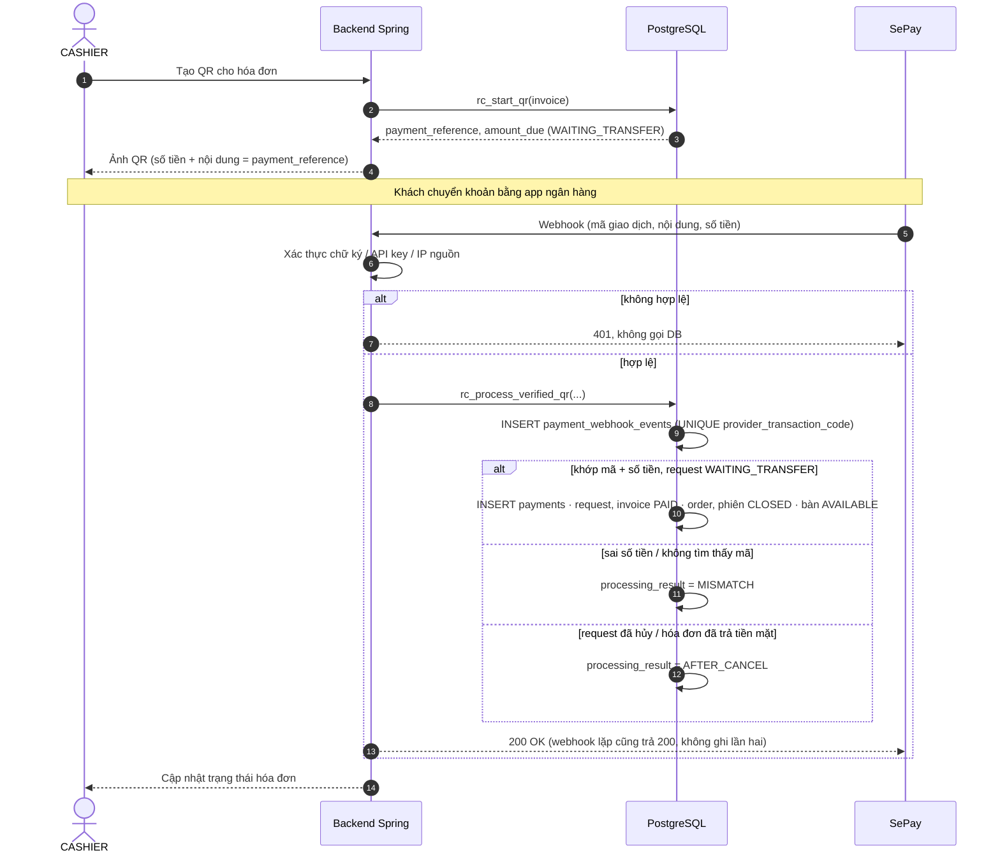

### 8.3 Trạng thái hóa đơn và yêu cầu thanh toán

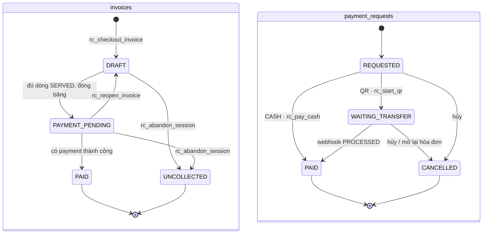

Bốn hàng rào chống thu trùng: `payments.invoice_id` UNIQUE, `payments.payment_request_id` UNIQUE, `payment_webhook_events.provider_transaction_code` UNIQUE, ≤ 1 request đang mở/hóa đơn (`ux_payment_request_active`). Ngoài ra trigger chặn ghi `payments` khi hóa đơn không `PAYMENT_PENDING` hoặc số tiền khác số phải thu, và chặn đánh dấu `PAID` khi chưa có `payments` khớp.

Webhook trùng hoặc đến cùng lúc luôn nhận kết quả đã lưu (không lỗi, không ghi lần hai); thu tiền mặt và webhook QR không thể cùng thắng vì đều khóa `orders → invoices` rồi kiểm lại trạng thái.

### 8.4 Khách bỏ về chưa thanh toán (QĐ-3)

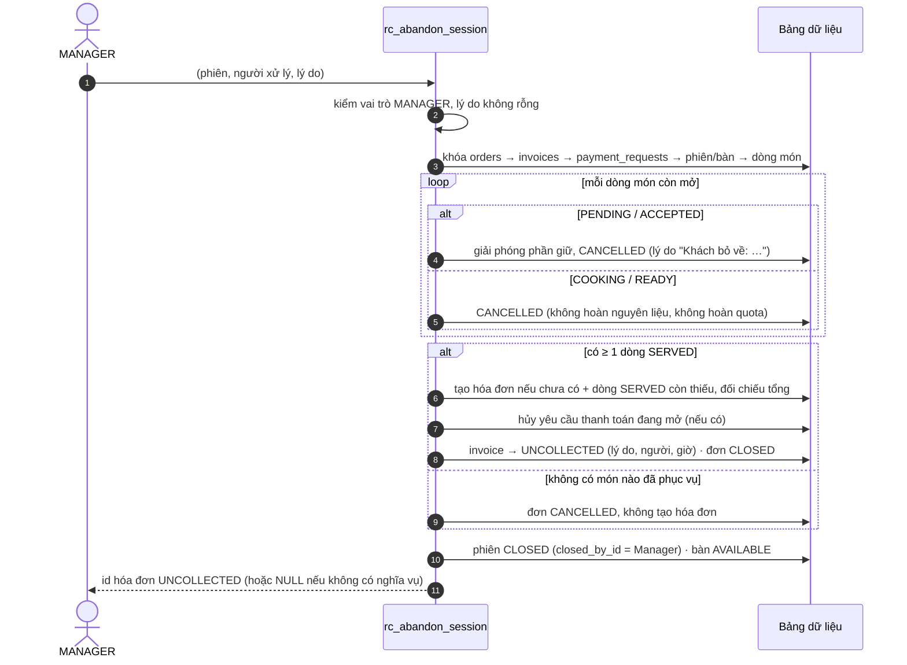

- **Không** tạo `payments`, **không** đánh dấu `PAID`, **không** có doanh thu thực thu; **không** xóa dữ liệu (đơn, món, hóa đơn, nhật ký đều giữ).
- `UNCOLLECTED` là trạng thái cuối: hóa đơn giữ nguyên nghĩa vụ phải thu (`total`, `invoice_items`) và bất biến. Báo cáo "nghĩa vụ chưa thu" là truy vấn `invoices WHERE status = 'UNCOLLECTED'` (chỉ mục `idx_invoices_uncollected`).
- QR đến muộn sau khi bỏ về: yêu cầu đã bị hủy nên webhook được ghi `AFTER_CANCEL` và mở sự cố đối soát (`resolution_status = OPEN`) để Manager xử lý ngoài hệ thống.
- Biểu diễn trạng thái: Core cũ chưa có chỗ ghi "kết thúc phiên không thu tiền" (hóa đơn kẹt `PAYMENT_PENDING`, bàn kẹt `OCCUPIED`). Điều chỉnh tối thiểu: thêm giá trị `UNCOLLECTED` vào `invoices.status` và 3 cột `uncollected_reason/by/at`; `orders.status = CLOSED` nay nghĩa là hóa đơn `PAID` **hoặc** `UNCOLLECTED`. Thu nợ/xóa nợ sau đó nằm ngoài Core.

## 9. L6 · Ngoại lệ kho

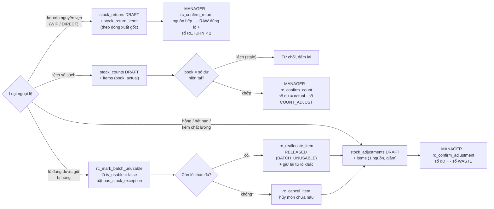

- Lô PREPARED (đã sơ chế) **không** trả về RAW; chỉ WIP và DIRECT còn nguyên vẹn được hoàn trả.
- Hao hụt bảo quản (WASTE) và hao hụt sơ chế là **hai chỉ tiêu khác nhau** trên báo cáo 5.5.
- Nhánh "lô đang được giữ bị hỏng" là luồng v4.1 bổ sung cho cờ `has_stock_exception` mà spec chưa mô tả (DB-14). Khi cờ đang bật, `rc_start_cooking` từ chối nấu cho tới khi món được cấp lại hoặc hủy.

## 10. L7 · Tài chính cuối ngày

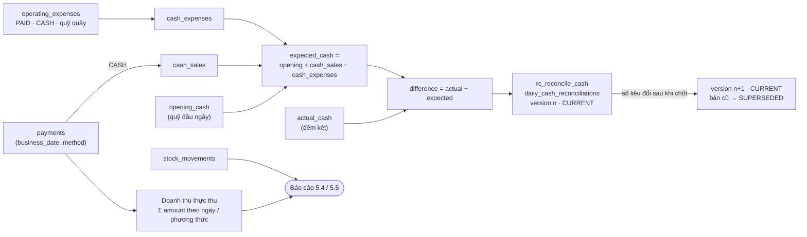

- Doanh thu chỉ tính `payments` (đã thu), không tính hóa đơn chưa PAID hay `UNCOLLECTED`; tiền QR không vào quỹ tiền mặt. Nghĩa vụ khách bỏ về (`invoices.status = 'UNCOLLECTED'`) được báo cáo riêng, không cộng vào doanh thu.
- Khoản chi trả bằng chuyển khoản hoặc từ quỹ chủ **không** trừ vào két; v4.1 cố định miền giá trị `payment_method`, `fund_source` và bắt buộc chi từ két (`CASH_DRAWER`) phải là tiền mặt (DB-30).
- `expected_cash`, `difference` là cột tự tính; bản đối soát đã chốt chỉ được chuyển sang SUPERSEDED, không sửa số liệu.
- Đây là báo cáo thu–chi, chưa phải lợi nhuận (chưa có giá vốn đầy đủ).

## 11. Ví dụ xuyên suốt — một món, một bàn, một ngày

Dùng đúng số liệu mục H của spec, mở rộng tới thanh toán và đối soát. Kịch bản chạy được: [08-vi-du-xuyen-suot.sql](08-vi-du-xuyen-suot.sql) thực hiện từng bước bằng các hàm `rc_*` của [schema v4.1](04-schema-v4.1.sql) trên PostgreSQL thật và so sánh 32 giá trị (mọi con số trong bảng dưới đây, cộng sổ kho và 6 truy vấn bất biến ở [02 §9](02-danh-gia-database.md)); tất cả khớp. Các nhánh khác (QR, webhook lặp, hủy món, hủy ngoại lệ, khách bỏ về, lô hỏng, hoàn trả, kiểm kê) nằm trong [05-test-v4.1.sql](05-test-v4.1.sql) và [06-test-concurrency-v4.1.mjs](06-test-concurrency-v4.1.mjs).

**Dữ liệu nền:** nguyên liệu `ingredients#1` "Thịt bò A" (kg); loại bếp `kitchen_ingredient_types#2` "Bò thái" (PREPARED); món "Bò lúc lắc" 50.000đ, công thức v1 = 0,2 kg "Bò thái"/suất; thực đơn ngày 25/10 có món này, quota 30; bàn B01.

| # | Bước (actor · hàm) | Ghi CSDL | RAW lô#1 | Đang chuyển | WIP | Bếp lô#1 (giữ) |
| --- | --- | --- | ---: | ---: | ---: | ---: |
| 1 | Nhập 10 kg (MANAGER · `rc_confirm_receipt`) | `stock_receipts#1` CONFIRMED · `stock_receipt_items#1` 10 kg × 250.000đ · `inventory_batches#1` = 10 · sổ RECEIPT +10 | 10,0 | 0 | 0 | — |
| 2 | Xuất 7 kg PREPARE (MANAGER · `rc_issue_stock`) | `stock_issues#1` ISSUED · `stock_issue_items#1` (7, PREPARE) · lô#1 = 3 · sổ ISSUE_OUT −7 | 3,0 | 7,0 | 0 | — |
| 3 | Bếp nhận (KITCHEN · `rc_receive_issue`) | `stock_issues#1` RECEIVED · WIP dòng#1 = 7 · sổ ISSUE_RECEIVED +7 | 3,0 | 0 | 7,0 | — |
| 4 | Sơ chế 7 → 6,3 kg (KITCHEN · `rc_confirm_preparation`) | `kitchen_preparations#1` (input 7) · `kitchen_preparation_outputs#1` 6,3 · `kitchen_batches#1` = 6,3 · sổ PREP_INPUT −7, PREP_OUTPUT +6,3 | 3,0 | 0 | 0 | 6,3 (0) |
| 5 | Mở bàn B01 (WAITER · `rc_open_session`) | `table_sessions#1` OPEN · `orders#1` OPEN · B01 OCCUPIED | | | | |
| 6 | Gọi 1 Bò lúc lắc (WAITER · `rc_submit_batch`) | `order_batches#1` · `order_items#1` PENDING, 1 × 50.000đ · event | | | | |
| 7 | Bếp nhận món (KITCHEN · `rc_accept_item`) | cần 1 × 0,2 = 0,2 kg → FEFO chọn lô#1 · `stock_reservations#1` ACTIVE 0,2 · ACCEPTED | 3,0 | 0 | 0 | 6,3 (0,2) |
| 8 | Bắt đầu nấu (KITCHEN · `rc_start_cooking`) | reservation CONSUMED · lô#1 = 6,1 · sổ COOK −0,2 · COOKING | 3,0 | 0 | 0 | 6,1 (0) |
| 9 | Xong, phục vụ (`rc_finish_dish`, `rc_serve_item`) | READY → SERVED · 2 event | | | | |
| 10 | Chốt hóa đơn (CASHIER · `rc_checkout_invoice`) | `invoices#1` total 50.000 PAYMENT_PENDING · `invoice_items#1` 1 × 50.000 = 50.000 | | | | |
| 11 | Khách đưa 60.000đ (CASHIER · `rc_pay_cash`) | `payment_requests#1` CASH: amount_due 50.000, cash_received 60.000, change_amount 10.000 (tự tính) · `payments#1` **50.000** · invoice PAID · order, phiên CLOSED · B01 AVAILABLE | | | | |
| 12 | Ghi chi (MANAGER) | `operating_expenses#1` 2.500.000 trả NCC, BANK_TRANSFER/BANK (gắn `stock_receipts#1`) · `#2` 50.000 mua đá, CASH/CASH_DRAWER | | | | |
| 13 | Đối soát (MANAGER · `rc_reconcile_cash`) | `daily_cash_reconciliations` v1: opening 1.000.000 + cash_sales 50.000 − cash_expenses 50.000 = expected 1.000.000; đếm két 1.000.000 → difference 0 | | | | |

**Kiểm tra chéo:**

- Sổ lô RAW#1: +10 − 7 = **3** = `quantity_on_hand`. Sổ WIP dòng#1: +7 − 7 = **0**. Sổ lô bếp#1: +6,3 − 0,2 = **6,1**.
- Hao hụt sơ chế = 7 − 6,3 = **0,7 kg** — suy ra từ phiếu sơ chế, không có movement −0,7.
- Tiêu hao món = 0,2 kg = 1 suất × 0,2 kg/suất (truy vấn I-9).
- Tiền: két nhận 60.000 − thối 10.000 = 50.000 = `cash_sales`. Khoản chi 2.500.000 trả chuyển khoản **không** vào `cash_expenses`; chỉ 50.000 tiền đá trừ vào két.
