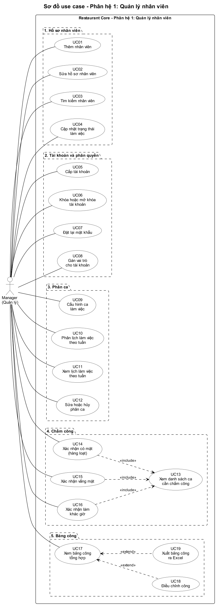
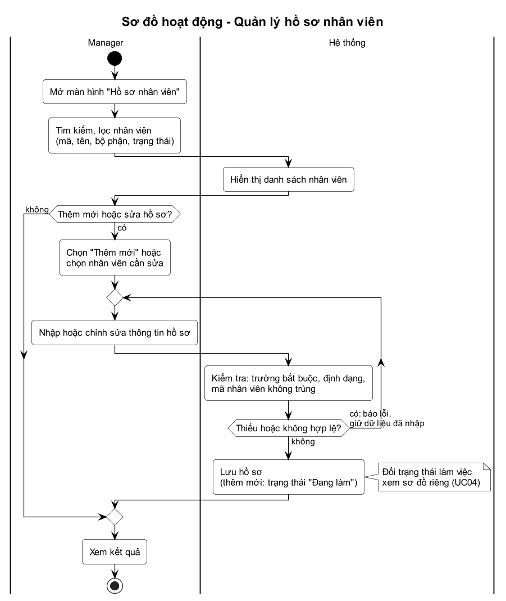
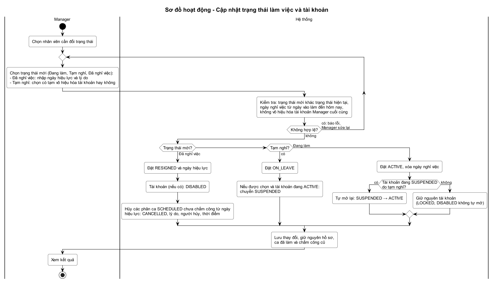
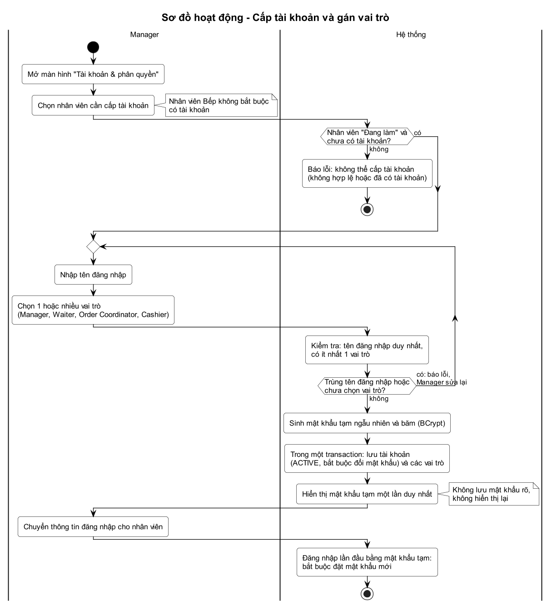
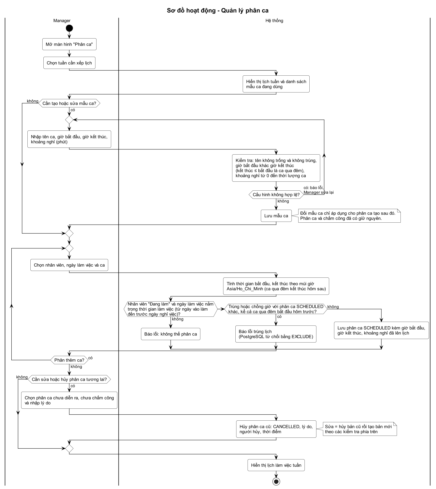
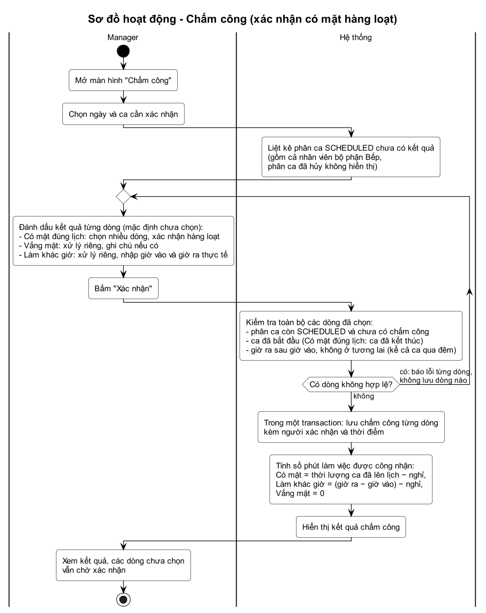
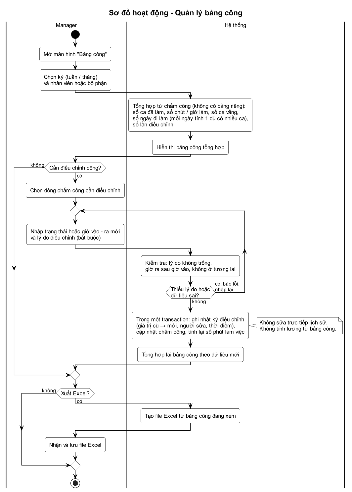
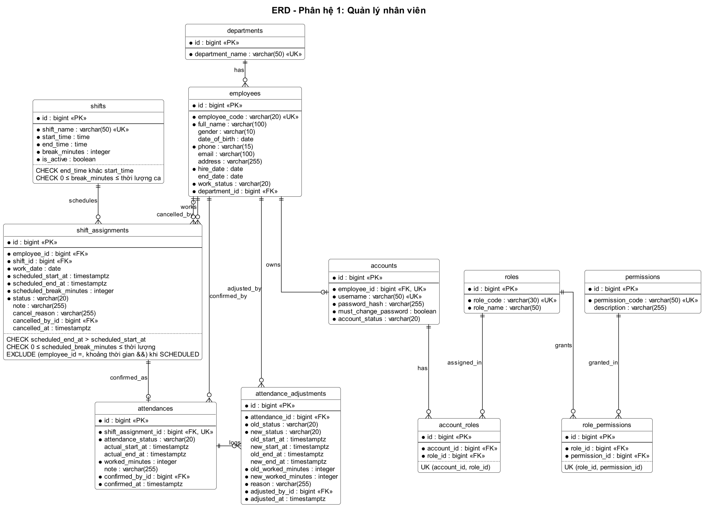

# Phân hệ 1 – Quản lý nhân viên (RMS Core)

Tài liệu phân tích và thiết kế phân hệ 1 của Restaurant Core (Spring Boot REST, WebSocket, web responsive, cơ sở dữ liệu **PostgreSQL**): use case, sơ đồ hoạt động, ERD, từ điển dữ liệu và DDL. Nguồn sơ đồ là các file `.puml` (PlantUML) cùng thư mục; ảnh `.png` được render từ các file đó. Lược đồ PostgreSQL nằm ở [schema-postgresql.sql](schema-postgresql.sql), bộ kiểm thử ở [test-postgresql.sql](test-postgresql.sql); phạm vi đã kiểm tra ghi ở [mục 7](#7-phạm-vi-đã-kiểm-tra).

## 1. Phạm vi

Phân hệ gồm 5 nhóm chức năng. Bản Core **không tính lương**; dữ liệu công được lưu đầy đủ để bổ sung tính lương ở phiên bản sau mà không phải sửa các bảng hiện có.

| STT | Nhóm chức năng | Use case | Phạm vi Core |
| --- | --- | --- | --- |
| 1 | Quản lý hồ sơ nhân viên | UC01–UC04 | Thêm, sửa, tìm kiếm, cập nhật trạng thái làm việc |
| 2 | Quản lý tài khoản và phân quyền | UC05–UC08 | Cấp tài khoản, khóa hoặc mở khóa, đặt lại mật khẩu, gán vai trò (RBAC) |
| 3 | Quản lý phân ca | UC09–UC12 | Cấu hình mẫu ca, phân lịch tuần, xem lịch, sửa hoặc hủy phân ca chưa diễn ra |
| 4 | Quản lý chấm công | UC13–UC16 | Danh sách ca cần chấm công; xác nhận có mặt hàng loạt, vắng mặt, làm khác giờ |
| 5 | Quản lý bảng công | UC17–UC19 | Tổng hợp theo kỳ, điều chỉnh công có lý do, xuất Excel |

**Ngoài phạm vi Core:** tính lương, trả lương, tạm ứng, phụ cấp, thưởng, phạt, thuế, bảo hiểm; quản lý nghỉ phép; đổi ca nhiều cấp phê duyệt; chấm công bằng QR, vân tay hoặc GPS.

**Nguyên tắc thiết kế:**

1. Manager là actor chính và duy nhất của phân hệ; không có quy trình phê duyệt nhiều cấp.
2. Bộ phận Bếp không phải actor: nhân viên bếp vẫn có hồ sơ, được phân ca và chấm công (Manager xác nhận thay), không bắt buộc có tài khoản.
3. Trạng thái làm việc của nhân viên (`work_status`) tách khỏi trạng thái tài khoản (`account_status`); đổi trạng thái nhân viên không làm mất việc kiểm soát tài khoản của Manager.
4. Không tự coi là có mặt chỉ vì có lịch: chỉ có dòng chấm công khi Manager xác nhận.
5. Không xóa cứng dữ liệu đã có lịch sử; chỉ đổi trạng thái hoặc hủy kèm lý do.
6. Dữ liệu sai hoặc trùng thì báo lỗi để Manager sửa; chỉ lưu khi hợp lệ.

**Phương án demo:** một laptop, tài khoản Manager, thực hiện tuần tự: (1) tạo hồ sơ nhân viên, cấp tài khoản và gán vai trò; (2) phân lịch làm việc; (3) xác nhận công hàng loạt, gồm cả bộ phận bếp; (4) xử lý một trường hợp vắng mặt hoặc đến muộn và điều chỉnh công; (5) xem bảng công tổng hợp và xuất Excel. Không cần máy chấm công, QR, GPS; đầu bếp không phải dùng phần mềm.

## 2. Tác nhân và giới hạn quyền

### 2.1 Tác nhân

| Đối tượng | Vai trò trong phân hệ 1 |
| --- | --- |
| Manager (Quản lý) | Actor duy nhất; dùng mọi use case của phân hệ |
| Waiter, Order Coordinator, Cashier | Không thao tác trong phân hệ này; là đối tượng được Manager tạo hồ sơ, cấp tài khoản, phân ca và xác nhận công. Quyền của họ ở các phân hệ khác do RBAC quyết định |
| Nhân viên bộ phận Bếp | Không phải actor: có hồ sơ, phân ca và chấm công do Manager xác nhận; tài khoản không bắt buộc |
| Hệ thống | Không vẽ thành actor: kiểm tra dữ liệu, tính phút công, ghi nhật ký là xử lý nội bộ |

Đăng nhập dùng chung toàn hệ thống nên không vẽ trong sơ đồ này; điều kiện tiên quyết của mọi use case là Manager đã đăng nhập.

### 2.2 Quyền của Manager và giới hạn

Backend kiểm tra quyền theo mã quyền ở mọi API; Manager có đủ sáu mã dưới đây (seed sẵn, không có màn hình cấu hình quyền).

| Mã quyền | Use case | Cho phép |
| --- | --- | --- |
| `EMPLOYEE_MANAGE` | UC01–UC04 | Thêm, sửa, tìm kiếm hồ sơ; cập nhật trạng thái làm việc |
| `ACCOUNT_MANAGE` | UC05–UC08 | Cấp tài khoản, khóa hoặc mở khóa, đặt lại mật khẩu tạm, gán vai trò |
| `SHIFT_MANAGE` | UC09–UC12 | Cấu hình mẫu ca, phân lịch, xem lịch, sửa hoặc hủy phân ca chưa diễn ra |
| `ATTENDANCE_CONFIRM` | UC13–UC16 | Xem ca cần chấm công; xác nhận có mặt, vắng mặt, làm khác giờ |
| `TIMESHEET_VIEW` | UC17, UC19 | Xem bảng công tổng hợp; xuất Excel |
| `TIMESHEET_ADJUST` | UC18 | Điều chỉnh công kèm lý do |

**Manager không được:**

- Xóa nhân viên, tài khoản, ca, phân ca hay chấm công; chỉ đổi trạng thái hoặc hủy kèm lý do.
- Xem hay lấy lại mật khẩu của người khác; chỉ đặt lại bằng mật khẩu tạm, hiển thị một lần.
- Xác nhận chấm công cho ca chưa bắt đầu, ca đã hủy hoặc ca đã có chấm công; xác nhận "có mặt đúng lịch" khi ca chưa kết thúc; không có thao tác "xác nhận tất cả" ngầm, mỗi dòng phải được tick.
- Sửa hay hủy phân ca đã bắt đầu hoặc đã chấm công; trường hợp đó xử lý bằng chấm công hoặc điều chỉnh công.
- Sửa công mà không có lý do, hoặc sửa nhật ký điều chỉnh.
- Khóa, vô hiệu hóa hay gỡ vai trò Manager của tài khoản Manager đang hoạt động cuối cùng (HR-08).
- Tính lương, ghi thưởng hoặc phạt; cấu hình ma trận vai trò – quyền.

### 2.3 Phân quyền cho bốn vai trò

| Vai trò | Mã quyền trong dữ liệu khởi tạo | Ghi chú |
| --- | --- | --- |
| `MANAGER` | 6 mã nhân sự ở bảng trên và 7 mã tài chính: `FIN_REVENUE_VIEW`, `FIN_TXN_VIEW`, `FIN_EXPENSE_VIEW`, `FIN_EXPENSE_RECORD`, `FIN_EXPENSE_RECORD_COUNTER_CASH`, `FIN_RECONCILE_VIEW`, `FIN_REPORT_VIEW` | 13 mã |
| `CASHIER` | `FIN_REVENUE_VIEW`, `FIN_TXN_VIEW`, `FIN_EXPENSE_VIEW`, `FIN_EXPENSE_RECORD_COUNTER_CASH`, `FIN_RECONCILE`, `FIN_RECONCILE_VIEW` | 6 mã; không có quyền nhân sự |
| `WAITER` | chưa có mã | Không dùng phân hệ 1 và 5; chức năng ở phân hệ 2, 3, 4 do các phân hệ đó mô tả theo vai trò |
| `ORDER_COORDINATOR` | chưa có mã | Như trên |

- Mã tài chính khớp bảng phân quyền ở README phân hệ 5. Khi phân hệ 2–4 cần mã quyền riêng, chỉ thêm dòng vào `permissions` và `role_permissions`, không đổi cấu trúc bảng.
- Một tài khoản có nhiều vai trò thì quyền là **hợp** quyền các vai trò. Ví dụ tài khoản có `MANAGER` và `CASHIER` có đủ 14 mã (ca kiểm thử RB-01); view `v_account_permissions` cho ra danh sách này.
- Nhân viên bếp không có tài khoản nên không có quyền nào nhưng vẫn có lịch làm và công (ca kiểm thử TS-05).
- Ma trận trên được tạo bằng lệnh `INSERT` cuối [schema-postgresql.sql](schema-postgresql.sql).

## 3. Sơ đồ use case



**Ranh giới hệ thống:** khung nét liền "Restaurant Core – Phân hệ 1: Quản lý nhân viên" là ranh giới hệ thống, Manager đứng ngoài khung. Năm khung nét đứt chỉ để nhóm use case theo chức năng, không phải hệ thống riêng. Các đường nối Manager với use case là quan hệ liên kết, không có mũi tên.

| Mã | Use case | Actor | Mô tả |
| --- | --- | --- | --- |
| UC01 | Thêm nhân viên | Manager | Nhập mã nhân viên, họ tên, số điện thoại, ngày vào làm, bộ phận và thông tin tùy chọn; hợp lệ thì lưu với trạng thái "Đang làm", sai hoặc trùng mã thì báo lỗi để sửa |
| UC02 | Sửa hồ sơ nhân viên | Manager | Chỉnh thông tin hồ sơ với cùng bộ kiểm tra như thêm mới; không đổi trạng thái làm việc ở đây |
| UC03 | Tìm kiếm nhân viên | Manager | Tìm và lọc theo mã, tên, bộ phận, trạng thái làm việc |
| UC04 | Cập nhật trạng thái làm việc | Manager | Đang làm, Tạm nghỉ hoặc Đã nghỉ việc; nghỉ việc thì vô hiệu hóa tài khoản và hủy phân ca chưa chấm công từ ngày hiệu lực, giữ nguyên lịch sử |
| UC05 | Cấp tài khoản | Manager | Cho nhân viên "Đang làm" chưa có tài khoản: tên đăng nhập, ít nhất một vai trò, mật khẩu tạm bắt buộc đổi ở lần đăng nhập đầu |
| UC06 | Khóa hoặc mở khóa tài khoản | Manager | Khóa tài khoản đang hoạt động hoặc mở lại tài khoản không hoạt động; không xóa tài khoản |
| UC07 | Đặt lại mật khẩu | Manager | Cấp mật khẩu tạm mới, hiển thị một lần, bắt buộc đổi khi đăng nhập |
| UC08 | Gán vai trò cho tài khoản | Manager | Thêm hoặc bỏ vai trò; một tài khoản có thể có nhiều vai trò, tối thiểu một |
| UC09 | Cấu hình ca làm việc | Manager | Tạo, sửa, ngừng dùng mẫu ca (tên, giờ bắt đầu, giờ kết thúc, khoảng nghỉ không tính công; hỗ trợ ca qua đêm); không ảnh hưởng phân ca đã tạo |
| UC10 | Phân lịch làm việc theo tuần | Manager | Gán nhân viên vào mẫu ca theo từng ngày; hệ thống lưu giờ bắt đầu, giờ kết thúc, khoảng nghỉ đã lên lịch và chặn trùng, chồng giờ |
| UC11 | Xem lịch làm việc theo tuần | Manager | Xem lịch cả tuần theo ngày, ca và nhân viên |
| UC12 | Sửa hoặc hủy phân ca | Manager | Với phân ca chưa diễn ra và chưa chấm công: hủy (giữ dòng, kèm lý do) hoặc đổi bằng cách hủy rồi tạo lại |
| UC13 | Xem danh sách ca cần chấm công | Manager | Liệt kê phân ca SCHEDULED chưa có kết quả theo ngày, gồm cả nhân viên bếp; phân ca đã hủy không hiển thị |
| UC14 | Xác nhận có mặt (hàng loạt) | Manager | Tick nhiều dòng của ca đã kết thúc rồi xác nhận một lần; hệ thống kiểm tra cả lô, lưu người xác nhận và thời điểm, tính phút công theo ca đã lên lịch |
| UC15 | Xác nhận vắng mặt | Manager | Ghi nhận vắng mặt (0 phút), có thể kèm ghi chú |
| UC16 | Xác nhận làm khác giờ | Manager | Nhập giờ vào và giờ ra thực tế (đi muộn, về sớm, tăng ca); hệ thống kiểm tra và tính phút công |
| UC17 | Xem bảng công tổng hợp | Manager | Tổng hợp theo kỳ: số ca đã làm, số ngày đi làm, số phút hoặc giờ làm, số ca vắng, số lần điều chỉnh |
| UC18 | Điều chỉnh công | Manager | Sửa công đã xác nhận với lý do bắt buộc; ghi nhật ký và tính lại bảng công |
| UC19 | Xuất bảng công ra Excel | Manager | Xuất bảng công của kỳ đang xem |

**Quan hệ giữa các use case** (chỉ giữ những quan hệ có lý do rõ ràng):

| Use case nguồn | Quan hệ | Use case đích | Lý do |
| --- | --- | --- | --- |
| UC14 | «include» | UC13 | Luôn bắt đầu từ danh sách ca cần chấm công của ngày |
| UC15 | «include» | UC13 | Như trên |
| UC16 | «include» | UC13 | Như trên |
| UC18 | «extend» | UC17 | Chỉ xảy ra khi Manager thấy dòng cần sửa trên bảng công đang xem |
| UC19 | «extend» | UC17 | Chỉ xảy ra khi Manager chọn xuất Excel |

- «include» chỉ dùng khi bước chung **luôn** được thực hiện; «extend» chỉ dùng khi hành vi thêm xảy ra **có điều kiện**. Chiều mũi tên: «include» từ use case gốc sang use case được bao gồm; «extend» từ use case mở rộng sang use case gốc.
- Không dùng «include» cho đăng nhập (điều kiện tiên quyết chung), cho kiểm tra dữ liệu (chi tiết nằm trong sơ đồ hoạt động) hay giữa UC01 và UC02 (không phải lúc nào cũng cùng xảy ra).
- UC13, UC18, UC19 không có đường nối actor vì Manager thực hiện chúng thông qua use case chính (UC14–UC16, UC17); bảng trên cho thấy actor của chúng vẫn là Manager.
- UC09 là cấu hình mẫu ca (khuôn giờ), tách khỏi UC10 là phân công cụ thể từng người, từng ngày. Đổi mẫu ca chỉ áp dụng cho phân ca tạo sau đó.
- Chấm công hàng loạt nằm ở UC14. Vắng mặt (UC15) và làm khác giờ (UC16) xử lý riêng từng dòng vì mỗi dòng cần ghi chú hoặc giờ thực tế khác nhau.

## 4. Sơ đồ hoạt động

Sáu sơ đồ hai làn bơi (Manager và Hệ thống) cho các use case có luồng đáng kể. UC06, UC07, UC08 và UC11 có luồng đơn giản, mô tả ở [4.7](#47-luồng-phụ-uc06-uc07-uc08-uc11). Mọi vòng lặp "báo lỗi, Manager sửa lại" nghĩa là: không lưu gì cho đến khi dữ liệu hợp lệ.

### 4.1 Quản lý hồ sơ nhân viên (UC01, UC02, UC03)



- Tìm kiếm và lọc theo mã, tên, bộ phận, trạng thái; thêm mới và sửa dùng chung một biểu mẫu.
- Kiểm tra trường bắt buộc, định dạng và mã nhân viên không trùng. Không hợp lệ thì báo lỗi, giữ dữ liệu đã nhập; chỉ lưu khi hợp lệ.
- Thêm mới lưu trạng thái "Đang làm". Không yêu cầu CCCD.
- Đổi trạng thái làm việc không làm ở đây mà ở sơ đồ 4.2.

### 4.2 Cập nhật trạng thái làm việc và tài khoản (UC04)



- Đã nghỉ việc: nhập ngày hiệu lực và lý do. Tạm nghỉ: chọn có tạm vô hiệu hóa tài khoản hay không.
- Kiểm tra: trạng thái mới khác hiện tại; ngày nghỉ việc từ ngày vào làm đến hôm nay; không vô hiệu hóa tài khoản Manager cuối cùng. Sai thì quay lại nhập.
- Đã nghỉ việc: đặt `RESIGNED` và `end_date`; tài khoản (nếu có) thành `DISABLED`; hủy các phân ca `SCHEDULED` chưa chấm công từ ngày hiệu lực (`CANCELLED`, lý do, người hủy, thời điểm).
- Tạm nghỉ: đặt `ON_LEAVE`; nếu được chọn và tài khoản đang `ACTIVE` thì chuyển `SUSPENDED`.
- Đang làm: đặt `ACTIVE`, xóa `end_date`; chỉ tài khoản `SUSPENDED` được tự mở lại, tài khoản `LOCKED` (khóa tay vì an ninh) và `DISABLED` giữ nguyên.
- Ca đã làm và chấm công cũ giữ nguyên; toàn bộ thay đổi nằm trong một transaction.

### 4.3 Cấp tài khoản và gán vai trò (UC05, UC08)



- Chỉ cấp cho nhân viên "Đang làm" chưa có tài khoản; nhân viên bếp không bắt buộc có tài khoản. Ngược lại báo lỗi và dừng.
- Tên đăng nhập duy nhất và có ít nhất một vai trò, vai trò chọn trong bốn vai trò; sai thì Manager sửa lại.
- Hệ thống sinh mật khẩu tạm ngẫu nhiên, băm BCrypt; lưu tài khoản (`ACTIVE`, bắt buộc đổi mật khẩu) và các dòng vai trò trong một transaction.
- Mật khẩu tạm hiển thị đúng một lần, không lưu dạng rõ, không xem lại được; lần đăng nhập đầu bắt buộc đặt mật khẩu mới.

### 4.4 Quản lý phân ca (UC09, UC10, UC11, UC12)



- Nhánh cấu hình mẫu ca: tên không trống và không trùng, giờ bắt đầu khác giờ kết thúc (kết thúc nhỏ hơn bắt đầu là ca qua đêm), khoảng nghỉ từ 0 đến thời lượng ca. Sai thì sửa lại.
- Phân ca: hệ thống tính thời điểm bắt đầu, kết thúc theo múi giờ `Asia/Ho_Chi_Minh` (ca qua đêm kết thúc ngày hôm sau) và lưu cùng khoảng nghỉ vào phân ca. Mẫu ca đổi về sau không làm đổi phân ca đã tạo.
- Chặn khi nhân viên không "Đang làm", ngày làm việc ngoài khoảng từ ngày vào làm đến trước ngày nghỉ việc, hoặc trùng và chồng giờ với phân ca `SCHEDULED` khác (kể cả ca qua đêm bắt đầu từ hôm trước). Việc chống chồng giờ do PostgreSQL bảo đảm bằng ràng buộc `EXCLUDE` (mục 5.8).
- Sửa hoặc hủy chỉ áp dụng phân ca chưa diễn ra và chưa chấm công, lý do bắt buộc. Sửa nghĩa là hủy bản cũ rồi tạo bản mới; bản cũ giữ lại ở trạng thái `CANCELLED`.

### 4.5 Chấm công, xác nhận có mặt hàng loạt (UC13, UC14, UC15, UC16)



- Danh sách gồm phân ca `SCHEDULED` chưa có kết quả của ngày được chọn, kể cả nhân viên bếp; phân ca đã hủy không hiển thị. Mặc định mọi dòng chưa được chọn.
- Có mặt đúng lịch: Manager tick nhiều dòng rồi xác nhận một lần. Vắng mặt và làm khác giờ (nhập giờ vào, giờ ra) xử lý riêng từng dòng.
- Kiểm tra toàn bộ dòng đã chọn: phân ca còn `SCHEDULED` và chưa có chấm công; ca đã bắt đầu (Có mặt đúng lịch thì ca phải đã kết thúc); giờ ra sau giờ vào và không ở tương lai. Có một dòng sai thì báo lỗi từng dòng và **không lưu dòng nào**.
- Hợp lệ thì lưu trong một transaction, kèm người xác nhận và thời điểm. Phút công được công nhận: Có mặt = thời lượng ca đã lên lịch trừ khoảng nghỉ; Làm khác giờ = (giờ ra trừ giờ vào) trừ khoảng nghỉ; Vắng mặt = 0.
- Các dòng chưa chọn vẫn chờ xác nhận, không bị coi là có mặt.

### 4.6 Quản lý bảng công (UC17, UC18, UC19)



- Bảng công không có bảng riêng, tổng hợp từ chấm công: số ca đã làm, số phút hoặc giờ làm, số ca vắng, số ngày đi làm (mỗi ngày tính một dù có nhiều ca), số lần điều chỉnh.
- Điều chỉnh: nhập trạng thái hoặc giờ vào – ra mới và lý do (bắt buộc); sai thì nhập lại. Hợp lệ thì trong một transaction ghi nhật ký (giá trị cũ → mới, người sửa, thời điểm), cập nhật chấm công, tính lại số phút; sau đó bảng công tổng hợp lại.
- Không sửa trực tiếp lịch sử, không tính lương từ bảng công. Xuất Excel lấy đúng bảng công đang xem.

### 4.7 Luồng phụ (UC06, UC07, UC08, UC11)

**UC06 – Khóa hoặc mở khóa tài khoản**

1. Manager chọn tài khoản.
2. Khóa: chỉ tài khoản `ACTIVE` chuyển `LOCKED`; từ chối nếu là tài khoản Manager đang hoạt động cuối cùng.
3. Mở khóa: tài khoản `LOCKED`, `SUSPENDED` hoặc `DISABLED` chuyển `ACTIVE`, với điều kiện nhân viên đang "Đang làm". Nhân viên "Đã nghỉ việc" bị từ chối, muốn dùng lại phải đặt trạng thái "Đang làm" trước (UC04).
4. Không xóa tài khoản và không đổi mật khẩu.

**UC07 – Đặt lại mật khẩu**

1. Manager chọn tài khoản; từ chối nếu tài khoản `DISABLED`.
2. Hệ thống sinh mật khẩu tạm ngẫu nhiên, băm BCrypt, lưu `must_change_password = TRUE`.
3. Hiển thị mật khẩu tạm một lần; lần đăng nhập đầu bắt buộc đặt mật khẩu mới. Không hiển thị lại.

**UC08 – Gán vai trò cho tài khoản** (lần gán đầu nằm trong luồng cấp tài khoản, mục 4.3)

1. Manager chọn tài khoản và đánh dấu tập vai trò mong muốn; phải còn ít nhất một vai trò.
2. Hệ thống so với tập hiện có, thêm hoặc bỏ các dòng `account_roles` trong một transaction.
3. Từ chối nếu thao tác làm tài khoản Manager đang hoạt động cuối cùng mất vai trò `MANAGER`. Core không lưu lịch sử đổi vai trò.

**UC11 – Xem lịch làm việc theo tuần:** Manager chọn tuần; hệ thống hiển thị lưới ngày × ca × nhân viên gồm phân ca `SCHEDULED` (có thể bật hiển thị cả `CANCELLED`). Chỉ đọc, không có ngoại lệ nghiệp vụ.

### 4.8 Ngoại lệ và cách xử lý

| Tình huống | Xử lý | Use case | Quy tắc |
| --- | --- | --- | --- |
| Thiếu trường bắt buộc hoặc sai định dạng | Báo lỗi từng trường, giữ dữ liệu đã nhập, không lưu | UC01, UC02 | HR-02, HR-03 |
| Trùng mã nhân viên | Báo lỗi; cơ sở dữ liệu từ chối bằng `uq_employees_code` (23505) | UC01, UC02 | HR-03 |
| Đổi sang đúng trạng thái hiện tại | Báo lỗi "không có thay đổi" | UC04 | HR-04 |
| Ngày nghỉ việc ngoài khoảng từ ngày vào làm đến hôm nay, hoặc thiếu lý do | Báo lỗi, Manager nhập lại | UC04 | HR-04 |
| Vô hiệu hóa, khóa hay gỡ vai trò Manager cuối cùng | Từ chối, nêu rõ lý do | UC04, UC06, UC08 | HR-08 |
| Đi làm lại nhưng tài khoản đang `LOCKED` | Giữ nguyên `LOCKED`, không tự mở | UC04 | HR-07 |
| Cấp tài khoản cho nhân viên không "Đang làm" hoặc đã có tài khoản | Báo lỗi và dừng | UC05 | HR-09 |
| Tên đăng nhập trùng, sai dạng (chữ hoa, khoảng trắng đầu cuối) hoặc chưa chọn vai trò | Báo lỗi, Manager sửa lại | UC05, UC08 | HR-10 |
| Mở khóa hoặc đặt lại mật khẩu cho nhân viên đã nghỉ việc | Từ chối | UC06, UC07 | HR-05 |
| Cấu hình ca không hợp lệ (giờ bằng nhau, nghỉ vượt thời lượng, tên trùng) | Báo lỗi, sửa lại | UC09 | HR-13 |
| Phân ca nhân viên không "Đang làm" hoặc ngoài thời gian làm việc | Báo lỗi | UC10 | HR-14 |
| Phân ca trùng hoặc chồng giờ | Báo lỗi trùng lịch; cơ sở dữ liệu từ chối bằng `EXCLUDE` (23P01) | UC10, UC12 | HR-15 |
| Sửa hoặc hủy phân ca đã bắt đầu hoặc đã chấm công | Từ chối; chuyển sang chấm công hoặc điều chỉnh công | UC12 | HR-16 |
| Xác nhận ca chưa bắt đầu, đã hủy hoặc đã có chấm công | Báo lỗi từng dòng, không lưu dòng nào | UC14, UC15, UC16 | HR-17, HR-18 |
| Hai Manager cùng xác nhận một ca | Người sau nhận lỗi; cơ sở dữ liệu từ chối bằng `uq_attendances_assignment` (23505) | UC14, UC15, UC16 | HR-17 |
| Bấm xác nhận khi chưa chọn dòng nào | Không làm gì, thông báo | UC14 | HR-18 |
| Giờ ra không sau giờ vào, hoặc ở tương lai | Báo lỗi, nhập lại | UC16, UC18 | HR-19 |
| Điều chỉnh công thiếu lý do | Báo lỗi, nhập lại | UC18 | HR-20 |
| Xuất Excel khi kỳ không có dữ liệu | Thông báo, không tạo file | UC19 | HR-21 |

## 5. ERD và thiết kế PostgreSQL



Các phân hệ khác tham chiếu `employees` (người thực hiện thao tác); xem tất cả liên kết ở [ERD tổng thể](../erd-tong-the.png). Hai view `v_daily_timesheets` và `v_account_permissions` là truy vấn lưu sẵn, không phải bảng nên không vẽ trong ERD.

### 5.1 Quy ước và kiểu dữ liệu

- Tên bảng và cột `snake_case`, tên bảng số nhiều; khóa chính `id BIGINT GENERATED BY DEFAULT AS IDENTITY`; khóa ngoại `<thực thể>_id BIGINT`; chỉ khóa ngoại mới có hậu tố `_id`. Cột chỉ người thực hiện mang tên vai trò (`cancelled_by_id`, `confirmed_by_id`, `adjusted_by_id`) và tham chiếu `employees.id`.
- Bảng nối có khóa chính `id` riêng kèm ràng buộc duy nhất trên cặp khóa ngoại.
- Kiểu: `bigint`, `varchar(n)`, `boolean`, `integer`, `date` (ngày), `time` (giờ trong ngày của mẫu ca), `timestamptz` (thời điểm tuyệt đối). Phân hệ này không có tiền hay số lượng thập phân.
- **Múi giờ vận hành `Asia/Ho_Chi_Minh`** (UTC+7, không có giờ mùa hè). Cơ sở dữ liệu lưu thời điểm tuyệt đối; backend tính `scheduled_start_at` từ (`work_date` + giờ bắt đầu của mẫu ca) theo múi giờ này. `work_date` là ngày bắt đầu ca theo múi giờ này và được CHECK bám theo `scheduled_start_at` với múi giờ ghi rõ trong ràng buộc, nên không phụ thuộc múi giờ của phiên kết nối.
- Trạng thái dùng `varchar(20)` kèm CHECK (xem mục 5.11).

### 5.2 Quan hệ giữa các bảng

| Quan hệ | Khóa ngoại | Nhãn ERD |
| --- | --- | --- |
| departments 1 – N employees | `employees.department_id` | `has` |
| employees 1 – 0..1 accounts | `accounts.employee_id` | `owns` |
| accounts 1 – N account_roles | `account_roles.account_id` | `has` |
| roles 1 – N account_roles | `account_roles.role_id` | `assigned_in` |
| roles 1 – N role_permissions | `role_permissions.role_id` | `grants` |
| permissions 1 – N role_permissions | `role_permissions.permission_id` | `granted_in` |
| employees 1 – N shift_assignments | `shift_assignments.employee_id` | `works` |
| employees 0..1 – N shift_assignments | `shift_assignments.cancelled_by_id` | `cancelled_by` |
| shifts 1 – N shift_assignments | `shift_assignments.shift_id` | `schedules` |
| shift_assignments 1 – 0..1 attendances | `attendances.shift_assignment_id` | `confirmed_as` |
| attendances 1 – N attendance_adjustments | `attendance_adjustments.attendance_id` | `logs` |
| employees 1 – N attendances | `attendances.confirmed_by_id` | `confirmed_by` |
| employees 1 – N attendance_adjustments | `attendance_adjustments.adjusted_by_id` | `adjusted_by` |

### 5.3 Quan hệ nhiều – nhiều

- **accounts N – M roles** qua `account_roles`: một tài khoản có nhiều vai trò, một vai trò thuộc nhiều tài khoản. Bảng nối có `id` riêng và `uq_account_roles` trên (`account_id`, `role_id`) để không gán trùng.
- **roles N – M permissions** qua `role_permissions`: một vai trò có nhiều quyền, một quyền thuộc nhiều vai trò. Bảng nối có `id` riêng và `uq_role_permissions` trên (`role_id`, `permission_id`).
- Ngoài ra `employees` và `shifts` là quan hệ nhiều – nhiều ở mức nghiệp vụ (một nhân viên làm nhiều ca, một ca có nhiều nhân viên), được hiện thực bằng bảng `shift_assignments`; bảng này mang thêm dữ liệu riêng (ngày, giờ đã lên lịch, trạng thái) nên là thực thể đầy đủ, không phải bảng nối thuần.

### 5.4 Từ điển dữ liệu

**departments** – Bộ phận

| Cột | Kiểu | Ràng buộc | Ý nghĩa |
| --- | --- | --- | --- |
| id | bigint | PK | Mã bộ phận |
| department_name | varchar(50) | UK, bắt buộc | Quản lý, Phục vụ, Điều phối, Thu ngân, Bếp |

**employees** – Nhân viên

| Cột | Kiểu | Ràng buộc | Ý nghĩa |
| --- | --- | --- | --- |
| id | bigint | PK | Mã định danh |
| employee_code | varchar(20) | UK, bắt buộc | Mã nhân viên |
| full_name | varchar(100) | bắt buộc | Họ tên |
| gender | varchar(10) | | Giới tính |
| date_of_birth | date | | Ngày sinh |
| phone | varchar(15) | bắt buộc | Số điện thoại; định dạng kiểm tra ở backend |
| email | varchar(100) | | Email |
| address | varchar(255) | | Địa chỉ |
| hire_date | date | bắt buộc | Ngày vào làm |
| end_date | date | CHECK | Ngày nghỉ việc có hiệu lực (ngày đầu tiên không còn làm việc); chỉ có giá trị khi RESIGNED |
| work_status | varchar(20) | bắt buộc, CHECK | ACTIVE (Đang làm), ON_LEAVE (Tạm nghỉ), RESIGNED (Đã nghỉ việc) |
| department_id | bigint | FK → departments, bắt buộc | Bộ phận |

**accounts** – Tài khoản

| Cột | Kiểu | Ràng buộc | Ý nghĩa |
| --- | --- | --- | --- |
| id | bigint | PK | Mã tài khoản |
| employee_id | bigint | FK → employees, UK, bắt buộc | Mỗi nhân viên tối đa một tài khoản |
| username | varchar(50) | UK, bắt buộc, CHECK | Tên đăng nhập, chữ thường, không rỗng, không khoảng trắng đầu cuối |
| password_hash | varchar(255) | bắt buộc | Mật khẩu đã băm (BCrypt); không lưu mật khẩu gốc |
| must_change_password | boolean | bắt buộc | TRUE khi mật khẩu là mật khẩu tạm; bắt buộc đổi ở lần đăng nhập đầu |
| account_status | varchar(20) | bắt buộc, CHECK | ACTIVE (hoạt động), LOCKED (Manager khóa), SUSPENDED (tạm vô hiệu hóa do tạm nghỉ), DISABLED (đã nghỉ việc) |

**roles** – Vai trò

| Cột | Kiểu | Ràng buộc | Ý nghĩa |
| --- | --- | --- | --- |
| id | bigint | PK | Mã vai trò |
| role_code | varchar(30) | UK, bắt buộc | MANAGER, WAITER, ORDER_COORDINATOR, CASHIER |
| role_name | varchar(50) | bắt buộc | Tên hiển thị |

**permissions** – Quyền

| Cột | Kiểu | Ràng buộc | Ý nghĩa |
| --- | --- | --- | --- |
| id | bigint | PK | Mã quyền |
| permission_code | varchar(50) | UK, bắt buộc | Mã quyền theo chức năng, ví dụ EMPLOYEE_MANAGE |
| description | varchar(255) | | Mô tả |

**account_roles** – Gán vai trò cho tài khoản

| Cột | Kiểu | Ràng buộc | Ý nghĩa |
| --- | --- | --- | --- |
| id | bigint | PK | Mã dòng gán vai trò |
| account_id | bigint | FK → accounts, bắt buộc | Tài khoản |
| role_id | bigint | FK → roles, bắt buộc | Vai trò |
| (account_id, role_id) | | UK | Không gán trùng một vai trò |

**role_permissions** – Quyền của vai trò

| Cột | Kiểu | Ràng buộc | Ý nghĩa |
| --- | --- | --- | --- |
| id | bigint | PK | Mã dòng gán quyền |
| role_id | bigint | FK → roles, bắt buộc | Vai trò |
| permission_id | bigint | FK → permissions, bắt buộc | Quyền |
| (role_id, permission_id) | | UK | Không gán trùng một quyền |

**shifts** – Mẫu ca làm việc

| Cột | Kiểu | Ràng buộc | Ý nghĩa |
| --- | --- | --- | --- |
| id | bigint | PK | Mã mẫu ca |
| shift_name | varchar(50) | UK, bắt buộc, CHECK | Tên ca, ví dụ Ca sáng; không trống |
| start_time | time | bắt buộc | Giờ bắt đầu |
| end_time | time | bắt buộc, CHECK | Giờ kết thúc, khác giờ bắt đầu; nhỏ hơn giờ bắt đầu nghĩa là ca qua đêm |
| break_minutes | integer | bắt buộc, CHECK | Khoảng nghỉ không tính công (phút), từ 0 đến thời lượng ca, mặc định 0 |
| is_active | boolean | bắt buộc | Ngừng dùng thay vì xóa |

**shift_assignments** – Phân ca

| Cột | Kiểu | Ràng buộc | Ý nghĩa |
| --- | --- | --- | --- |
| id | bigint | PK | Mã phân ca |
| employee_id | bigint | FK → employees, bắt buộc | Nhân viên |
| shift_id | bigint | FK → shifts, bắt buộc | Mẫu ca được dùng khi phân |
| work_date | date | bắt buộc, CHECK | Ngày bắt đầu ca theo múi giờ Asia/Ho_Chi_Minh |
| scheduled_start_at | timestamptz | bắt buộc | Thời điểm bắt đầu đã lên lịch (bản sao tại lúc phân ca) |
| scheduled_end_at | timestamptz | bắt buộc, CHECK | Thời điểm kết thúc đã lên lịch, sau thời điểm bắt đầu; ca qua đêm rơi sang ngày sau |
| scheduled_break_minutes | integer | bắt buộc, CHECK | Khoảng nghỉ không tính công đã lên lịch, từ 0 đến thời lượng |
| status | varchar(20) | bắt buộc, CHECK | SCHEDULED (đã lên lịch), CANCELLED (đã hủy) |
| note | varchar(255) | | Ghi chú |
| cancel_reason | varchar(255) | CHECK | Lý do hủy; bắt buộc khi CANCELLED, trống khi SCHEDULED |
| cancelled_by_id | bigint | FK → employees, CHECK | Người hủy; bắt buộc khi CANCELLED |
| cancelled_at | timestamptz | CHECK | Thời điểm hủy; bắt buộc khi CANCELLED |

**attendances** – Chấm công

| Cột | Kiểu | Ràng buộc | Ý nghĩa |
| --- | --- | --- | --- |
| id | bigint | PK | Mã chấm công |
| shift_assignment_id | bigint | FK → shift_assignments, UK, bắt buộc | Phân ca được xác nhận; mỗi phân ca tối đa một dòng chấm công |
| attendance_status | varchar(20) | bắt buộc, CHECK | PRESENT (Có mặt), ABSENT (Vắng mặt), DIFFERENT_HOURS (Làm khác giờ) |
| actual_start_at | timestamptz | CHECK | Giờ vào thực tế; chỉ có khi DIFFERENT_HOURS |
| actual_end_at | timestamptz | CHECK | Giờ ra thực tế, sau giờ vào; chỉ có khi DIFFERENT_HOURS |
| worked_minutes | integer | bắt buộc, CHECK | Phút công được công nhận, không âm; ABSENT bằng 0; DIFFERENT_HOURS không vượt khoảng giờ vào – ra |
| note | varchar(255) | | Ghi chú |
| confirmed_by_id | bigint | FK → employees, bắt buộc | Người xác nhận |
| confirmed_at | timestamptz | bắt buộc | Thời điểm xác nhận |

**attendance_adjustments** – Nhật ký điều chỉnh công

| Cột | Kiểu | Ràng buộc | Ý nghĩa |
| --- | --- | --- | --- |
| id | bigint | PK | Mã lần điều chỉnh |
| attendance_id | bigint | FK → attendances, bắt buộc | Dòng chấm công bị điều chỉnh |
| old_status | varchar(20) | bắt buộc, CHECK | Trạng thái chấm công trước điều chỉnh |
| new_status | varchar(20) | bắt buộc, CHECK | Trạng thái chấm công sau điều chỉnh |
| old_start_at | timestamptz | | Giờ vào trước điều chỉnh |
| new_start_at | timestamptz | | Giờ vào sau điều chỉnh |
| old_end_at | timestamptz | | Giờ ra trước điều chỉnh |
| new_end_at | timestamptz | | Giờ ra sau điều chỉnh |
| old_worked_minutes | integer | bắt buộc, CHECK | Phút công trước điều chỉnh |
| new_worked_minutes | integer | bắt buộc, CHECK | Phút công sau điều chỉnh |
| reason | varchar(255) | bắt buộc, CHECK | Lý do điều chỉnh, không trống |
| adjusted_by_id | bigint | FK → employees, bắt buộc | Người điều chỉnh |
| adjusted_at | timestamptz | bắt buộc | Thời điểm điều chỉnh |

### 5.5 Ràng buộc theo bảng

Mọi ràng buộc đều có tên để dễ tra và bắt lỗi (`pk_` khóa chính, `uq_` duy nhất, `fk_` khóa ngoại, `ck_` CHECK, `ex_` loại trừ). Đếm từ catalog sau khi chạy [schema-postgresql.sql](schema-postgresql.sql): 11 khóa chính, 10 ràng buộc duy nhất, 13 khóa ngoại, 21 CHECK, 1 EXCLUDE.

| Bảng | Khóa chính | Duy nhất | Khóa ngoại (đều ON DELETE RESTRICT) | CHECK và EXCLUDE |
| --- | --- | --- | --- | --- |
| departments | `pk_departments` | `uq_departments_name` | | |
| employees | `pk_employees` | `uq_employees_code` | `fk_employees_department` | `ck_employees_status`, `ck_employees_end_date` |
| accounts | `pk_accounts` | `uq_accounts_employee`, `uq_accounts_username` | `fk_accounts_employee` | `ck_accounts_username`, `ck_accounts_status` |
| roles | `pk_roles` | `uq_roles_code` | | |
| permissions | `pk_permissions` | `uq_permissions_code` | | |
| account_roles | `pk_account_roles` | `uq_account_roles` | `fk_account_roles_account`, `fk_account_roles_role` | |
| role_permissions | `pk_role_permissions` | `uq_role_permissions` | `fk_role_permissions_role`, `fk_role_permissions_permission` | |
| shifts | `pk_shifts` | `uq_shifts_name` | | `ck_shifts_name`, `ck_shifts_time`, `ck_shifts_break` |
| shift_assignments | `pk_shift_assignments` | | `fk_shift_assignments_employee`, `fk_shift_assignments_shift`, `fk_shift_assignments_cancelled_by` | `ck_shift_assignments_status`, `ck_shift_assignments_time`, `ck_shift_assignments_break`, `ck_shift_assignments_work_date`, `ck_shift_assignments_cancel`, `ex_shift_assignments_no_overlap` |
| attendances | `pk_attendances` | `uq_attendances_assignment` | `fk_attendances_assignment`, `fk_attendances_confirmed_by` | `ck_attendances_status`, `ck_attendances_minutes`, `ck_attendances_absent`, `ck_attendances_bound`, `ck_attendances_times` |
| attendance_adjustments | `pk_attendance_adjustments` | | `fk_attendance_adjustments_attendance`, `fk_attendance_adjustments_adjusted_by` | `ck_attendance_adjustments_old_status`, `ck_attendance_adjustments_new_status`, `ck_attendance_adjustments_minutes`, `ck_attendance_adjustments_reason` |

Nội dung từng CHECK và EXCLUDE:

| Ràng buộc | Quy tắc |
| --- | --- |
| `ck_employees_status` | `work_status` thuộc ACTIVE, ON_LEAVE, RESIGNED |
| `ck_employees_end_date` | `end_date` có giá trị khi và chỉ khi RESIGNED, và không trước `hire_date` |
| `ck_accounts_username` | Tên đăng nhập không rỗng và bằng chính nó sau khi cắt khoảng trắng và đổi chữ thường (nhờ đó ràng buộc duy nhất không phân biệt hoa thường) |
| `ck_accounts_status` | `account_status` thuộc ACTIVE, LOCKED, SUSPENDED, DISABLED |
| `ck_shifts_name` | Tên ca không chỉ gồm khoảng trắng |
| `ck_shifts_time` | Giờ kết thúc khác giờ bắt đầu |
| `ck_shifts_break` | Khoảng nghỉ từ 0 đến thời lượng ca (tính cả ca qua đêm) |
| `ck_shift_assignments_status` | `status` thuộc SCHEDULED, CANCELLED |
| `ck_shift_assignments_time` | `scheduled_end_at` sau `scheduled_start_at` |
| `ck_shift_assignments_break` | Khoảng nghỉ đã lên lịch từ 0 đến thời lượng đã lên lịch |
| `ck_shift_assignments_work_date` | `work_date` bằng ngày của `scheduled_start_at` theo múi giờ Asia/Ho_Chi_Minh |
| `ck_shift_assignments_cancel` | SCHEDULED thì không có lý do, người hủy, thời điểm hủy; CANCELLED thì có đủ ba thứ và lý do không trống |
| `ex_shift_assignments_no_overlap` | Một nhân viên không có hai phân ca SCHEDULED chồng thời gian (mục 5.8) |
| `ck_attendances_status` | `attendance_status` thuộc PRESENT, ABSENT, DIFFERENT_HOURS |
| `ck_attendances_minutes` | `worked_minutes` không âm |
| `ck_attendances_absent` | ABSENT thì `worked_minutes` bằng 0 |
| `ck_attendances_bound` | DIFFERENT_HOURS thì `worked_minutes` không vượt khoảng từ giờ vào đến giờ ra |
| `ck_attendances_times` | DIFFERENT_HOURS có đủ giờ vào, giờ ra và giờ ra sau giờ vào; PRESENT và ABSENT không lưu giờ thực tế |
| `ck_attendance_adjustments_old_status` | `old_status` thuộc PRESENT, ABSENT, DIFFERENT_HOURS |
| `ck_attendance_adjustments_new_status` | `new_status` thuộc PRESENT, ABSENT, DIFFERENT_HOURS |
| `ck_attendance_adjustments_minutes` | Phút công cũ và mới không âm |
| `ck_attendance_adjustments_reason` | Lý do điều chỉnh không trống |

Chỉ mục (PostgreSQL không tự tạo chỉ mục cho cột khóa ngoại; khóa chính, ràng buộc duy nhất và EXCLUDE đã có chỉ mục riêng):

| Chỉ mục | Bảng và cột | Phục vụ |
| --- | --- | --- |
| `ix_employees_department` | employees (department_id) | Lọc nhân viên theo bộ phận (UC03) |
| `ix_shift_assignments_work_date` | shift_assignments (work_date, status) | Danh sách phân ca trong ngày hoặc tuần (UC11, UC13) |
| `ix_shift_assignments_employee_date` | shift_assignments (employee_id, work_date) | Lịch và bảng công theo nhân viên (UC11, UC17) |
| `ix_shift_assignments_shift` | shift_assignments (shift_id) | Tra phân ca theo mẫu ca |
| `ix_attendance_adjustments_attendance` | attendance_adjustments (attendance_id, adjusted_at) | Xem lịch sử điều chỉnh của một dòng chấm công |

### 5.6 Khóa ngoại: bắt buộc hay NULL, và khi xóa bản ghi cha

| Khóa ngoại | Bắt buộc | NULL khi nào |
| --- | --- | --- |
| `employees.department_id` | Có | Không bao giờ |
| `accounts.employee_id` | Có | Không bao giờ; nhân viên chưa có tài khoản thì đơn giản là không có dòng trong `accounts` |
| `account_roles.account_id` | Có | Không bao giờ |
| `account_roles.role_id` | Có | Không bao giờ |
| `role_permissions.role_id` | Có | Không bao giờ |
| `role_permissions.permission_id` | Có | Không bao giờ |
| `shift_assignments.employee_id` | Có | Không bao giờ |
| `shift_assignments.shift_id` | Có | Không bao giờ |
| `shift_assignments.cancelled_by_id` | Không | NULL khi SCHEDULED; bắt buộc khi CANCELLED (`ck_shift_assignments_cancel`) |
| `attendances.shift_assignment_id` | Có | Không bao giờ |
| `attendances.confirmed_by_id` | Có | Không bao giờ |
| `attendance_adjustments.attendance_id` | Có | Không bao giờ |
| `attendance_adjustments.adjusted_by_id` | Có | Không bao giờ |

Mọi khóa ngoại đặt `ON DELETE RESTRICT`: xóa bản ghi cha đang được tham chiếu bị từ chối, nên không mất lịch sử (nhân viên nghỉ việc vẫn còn phân ca và chấm công cũ). Trên PostgreSQL 18.3 lỗi này mang SQLSTATE `23001` (restrict_violation); lỗi chèn hoặc sửa với giá trị khóa ngoại không tồn tại mang `23503`. Backend nên bắt cả hai mã. Nhật ký điều chỉnh còn được chặn sửa và xóa bằng trigger (mục 5.9).

### 5.7 Trạng thái

| Đối tượng | Giá trị | Chuyển hợp lệ |
| --- | --- | --- |
| Nhân viên (`work_status`) | ACTIVE, ON_LEAVE, RESIGNED | ACTIVE ⇄ ON_LEAVE; ACTIVE hoặc ON_LEAVE → RESIGNED; RESIGNED → ACTIVE chỉ để sửa nhầm (xóa `end_date`, không khôi phục phân ca đã hủy, không tự mở tài khoản) |
| Tài khoản (`account_status`) | ACTIVE, LOCKED, SUSPENDED, DISABLED | Xem bảng dưới |
| Phân ca (`status`) | SCHEDULED, CANCELLED | SCHEDULED → CANCELLED (UC12, UC04); CANCELLED là trạng thái cuối, muốn làm lại thì tạo phân ca mới |
| Chấm công (`attendance_status`) | không có dòng; PRESENT, ABSENT, DIFFERENT_HOURS | Không có dòng → một trong ba (UC14–UC16); đổi giữa ba giá trị chỉ qua UC18 kèm nhật ký |

Quan hệ giữa trạng thái nhân viên và tài khoản:

| Trạng thái nhân viên | Tài khoản đi kèm |
| --- | --- |
| ACTIVE (Đang làm) | ACTIVE; LOCKED nếu Manager khóa; hoặc chưa có tài khoản |
| ON_LEAVE (Tạm nghỉ) | Giữ nguyên, hoặc SUSPENDED nếu Manager chọn khi chuyển sang tạm nghỉ |
| RESIGNED (Đã nghỉ việc) | DISABLED, hoặc chưa từng có tài khoản |

Chuyển trạng thái tài khoản:

| Chuyển | Do | Điều kiện |
| --- | --- | --- |
| ACTIVE → LOCKED | UC06 (Manager) | Không phải Manager hoạt động cuối cùng |
| LOCKED, SUSPENDED, DISABLED → ACTIVE | UC06 (Manager) | Nhân viên đang "Đang làm" |
| ACTIVE → SUSPENDED | UC04, Tạm nghỉ | Manager chọn tạm vô hiệu hóa và tài khoản đang ACTIVE |
| SUSPENDED → ACTIVE | UC04, Đang làm | Tự động, **chỉ** tài khoản SUSPENDED; LOCKED và DISABLED không bị đụng |
| ACTIVE, LOCKED, SUSPENDED → DISABLED | UC04, Đã nghỉ việc | Không phải Manager hoạt động cuối cùng |

### 5.8 Chống chồng lịch phân ca

Kiểm tra chồng giờ trong service (đọc rồi mới ghi) có thể bị lọt khi hai yêu cầu chạy đồng thời. Vì vậy quy tắc được đặt thẳng vào cơ sở dữ liệu bằng một ràng buộc `EXCLUDE` trên bảng `shift_assignments`:

- Cần extension `btree_gist` (trusted từ PostgreSQL 13) để dùng toán tử `=` trên `employee_id` cùng toán tử chồng lấn `&&` trên khoảng thời gian trong một chỉ mục GiST.
- Khoảng thời gian là `tstzrange(scheduled_start_at, scheduled_end_at, '[)')`, nửa mở: ca kết thúc 22:00 và ca bắt đầu 22:00 không chồng nhau.
- `WHERE (status = 'SCHEDULED')`: chỉ phân ca còn hiệu lực chiếm chỗ; phân ca đã hủy không chặn việc tạo lại.
- Vì dùng thời điểm tuyệt đối nên ca qua đêm (22:00 hôm trước đến 06:00 hôm sau) chồng đúng với ca 05:00 hôm sau; so sánh theo `work_date` và giờ trong ngày không bắt được trường hợp này.
- Không thêm UNIQUE một phần trên (`employee_id`, `shift_id`, `work_date`): trường hợp trùng hệt đã nằm trong chồng lấn, thêm vào chỉ là cơ chế thừa.
- Sửa phân ca = hủy bản cũ **trước**, rồi tạo bản mới trong cùng transaction; nếu tạo mới trước, bản mới sẽ xung đột với chính bản cũ.
- Lỗi vi phạm mang SQLSTATE `23P01` (exclusion_violation); backend dịch thành thông báo "nhân viên đã có ca trong khoảng thời gian này".

```sql
CREATE TABLE shift_assignments (
    id BIGINT GENERATED BY DEFAULT AS IDENTITY,
    employee_id BIGINT NOT NULL,
    shift_id BIGINT NOT NULL,
    work_date DATE NOT NULL,
    scheduled_start_at TIMESTAMPTZ NOT NULL,
    scheduled_end_at TIMESTAMPTZ NOT NULL,
    scheduled_break_minutes INTEGER NOT NULL DEFAULT 0,
    status VARCHAR(20) NOT NULL DEFAULT 'SCHEDULED',
    note VARCHAR(255),
    cancel_reason VARCHAR(255),
    cancelled_by_id BIGINT,
    cancelled_at TIMESTAMPTZ,
    CONSTRAINT pk_shift_assignments PRIMARY KEY (id),
    CONSTRAINT fk_shift_assignments_employee FOREIGN KEY (employee_id) REFERENCES employees (id) ON DELETE RESTRICT,
    CONSTRAINT fk_shift_assignments_shift FOREIGN KEY (shift_id) REFERENCES shifts (id) ON DELETE RESTRICT,
    CONSTRAINT fk_shift_assignments_cancelled_by FOREIGN KEY (cancelled_by_id) REFERENCES employees (id) ON DELETE RESTRICT,
    CONSTRAINT ck_shift_assignments_status CHECK (status IN ('SCHEDULED', 'CANCELLED')),
    CONSTRAINT ck_shift_assignments_time CHECK (scheduled_end_at > scheduled_start_at),
    CONSTRAINT ck_shift_assignments_break CHECK (
        scheduled_break_minutes >= 0
        AND scheduled_break_minutes <= EXTRACT(EPOCH FROM (scheduled_end_at - scheduled_start_at)) / 60
    ),
    CONSTRAINT ck_shift_assignments_work_date CHECK (
        work_date = (scheduled_start_at AT TIME ZONE 'Asia/Ho_Chi_Minh')::date
    ),
    CONSTRAINT ck_shift_assignments_cancel CHECK (
        (status = 'SCHEDULED' AND cancel_reason IS NULL AND cancelled_by_id IS NULL AND cancelled_at IS NULL)
        OR (status = 'CANCELLED' AND cancel_reason IS NOT NULL AND length(btrim(cancel_reason)) > 0
            AND cancelled_by_id IS NOT NULL AND cancelled_at IS NOT NULL)
    ),
    CONSTRAINT ex_shift_assignments_no_overlap EXCLUDE USING gist (
        employee_id WITH =,
        tstzrange(scheduled_start_at, scheduled_end_at, '[)') WITH &&
    ) WHERE (status = 'SCHEDULED')
);
```

Năm kịch bản bắt buộc, cùng ca kiểm thử trong [test-postgresql.sql](test-postgresql.sql). Giả sử T001 đã có phân ca 18:00–22:00 ngày 02/03/2026 (`SCHEDULED`):

| # | Kịch bản | Thử chèn cho T001 | Mong đợi | Ca kiểm thử |
| --- | --- | --- | --- | --- |
| 1 | Trùng hệt | 18:00–22:00 ngày 02/03 | Bị từ chối, `23P01` | OV-01 |
| 2 | Chồng một phần | 20:00–23:00 ngày 02/03 | Bị từ chối, `23P01` | OV-02 |
| 3 | Liền kề | 22:00–23:30 ngày 02/03 và 16:30–18:00 ngày 02/03 | Được chấp nhận | OV-03a, OV-03b |
| 4 | Ca qua đêm chồng sang ngày sau | Đã có ca đêm 22:00 ngày 03/03 đến 06:00 ngày 04/03; thử 05:00–09:00 ngày 04/03 | Bị từ chối, `23P01`; còn 06:00–10:00 ngày 04/03 thì được chấp nhận | OV-04a, OV-04b, OV-04c |
| 5 | Phân ca đã hủy không chặn | Hủy phân ca 18:00–22:00 ngày 05/03, rồi chèn lại đúng giờ đó | Được chấp nhận; khôi phục bản đã hủy khi giờ đã bị lấp thì bị từ chối | OV-05a đến OV-05d |

Hai ca bổ sung: nhân viên khác cùng giờ được chấp nhận (OV-06); cùng thời điểm tuyệt đối ghi theo UTC vẫn bị từ chối (OV-07). Kết quả chạy ghi ở mục 7.2: cả sáu nhóm đều đúng như mong đợi. Để chắc chắn bộ kiểm thử không "đúng cho có", đã cố ý làm hỏng lược đồ: bỏ `EXCLUDE` thì OV-01, OV-02, OV-04b, OV-05d, OV-07 thất bại; đổi `'[)'` thành `'[]'` thì OV-03a, OV-03b, OV-04c thất bại; bỏ `WHERE (status = 'SCHEDULED')` thì OV-05c, OV-05d thất bại.

### 5.9 DDL trọng tâm

Các đoạn dưới đây trích nguyên văn từ [schema-postgresql.sql](schema-postgresql.sql): ràng buộc duy nhất, CHECK và khóa ngoại cho `accounts` và `attendances`, cùng trigger giữ nhật ký chỉ ghi thêm. `shift_assignments` (CHECK, FK và EXCLUDE) đã nêu ở mục 5.8; các bảng còn lại xem bảng ràng buộc ở mục 5.5 và file SQL.

```sql
CREATE TABLE accounts (
    id BIGINT GENERATED BY DEFAULT AS IDENTITY,
    employee_id BIGINT NOT NULL,
    username VARCHAR(50) NOT NULL,
    password_hash VARCHAR(255) NOT NULL,
    must_change_password BOOLEAN NOT NULL DEFAULT TRUE,
    account_status VARCHAR(20) NOT NULL DEFAULT 'ACTIVE',
    CONSTRAINT pk_accounts PRIMARY KEY (id),
    CONSTRAINT uq_accounts_employee UNIQUE (employee_id),
    CONSTRAINT uq_accounts_username UNIQUE (username),
    CONSTRAINT fk_accounts_employee FOREIGN KEY (employee_id) REFERENCES employees (id) ON DELETE RESTRICT,
    CONSTRAINT ck_accounts_username CHECK (username <> '' AND username = lower(btrim(username))),
    CONSTRAINT ck_accounts_status CHECK (account_status IN ('ACTIVE', 'LOCKED', 'SUSPENDED', 'DISABLED'))
);
```

```sql
CREATE TABLE attendances (
    id BIGINT GENERATED BY DEFAULT AS IDENTITY,
    shift_assignment_id BIGINT NOT NULL,
    attendance_status VARCHAR(20) NOT NULL,
    actual_start_at TIMESTAMPTZ,
    actual_end_at TIMESTAMPTZ,
    worked_minutes INTEGER NOT NULL,
    note VARCHAR(255),
    confirmed_by_id BIGINT NOT NULL,
    confirmed_at TIMESTAMPTZ NOT NULL DEFAULT now(),
    CONSTRAINT pk_attendances PRIMARY KEY (id),
    CONSTRAINT uq_attendances_assignment UNIQUE (shift_assignment_id),
    CONSTRAINT fk_attendances_assignment FOREIGN KEY (shift_assignment_id) REFERENCES shift_assignments (id) ON DELETE RESTRICT,
    CONSTRAINT fk_attendances_confirmed_by FOREIGN KEY (confirmed_by_id) REFERENCES employees (id) ON DELETE RESTRICT,
    CONSTRAINT ck_attendances_status CHECK (attendance_status IN ('PRESENT', 'ABSENT', 'DIFFERENT_HOURS')),
    CONSTRAINT ck_attendances_minutes CHECK (worked_minutes >= 0),
    CONSTRAINT ck_attendances_absent CHECK (attendance_status <> 'ABSENT' OR worked_minutes = 0),
    CONSTRAINT ck_attendances_bound CHECK (
        attendance_status <> 'DIFFERENT_HOURS'
        OR worked_minutes <= EXTRACT(EPOCH FROM (actual_end_at - actual_start_at)) / 60
    ),
    CONSTRAINT ck_attendances_times CHECK (
        (attendance_status = 'DIFFERENT_HOURS'
            AND actual_start_at IS NOT NULL AND actual_end_at IS NOT NULL AND actual_end_at > actual_start_at)
        OR (attendance_status IN ('PRESENT', 'ABSENT') AND actual_start_at IS NULL AND actual_end_at IS NULL)
    )
);
```

```sql
CREATE FUNCTION fn_reject_history_change() RETURNS trigger
LANGUAGE plpgsql AS $$
BEGIN
    RAISE EXCEPTION 'Bảng % là nhật ký chỉ ghi thêm, không được % dòng', TG_TABLE_NAME, TG_OP;
END;
$$;

CREATE TRIGGER trg_attendance_adjustments_append_only
BEFORE UPDATE OR DELETE ON attendance_adjustments
FOR EACH ROW EXECUTE FUNCTION fn_reject_history_change();
```

Trigger chỉ chặn `UPDATE` và `DELETE` từng dòng; ứng dụng không nên được cấp quyền `TRUNCATE` trên bảng này.

### 5.10 Chuẩn hóa

**Phụ thuộc hàm làm căn cứ** (X → Y là "biết X thì xác định được Y"; mọi khóa ứng viên đều xác định các cột còn lại của bảng):

| Bảng | Khóa ứng viên | Nhận xét |
| --- | --- | --- |
| departments | `id`, `department_name` | Hai cột, không có thuộc tính khác |
| employees | `id`, `employee_code` | Tên bộ phận nằm ở `departments`, không lặp ở nhân viên |
| accounts | `id`, `employee_id`, `username` | Thông tin nhân viên và tên vai trò không lặp trong tài khoản |
| roles, permissions | `id`, `role_code` / `permission_code` | Mã xác định tên và mô tả |
| account_roles, role_permissions | `id`, cặp khóa ngoại | Không có thuộc tính ngoài khóa nên không thể có phụ thuộc vào một phần khóa |
| shifts | `id`, `shift_name` | Mẫu ca |
| shift_assignments | `id` | `scheduled_*` thuộc về chính phân ca (xem bên dưới); `work_date` suy ra từ `scheduled_start_at` |
| attendances | `id`, `shift_assignment_id` | `worked_minutes` là giá trị đã công nhận (xem bên dưới) |
| attendance_adjustments | `id` | `old_*` và `new_*` là sự kiện lịch sử |

- **1NF:** mọi cột là giá trị đơn; không có nhóm lặp (nhiều vai trò dùng bảng nối `account_roles`, nhiều ca trong ngày là nhiều dòng `shift_assignments`).
- **2NF:** mọi bảng có khóa chính một cột `id` nên không có phụ thuộc vào một phần khóa; hai bảng nối không có thuộc tính ngoài khóa.
- **3NF:** thông tin của thực thể khác được tách sang bảng của nó và chỉ tham chiếu bằng khóa ngoại. Các ngoại lệ có chủ đích nằm ở bảng dưới.

| Thuộc tính | Vì sao đây không (hoặc không hẳn) là dư thừa | Kiểm soát |
| --- | --- | --- |
| `shift_assignments.scheduled_start_at`, `scheduled_end_at`, `scheduled_break_minutes` | Bản sao thời gian ca **tại lúc phân công**. Nếu luôn bằng mẫu ca thì chúng phụ thuộc bắc cầu qua `shift_id`; nhưng mẫu ca được phép đổi sau đó mà phân ca cũ phải giữ nguyên, nên `shift_id` không xác định các giá trị này. Chúng là dữ kiện lịch sử của phân ca | `ck_shift_assignments_time`, `ck_shift_assignments_break` |
| `shift_assignments.work_date` | Phụ thuộc hàm vào `scheduled_start_at` (với múi giờ cố định), tức vi phạm 3NF về hình thức. Giữ lại có chủ đích để lọc, nhóm và đánh chỉ mục theo ngày mà không tính lại múi giờ ở mọi truy vấn | `ck_shift_assignments_work_date` |
| `attendances.worked_minutes` | Suy ra được từ trạng thái, giờ thực tế hoặc giờ đã lên lịch và khoảng nghỉ. Lưu lại giá trị **đã công nhận** để không đổi khi quy tắc hay mẫu ca thay đổi, và để nhật ký so sánh cũ – mới | `ck_attendances_minutes`, `ck_attendances_absent`, `ck_attendances_bound`; với PRESENT do backend tính (HR-19) |
| `attendance_adjustments.old_*`, `new_*` | Ghi lại sự kiện đã xảy ra, không suy ra được từ dòng chấm công hiện tại | Trigger chỉ ghi thêm |

Cờ "đã điều chỉnh" không lưu thành cột: suy ra từ việc có dòng trong `attendance_adjustments`.

Đây là phân tích dựa trên các phụ thuộc hàm nêu trên, không phải chứng minh hình thức hay kiểm tra bằng công cụ. Kết luận được phép nêu: các bảng phù hợp 3NF, **trừ** hai thuộc tính suy diễn có kiểm soát `work_date` và `worked_minutes`.

**Quy tắc cơ sở dữ liệu không tự bảo đảm** (kiểm tra ở service và cần kiểm thử ở tầng đó; tài liệu không khẳng định toàn vẹn tuyệt đối): mỗi tài khoản có ít nhất một vai trò; chỉ cấp tài khoản cho nhân viên "Đang làm"; không khóa Manager cuối cùng; phân ca nằm trong thời gian làm việc của nhân viên; chỉ chấm công cho phân ca `SCHEDULED` đã bắt đầu; không hủy phân ca đã chấm công; `worked_minutes` của PRESENT bằng thời lượng ca trừ khoảng nghỉ; trạng thái tài khoản khớp trạng thái nhân viên (ví dụ RESIGNED thì DISABLED).

### 5.11 CHECK thay cho ENUM và ánh xạ JPA

- Trạng thái dùng `varchar(20)` kèm CHECK thay vì kiểu `ENUM` gốc của PostgreSQL: thêm hay bỏ một giá trị chỉ là đổi một ràng buộc bằng migration (`ALTER TABLE ... DROP CONSTRAINT`, `ADD CONSTRAINT`), trong khi `ENUM` gốc không cho xóa giá trị đã tạo.
- Entity dùng enum Java với `@Enumerated(EnumType.STRING)`; tên hằng phải khớp CHECK. Thêm trạng thái mới là sửa enum Java và viết migration đổi CHECK.
- `GenerationType.IDENTITY` cho khóa `GENERATED BY DEFAULT AS IDENTITY`; `Instant` hoặc `OffsetDateTime` cho `timestamptz`; `LocalDate` cho `date`; `LocalTime` cho `time`. Tính `scheduled_start_at` và `work_date` bằng `ZoneId.of("Asia/Ho_Chi_Minh")`.
- Nên để schema do file SQL hoặc công cụ migration quản lý và đặt `spring.jpa.hibernate.ddl-auto=validate`, không dùng `update`.
- Ánh xạ lỗi từ `SQLState` của `PSQLException`: `23P01` trùng lịch, `23505` trùng dữ liệu duy nhất, `23514` vi phạm CHECK, `23001` hoặc `23503` tham chiếu còn tồn tại.

### 5.12 Truy vấn mẫu

Các mẫu dưới đây dùng tham số `:tên`; bản đã chạy thử với dữ liệu cụ thể nằm trong [test-postgresql.sql](test-postgresql.sql).

**Xác nhận có mặt hàng loạt** (UC14, ca kiểm thử CC-10, CC-15, CC-17 và CC-18). Một câu lệnh nên một dòng sai thì cả lô không được lưu; backend so số dòng chèn được với số dòng đã chọn, lệch thì rollback.

```sql
INSERT INTO attendances (shift_assignment_id, attendance_status, worked_minutes, confirmed_by_id)
SELECT sa.id, 'PRESENT',
       (EXTRACT(EPOCH FROM (sa.scheduled_end_at - sa.scheduled_start_at)) / 60)::integer - sa.scheduled_break_minutes,
       :manager_id
FROM shift_assignments sa
WHERE sa.id IN (:selected_ids)
  AND sa.status = 'SCHEDULED'
  AND sa.scheduled_end_at <= now();
```

**Nghỉ việc: hủy phân ca chưa chấm công từ ngày hiệu lực** (UC04, ca kiểm thử RS-03), chạy cùng câu cập nhật `employees` và `accounts` trong một transaction.

```sql
UPDATE shift_assignments
SET status = 'CANCELLED', cancel_reason = :reason, cancelled_by_id = :manager_id, cancelled_at = now()
WHERE employee_id = :employee_id AND status = 'SCHEDULED' AND work_date >= :end_date
  AND NOT EXISTS (SELECT 1 FROM attendances a WHERE a.shift_assignment_id = shift_assignments.id);
```

**Đi làm lại: chỉ mở lại tài khoản tạm vô hiệu hóa** (UC04, ca kiểm thử LV-05). `LOCKED` và `DISABLED` không bị đụng.

```sql
UPDATE accounts SET account_status = 'ACTIVE'
WHERE employee_id = :employee_id AND account_status = 'SUSPENDED';
```

**Bảng công theo ngày** (UC17, ca kiểm thử TS-01 đến TS-05) là view `v_daily_timesheets` trong file SQL: mỗi nhân viên mỗi ngày một dòng nên ngày có nhiều ca vẫn chỉ tính một ngày đi làm; ca qua đêm tính vào ngày bắt đầu. Số ngày đi làm của một kỳ là số dòng có `shifts_worked > 0`.

## 6. Quy tắc nghiệp vụ

| Mã | Quy tắc |
| --- | --- |
| HR-01 | Không xóa cứng nhân viên, tài khoản, ca, phân ca hay chấm công; chỉ đổi trạng thái, ngừng dùng hoặc hủy kèm lý do. Khóa ngoại `ON DELETE RESTRICT` bảo vệ điều này ở cơ sở dữ liệu |
| HR-02 | Dữ liệu không hợp lệ hoặc trùng thì báo lỗi để Manager sửa; chỉ lưu khi hợp lệ |
| HR-03 | Hồ sơ chỉ gồm thông tin cơ bản; bắt buộc mã nhân viên (duy nhất), họ tên, số điện thoại, ngày vào làm, bộ phận. Không yêu cầu CCCD |
| HR-04 | Trạng thái làm việc là ACTIVE, ON_LEAVE hoặc RESIGNED. RESIGNED bắt buộc có `end_date` là ngày hiệu lực (ngày đầu tiên không còn làm việc), từ ngày vào làm đến hôm nay; hai trạng thái còn lại không có `end_date`. Nghỉ việc được ghi khi có hiệu lực, Core không có tiến trình tự chạy theo ngày. Đặt lại "Đang làm" từ "Đã nghỉ việc" chỉ để sửa nhầm: xóa `end_date`, không khôi phục phân ca đã hủy, không tự mở tài khoản |
| HR-05 | Trạng thái tài khoản tách khỏi trạng thái nhân viên: ACTIVE, LOCKED, SUSPENDED, DISABLED, với các chuyển ở mục 5.7. Không mở khóa hay đặt lại mật khẩu cho nhân viên đã nghỉ việc |
| HR-06 | Nghỉ việc: tài khoản (nếu có) thành DISABLED; hủy các phân ca SCHEDULED chưa chấm công có `work_date` từ `end_date` trở đi, ghi lý do, người hủy, thời điểm; phân ca đã chấm công và chấm công cũ giữ nguyên |
| HR-07 | Tạm nghỉ rồi đi làm lại chỉ tự mở lại tài khoản SUSPENDED do tạm nghỉ; tài khoản LOCKED (khóa tay) và DISABLED giữ nguyên |
| HR-08 | Không vô hiệu hóa, khóa hay gỡ vai trò MANAGER của tài khoản Manager đang hoạt động cuối cùng (kiểm tra ở backend) |
| HR-09 | Tài khoản chỉ cấp cho nhân viên "Đang làm" chưa có tài khoản; mỗi nhân viên tối đa một tài khoản (`uq_accounts_employee`). Nhân viên bếp không bắt buộc có tài khoản |
| HR-10 | Tên đăng nhập duy nhất và lưu dạng chữ thường không khoảng trắng đầu cuối; mỗi tài khoản có ít nhất một vai trò (kiểm tra ở backend vì cần xét hai bảng) |
| HR-11 | Mật khẩu chỉ lưu dạng băm BCrypt. Mật khẩu tạm sinh ngẫu nhiên, hiển thị một lần, không xem lại; `must_change_password` buộc đổi ở lần đăng nhập đầu |
| HR-12 | Quyền của tài khoản là hợp quyền các vai trò; ma trận vai trò – quyền tạo sẵn; backend kiểm tra quyền ở mọi API |
| HR-13 | Mẫu ca: tên duy nhất; giờ bắt đầu khác giờ kết thúc (kết thúc nhỏ hơn bắt đầu là ca qua đêm); khoảng nghỉ từ 0 đến thời lượng ca; ngừng dùng thay vì xóa; đổi mẫu ca không ảnh hưởng phân ca đã tạo |
| HR-14 | Chỉ phân ca cho nhân viên "Đang làm" và ngày làm việc từ ngày vào làm đến trước ngày nghỉ việc (nếu có). Phân ca lưu thời điểm bắt đầu, kết thúc và khoảng nghỉ đã lên lịch theo múi giờ Asia/Ho_Chi_Minh |
| HR-15 | Một nhân viên không có hai phân ca SCHEDULED chồng thời gian, kể cả ca qua đêm; liền kề (kết thúc bằng lúc bắt đầu) là hợp lệ; phân ca CANCELLED không chặn. Cơ sở dữ liệu bảo đảm bằng `EXCLUDE` |
| HR-16 | Chỉ sửa hoặc hủy phân ca SCHEDULED chưa bắt đầu và chưa chấm công, lý do bắt buộc. Sửa = hủy bản cũ rồi tạo bản mới trong cùng transaction. Phân ca đã bắt đầu hoặc đã chấm công xử lý bằng chấm công và điều chỉnh công |
| HR-17 | Chỉ chấm công cho phân ca SCHEDULED đã bắt đầu và chưa có chấm công; Có mặt đúng lịch (tính đủ ca) chỉ xác nhận khi ca đã kết thúc. Không có dòng chấm công nghĩa là chưa xác nhận, không được coi là có mặt. Phân ca đã hủy không hiển thị để chấm công |
| HR-18 | Xác nhận có mặt hàng loạt: Manager tick từng dòng (mặc định không chọn); kiểm tra cả lô, một dòng sai thì không lưu dòng nào; lưu trong một transaction kèm người xác nhận và thời điểm. Vắng mặt và làm khác giờ xử lý riêng |
| HR-19 | Phút công: Có mặt = thời lượng ca đã lên lịch trừ khoảng nghỉ đã lên lịch; Làm khác giờ = (giờ ra trừ giờ vào) trừ khoảng nghỉ đã lên lịch, tối thiểu 0; Vắng mặt = 0. Giờ ra sau giờ vào và không ở tương lai; ca qua đêm tính theo thời điểm tuyệt đối |
| HR-20 | Điều chỉnh công bắt buộc có lý do; trong một transaction ghi nhật ký (giá trị cũ → mới, người sửa, thời điểm), cập nhật chấm công và tính lại. Nhật ký chỉ ghi thêm, trigger chặn sửa và xóa. Không sửa lịch sử bằng cách khác |
| HR-21 | Bảng công không có bảng riêng, tổng hợp từ chấm công (`v_daily_timesheets`): ngày có nhiều ca chỉ tính một ngày đi làm; ca qua đêm tính vào ngày bắt đầu; không quy đổi sang lương và không có bước chốt kỳ công |
| HR-22 | Người hủy phân ca, người xác nhận và người điều chỉnh công lưu theo `employees.id`, thống nhất với cách lưu người thực hiện ở các phân hệ khác |

## 7. Phạm vi đã kiểm tra

### 7.1 Đối chiếu tài liệu

Đã đối chiếu bằng script tạm (không đưa vào repo) và xem từng ảnh sau khi render: mã và tên use case, actor, include và extend giữa README và `usecase.puml`; bảng, cột, kiểu giữa ERD, từ điển trong README và `schema-postgresql.sql`; tên mọi ràng buộc và chỉ mục giữa README và file SQL; các đoạn SQL trích trong README khớp nguyên văn file SQL; bộ giá trị trạng thái giữa README và CHECK; ảnh `.png` mới hơn nguồn `.puml` và `_style.puml`; link ảnh không hỏng. Đây là kiểm tra tính nhất quán của tài liệu, không phải kiểm thử cơ sở dữ liệu.

### 7.2 Kiểm thử trên PostgreSQL

Máy không cài PostgreSQL server và Docker không chạy, nên bộ kiểm thử được chạy trên **PGlite 0.5.8, tức PostgreSQL 18.3 biên dịch sang WebAssembly và chạy trong Node.js** (đã có sẵn trong `node_modules` của một dự án khác trên máy, không cài thêm). Đây là mã nguồn PostgreSQL thật nhưng không phải server cài riêng.

- Nạp [schema-postgresql.sql](schema-postgresql.sql) thành công: 11 bảng, 2 view, 11 khóa chính, 10 ràng buộc duy nhất, 13 khóa ngoại, 21 CHECK, 1 EXCLUDE.
- Chạy [test-postgresql.sql](test-postgresql.sql): **94 ca, đạt 94**, lặp lại với múi giờ phiên mặc định (UTC+7), `UTC` và `America/New_York`. Mỗi ca nêu rõ ràng buộc nào phải từ chối (SQLSTATE và tên ràng buộc). Nhóm ca: SC (cấu trúc, dữ liệu khởi tạo), OV (chống chồng lịch), UQ (duy nhất), CK (CHECK), FK và NN (khóa ngoại, NOT NULL, RESTRICT), CC (chấm công, hàng loạt), TS (bảng công), AD (điều chỉnh, nhật ký chỉ ghi thêm), RB (phân quyền nhiều vai trò, Manager cuối cùng), LV (tạm nghỉ rồi đi làm lại), RS (nghỉ việc).
- Làm hỏng lược đồ có chủ đích (bỏ `EXCLUDE`, đổi `'[)'` thành `'[]'`, bỏ `WHERE` của `EXCLUDE`, bỏ `ck_shift_assignments_work_date`) đều làm đúng các ca liên quan thất bại.

**Chưa kiểm tra:** server PostgreSQL cài riêng; PostgreSQL 13–17; chạy bằng `psql` (file test viết để chạy được bằng `psql` nhưng đường này chưa thử); nhiều kết nối đồng thời (hành vi chặn của `EXCLUDE` khi hai transaction chèn cùng lúc là đặc tính của PostgreSQL, chưa thử ở đây); ánh xạ JPA và code Spring Boot; hiệu năng; các quy tắc ở service nêu ở mục 5.10.

Để chạy trên PostgreSQL thật (cần Docker):

```powershell
docker run --name rms-pg -e POSTGRES_PASSWORD=postgres -p 5432:5432 -d postgres:16
docker cp docs\01-quan-ly-nhan-vien\schema-postgresql.sql rms-pg:/schema.sql
docker cp docs\01-quan-ly-nhan-vien\test-postgresql.sql rms-pg:/test.sql
docker exec -i rms-pg psql -U postgres -v ON_ERROR_STOP=1 -f /schema.sql
docker exec -i rms-pg psql -U postgres -v ON_ERROR_STOP=1 -f /test.sql
docker rm -f rms-pg
```

Lệnh cuối của file test dừng với lỗi nếu có ca thất bại, nên mã thoát khác 0 báo có lỗi; bảng kết quả từng ca được in trước đó. Test chạy trong một transaction và `ROLLBACK`, không để lại dữ liệu.

### 7.3 Điểm cần nhóm xác nhận

1. **HR-08 (Manager cuối cùng)** là quy tắc thêm mới để Manager không tự khóa mình khỏi hệ thống.
2. **HR-17 và HR-19:** chỉ chấm công cho ca đã bắt đầu, "có mặt đúng lịch" chỉ khi ca đã kết thúc, và không nhập giờ ở tương lai.
3. **HR-04:** `end_date` ghi theo thời điểm nghỉ việc có hiệu lực, không đặt lịch trước.
4. **Trạng thái tài khoản** có thêm SUSPENDED và DISABLED để tách "khóa tay vì an ninh" khỏi "tạm nghỉ" và "nghỉ việc".
5. **Sáu mã quyền nhân sự** (mục 2.2) do nhóm đặt tên; đổi tên không ảnh hưởng cấu trúc bảng.

## 8. Render lại sơ đồ

Cần Java và Graphviz. `plantuml.jar` có sẵn trong extension VS Code `jebbs.plantuml` (thư mục `%USERPROFILE%\.vscode\extensions\jebbs.plantuml-<phiên bản>\`). Chạy từ thư mục gốc dự án:

```powershell
java "-DPLANTUML_LIMIT_SIZE=8192" -jar "<đường dẫn plantuml.jar>" -charset UTF-8 -failfast2 -tpng docs\01-quan-ly-nhan-vien\*.puml
```

Hoặc mở file `.puml` trong VS Code và nhấn Alt+D để xem trước. Style đen trắng dùng chung nằm ở `docs/_style.puml`.
