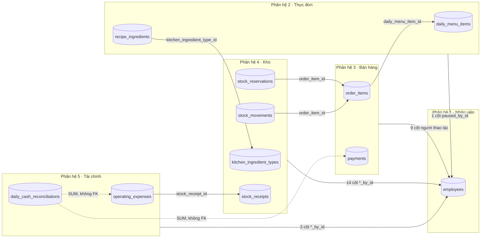
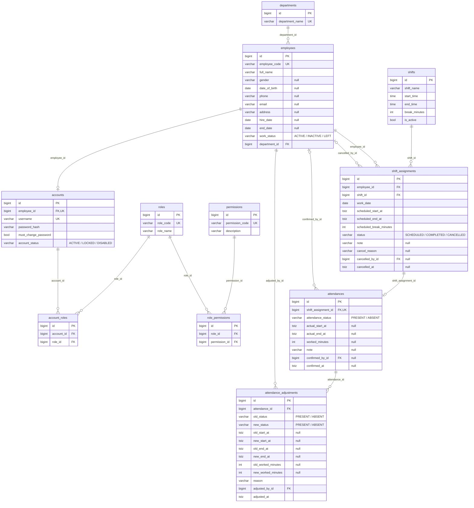
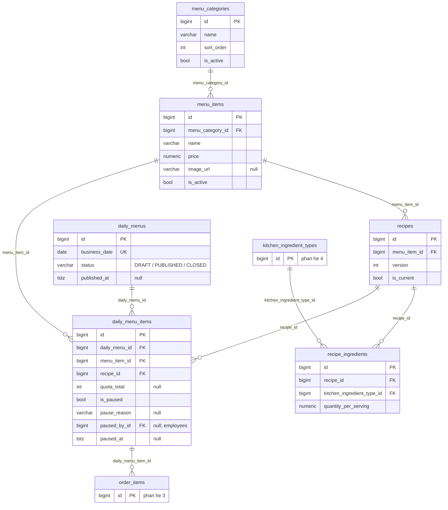
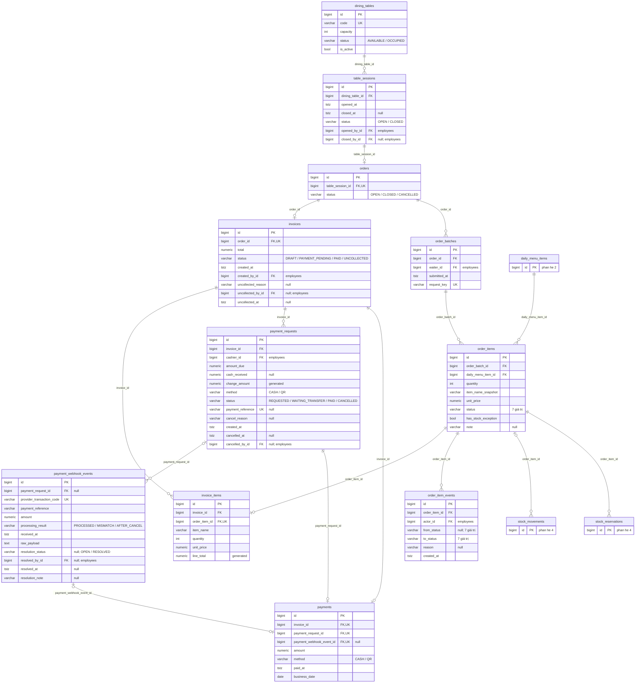
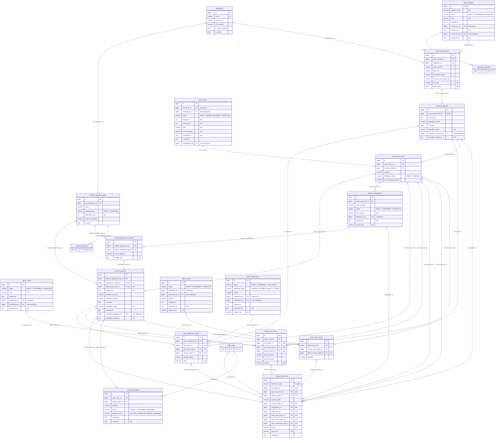
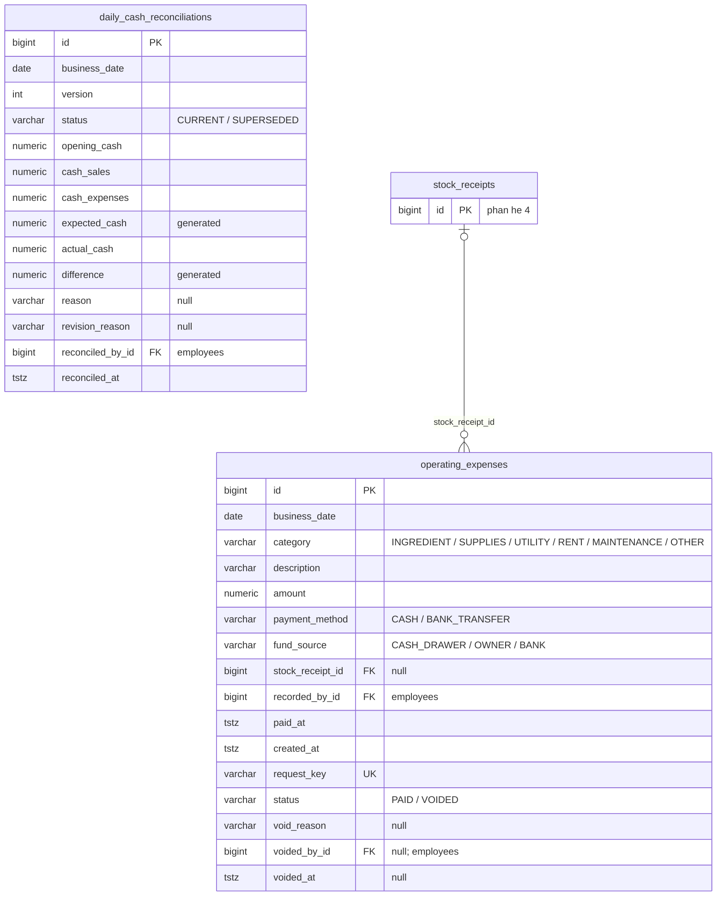

# 02 · Đánh giá CSDL v4 theo phân hệ — liên kết · chuẩn hóa 3NF · tối ưu · thừa/thiếu

> **Phạm vi:** 48 bảng / 5 phân hệ của Master Spec v4.
> **Cách đọc:** §0–§9 là kết quả rà soát thiết kế **v4** trên từ điển dữ liệu §D, CHECK §E1, ràng buộc §I1, FK §J, index §K của spec (repo không có file DDL v4 nên "chưa thấy" = không xuất hiện trong spec). §10 liệt kê **47 phát hiện** — 35 ở vòng rà soát đầu (DB-01…DB-35) và 12 ở vòng chốt nghiệp vụ, kiểm thử trên server thật (DB-36…DB-47) — **tất cả đã xử lý trong schema v4.1**. §11 là các quyết định nghiệp vụ QĐ-1…QĐ-8 (đã áp dụng / chờ nhóm). §12 là kiểm toán 48 bảng và luồng dữ liệu.
> **Schema v4.1:** [04-schema-v4.1.sql](04-schema-v4.1.sql) (48 bảng, 366 cột, 101 FK, 105 CHECK, 47 trigger, 28 hàm nghiệp vụ `rc_*`) · kiểm thử [05-test-v4.1.sql](05-test-v4.1.sql) và [06-test-concurrency-v4.1.mjs](06-test-concurrency-v4.1.mjs) · kiểm toán hàm [07-kiem-toan-ham-rc.md](07-kiem-toan-ham-rc.md) · ERD draw.io trong thư mục [erd/](erd/). ERD Mermaid bên dưới **sinh tự động từ chính schema v4.1 đã chạy**, khớp DDL đến từng cột.
> **Mức xác minh:** PostgreSQL 15.18, 16.14, 17.5 và 18.4 (server thật, không phải PGlite; kết quả giống nhau ở cả bốn phiên bản, mutation chạy trên 17.5): file 05 đạt **444 kiểm tra** (198 dương + 246 âm, gồm 19 truy vấn bất biến §9 trả 0 dòng), file 06 đạt **67/67** ca nhiều kết nối, file 08 (ví dụ xuyên suốt) đạt 32/32 phép so sánh, **40/40** lỗi cài cố ý vào SQL bị phát hiện, **12/15** lỗi cài vào khóa bị phát hiện (3 mutant còn lại là mutant tương đương, [07 §9](07-kiem-toan-ham-rc.md)). Chưa đo hiệu năng, chưa chạy trên Linux.

## 0. Kết luận nhanh

| Tiêu chí | Kết quả |
| --- | --- |
| Đủ bảng cho 27 nhóm chức năng | ✅ **Đủ.** Mọi nhóm có bảng đọc/ghi tương ứng ([03 §B](03-luong-du-lieu-chuc-nang.md)). Không cần thêm bảng mới; chỉ thiếu **cột** và **ràng buộc** (dưới đây). |
| Bảng thừa | ✅ **Không có.** 48/48 bảng đều có chức năng tạo và chức năng đọc (kiểm tự động trên 27 thẻ chức năng, [03 §B](03-luong-du-lieu-chuc-nang.md)). Ba cặp quan hệ 1–1 (`table_sessions`–`orders`, `stock_receipt_items`–`inventory_batches`, `kitchen_preparation_outputs`–`kitchen_batches`) có lý do: tách **chứng từ bất biến** khỏi **số dư/trạng thái thay đổi**. Vòng chốt nghiệp vụ **không đổi số bảng**: chỉ thêm 3 cột, 1 trạng thái, 1 index (QĐ-7 giữ `orders`). |
| Liên kết | ✅ 88 FK ở v4, không có vòng FK giữa các bảng; mọi cột người thao tác trỏ `employees` (không trỏ `accounts` → khóa tài khoản không mất dấu vết). ⚠️ 3 bản sao liên bảng chưa có FK ghép giữ nhất quán (DB-09, DB-23, DB-24). **v4.1:** 101 FK (5 FK ghép), không FK nào có `ON DELETE` → xóa cha khi còn con luôn bị chặn; 9 bảng giao dịch còn bị trigger cấm xóa. |
| 1NF, 2NF | ✅ Đạt. Giá trị nguyên tử (`raw_payload` là blob chứng cứ, không truy vấn bên trong); khóa chính surrogate đơn; các khóa ứng viên ghép như `(daily_menu_id, menu_item_id)`, `(recipe_id, kitchen_ingredient_type_id)` không có phụ thuộc bộ phận. |
| 3NF | ⚠️ **Đạt ở mức thiết kế, còn 3 cột vi phạm**: `payment_requests.change_amount`, `daily_cash_reconciliations.expected_cash`, `daily_cash_reconciliations.difference` là giá trị tính từ cột khác trong cùng dòng (DB-10, DB-31). Giá trị `ADJUSTED` của `attendances` lưu lặp thông tin đã có ở `attendance_adjustments` (DB-01). Các dư thừa còn lại là **có chủ đích** (snapshot, số dư) — liệt kê ở §8. **v4.1:** 4 cột GENERATED (cả `invoice_items.line_total`), bỏ `ADJUSTED`, **không lưu số suất đã bán** (suy ra bằng `rc_quota_used`) → đạt 3NF ở mô hình logic. |
| Tối ưu (index) | ✅ 43 index ở spec §K (15 UNIQUE + 28 thường) phủ FEFO, audit sổ kho, doanh thu, lịch ca. ⚠️ Thiếu index thời gian cho báo cáo nhập–xuất–tồn và index truy vết theo chứng từ (DB-27). **v4.1:** 51 `CREATE INDEX` (15 UNIQUE + 36 thường, có 1 BRIN) cộng 43 ràng buộc UNIQUE và 1 EXCLUDE. Chưa đo `EXPLAIN ANALYZE`. |
| Hàng rào bất biến tiền/tồn | 🔴 **6 bất biến cốt lõi chưa có ràng buộc DB** ở v4 (DB-09, DB-19…DB-22, DB-30). **v4.1:** đủ 6 hàng rào, cộng (vòng chốt) số dư kiểm bằng đẳng thức với sổ kho tại COMMIT (DB-39), đồ thị trạng thái đóng ở mọi đường ghi (DB-38) và khóa theo một thứ tự chung (DB-36). |
| Cột thiếu cho nghiệp vụ spec yêu cầu | 🟠 Mốc thời gian/người thao tác của chứng từ tiền (DB-11, DB-13), nơi ghi xử lý sự cố webhook (DB-12), audit kho (DB-25), routine cho thao tác chạm số dư (DB-34). **v4.1:** đã bổ sung cột + 8 hàm (6 của DB-34, 2 của QĐ-2/QĐ-3). |
| Quyết định nghiệp vụ | QĐ-1, QĐ-2, QĐ-3, QĐ-4, QĐ-8 do nhóm chốt, QĐ-6 và QĐ-7 áp dụng (đề xuất rõ, không mâu thuẫn): đã cài và kiểm thử. **QĐ-5 giữ hiện trạng, chờ nhóm** (§11). |

**Tổng: 47 phát hiện — 🔴 10 · 🟠 21 · 🟢 16** (danh sách §10: 35 ở vòng đầu + 12 ở vòng chốt nghiệp vụ) — **tất cả đã xử lý trong v4.1**; điểm còn chờ nhóm xác nhận ở §11 và [07 §8](07-kiem-toan-ham-rc.md).

## 1. Phương pháp và ký hiệu

**Chuẩn hóa.** 1NF: mọi cột nguyên tử, không lưu danh sách trong 1 cột. 2NF: thuộc tính không khóa phụ thuộc **toàn bộ** khóa ứng viên. 3NF: không có phụ thuộc bắc cầu `khóa → X → Y` với X không phải khóa.
**Snapshot không vi phạm 3NF**: `order_items.unit_price` không phụ thuộc hàm vào `daily_menu_item_id` (giá đổi giữa ngày thì 2 dòng cùng món có 2 giá) → là sự kiện riêng của dòng, không phải dữ liệu lặp.

| Loại dư thừa | Ý nghĩa | Xử lý yêu cầu |
| --- | --- | --- |
| **S** — Snapshot | Giá trị chụp tại thời điểm nghiệp vụ, nguồn có thể đổi sau đó | Chỉ ghi một lần, không cập nhật theo nguồn |
| **B** — Số dư/cache | Tổng hợp từ sổ hoặc chi tiết (vd `quantity_on_hand`) | Cập nhật cùng transaction với sổ; có truy vấn kiểm tra bất biến (§9) |
| **D** — Suy ra trong dòng | Tính từ cột khác cùng dòng | Cột `GENERATED` hoặc `CHECK` đẳng thức |
| **X** — Bản sao liên bảng | Lặp cột của bảng cha để ràng buộc/index | FK ghép hoặc CHECK để không lệch |

**Mức độ:** 🔴 thiếu hàng rào DB cho bất biến tiền/tồn (sai dữ liệu nếu service lỗi hoặc có DML trực tiếp) · 🟠 thiếu dữ liệu spec yêu cầu (audit, đối soát) hoặc vi phạm 3NF · 🟢 dọn dẹp/tối ưu, không ảnh hưởng đúng sai.

## 2. Liên kết giữa các phân hệ



- Sơ đồ và số cột người thao tác tính theo schema v4.1 (v4 có 3/10/3 cột ở P3/P4/P5 và 0 ở P2).
- Ở mức **bảng** không có vòng FK. Ở mức **phân hệ** có vòng P2 → P4 → P3 → P2 (`recipe_ingredients` → `kitchen_ingredient_types`; `stock_reservations` → `order_items`; `order_items` → `daily_menu_items`). Hệ quả cho Spring Boot modular monolith và migration ở DB-35.
- `daily_cash_reconciliations` không có FK tới `payments`/`operating_expenses` là **đúng**: bản đối soát là ảnh chụp tổng tại thời điểm chốt (loại S), không phải liên kết dòng.

## 3. Phân hệ 1 — Nhân viên • tài khoản • ca • chấm công (11 bảng)

<!-- GEN:ERD-1 -->
**ERD phân hệ 1 (schema v4.1)** — bản draw.io: [erd/erd-p1-nhan-vien.drawio](erd/erd-p1-nhan-vien.drawio) · ảnh xem nhanh: [erd/erd-p1-nhan-vien.png](erd/erd-p1-nhan-vien.png). Sơ đồ Mermaid dưới đây sinh từ cùng schema; cột người thao tác ghi chú `employees` thay vì vẽ cạnh, bảng phân hệ khác chỉ hiện `id`.


<!-- /GEN:ERD-1 -->

**Liên kết.** `departments` 1–N `employees`; `employees` 1–0..1 `accounts` (`employee_id` UNIQUE); `accounts` N–N `roles` qua `account_roles`; `roles` N–N `permissions` qua `role_permissions`; `shifts` 1–N `shift_assignments` N–1 `employees`; `shift_assignments` 1–0..1 `attendances` (UNIQUE); `attendances` 1–N `attendance_adjustments`.

**Chuẩn hóa.**

| Bảng | Khóa ứng viên | Đánh giá |
| --- | --- | --- |
| `departments`, `roles`, `permissions`, `shifts` | `id` + mã/tên UNIQUE | ✅ BCNF |
| `employees` | `id`, `employee_code` | ✅. `work_status` ↔ `end_date` là ràng buộc điều kiện, không phải phụ thuộc hàm → CHECK (DB-03) |
| `accounts` | `id`, `employee_id`, `username` | ✅ BCNF |
| `account_roles`, `role_permissions` | `id`, cặp FK | ✅ không có thuộc tính ngoài khóa; cần UNIQUE cặp (DB-04) |
| `shift_assignments` | `id` | ✅. `scheduled_start_at`, `scheduled_end_at`, `scheduled_break_minutes` là **S** (giữ lịch cũ khi sửa mẫu ca, xử lý ca qua đêm) |
| `attendances` | `id`, `shift_assignment_id` | ⚠️ `worked_minutes` là giá trị tính (giờ ra − giờ vào − nghỉ) nhưng phần nghỉ nằm ở bảng khác → giữ như **giá trị được duyệt**. Giá trị `ADJUSTED` lặp thông tin (DB-01) |
| `attendance_adjustments` | `id` | ✅ nhật ký before/after, chỉ thêm |

**Tối ưu.** Có sẵn `idx_employee_department_status`, `idx_account_role_inverse`, `idx_permission_role_inverse`, `idx_shift_assignment_roster`, `idx_attendance_adjustments_history` — đủ cho tra cứu theo bộ phận, nạp quyền khi đăng nhập, lịch ca, lịch sử chỉnh công. EXCLUDE ở DB-02 đồng thời tạo index GiST chống trùng ca.

**Phát hiện.**

- **DB-01 🟠** `attendances.attendance_status` có `ADJUSTED`: trộn "kết quả chấm công" với "đã từng sửa" → sau khi sửa không biết người đó có mặt hay vắng; thông tin "đã sửa" đã có ở `attendance_adjustments`. Đề xuất miền {PRESENT, ABSENT}; "đã điều chỉnh" = EXISTS dòng điều chỉnh. Thêm CHECK PRESENT ⇒ có giờ vào/ra; `confirmed_by_id` ⇔ `confirmed_at`.
- **DB-02 🟠** Chống trùng ca chỉ ở service → hai request song song vẫn tạo được 2 ca chồng giờ. Đề xuất `EXCLUDE USING gist (employee_id WITH =, tstzrange(scheduled_start_at, scheduled_end_at) WITH &&) WHERE (status <> 'CANCELLED')` + CHECK giờ kết thúc > giờ bắt đầu (cần extension `btree_gist`).
- **DB-03 🟢** Trạng thái phải đi kèm đủ cột: LEFT ⇒ `end_date`; CANCELLED ⇔ đủ 3 cột `cancel_*` (và ngược lại các cột này rỗng khi chưa hủy).
- **DB-04 🟢** Spec G1.2 và test HR-01 yêu cầu UNIQUE `(account_id, role_id)`, `(role_id, permission_id)` nhưng §I1 không liệt kê → xác minh trong DDL (tên index `*_inverse` gợi ý đã có chiều thuận).

## 4. Phân hệ 2 — Thực đơn • món • công thức • thực đơn ngày (6 bảng)

<!-- GEN:ERD-2 -->
**ERD phân hệ 2 (schema v4.1)** — bản draw.io: [erd/erd-p2-thuc-don.drawio](erd/erd-p2-thuc-don.drawio) · ảnh xem nhanh: [erd/erd-p2-thuc-don.png](erd/erd-p2-thuc-don.png). Sơ đồ Mermaid dưới đây sinh từ cùng schema; cột người thao tác ghi chú `employees` thay vì vẽ cạnh, bảng phân hệ khác chỉ hiện `id`.


<!-- /GEN:ERD-2 -->

**Liên kết.** `menu_categories` 1–N `menu_items` 1–N `recipes` (phiên bản) 1–N `recipe_ingredients` N–1 `kitchen_ingredient_types` (phân hệ 4). `daily_menus` 1–N `daily_menu_items` N–1 `menu_items`. FK ghép `daily_menu_items(recipe_id, menu_item_id)` → `recipes(id, menu_item_id)` bảo đảm công thức thuộc đúng món (MENU-01) — PostgreSQL bắt buộc `recipes` có UNIQUE `(id, menu_item_id)` để FK này tồn tại.

**Chuẩn hóa.**

| Bảng | Khóa ứng viên | Đánh giá |
| --- | --- | --- |
| `menu_categories` | `id` | ✅ |
| `menu_items` | `id` | ✅ `price` là giá hiện hành duy nhất; giá lịch sử nằm ở snapshot `order_items` |
| `recipes` | `id`, `(menu_item_id, version)` | ✅; `is_current` có partial UNIQUE |
| `recipe_ingredients` | `id`, `(recipe_id, kitchen_ingredient_type_id)` | ✅; không lưu đơn vị — đơn vị là `ingredients.base_unit` của nguyên liệu gốc (lưu lại sẽ là dư thừa) |
| `daily_menus` | `id`, `business_date` | ✅ |
| `daily_menu_items` | `id`, `(daily_menu_id, menu_item_id)` | ✅ có chủ đích: `menu_item_id` suy ra được từ `recipe_id` (**X**) nhưng cần để có UNIQUE "1 món/ngày"; FK ghép đã khóa nhất quán. Số đã bán/quota còn **không lưu** (suy ra từ `order_items` bằng `rc_quota_used`) ✓. `quota_total` NULL = không giới hạn suất, 0 = hết suất, không âm (QĐ-1, `ck_daily_menu_quota_nonneg`); trigger không cho hạ quota dưới số suất đã chiếm |

**Tối ưu.** `ux_recipes_current`, `ux_daily_menu_items_once`, `ux_recipe_ingredient_once`, `idx_menu_items_active_category` (màn hình gọi món), `idx_recipe_ingredient_type` (tìm món bị ảnh hưởng khi một nguyên liệu bếp cạn → phục vụ 2.4). Đủ.

**Phát hiện.**

- **DB-05 🟠** Chưa thấy CHECK `quantity_per_serving > 0` → công thức định lượng 0/âm chỉ bị phát hiện muộn khi Kitchen nhận món (CHECK của `stock_reservations`).
- **DB-06 🟠** Version công thức đã dùng trong `daily_menu_items` vẫn sửa được `recipe_ingredients` → báo cáo tiêu hao lý thuyết và đặt giữ của món đang chờ lệch nhau. Đề xuất trigger chặn sửa/xóa/thêm dòng của version đã dùng (bắt buộc tạo version mới). Xác minh thêm UNIQUE `(menu_item_id, version)`.
- **DB-07 🟢** CHECK `is_paused = (pause_reason IS NOT NULL)`. Nếu cần biết ai tạm dừng món (2.4 có 2 actor) → thêm `paused_by_id`, `paused_at`.
- **DB-08 🟢** Tên danh mục/món/loại nguyên liệu bếp chưa UNIQUE → trùng tên gây chọn nhầm khi gọi món và lập công thức.

## 5. Phân hệ 3 — Bàn • đơn hàng • hóa đơn • thanh toán (11 bảng)

<!-- GEN:ERD-3 -->
**ERD phân hệ 3 (schema v4.1)** — bản draw.io: [erd/erd-p3-ban-hang-thanh-toan.drawio](erd/erd-p3-ban-hang-thanh-toan.drawio) · ảnh xem nhanh: [erd/erd-p3-ban-hang-thanh-toan.png](erd/erd-p3-ban-hang-thanh-toan.png). Sơ đồ Mermaid dưới đây sinh từ cùng schema; cột người thao tác ghi chú `employees` thay vì vẽ cạnh, bảng phân hệ khác chỉ hiện `id`.


<!-- /GEN:ERD-3 -->

**Liên kết.** `dining_tables` 1–N `table_sessions` (≤ 1 phiên OPEN/bàn — `ux_table_sessions_open`) 1–1 `orders` 1–N `order_batches` 1–N `order_items` 1–N `order_item_events`. `orders` 1–0..1 `invoices` 1–N `invoice_items`; mỗi `order_items` vào tối đa 1 `invoice_items`. `invoices` 1–N `payment_requests` (≤ 1 đang mở — `ux_payment_request_active`) và 1–0..1 `payments`. FK ghép: `payments(payment_request_id, invoice_id)` và `payments(payment_webhook_event_id, payment_request_id)`.

**Chuẩn hóa.**

| Bảng | Khóa ứng viên | Đánh giá |
| --- | --- | --- |
| `dining_tables` | `id`, `code` | ⚠️ `status` là **B** — cache của "có phiên OPEN" (nguồn thật là `ux_table_sessions_open`) |
| `table_sessions` | `id` | ⚠️ `status` suy ra từ `closed_at` → CHECK (DB-16) |
| `orders` | `id`, `table_session_id` | ✅. Quan hệ 1–1 bắt buộc với phiên — giữ để tách *chứng từ bán hàng* (hóa đơn trỏ vào) khỏi *việc chiếm bàn* (QĐ-7) |
| `order_batches` | `id`, `request_key` | ✅ |
| `order_items` | `id` | ✅. `item_name_snapshot`, `unit_price` = **S**; `status` = **B** (trạng thái của sự kiện cuối, kiểm lúc COMMIT). Số suất đã chiếm của một món/ngày **không lưu** mà suy ra từ `status` và sự kiện COOKING (`rc_quota_used`, QĐ-8) |
| `order_item_events` | `id` | ✅ nhật ký, chỉ thêm; sự kiện đầu bắt buộc `NULL → PENDING`, các sự kiện nối đúng chuỗi, REJECTED/CANCELLED bắt buộc lý do khác rỗng (QĐ-2) |
| `invoices` | `id`, `order_id` | ✅. `total` = **B** (Σ `line_total`, đối chiếu bằng `rc_invoice_total_checked`). `uncollected_reason/by/at` là dữ kiện của sự kiện "khách bỏ về" (QĐ-3): chỉ có khi `status = UNCOLLECTED` (`ck_invoice_uncollected_fields`) — không phải dư thừa |
| `invoice_items` | `id`, `order_item_id` | ✅ BCNF (`order_item_id` là khóa). Toàn bộ dòng là **S** của `order_items` đã SERVED; `invoice_id` suy ra được qua order → cần khóa sửa sau chốt (DB-17). Chỉ xóa được khi hóa đơn còn DRAFT (hủy ngoại lệ, QĐ-2) |
| `payment_requests` | `id` | ❌ `change_amount = cash_received − amount_due` là phụ thuộc bắc cầu trong dòng (DB-10). `amount_due` = **S** |
| `payments` | `id`, `invoice_id`, `payment_request_id` | ✅ BCNF (mọi định thức đều là khóa). `method` = **X** chưa khóa (DB-09); `business_date` = **S** |
| `payment_webhook_events` | `id`, `provider_transaction_code` | ✅; `raw_payload` là chứng cứ nguyên văn |

**Tối ưu.** `idx_order_items_daily_quota` (đếm đã bán theo quota), `idx_order_items_batch_status`, `idx_order_item_events_history`, `idx_invoice_items_invoice`, `idx_payrequest_invoice_history`, `idx_webhook_reference_audit`, `idx_payments_business_date (business_date, method, paid_at)` (doanh thu và `cash_sales` đọc thẳng từ index). Thiếu index tra webhook theo request và lịch sử phiên theo bàn (DB-27).

**Phát hiện.**

- **DB-09 🔴** `payments.method` lặp `payment_requests.method` nhưng không ràng buộc nào giữ chúng bằng nhau; `payment_webhook_event_id` cũng không bị buộc theo phương thức → có thể ghi payment QR cho request CASH, hoặc payment QR không có webhook. Đề xuất mở rộng FK ghép thành `(payment_request_id, invoice_id, method)` + CHECK `(method = 'QR') = (payment_webhook_event_id IS NOT NULL)`.
- **DB-10 🟠** `change_amount` vi phạm 3NF → cột `GENERATED ALWAYS AS (cash_received - amount_due) STORED` (giống `invoice_items.line_total`) + CHECK CASH ⇒ `cash_received ≥ amount_due`, QR ⇒ `cash_received` rỗng. v4.1: `rc_pay_cash` không ghi cột này, DB tự tính.
- **DB-11 🟠** `payment_requests` không có `created_at`, `cancelled_at`, `cancelled_by_id` → không xác định được QR về **trước hay sau** khi hủy (AFTER_CANCEL), không audit được ai hủy. `cashier_id` nên NOT NULL (request luôn do Cashier tạo).
- **DB-12 🟠** Spec G10/I3.7 coi MISMATCH/AFTER_CANCEL là "sự cố đối soát cần xử lý" nhưng không có cột ghi trạng thái xử lý. Đề xuất `resolution_status` (OPEN/RESOLVED, tự đặt OPEN khi sự kiện không PROCESSED), `resolved_by_id`, `resolved_at`, `resolution_note`; trigger giữ bất biến các cột chứng cứ và chặn DELETE.
- **DB-13 🟠** `invoices` là chứng từ tài chính nhưng không có thời điểm lập/người chốt → không truy được hóa đơn treo lâu (QĐ-3), không audit được ai chốt. Thêm `created_at`, `created_by_id`.
- **DB-14 🟠** `order_items.has_stock_exception` có cột nhưng spec không mô tả luồng bật/tắt; `stock_reservations.release_reason` không có miền giá trị. Luồng đề xuất (đã ghi vào [03](03-luong-du-lieu-chuc-nang.md) thẻ 3.4/4.5): lô đang giữ bị đánh dấu hỏng → bật cờ → Kitchen cấp lại (RELEASED `BATCH_UNUSABLE` + reservation mới) hoặc hủy món. CHECK `release_reason IN ('ITEM_CANCELLED','BATCH_UNUSABLE')` (v4.1 chỉ có 2 nguồn giải phóng) và cặp `status`–`closed_at`–`release_reason`.
- **DB-15 🟢** `dining_tables` thiếu `is_active` → bàn hỏng/bỏ không xóa được (FK lịch sử) cũng không ẩn được. `status` nên chỉ đổi trong routine mở/đóng/thanh toán + truy vấn bất biến I-6.
- **DB-16 🟢** CHECK `(status = 'OPEN') = (closed_at IS NULL)` và `closed_at ≥ opened_at`; thêm `opened_by_id`, `closed_by_id` (phiên trống bị đóng không biết do ai).
- **DB-17 🟢** Khóa chứng từ: trigger chặn đổi `invoices.total` khi PAYMENT_PENDING, chặn mọi thay đổi khi PAID, chặn sửa/xóa `invoice_items` khi hóa đơn khác DRAFT. CHECK `ck_invoice_item_nonnegative` có thể trùng hệ quả của 2 CHECK còn lại → xác minh biểu thức rồi bỏ.
- **DB-18 🟢** `orders` 1–1 với `table_sessions`, ba bảng `dining_tables`/`table_sessions`/`orders` cùng có trạng thái → mọi chuyển trạng thái phải nằm trong cùng routine (đã đúng ở `rc_open_session`, `rc_close_empty_session`, `rc_pay_cash`, `rc_process_verified_qr`). Không đề xuất gộp bảng.

## 6. Phân hệ 4 — Kho RAW • bếp • sơ chế • kiểm kê (18 bảng)

<!-- GEN:ERD-4 -->
**ERD phân hệ 4 (schema v4.1)** — bản draw.io: [erd/erd-p4-kho-bep.drawio](erd/erd-p4-kho-bep.drawio) · ảnh xem nhanh: [erd/erd-p4-kho-bep.png](erd/erd-p4-kho-bep.png). Sơ đồ Mermaid dưới đây sinh từ cùng schema; cột người thao tác ghi chú `employees` thay vì vẽ cạnh, bảng phân hệ khác chỉ hiện `id`.


<!-- /GEN:ERD-4 -->

**Liên kết.** Chuỗi truy vết đầy đủ theo G6.7:
`stock_receipts` 1–N `stock_receipt_items` 1–1 `inventory_batches` (lô RAW) 1–N `stock_issue_items` (mỗi dòng = 1 lô × 1 hình thức) → PREPARE: 1–N `kitchen_preparations` 1–N `kitchen_preparation_outputs` 1–1 `kitchen_batches` · DIRECT: 1–0..1 `kitchen_batches` (`direct_issue_item_id` UNIQUE).
`ingredients` 1–N `kitchen_ingredient_types` (≤ 1 loại DIRECT/nguyên liệu) 1–N `kitchen_batches`, `kitchen_preparation_outputs`, `recipe_ingredients`. `kitchen_batches` 1–N `stock_reservations` N–1 `order_items`.
`stock_movements`, `stock_count_items`, `stock_adjustment_items` trỏ **đúng 1** trong 3 vị trí tồn (`num_nonnulls = 1`).

**Chuẩn hóa.**

| Bảng | Khóa ứng viên | Đánh giá |
| --- | --- | --- |
| `ingredients` | `id`, `name` | ✅ |
| `stock_receipts` | `id` | ✅; tổng tiền phiếu không lưu (suy ra từ dòng) ✓ |
| `stock_receipt_items` | `id`, `(stock_receipt_id, ingredient_id, lot_code, expiry_date)` | ✅. `conversion_factor` là sự kiện của từng dòng (quy cách bao/thùng thay đổi theo lô) nên không phụ thuộc `(ingredient_id, input_unit)` |
| `inventory_batches` | `id`, `stock_receipt_item_id` | ✅. `quantity_on_hand` = **B**; `received_at` ≈ `stock_receipts.confirmed_at` (dư thừa nhẹ, dùng làm tiêu chí phụ FEFO) |
| `stock_movements` | `id`, `event_key` | ✅ sổ bất biến; người thao tác suy ra qua chứng từ tham chiếu (không lưu lặp) ✓ |
| `stock_reservations` | `id`, `(order_item_id, kitchen_batch_id)` | ✅; `status` suy ra được từ `closed_at` + `release_reason` → CHECK (DB-14) |
| `stock_counts`, `stock_adjustments`, `stock_returns`, `stock_issues`, `kitchen_preparations` | `id` (+ `request_key` nếu có) | ✅ header phiếu |
| `stock_count_items` | `id` | ✅; chênh lệch (actual − book) không lưu ✓ |
| `kitchen_ingredient_types` | `id` | ✅; không có cột đơn vị → đơn vị = `base_unit` nguyên liệu gốc (QĐ-6) |
| `stock_issue_items` | `id`, `(stock_issue_id, inventory_batch_id, fulfillment_mode)` | ✅. `wip_remaining_quantity` = **B** đặt trên dòng chứng từ — chấp nhận vì WIP 1–1 với dòng xuất |
| `kitchen_preparation_outputs` | `id`, `(kitchen_preparation_id, kitchen_ingredient_type_id)` | ✅; hao hụt không lưu (suy ra) ✓ |
| `kitchen_batches` | `id` | ✅ có chủ đích: `kitchen_ingredient_type_id`, `usable_until` là **X** (sao từ dòng đầu ra/loại DIRECT) để một index FEFO dùng chung DIRECT + PREPARED; `quantity_on_hand`, `reserved_quantity` = **B** |
| `stock_return_items` | `id` | ⚠️ `direct_kitchen_batch_id` suy ra được từ `source_issue_item_id` (**X** chưa khóa — DB-23) |
| `stock_adjustment_items` | `id` | ✅ |

**Tối ưu.** FEFO: `idx_kitchen_lots_fefo` (partial: chỉ lô dùng được, còn hàng) tốt; FEFO RAW dùng `idx_raw_lots_fefo` trên `stock_receipt_items` — gồm cả lô đã hết nên quét tăng dần theo lịch sử nhập. Audit: 3 index partial theo vị trí trên `stock_movements`. Thiếu: index thời gian cho báo cáo theo kỳ, index truy vết theo `order_item_id`/`preparation_id` (DB-27).

**Phát hiện.**

- **DB-19 🔴** Chưa thấy CHECK `reserved_quantity ≤ quantity_on_hand` trên `kitchen_batches` — đây là bất biến chống bán vượt (G7.3, CONC-01). Có CHECK này thì kiểm kê/hủy hàng làm tồn xuống dưới lượng đang giữ cũng bị chặn ở DB, đúng tinh thần "không xóa reserve ngầm" (G7.8).
- **DB-20 🔴** `stock_movements` chỉ có CHECK "đúng 1 vị trí". Chưa ràng buộc loại biến động ↔ vị trí ↔ chứng từ ↔ dấu số lượng (vd COOK phải có `kitchen_batch_id` + `order_item_id` và số âm; RECEIPT phải dương trên lô RAW). Sổ là chứng cứ audit → nên khóa bằng 1 CHECK theo `movement_type`.
- **DB-21 🔴** `stock_issue_items`: thiếu CHECK `wip_remaining_quantity ≤ quantity` và "dòng DIRECT luôn có WIP = 0". Đồng thời 2 CHECK trùng nghĩa (`ck_stock_issue_items_wip_remaining_quantity_nonneg`, `ck_issue_wip_nonneg`) → giữ một.
- **DB-22 🔴** `stock_adjustment_items.quantity_delta` không có CHECK dấu → phiếu "hư hỏng" có thể **tăng** tồn. Spec chỉ cho phiếu này giảm (tăng đi qua kiểm kê) → CHECK `< 0` + mỗi nguồn 1 lần/phiếu.
- **DB-23 🟠** `stock_return_items.direct_kitchen_batch_id` suy ra được từ `source_issue_item_id` (mỗi dòng DIRECT sinh đúng 1 lô bếp) → có thể trỏ lệch lô. FK ghép `(direct_kitchen_batch_id, source_issue_item_id)` → `kitchen_batches(id, direct_issue_item_id)` vừa chống lệch vừa **tự chặn trả lô PREPARED** (RETURN-02). Thêm UNIQUE `(stock_return_id, source_issue_item_id)` (cũng là index header→dòng).
- **DB-24 🟢** Lô PREPARED phải cùng loại với dòng đầu ra sinh ra nó → FK ghép `(preparation_output_id, kitchen_ingredient_type_id)`. Lô DIRECT phải mang đúng loại DIRECT của nguyên liệu gốc và `usable_until` của lô PREPARED phải bằng của dòng đầu ra → kiểm trong `rc_receive_issue` / `rc_confirm_preparation` + test.
- **DB-25 🟠** Người lập/thời điểm không nhất quán: `stock_returns`, `stock_adjustments` có người lập nhưng `stock_receipts`, `stock_counts` không có `created_by_id`; `stock_issues` thiếu `created_at`, `cancelled_by_id`; `kitchen_batches` thiếu `created_at`, `unusable_marked_by_id`, `unusable_marked_at` (trong khi `inventory_batches` có).
- **DB-26 🟢** CHECK trùng nghĩa cần dọn sau khi xác minh biểu thức: `ck_stock_reservations_quantity_positive` ~ `ck_reserve_qty_positive`; `ck_count_total_nonnegative` so với 2 CHECK không âm của `stock_count_items`.
- **DB-27 🟢** Index bổ sung: partial `inventory_batches(stock_receipt_item_id) WHERE is_usable AND quantity_on_hand > 0` (FEFO RAW chỉ quét lô còn hàng); BRIN `stock_movements(created_at)` (bảng chỉ-thêm → BRIN rất nhỏ, phục vụ báo cáo theo kỳ); `stock_movements(order_item_id)`, `(preparation_id)` (truy vết); `payment_webhook_events(payment_request_id)`; `table_sessions(dining_table_id, opened_at DESC)`. Giữ lại sau khi đo `EXPLAIN ANALYZE`.
- **DB-28 🟢** `kitchen_ingredient_types` không có cột đơn vị → đơn vị ngầm định là `base_unit` của nguyên liệu gốc. Đúng 3NF, nhưng không biểu diễn được đầu ra khác thứ nguyên (xương kg → nước dùng lít), đúng như spec M3 thừa nhận → ghi rõ quy ước (QĐ-6).
- **DB-29 🟢** `NUMERIC(12,3)` với `base_unit = kg` → bước nhỏ nhất 1 g; gia vị < 1 g/suất bị làm tròn về 0 → chọn `base_unit = g` cho nguyên liệu định lượng nhỏ.

## 7. Phân hệ 5 — Chi phí • báo cáo • đối soát (2 bảng)

<!-- GEN:ERD-5 -->
**ERD phân hệ 5 (schema v4.1)** — bản draw.io: [erd/erd-p5-tai-chinh.drawio](erd/erd-p5-tai-chinh.drawio) · ảnh xem nhanh: [erd/erd-p5-tai-chinh.png](erd/erd-p5-tai-chinh.png). Sơ đồ Mermaid dưới đây sinh từ cùng schema; cột người thao tác ghi chú `employees` thay vì vẽ cạnh, bảng phân hệ khác chỉ hiện `id`.


<!-- /GEN:ERD-5 -->

**Liên kết.** `operating_expenses` → `stock_receipts` (0..1; ≤ 1 khoản chi còn hiệu lực/phiếu — `ux_expense_receipt_live`) và → `employees` (người ghi, người hủy). `daily_cash_reconciliations` → `employees`; số liệu tiền đọc bằng tổng, không FK (§2).

**Chuẩn hóa.**

| Bảng | Khóa ứng viên | Đánh giá |
| --- | --- | --- |
| `operating_expenses` | `id`, `request_key` | ✅. `business_date` = **S**. `category`, `payment_method`, `fund_source` thiếu miền giá trị (DB-30) |
| `daily_cash_reconciliations` | `id`, `(business_date, version)` | ❌ `expected_cash = opening_cash + cash_sales − cash_expenses` và `difference = actual_cash − expected_cash` là phụ thuộc bắc cầu trong dòng (DB-31). `opening_cash`, `cash_sales`, `cash_expenses` = **S** (ảnh chụp lúc chốt) |

**Tối ưu.** `idx_expense_period_category` (partial PAID), `ux_expense_receipt_live`, `ux_cash_recon_current`, cùng `idx_payments_business_date` ở phân hệ 3 đủ cho tính `cash_sales`/`cash_expenses` theo ngày.

**Phát hiện.**

- **DB-30 🔴** §E1 không có CHECK cho `category`, `payment_method`, `fund_source`, trong khi công thức đối soát G11 lọc "chi bằng CASH từ quỹ quầy". Nhập tự do (`cash`, `Tiền mặt`, `quy quay`…) làm `cash_expenses` sai mà không báo lỗi. Đề xuất miền giá trị (nhóm chốt danh sách), CHECK quỹ quầy ⇒ CASH, `amount > 0`, VOIDED ⇔ đủ 3 cột hủy.
- **DB-31 🟠** `expected_cash`, `difference` → cột GENERATED. PostgreSQL không cho cột generated tham chiếu cột generated khác nên `difference` phải viết lại đủ biểu thức. Thêm CHECK có chênh lệch ⇒ có `reason`; `version > 1` ⇒ có `revision_reason`.
- **DB-32 🟢** `opening_cash` nhập tay, không có bảng nộp/rút quỹ → chấp nhận cho Core; quy ước: quỹ đầu ngày do Manager xác nhận, không tự lấy `actual_cash` hôm trước.

### Phát hiện xuyên phân hệ

- **DB-33 🟠** `business_date` xuất hiện ở `payments`, `operating_expenses`, `daily_menus`, `daily_cash_reconciliations` nhưng spec không nói giờ chốt ngày lưu ở đâu. Nếu mỗi chỗ tự tính, giao dịch lúc 00:30 có thể rơi vào hai ngày khác nhau. Đề xuất **một** hàm `rc_business_date(timestamptz)` (ví dụ chốt 04:00 giờ Việt Nam) dùng chung cho mọi routine và service.
- **DB-34 🟠** Spec (I4, M7) yêu cầu thao tác tiền/tồn đi qua routine, không DML trực tiếp; nhưng v4 chưa có hàm cho: gửi đợt món, từ chối món, đánh dấu đã phục vụ, đánh dấu lô hỏng, cấp lại nguyên liệu, đối soát tiền mặt. Nếu REVOKE DML thì các thao tác này không chạy được; nếu GRANT thì app role có thể đặt thẳng `order_items.status = COOKING` bỏ qua tiêu hao. Danh sách hàm đề xuất ở [03 §H](03-luong-du-lieu-chuc-nang.md).
- **DB-35 🟢** Vòng phụ thuộc phân hệ P2 → P4 → P3 → P2 (§2). Không lỗi ở DB nhưng ảnh hưởng: (1) **thứ tự migration**: P1 → P4-danh mục (`ingredients`, `kitchen_ingredient_types`) → P2 → P3 → P4 còn lại → P5; (2) **code Spring**: module kho tham chiếu `order_items` bằng id, việc nhận/nấu món điều phối qua routine `rc_*` hoặc một application service, tránh hai package gọi lẫn nhau.

### Phát hiện của vòng chốt nghiệp vụ và kiểm thử trên server thật (DB-36…DB-47)

Vòng này nạp lại toàn bộ schema trên PostgreSQL 17.5 thật, viết thêm kiểm thử nhiều kết nối và kiểm bằng lỗi cài cố ý (mutation). Mô tả hàm-theo-hàm và bằng chứng nằm ở [07 §7](07-kiem-toan-ham-rc.md).

- **DB-36 🔴** Thứ tự khóa không thống nhất: thanh toán, QR, hủy yêu cầu khóa `invoices` rồi (trong `rc_settle_invoice`) mới khóa `orders`; chốt hóa đơn và gửi món khóa `orders` rồi `invoices` → **deadlock `40P01`** (tái hiện trên baseline). Đề xuất thứ tự chung 1 `orders` → 2 `invoices` → 3 `payment_requests` đang mở → 4 phiên/bàn → 5 `order_items` → 6 `daily_menu_items` → 7 lô RAW → 8 WIP → 9 lô bếp (theo loại, `id`), cài trong `rc_lock_invoice` và mọi hàm.
- **DB-37 🔴** Hai webhook cùng `provider_transaction_code` đến đồng thời: bên sau vượt kiểm tra trước khóa rồi đụng UNIQUE và nhận `23505` thay vì kết quả đã lưu (SePay sẽ gửi lại). Đề xuất kiểm lại sau khi giữ khóa và ghi bằng `ON CONFLICT DO NOTHING`.
- **DB-38 🔴** Baseline chỉ có 9 trigger: DML trực tiếp vẫn đổi được trạng thái dòng món, bàn, đơn, yêu cầu thanh toán, `payments`, chứng từ kho đã chốt. Đề xuất đóng các đồ thị trạng thái (E2) bằng trigger ở mọi đường ghi, cấm xóa dữ liệu giao dịch, khóa dòng chi tiết khi chứng từ khác DRAFT (tổng 47 trigger).
- **DB-39 🔴** Số dư `inventory_batches`, `stock_issue_items`, `kitchen_batches` và `reserved_quantity` chỉ có CHECK khoảng, chưa có đẳng thức với sổ kho / tổng reservation ACTIVE. Đề xuất 5 constraint trigger hoãn tới COMMIT gọi `rc_check_balance` (RC500 nếu lệch) và chuỗi sự kiện món khớp trạng thái.
- **DB-40 🟠** Hoàn trả, hủy hàng, kiểm kê khóa tài nguyên theo thứ tự dòng phiếu: hai phiếu liệt kê cùng nguồn theo thứ tự ngược nhau chờ vòng tròn (gỡ khóa trước khỏi mã final → 8/8 vòng deadlock). Đề xuất khóa trước toàn bộ nguồn theo thứ tự chung RAW → WIP → bếp.
- **DB-41 🟠** (QĐ-4) Chốt hóa đơn chỉ cộng `invoice_items`, không đối chiếu từng dòng với đơn. Đề xuất `rc_invoice_total_checked`: không sót dòng SERVED, mọi dòng hóa đơn là bản chụp đúng (tên, số lượng, đơn giá) của dòng SERVED cùng đơn; tổng do hàm tự tính.
- **DB-42 🟠** (QĐ-1, QĐ-2, QĐ-8) `quota_total NOT NULL > 0` không biểu diễn "không giới hạn" hay "hết suất", và nếu số suất tính theo trạng thái hiện tại thì hủy ngoại lệ sau COOKING sẽ hoàn suất. Đề xuất `quota_total` NULL được, CHECK ≥ 0; số suất đã chiếm **suy ra** bằng `rc_quota_used` (ACCEPTED, COOKING, READY, SERVED và CANCELLED sau COOKING); trigger không hạ quota dưới số đã chiếm.
- **DB-43 🟠** (QĐ-3) Khách bỏ về không có biểu diễn nên bàn kẹt OCCUPIED, hóa đơn treo. Đề xuất thêm trạng thái hóa đơn `UNCOLLECTED` cùng `uncollected_reason`, `uncollected_by_id`, `uncollected_at` (`ck_invoice_uncollected_fields`, index `idx_invoices_uncollected`) và `rc_abandon_session` (Manager): ghi nghĩa vụ, đóng phiên, trả bàn; không `payments`, không PAID.
- **DB-44 🟠** (QĐ-2) Hủy từ COOKING cần người, lý do, lịch sử; sự kiện đầu của một dòng phải là `NULL → PENDING`; lý do toàn khoảng trắng lọt qua CHECK `IS NOT NULL`. Đề xuất `ck_order_item_event_first`, `ck_order_item_event_reason` (`btrim`) và `rc_cancel_item_exception`.
- **DB-45 🟠** Kiểm đầu vào trong hàm còn thiếu: lý do trắng (từ chối món, mở lại hóa đơn, hủy request/phiếu), xuất DIRECT cho nguyên liệu chưa có loại bếp DIRECT (lỗi muộn khi RAW đã trừ), nhận vào kho lô đã quá hạn hoặc nguyên liệu ngừng dùng, đối soát ngày tương lai hoặc thiếu số liệu. Đề xuất RC422 ngay đầu hàm.
- **DB-46 🟠** (QĐ-2, QĐ-3) Cưỡng chế "chỉ Manager" cần dữ liệu vai trò, nhưng baseline không seed `roles`. Đề xuất seed 4 vai trò và `rc_require_role` (nhân viên ACTIVE, tài khoản ACTIVE, đúng vai trò → nếu không RC403) cho hai hàm ngoại lệ; các hàm còn lại kiểm quyền ở ứng dụng (spec A2).
- **DB-47 🟢** Môi trường và ràng buộc nhỏ: database locale `C` không hạ chữ hoa có dấu nên `UNIQUE (lower(name))` hở (PGlite không lộ ra) → file 04 từ chối nạp khi `lower('ẮÒÚĐ') <> 'ắòúđ'`; `attendances.worked_minutes` không được vượt khoảng có mặt (`ck_attendance_worked_le_span`).

## 8. Sổ đăng ký dư thừa có chủ đích

| Cột | Loại | Nguồn sự thật | Ghi/đồng bộ tại | Kiểm tra |
| --- | :-: | --- | --- | --- |
| `order_items.item_name_snapshot`, `unit_price` | S | `menu_items` lúc gọi | 3.2 | INV-02 |
| `invoice_items.item_name`, `quantity`, `unit_price` | S | `order_items` SERVED | `rc_checkout_invoice` | I-4, INV-01 |
| `payment_requests.amount_due` | S | `invoices.total` lúc tạo request | `rc_pay_cash`, `rc_start_qr` (`trg_payment_requests_guard` buộc bằng `total`) | I-7 |
| `payments.amount` | S | `payment_requests.amount_due` = `invoices.total` lúc thu | `rc_pay_cash`, `rc_process_verified_qr` (`trg_payments_guard` buộc bằng số phải thu) | I-7 |
| `shift_assignments.scheduled_*` | S | `shifts` + `work_date` | 1.3 | — |
| `payments.business_date`, `operating_expenses.business_date` | S | `paid_at` + quy tắc ngày (DB-33) | routine thanh toán, 5.1 | — |
| `daily_cash_reconciliations.opening_cash`, `cash_sales`, `cash_expenses` | S | `payments`, `operating_expenses` lúc chốt | 5.3 | I-10 |
| `daily_menu_items.recipe_id` | S | `recipes.is_current` lúc lập thực đơn | 2.3 | MENU-01 |
| `inventory_batches.quantity_on_hand` | B | Σ `stock_movements` theo `raw_batch_id` | routine kho | I-1 |
| `stock_issue_items.wip_remaining_quantity` | B | Σ `stock_movements` theo `wip_issue_item_id` | `rc_receive_issue`, `rc_confirm_preparation`, `rc_confirm_return` | I-2 |
| `kitchen_batches.quantity_on_hand` | B | Σ `stock_movements` theo `kitchen_batch_id` | routine kho, `rc_start_cooking` | I-3 |
| `kitchen_batches.reserved_quantity` | B | Σ `stock_reservations` ACTIVE | `rc_accept_item`, `rc_start_cooking`, `rc_cancel_item` | I-3, DB-19 |
| `invoices.total` | B | Σ `invoice_items.line_total` | `rc_checkout_invoice`; tính lại ở `rc_cancel_item_exception` (DRAFT) và `rc_abandon_session` | I-4 |
| `order_items.status` | B | `order_item_events` cuối | mọi bước 3.3 (`rc_item_transition`); constraint trigger `trg_order_items_event_sync` kiểm lúc COMMIT | I-5 |
| Số suất đã chiếm của `daily_menu_items` | — | **không lưu**: suy ra từ `order_items.status` và sự kiện COOKING | `rc_quota_used` (đọc), không có chỗ ghi | I-8 |
| `dining_tables.status`, `orders.status`, `table_sessions.status` | B | phiên OPEN, invoice PAID | `rc_open_session`, `rc_close_empty_session`, routine thanh toán | I-6, DB-16 |
| `payment_requests.change_amount` | D | `cash_received − amount_due` | → GENERATED | DB-10 |
| `daily_cash_reconciliations.expected_cash`, `difference` | D | các cột tiền cùng dòng | → GENERATED | DB-31 |
| `daily_menu_items.menu_item_id` | X | `recipes.menu_item_id` | FK ghép có sẵn ✓ | MENU-01 |
| `payments.invoice_id` | X | `payment_requests.invoice_id` | FK ghép có sẵn ✓ | — |
| `payments.method` | X | `payment_requests.method` | → FK ghép mở rộng | DB-09, I-7 |
| `kitchen_batches.kitchen_ingredient_type_id`, `usable_until` | X | dòng đầu ra / loại DIRECT | → FK ghép + routine | DB-24 |
| `stock_return_items.direct_kitchen_batch_id` | X | `kitchen_batches.direct_issue_item_id` | → FK ghép | DB-23 |

## 9. Truy vấn kiểm tra bất biến

<!-- GEN:INV -->
Mỗi truy vấn **phải trả về 0 dòng**. Đây là **nguồn duy nhất**: khối "bất biến" cuối [05-test-v4.1.sql](05-test-v4.1.sql) chạy đúng 19 truy vấn dưới đây sau toàn bộ kịch bản, và [06-test-concurrency-v4.1.mjs](06-test-concurrency-v4.1.mjs) chạy lại các truy vấn I-1…I-8, I-11, I-13 sau các ca đua. Có thể chạy định kỳ như health-check. Đã chạy trên PostgreSQL 17.5.

```sql
-- I-1 RAW: số dư lô = tổng sổ
SELECT b.id FROM inventory_batches b LEFT JOIN stock_movements m ON m.raw_batch_id = b.id
GROUP BY b.id HAVING b.quantity_on_hand <> COALESCE(SUM(m.quantity_delta), 0);

-- I-2 WIP: lượng chờ sơ chế = tổng sổ
SELECT i.id FROM stock_issue_items i LEFT JOIN stock_movements m ON m.wip_issue_item_id = i.id
GROUP BY i.id HAVING i.wip_remaining_quantity <> COALESCE(SUM(m.quantity_delta), 0);

-- I-3 Bếp: tồn = tổng sổ; đang giữ = tổng reservation ACTIVE
SELECT k.id FROM kitchen_batches k
WHERE k.quantity_on_hand <> (SELECT COALESCE(SUM(m.quantity_delta), 0) FROM stock_movements m WHERE m.kitchen_batch_id = k.id)
   OR k.reserved_quantity <> (SELECT COALESCE(SUM(r.quantity), 0) FROM stock_reservations r
                               WHERE r.kitchen_batch_id = k.id AND r.status = 'ACTIVE');

-- I-4a Hóa đơn: tổng = Σ dòng (mọi trạng thái)
SELECT v.id FROM invoices v LEFT JOIN invoice_items ii ON ii.invoice_id = v.id
GROUP BY v.id HAVING v.total <> COALESCE(SUM(ii.line_total), 0);

-- I-4b không sót dòng SERVED khi hóa đơn đã chốt (không còn DRAFT)
SELECT oi.id FROM invoices v JOIN order_batches ob ON ob.order_id = v.order_id
 JOIN order_items oi ON oi.order_batch_id = ob.id AND oi.status = 'SERVED'
 LEFT JOIN invoice_items ii ON ii.order_item_id = oi.id
WHERE v.status <> 'DRAFT' AND ii.id IS NULL;

-- I-4c dòng hóa đơn là snapshot đúng của dòng SERVED cùng đơn
SELECT ii.id FROM invoice_items ii JOIN invoices v ON v.id = ii.invoice_id
 JOIN order_items oi ON oi.id = ii.order_item_id JOIN order_batches ob ON ob.id = oi.order_batch_id
WHERE ob.order_id <> v.order_id OR oi.status <> 'SERVED'
   OR ii.item_name <> oi.item_name_snapshot OR ii.quantity <> oi.quantity OR ii.unit_price <> oi.unit_price;

-- I-5 trạng thái món = sự kiện cuối cùng
SELECT oi.id FROM order_items oi
 JOIN LATERAL (SELECT e.to_status FROM order_item_events e WHERE e.order_item_id = oi.id
                ORDER BY e.created_at DESC, e.id DESC LIMIT 1) last_ev ON true
WHERE last_ev.to_status <> oi.status;

-- I-6 bàn OCCUPIED <=> có phiên OPEN; phiên OPEN <=> đơn OPEN
SELECT t.id FROM dining_tables t
WHERE (t.status = 'OCCUPIED') <> EXISTS (SELECT 1 FROM table_sessions s WHERE s.dining_table_id = t.id AND s.status = 'OPEN');

SELECT s.id FROM table_sessions s JOIN orders o ON o.table_session_id = s.id
WHERE (s.status = 'OPEN') <> (o.status = 'OPEN');

-- I-7 thanh toán khớp yêu cầu và hóa đơn; hóa đơn PAID <=> có đúng một payment bằng số phải thu
SELECT p.id FROM payments p JOIN payment_requests r ON r.id = p.payment_request_id JOIN invoices v ON v.id = p.invoice_id
WHERE p.amount <> r.amount_due OR p.amount <> v.total OR p.method <> r.method OR r.status <> 'PAID' OR v.status <> 'PAID';

SELECT v.id FROM invoices v LEFT JOIN payments p ON p.invoice_id = v.id
WHERE (v.status = 'PAID') <> (p.id IS NOT NULL);

-- I-8 không bán vượt quota (QĐ-1, QĐ-8): số suất chiếm ≤ quota khi có giới hạn
SELECT d.id FROM daily_menu_items d WHERE d.quota_total IS NOT NULL AND rc_quota_used(d.id) > d.quota_total;

-- I-9 món đã nấu được trừ đủ nguyên liệu theo công thức; không trừ hai lần
SELECT oi.id FROM order_items oi
  JOIN daily_menu_items d ON d.id = oi.daily_menu_item_id
  JOIN recipe_ingredients ri ON ri.recipe_id = d.recipe_id
  LEFT JOIN (stock_movements m JOIN kitchen_batches k ON k.id = m.kitchen_batch_id)
         ON m.order_item_id = oi.id AND m.movement_type = 'COOK'
        AND k.kitchen_ingredient_type_id = ri.kitchen_ingredient_type_id
 WHERE oi.id IN (SELECT order_item_id FROM order_item_events WHERE to_status = 'COOKING')
 GROUP BY oi.id, ri.kitchen_ingredient_type_id, oi.quantity, ri.quantity_per_serving
HAVING COALESCE(-SUM(m.quantity_delta), 0) <> oi.quantity * ri.quantity_per_serving;

-- I-10 bản đối soát CURRENT không lỗi thời
SELECT r.business_date FROM daily_cash_reconciliations r
WHERE r.status = 'CURRENT'
  AND (r.cash_sales <> (SELECT COALESCE(SUM(p.amount), 0) FROM payments p
                         WHERE p.business_date = r.business_date AND p.method = 'CASH')
    OR r.cash_expenses <> (SELECT COALESCE(SUM(e.amount), 0) FROM operating_expenses e
                            WHERE e.business_date = r.business_date AND e.status = 'PAID'
                              AND e.payment_method = 'CASH' AND e.fund_source = 'CASH_DRAWER'));

-- I-11 khách bỏ về (QĐ-3): hóa đơn UNCOLLECTED không có payment, đơn CLOSED, phiên CLOSED do người đã ghi nhận
SELECT v.id FROM invoices v JOIN orders o ON o.id = v.order_id JOIN table_sessions s ON s.id = o.table_session_id
WHERE v.status = 'UNCOLLECTED'
  AND (EXISTS (SELECT 1 FROM payments p WHERE p.invoice_id = v.id) OR o.status <> 'CLOSED' OR s.status <> 'CLOSED'
    OR s.closed_by_id IS DISTINCT FROM v.uncollected_by_id);

-- I-12 đơn CLOSED <=> hóa đơn PAID/UNCOLLECTED; đơn CANCELLED không còn món/hóa đơn có nghĩa vụ
SELECT o.id FROM orders o
WHERE (o.status = 'CLOSED') <> EXISTS (SELECT 1 FROM invoices v WHERE v.order_id = o.id AND v.status IN ('PAID', 'UNCOLLECTED'));

SELECT o.id FROM orders o
WHERE o.status = 'CANCELLED'
  AND (EXISTS (SELECT 1 FROM invoices v WHERE v.order_id = o.id AND v.status <> 'DRAFT')
    OR EXISTS (SELECT 1 FROM order_items oi JOIN order_batches b ON b.id = oi.order_batch_id
                WHERE b.order_id = o.id AND oi.status NOT IN ('CANCELLED', 'REJECTED')));

-- I-13 reservation CONSUMED luôn có sổ COOK tương ứng (không trừ hai lần, không thiếu)
SELECT r.id FROM stock_reservations r
WHERE (r.status = 'CONSUMED') <> EXISTS (SELECT 1 FROM stock_movements m WHERE m.event_key = 'COOK:' || r.id);

-- I-14 hủy ngoại lệ (từ COOKING trở đi) chỉ do người mang vai trò MANAGER thực hiện và luôn có lý do
SELECT e.id FROM order_item_events e
WHERE e.to_status = 'CANCELLED' AND e.from_status IN ('COOKING', 'READY', 'SERVED')
  AND (btrim(COALESCE(e.reason, '')) = ''
    OR NOT EXISTS (SELECT 1 FROM accounts a JOIN account_roles ar ON ar.account_id = a.id JOIN roles r ON r.id = ar.role_id
                    WHERE a.employee_id = e.actor_id AND r.role_code = 'MANAGER'));
```
<!-- /GEN:INV -->

## 10. Danh sách phát hiện

Cột cuối ghi tên ràng buộc/cột/hàm trong [04-schema-v4.1.sql](04-schema-v4.1.sql); mỗi mục có ca kiểm thử tương ứng trong [05-test-v4.1.sql](05-test-v4.1.sql) hoặc [06-test-concurrency-v4.1.mjs](06-test-concurrency-v4.1.mjs). DB-01…DB-35: vòng rà soát đầu; DB-36…DB-47: vòng chốt nghiệp vụ và kiểm thử trên server thật.

| Mã | Mức | Bảng | Tóm tắt | Xử lý trong v4.1 |
| --- | :-: | --- | --- | --- |
| DB-01 | 🟠 | `attendances` | Bỏ `ADJUSTED`; "đã sửa" = EXISTS điều chỉnh | ✅ `ck_attendances_status`, `ck_attendance_present_fields`, `ck_attendance_confirm_pair` |
| DB-02 | 🟠 | `shift_assignments` | EXCLUDE chống trùng ca | ✅ `ex_shift_assignment_no_overlap`, `ck_shift_assignment_window` |
| DB-03 | 🟢 | nhiều bảng | Trạng thái ⇔ cột đi kèm | ✅ CHECK cặp trạng thái–cột cho nhân viên, ca, thực đơn ngày, phiếu nhập/xuất/trả/hủy/kiểm kê, sơ chế, lô RAW và lô bếp |
| DB-04 | 🟢 | `account_roles`, `role_permissions` | UNIQUE cặp | ✅ `ux_account_role`, `ux_role_permission` |
| DB-05 | 🟠 | `recipe_ingredients` | Định lượng > 0 | ✅ `ck_recipe_qty_positive` |
| DB-06 | 🟠 | `recipe_ingredients` | Khóa version công thức đã dùng | ✅ trigger `trg_recipe_ingredients_guard`, `ux_recipes_item_version` |
| DB-07 | 🟢 | `daily_menu_items` | Tạm dừng ⇔ lý do, người, thời điểm | ✅ cột `paused_by_id`, `paused_at`, `ck_daily_menu_pause_fields` |
| DB-08 | 🟢 | danh mục | UNIQUE tên | ✅ `ux_menu_categories_name`, `ux_menu_items_name`, `ux_kitchen_types_name` |
| DB-09 | 🔴 | `payments` | Phương thức khớp request; QR ⇔ webhook | ✅ `fk_payments_request_invoice_method`, `ck_payments_qr_webhook` |
| DB-10 | 🟠 | `payment_requests` | `change_amount` (3NF) | ✅ cột GENERATED, `ck_payment_method_fields` |
| DB-11 | 🟠 | `payment_requests` | Mốc thời gian, người hủy | ✅ `created_at`, `cancelled_at`, `cancelled_by_id`, `cashier_id` NOT NULL, `ck_payment_request_cancel_fields` |
| DB-12 | 🟠 | `payment_webhook_events` | Xử lý sự cố, giữ bất biến chứng cứ | ✅ cột `resolution_*`, `ck_webhook_resolution`, trigger `trg_webhook_event_guard`, index `idx_webhook_open_incidents` |
| DB-13 | 🟠 | `invoices` | Thời điểm, người chốt | ✅ `created_at`, `created_by_id` NOT NULL |
| DB-14 | 🟠 | `order_items`, `stock_reservations` | Luồng `has_stock_exception`; miền `release_reason` | ✅ `rc_mark_batch_unusable`, `rc_reallocate_item`, `ck_order_item_exception_accepted`, `ck_reservation_release_reason`, `ck_reservation_close_fields` |
| DB-15 | 🟢 | `dining_tables` | Ngừng dùng bàn | ✅ cột `is_active`; `rc_open_session` chặn bàn ngừng dùng |
| DB-16 | 🟢 | `table_sessions` | Trạng thái–`closed_at`; người mở/đóng | ✅ `opened_by_id`, `closed_by_id`, `ck_table_session_closed` |
| DB-17 | 🟢 | `invoices`, `invoice_items` | Đóng băng chứng từ | ✅ trigger `trg_invoice_guard`, `trg_invoice_items_guard` |
| DB-18 | 🟢 | `orders` | Giữ 1–1, đồng bộ trạng thái | ✅ giữ bảng; mọi chuyển trạng thái đi qua `rc_*` (đóng chung ở `rc_settle_invoice`) |
| DB-19 | 🔴 | `kitchen_batches` | Giữ ≤ tồn | ✅ `ck_kitchen_reserved_le_on_hand` |
| DB-20 | 🔴 | `stock_movements` | Loại ↔ vị trí ↔ chứng từ ↔ dấu | ✅ `ck_movement_type_shape`, trigger chỉ-thêm |
| DB-21 | 🔴 | `stock_issue_items` | Giới hạn WIP; bỏ CHECK trùng | ✅ `ck_issue_item_wip_bounds`; còn 1 CHECK không âm |
| DB-22 | 🔴 | `stock_adjustment_items` | Chỉ giảm; 1 nguồn/phiếu | ✅ `ck_adjust_delta_negative`, `ux_adjust_item_*` |
| DB-23 | 🟠 | `stock_return_items` | FK ghép lô DIRECT ↔ dòng xuất | ✅ `fk_return_direct_batch_of_issue_item`, `ux_return_item_source` |
| DB-24 | 🟢 | `kitchen_batches` | Loại ↔ dòng đầu ra | ✅ `fk_kitchen_batch_output_type`; `rc_confirm_preparation` ghi cùng hạn dùng cho lô và dòng đầu ra |
| DB-25 | 🟠 | phiếu kho | Người lập/thời điểm | ✅ `stock_receipts.created_by_id`, `stock_counts.created_by_id`, `stock_issues.created_at`/`cancelled_by_id`, `kitchen_batches.created_at`/`unusable_marked_*` |
| DB-26 | 🟢 | `stock_reservations`, `stock_count_items`, `invoice_items` | CHECK trùng | ✅ mỗi điều kiện còn đúng 1 CHECK |
| DB-27 | 🟢 | sổ kho, webhook, phiên bàn | Index bổ sung | ✅ `idx_raw_lots_active`, `brin_stock_movements_created`, `idx_stock_movements_order_item`, `idx_stock_movements_preparation`, `idx_webhook_by_request`, `idx_table_sessions_history` |
| DB-28 | 🟢 | `kitchen_ingredient_types` | Quy ước đơn vị = `base_unit` | ✅ ghi chú trong DDL |
| DB-29 | 🟢 | `ingredients` | `base_unit` nhỏ cho gia vị | ✅ ghi chú trong DDL |
| DB-30 | 🔴 | `operating_expenses` | Miền giá trị dùng cho đối soát | ✅ `ck_expense_category`, `ck_expense_payment_method`, `ck_expense_fund_source`, `ck_expense_cash_drawer_is_cash`, `ck_expense_amount_positive`, `ck_expense_void_fields` |
| DB-31 | 🟠 | `daily_cash_reconciliations` | `expected_cash`, `difference` (3NF) | ✅ 2 cột GENERATED, `ck_recon_reason_when_diff`, `ck_recon_revision_reason`, trigger `trg_cash_recon_guard` |
| DB-32 | 🟢 | `daily_cash_reconciliations` | Quy ước quỹ đầu ngày | ✅ ghi chú trong DDL; `rc_reconcile_cash` nhận quỹ đầu ngày làm tham số |
| DB-33 | 🟠 | nhiều bảng | Một hàm ngày kinh doanh | ✅ `rc_business_date()` dùng trong mọi `rc_*` |
| DB-34 | 🟠 | bảng số dư/trạng thái | Routine còn thiếu | ✅ `rc_submit_batch`, `rc_reject_item`, `rc_serve_item`, `rc_mark_batch_unusable`, `rc_reallocate_item`, `rc_reconcile_cash` |
| DB-35 | 🟢 | toàn hệ thống | Thứ tự migration, ranh giới module | ✅ DDL tạo bảng theo thứ tự P1 → P4 (danh mục) → P2 → P3 → P4 → P5 |
| DB-36 | 🔴 | nhiều bảng | Đảo thứ tự khóa orders ↔ invoices → deadlock `40P01` | ✅ thứ tự khóa chung 1 → 9, `rc_lock_invoice`; ca C5, C6, C8 |
| DB-37 | 🔴 | `payment_webhook_events` | Webhook trùng đến đồng thời: bên sau nhận `23505` | ✅ kiểm lại sau khóa + `ON CONFLICT DO NOTHING` trong `rc_process_verified_qr`; ca C7 |
| DB-38 | 🔴 | bán hàng, hóa đơn, thanh toán, chứng từ kho | DML trực tiếp đổi được trạng thái / chứng từ đã chốt (baseline chỉ 9 trigger) | ✅ 38 trigger mới: `rc_guard_*` (đồ thị trạng thái E2), `rc_forbid_delete`, `rc_guard_doc_lines`; ca GRD |
| DB-39 | 🔴 | `inventory_batches`, `stock_issue_items`, `kitchen_batches`, `stock_reservations` | Số dư chưa có đẳng thức với sổ kho / reservation | ✅ 5 constraint trigger hoãn tới COMMIT (`rc_check_balance`), `trg_order_items_event_sync`; bất biến I-1…I-5 |
| DB-40 | 🟠 | chứng từ kho | Deadlock khi hai phiếu hoàn trả / hủy hàng / kiểm kê chạm cùng nguồn theo thứ tự ngược | ✅ khóa trước mọi nguồn theo thứ tự chung RAW → WIP → bếp; ca C10 |
| DB-41 | 🟠 | `invoices`, `invoice_items` | Chốt hóa đơn chỉ cộng tổng, không đối chiếu từng dòng với đơn (QĐ-4) | ✅ `rc_invoice_total_checked`, `trg_invoice_items_guard`; I-4a/b/c |
| DB-42 | 🟠 | `daily_menu_items` | Quota không biểu diễn "không giới hạn" / "hết suất"; suất không được hoàn sau COOKING (QĐ-1, QĐ-2, QĐ-8) | ✅ `quota_total` NULL được, `ck_daily_menu_quota_nonneg`, `rc_quota_used`, `trg_daily_menu_items_guard` |
| DB-43 | 🟠 | `invoices`, `orders`, `table_sessions` | Khách bỏ về chưa có biểu diễn (QĐ-3) | ✅ trạng thái UNCOLLECTED, `uncollected_reason/by/at`, `ck_invoice_uncollected_fields`, `idx_invoices_uncollected`, `rc_abandon_session` |
| DB-44 | 🟠 | `order_items`, `order_item_events` | Hủy từ COOKING cần người / lý do / lịch sử; sự kiện đầu chuỗi; lý do toàn khoảng trắng (QĐ-2) | ✅ `ck_order_item_event_first`, `ck_order_item_event_reason` (`btrim`), `rc_cancel_item_exception` |
| DB-45 | 🟠 | hàm nghiệp vụ | Kiểm đầu vào thiếu: lý do trắng, xuất DIRECT thiếu loại bếp, nhập lô quá hạn / nguyên liệu ngừng dùng, đối soát ngày tương lai | ✅ RC422 ở `rc_reject_item`, `rc_cancel_item`, `rc_reopen_invoice`, `rc_cancel_payment_request`, `rc_cancel_issue`, `rc_issue_stock`, `rc_confirm_receipt`, `rc_reconcile_cash` |
| DB-46 | 🟠 | `roles`, `accounts` | Cưỡng chế "chỉ Manager" cần dữ liệu vai trò (baseline không seed `roles`) | ✅ seed 4 vai trò, `rc_require_role` (RC403) cho `rc_cancel_item_exception`, `rc_abandon_session`; ca RBAC |
| DB-47 | 🟢 | môi trường, `attendances` | Locale `C` làm `UNIQUE (lower(name))` hở; `worked_minutes` có thể vượt khoảng có mặt | ✅ file 04 từ chối nạp khi không hạ được chữ hoa có dấu; `ck_attendance_worked_le_span` |

## 11. Quyết định nghiệp vụ

Nhóm đã chốt QĐ-1, QĐ-2, QĐ-3, QĐ-4 và QĐ-8. QĐ-6 và QĐ-7 được áp dụng vì đề xuất duy nhất, rõ ràng và không mâu thuẫn với spec hay các quyết định đã chốt. **QĐ-5 là lựa chọn còn tranh luận (hai phương án) nên giữ nguyên hiện trạng** và chờ nhóm xác nhận. Khi nhóm quyết định khác, chỉ cần sửa ràng buộc/hàm liên quan trong file 04.

| Mã | Câu hỏi | Hiện trạng v4 | Áp dụng trong v4.1 | Trạng thái | Cài ở | Kiểm thử |
| --- | --- | --- | --- | :-: | --- | --- |
| QĐ-1 | Món không giới hạn suất? | `quota_total` NOT NULL và > 0 | `NULL` = không giới hạn suất, `0` = không còn suất được bán, không âm; không giới hạn suất **không** bỏ kiểm nguyên liệu | ✅ nhóm chốt | `quota_total`, `ck_daily_menu_quota_nonneg`, `rc_accept_item`, `rc_submit_batch` | QĐ-1 |
| QĐ-2 | Món đã COOKING bị cháy/sai món? | Không cho hủy sau COOKING (M5) | Trước COOKING: hủy thường theo quyền. Từ COOKING: chỉ Manager, bắt buộc lý do, lưu lịch sử + người, không hoàn nguyên liệu, không hoàn suất, không tính tiền khi chưa PAID, không hủy sau PAID | ✅ nhóm chốt | `rc_cancel_item`, `rc_cancel_item_exception`, `ck_order_item_event_*` | QĐ-2, I-14, C4, C8b |
| QĐ-3 | Khách bỏ về không trả tiền? | Bàn kẹt OCCUPIED, hóa đơn treo PAYMENT_PENDING (M6) | Manager xử lý, lý do + người bắt buộc; hóa đơn **UNCOLLECTED** (trạng thái mới + 3 cột), đóng phiên, trả bàn; không `payments`, không PAID, không vào doanh thu thực thu, không xóa dữ liệu | ✅ nhóm chốt | `rc_abandon_session`, `invoices.uncollected_*` | QĐ-3, I-11, I-12, C8 |
| QĐ-4 | DRAFT → PAYMENT_PENDING lúc nào? | Spec không nói rõ | Cashier chốt: đủ `invoice_items`, tự tính tổng, đối chiếu đơn → PAYMENT_PENDING; Waiter không gửi thêm; muốn đổi phải mở lại (hủy request hiện hành, có lý do); khóa orders → invoices | ✅ nhóm chốt | `rc_checkout_invoice`, `rc_invoice_total_checked`, `rc_reopen_invoice`, `rc_submit_batch` | QĐ-4, C5, C6 |
| QĐ-5 | Hủy một phần số lượng một dòng (gọi 3, hủy 1)? | Dòng món là đơn vị nguyên khối | **Giữ hiện trạng**: hủy cả dòng rồi gửi lại số đúng. Có hai phương án (hủy-gửi lại hoặc tách dòng khi hủy) nên chưa tự quyết | ⏳ chờ nhóm | — | — |
| QĐ-6 | Đầu ra sơ chế khác đơn vị? | Ngoài mô hình (M3) | Mọi loại bếp tính theo `base_unit` của nguyên liệu gốc (nước dùng làm công thức riêng nếu cần); `rc_confirm_preparation` kiểm Σ đầu ra ≤ đầu vào | ✅ áp dụng | `rc_confirm_preparation` | PREP-02, PREP-03 |
| QĐ-7 | Gộp `orders` vào `table_sessions`? | 1–1 bắt buộc | Không gộp, giữ baseline 48 bảng | ✅ áp dụng | — | — |
| QĐ-8 | Quota tính theo trạng thái nào? | Spec chỉ nói "quota còn" khi nhận món | Chiếm khi ACCEPTED; REJECTED không chiếm; hủy trước COOKING trả đúng một lần; từ COOKING không hoàn; hai Kitchen không nhận vượt suất; kiểm suất + đặt giữ nguyên liệu nguyên tử hoặc rollback | ✅ nhóm chốt | `rc_quota_used`, `rc_accept_item`, `rc_cancel_item`, `rc_allocate_item` | QĐ-8, C1, C3, C4 |

**Chỗ các quyết định ghi đè hoặc bổ sung văn bản spec** (có chủ đích, chỉ trong phạm vi hàm tương ứng): QĐ-3 ghi đè G3.6/M6 ("không tự trả bàn khi chưa PAID") riêng cho `rc_abandon_session`; QĐ-2 bổ sung ngoại lệ cho E2/M5 ("không hủy sau COOKING"); QĐ-8 thực hiện "PENDING chỉ cảnh báo" bằng kiểm *mềm* ở `rc_submit_batch` (chặn khi suất đã chiếm không còn đủ, kiểm cứng ở lúc nhận) — điểm này nằm trong danh sách nhóm xác nhận ở [07 §8](07-kiem-toan-ham-rc.md).

## 12. Kiểm toán 48 bảng và luồng dữ liệu

### 12.1 Mười hai điều kiện bắt buộc

| # | Yêu cầu | Cơ chế trong v4.1 | Bằng chứng |
| --- | --- | --- | --- |
| 1 | Không ghi trùng thanh toán | `payments.invoice_id`, `payment_request_id`, `payment_webhook_event_id` UNIQUE; khóa orders → invoices → request; `rc_pay_cash` và `rc_process_verified_qr` kiểm trạng thái dưới khóa; webhook idempotent; `trg_payments_guard` chỉ cho ghi khi PAYMENT_PENDING và đúng số phải thu | CASH-01, QR-02, C6, C7, C8; I-7 |
| 2 | Không trừ nguyên liệu hai lần | Reservation chỉ ACTIVE → CONSUMED/RELEASED (một chiều, trigger khóa); `stock_movements.event_key = COOK:<reservation>` UNIQUE; `rc_start_cooking` kiểm trạng thái dưới khóa dòng | ORDER-03, C3; I-9, I-13 |
| 3 | Không hoàn sai nguyên liệu đã tiêu hao | Hủy thường chỉ RELEASE phần ACTIVE (không movement cộng tồn); hủy ngoại lệ từ COOKING không đụng kho; hoàn trả chỉ từ phần khả dụng (không trả phần đang giữ, không trả PREPARED, không trả hàng đã COOK) | ORDER-02, QĐ-2, RETURN-01, RETURN-02; I-3, I-13 |
| 4 | Không ghi trùng hao hụt | `WASTE:<dòng>` event_key UNIQUE; xác nhận phiếu một lần; `request_key` chống tạo phiếu trùng; hao hụt sơ chế là giá trị suy ra, không ghi sổ thêm | WASTE-01, PREP-01, C10 |
| 5 | Không xuất từ lô hết hạn / không dùng được | `rc_issue_stock` kiểm `is_usable` và `expiry_date`; `rc_allocate_item` lọc lô bếp; `rc_start_cooking` kiểm lô đang giữ; FEFO có xử lý NULL expiry | EXC-01, FNC-EXP, FNC-FEFO |
| 6 | Không tạo hóa đơn thiếu món hoặc tính tiền trùng | `rc_invoice_total_checked`; `invoice_items.order_item_id` UNIQUE; `trg_invoice_items_guard` | INV-01, QĐ-4; I-4a, I-4b, I-4c |
| 7 | Không đóng bàn sai điều kiện | `trg_dining_tables_guard`, `trg_table_sessions_guard`, `trg_orders_guard`; chỉ `rc_close_empty_session`, `rc_settle_invoice`, `rc_abandon_session` trả bàn | TABLE-02, GRD, QĐ-3; I-6, I-12 |
| 8 | Không sửa trực tiếp lịch sử giao dịch đã hoàn tất | Chỉ-thêm (4 bảng), cấm xóa (9 bảng), hóa đơn PAID/UNCOLLECTED bất biến, chứng từ kho CONFIRMED và dòng chi tiết bị khóa, webhook chỉ sửa `resolution_*`, đối soát chỉ CURRENT → SUPERSEDED | GRD, FIN-02, DB-12 |
| 9 | Không có dữ liệu mồ côi | 101 FK, không FK nào có `ON DELETE`; quan hệ bắt buộc có cột NOT NULL; 9 bảng giao dịch cấm xóa; danh mục chỉ ngừng dùng (`is_active`) | CON (FK `23503`) |
| 10 | Số dư khớp nhật ký biến động | `rc_check_balance` trong 5 constraint trigger hoãn tới COMMIT cho RAW, WIP, kho bếp và reserved | I-1, I-2, I-3, GRD sửa tay số dư |
| 11 | Không lưu dư thừa vô mục đích | §8: mỗi cột dư thừa có loại (S/B/D/X), nguồn sự thật, nơi đồng bộ, truy vấn kiểm; 4 cột GENERATED; số suất đã chiếm không lưu | §8; I-4, I-5 |
| 12 | Snapshot hợp lệ và nhất quán | `order_items` (tên, giá), `invoice_items` (đối chiếu từng dòng), `payment_requests.amount_due`, `payments.amount`, `scheduled_*`, `opening_cash` / `cash_sales` / `cash_expenses` | INV-02, I-4c, I-7, I-10 |

### 12.2 Chuẩn hóa

Mô hình logic đạt **3NF** (phần lớn BCNF): mọi bảng có khóa chính surrogate; khóa ứng viên ghép không có phụ thuộc bộ phận; các giá trị tính từ cột khác trong cùng dòng (`change_amount`, `expected_cash`, `difference`, `line_total`) là cột GENERATED; trạng thái dạng cache (**B**) luôn có truy vấn bất biến (§9) và, với kho, kiểm bằng constraint trigger lúc COMMIT. Phần chưa chuẩn hóa là **có chủ đích** và được ghi trong §8: snapshot nghiệp vụ (**S**: giá/tên món, dòng hóa đơn, số phải thu, lịch ca, số liệu đối soát), số dư (**B**) và các bản sao liên bảng được khóa bằng FK ghép (**X**). Không còn cột nào vừa dư vừa không có cơ chế đồng bộ.

### 12.3 Từng bảng

<!-- GEN:AUDIT48 -->
Cột "Ghi" là mã nhóm chức năng ghi bảng (C, U hoặc D) theo các thẻ ở [03](03-luong-du-lieu-chuc-nang.md); "seed" không có ở đây vì chỉ `roles` và `permissions` được seed. Cột "cột/FK/CHECK" đếm từ danh mục của schema đã nạp. **S** = snapshot, **B** = số dư/cache, **X** = bản sao liên bảng (xem §1, §8).

| Bảng | PH | Loại | Ghi (nhóm CN) | Cột / FK / CHECK | Hàng rào chính | Chuẩn hóa và dư thừa |
| --- | :-: | --- | --- | :-: | --- | --- |
| `departments` | 1 | Danh mục | 1.1 | 2 / 0 / 0 | UNIQUE tên | BCNF |
| `employees` | 1 | Danh mục (hồ sơ) | 1.1 | 12 / 1 / 3 | `ck_employee_left_end_date` | BCNF; trạng thái làm việc là cột điều kiện, không phụ thuộc hàm |
| `accounts` | 1 | Hồ sơ đăng nhập | 1.1, 1.2 | 6 / 1 / 1 | UNIQUE `employee_id`, `username`; trỏ `employees` nên khóa tài khoản không mất dấu vết | BCNF |
| `roles` | 1 | Danh mục (seed 4 vai trò) | 1.2, seed | 3 / 0 / 0 | UNIQUE `role_code` | BCNF |
| `permissions` | 1 | Danh mục (seed) | seed | 3 / 0 / 0 | UNIQUE mã quyền | BCNF |
| `account_roles` | 1 | Bảng nối N–N | 1.2 | 3 / 2 / 0 | `ux_account_role` | Không thuộc tính ngoài khóa |
| `role_permissions` | 1 | Bảng nối N–N | 1.2 | 3 / 2 / 0 | `ux_role_permission` | Không thuộc tính ngoài khóa |
| `shifts` | 1 | Danh mục mẫu ca | 1.3 | 6 / 0 / 0 | CHECK giờ | BCNF |
| `shift_assignments` | 1 | Lịch ca | 1.1, 1.3, 1.4 | 12 / 3 / 3 | `ex_shift_assignment_no_overlap` (EXCLUDE), `ck_shift_assignment_window` | `scheduled_*` là **S** (giữ lịch cũ khi sửa mẫu ca) |
| `attendances` | 1 | Chấm công | 1.4 | 9 / 2 / 4 | UNIQUE `shift_assignment_id`, `ck_attendance_present_fields`, `ck_attendance_worked_le_span` | `worked_minutes` là giá trị được duyệt (**S**) |
| `attendance_adjustments` | 1 | Audit chỉ-thêm | 1.4 | 13 / 2 / 2 | `trg_attendance_adjustments_append_only` | Giá trị trước/sau là snapshot có chủ đích |
| `menu_categories` | 2 | Danh mục | 2.1 | 4 / 0 / 0 | `ux_menu_categories_name` (không phân biệt hoa thường) | BCNF |
| `menu_items` | 2 | Danh mục (giá niêm yết) | 2.1 | 6 / 1 / 1 | `ux_menu_items_name`, `ck_price_nonnegative` | Giá lịch sử nằm ở snapshot `order_items` |
| `recipes` | 2 | Phiên bản công thức | 2.2 | 4 / 1 / 0 | `ux_recipes_current`, `ux_recipes_item_version` | BCNF |
| `recipe_ingredients` | 2 | Chi tiết công thức | 2.2 | 4 / 2 / 1 | `ck_recipe_qty_positive`, `trg_recipe_ingredients_guard` (version đã dùng bất biến) | Không lưu đơn vị: là `base_unit` nguyên liệu gốc (QĐ-6) |
| `daily_menus` | 2 | Chứng từ thực đơn ngày | 2.3 | 4 / 0 / 2 | UNIQUE `business_date`, `trg_daily_menus_guard` | BCNF |
| `daily_menu_items` | 2 | Chi tiết + hạn mức | 2.3, 2.4 | 9 / 5 / 2 | `ck_daily_menu_quota_nonneg` (NULL = không giới hạn), `fk_daily_menu_items_recipe_of_item`, `trg_daily_menu_items_guard` | `menu_item_id` là bản sao có chủ đích (**X**) khóa bằng FK ghép; số suất đã chiếm **không lưu** |
| `dining_tables` | 3 | Danh mục + trạng thái | 3.1, 3.6, 3.7 | 5 / 0 / 2 | `trg_dining_tables_guard` (OCCUPIED ⇔ có phiên OPEN) | `status` là **B** (cache của "có phiên OPEN") |
| `table_sessions` | 3 | Chứng từ phiên | 3.1, 3.6, 3.7 | 7 / 3 / 2 | `ux_table_sessions_open`, `trg_table_sessions_guard`, cấm xóa | BCNF |
| `orders` | 3 | Chứng từ bán hàng (1–1 phiên) | 3.1, 3.6, 3.7 | 3 / 1 / 1 | `orders_table_session_id_key`, `trg_orders_guard`, cấm xóa | Giữ bảng (QĐ-7): tách chứng từ bán hàng khỏi việc chiếm bàn |
| `order_batches` | 3 | Chứng từ đợt gọi món | 3.2 | 5 / 2 / 0 | `order_batches_request_key_key`, cấm xóa | BCNF |
| `order_items` | 3 | Chi tiết + snapshot | 3.1, 3.2, 3.3, 3.4, 4.5 | 9 / 2 / 4 | `trg_order_items_guard`, `trg_order_items_event_sync`, cấm xóa | `item_name_snapshot`, `unit_price` là **S**; `status` là **B** |
| `order_item_events` | 3 | Audit chỉ-thêm | 3.1, 3.2, 3.3 | 7 / 2 / 4 | `trg_order_item_events_chain`, `ck_order_item_event_first`, `ck_order_item_event_reason` | Nhật ký, không thuộc tính dư |
| `invoices` | 3 | Chứng từ nghĩa vụ phải thu | 3.1, 3.3, 3.5, 3.6, 3.7 | 9 / 3 / 3 | `invoices_order_id_key`, `trg_invoice_guard`, `ck_invoice_uncollected_fields` | `total` là **B** (Σ dòng); `uncollected_*` là dữ kiện của sự kiện, không dư |
| `payment_requests` | 3 | Giao dịch yêu cầu thu | 3.1, 3.5, 3.6, 3.7 | 13 / 3 / 5 | `ux_payment_request_active`, `trg_payment_requests_guard`, cấm xóa | `amount_due` là **S**; `change_amount` GENERATED |
| `payments` | 3 | Giao dịch thu thành công, chỉ-thêm | 3.6, 3.7 | 8 / 5 / 3 | `payments_invoice_id_key`, `fk_payments_request_invoice_method`, `ck_payments_qr_webhook`, `trg_payments_guard` | `amount`, `business_date` là **S**; `method` là **X** khóa bằng FK ghép |
| `payment_webhook_events` | 3 | Audit chứng cứ | 3.7 | 12 / 2 / 3 | `provider_transaction_code` UNIQUE, `trg_webhook_event_guard` (chỉ sửa `resolution_*`) | `raw_payload` là chứng cứ nguyên văn |
| `invoice_items` | 3 | Snapshot dòng hóa đơn | 3.1, 3.3, 3.5 | 7 / 2 / 2 | `invoice_items_order_item_id_key`, `trg_invoice_items_guard` (chỉ bản chụp đúng của dòng SERVED; chỉ xóa khi DRAFT) | Toàn bộ dòng là **S**; `line_total` GENERATED |
| `ingredients` | 4 | Danh mục nguyên liệu thô | 4.1 | 6 / 0 / 1 | UNIQUE tên (không phân biệt hoa thường), `base_unit` cố định | BCNF |
| `stock_receipts` | 4 | Chứng từ nhập (header) | 4.2 | 9 / 2 / 2 | `trg_stock_receipts_guard`, `ck_stock_receipt_confirm_fields` | BCNF |
| `stock_receipt_items` | 4 | Chi tiết nhập (nguồn lô) | 4.2 | 9 / 2 / 3 | `ux_stock_receipt_items_lot`, `trg_stock_receipt_items_lines` (khóa khi header khác DRAFT) | Giá theo đơn vị mua (**S**) |
| `inventory_batches` | 4 | Số dư RAW theo lô | 4.1, 4.2, 4.3, 4.7 | 8 / 2 / 2 | `inventory_batches_stock_receipt_item_id_key`, `trg_inventory_batches_balance`, cấm xóa | `quantity_on_hand` là **B** (Σ sổ kho) |
| `stock_movements` | 4 | Sổ cái bất biến | 3.4, 4.2, 4.3, 4.4, 4.6, 4.7 | 15 / 9 / 3 | `stock_movements_event_key_key`, `ck_movement_type_shape`, chỉ-thêm, `trg_stock_movements_balance` | Nguồn sự thật của mọi số dư |
| `stock_reservations` | 4 | Đặt giữ lô bếp | 3.1, 3.4, 4.6 | 8 / 2 / 4 | `ux_stock_reservation_batch`, `trg_stock_reservations_guard` (một chiều), `trg_stock_reservations_balance`, cấm xóa | Σ ACTIVE = `reserved_quantity` (**B**) |
| `stock_counts` | 4 | Chứng từ kiểm kê (header) | 4.7 | 7 / 2 / 2 | `trg_stock_counts_guard`, `ck_stock_count_confirm_fields` | BCNF |
| `stock_count_items` | 4 | Chi tiết kiểm kê | 4.7 | 8 / 4 / 3 | `ck_stock_count_one_source`, `trg_stock_count_items_lines` | `book_quantity` là **S** (phát hiện sổ đã đổi — stale) |
| `kitchen_ingredient_types` | 4 | Danh mục loại nguyên liệu bếp | 2.2 | 7 / 1 / 3 | `ux_kitchen_direct_one`, `ux_kitchen_types_name` | BCNF |
| `stock_issues` | 4 | Chứng từ xuất kho (header) | 4.3 | 11 / 3 / 2 | `trg_stock_issues_guard`, `ck_stock_issue_fields` | BCNF |
| `stock_issue_items` | 4 | Chi tiết xuất + số dư WIP | 4.3, 4.4, 4.7 | 6 / 2 / 4 | `ux_stock_issue_batch_mode`, `ck_issue_item_wip_bounds`, `trg_stock_issue_items_balance` | `wip_remaining_quantity` là **B** (Σ sổ kho) |
| `kitchen_preparations` | 4 | Chứng từ sơ chế (header) | 4.4 | 8 / 2 / 3 | `request_key` UNIQUE, `trg_kitchen_preparations_guard` | Hao hụt = đầu vào − Σ đầu ra: suy ra, không lưu |
| `kitchen_batches` | 4 | Số dư tồn bếp theo lô | 3.1, 3.4, 4.3, 4.4, 4.5, 4.6, 4.7 | 12 / 5 / 5 | `ck_kitchen_reserved_le_on_hand`, `ck_kitchen_batch_one_source`, `trg_kitchen_batches_balance`, cấm xóa | `quantity_on_hand`, `reserved_quantity` là **B** |
| `kitchen_preparation_outputs` | 4 | Chi tiết đầu ra sơ chế | 4.4 | 5 / 2 / 1 | `ux_prep_output_id_type`, `ux_kitchen_prep_output_type`, `trg_kitchen_preparation_outputs_lines` | `usable_until` đồng nhất với lô bếp (**X**, `fk_kitchen_batch_output_type`) |
| `stock_returns` | 4 | Chứng từ hoàn trả (header) | 4.3 | 8 / 2 / 2 | `request_key` UNIQUE, `trg_stock_returns_guard` | BCNF |
| `stock_return_items` | 4 | Chi tiết hoàn trả | 4.3 | 5 / 4 / 1 | `fk_return_direct_batch_of_issue_item`, `ux_return_item_source`, `trg_stock_return_items_lines` | `direct_kitchen_batch_id` là **X** khóa bằng FK ghép |
| `stock_adjustments` | 4 | Chứng từ hủy hàng (header) | 4.7 | 9 / 2 / 3 | `request_key` UNIQUE, `trg_stock_adjustments_guard` | BCNF |
| `stock_adjustment_items` | 4 | Chi tiết hủy hàng | 4.7 | 7 / 4 / 2 | `ck_adjust_delta_negative`, `ck_stock_adjust_one_source`, `trg_stock_adjustment_items_lines` | BCNF |
| `operating_expenses` | 5 | Giao dịch chi thực tế | 5.1 | 16 / 3 / 7 | `request_key` UNIQUE, `ux_expense_receipt_live`, `ck_expense_*`, `trg_operating_expenses_guard`, cấm xóa | `business_date` là **S** |
| `daily_cash_reconciliations` | 5 | Snapshot đối soát có phiên bản | 5.3 | 14 / 1 / 4 | `ux_cash_recon_current`, `ux_cash_recon_date_version`, `trg_cash_recon_guard` | `opening_cash`, `cash_sales`, `cash_expenses` là **S**; `expected_cash`, `difference` GENERATED |
<!-- /GEN:AUDIT48 -->
