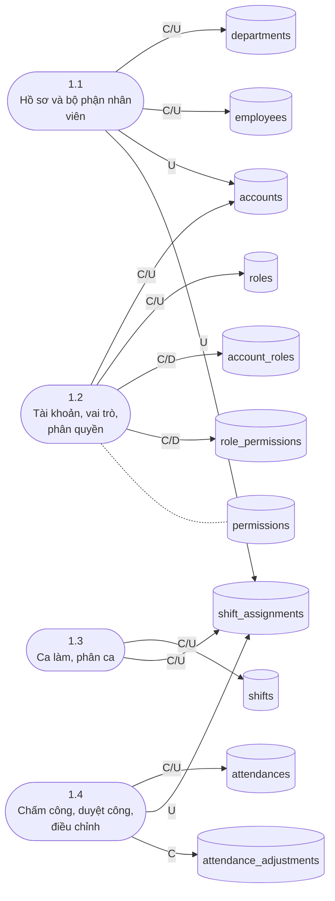
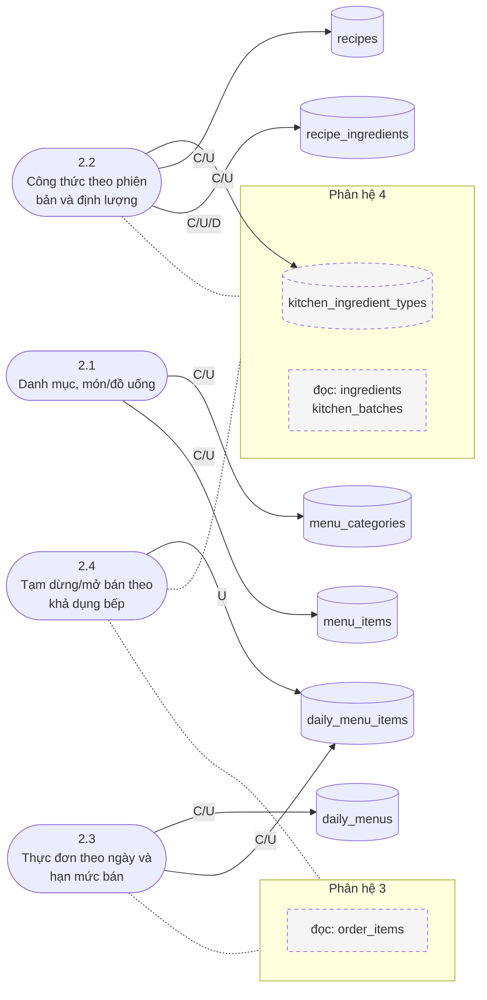
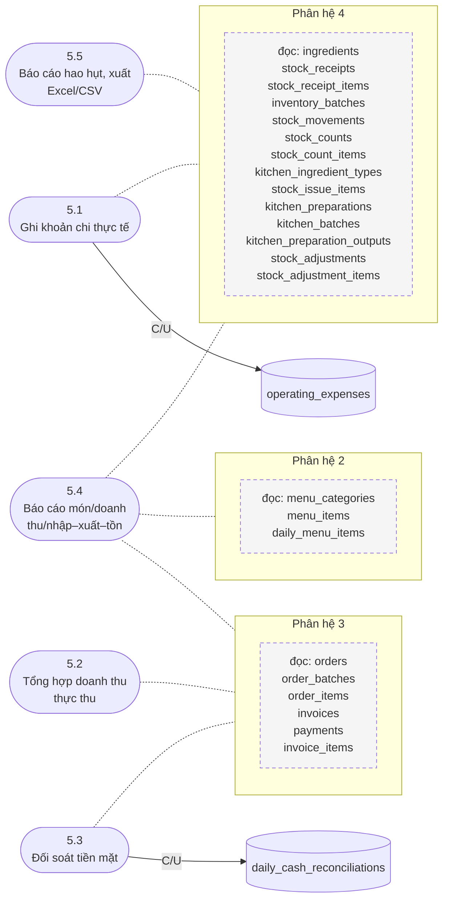

# 03 · Luồng dữ liệu của 27 nhóm chức năng

> **Baseline:** Master Spec v4 (48 bảng · 5 phân hệ · 27 nhóm chức năng) — mô tả **schema v4.1 bản đóng băng**: 32 hàm nghiệp vụ `rc_*` (20 tên của v4 + 12 hàm mới), đã áp dụng QĐ-1…QĐ-8 và QĐ-MT, QĐ-ID, QĐ-NG, QĐ-BM ([07 §3](07-kiem-toan-ham-rc.md)). Actor ghi ở mỗi thẻ là vai trò DB **cưỡng chế** (`rc_authorize`); Manager làm được mọi thao tác vận hành.
> Mỗi nhóm chức năng được mô tả theo đúng khuôn mục N của spec:
> **Actor → Điều kiện vào → Bảng đọc → Bảng ghi → Transaction & khóa → Trạng thái/event → Ngoại lệ → Test**.
> Ma trận CRUD và sơ đồ DFD mức 2 trong file này được **sinh tự động từ chính các thẻ chức năng** bên dưới,
> nên luôn khớp với nội dung thẻ.

## A. Cách đọc

| Ký hiệu | Ý nghĩa |
| --- | --- |
| **C** / **U** / **D** / **R** | INSERT / UPDATE / DELETE / SELECT trên bảng |
| **Routine v4.1** | Hàm `rc_*` trong [04-schema-v4.1.sql](04-schema-v4.1.sql), bao trọn một transaction: 20 tên của v4 + 8 hàm bổ sung (đánh dấu *mới*, xem mục H). `service` = Spring service ghi trực tiếp: danh mục, phiếu nháp, chấm công, khoản chi — không chạm số dư. Kiểm toán từng hàm: [07-kiem-toan-ham-rc.md](07-kiem-toan-ham-rc.md) |
| **DB-xx / QĐ-x** | Mã phát hiện / quyết định nghiệp vụ trong [02-danh-gia-database.md](02-danh-gia-database.md) |
| Test `HR-01`, `QĐ-2`… | Ca trong [05-test-v4.1.sql](05-test-v4.1.sql) (mã theo ma trận L1 Master Spec; `QĐ-n` = quyết định nghiệp vụ; `GRD`/`CON` = guard trigger / ràng buộc). `C1`…`C10` = ca hai kết nối thật trong [06-test-concurrency-v4.1.mjs](06-test-concurrency-v4.1.mjs) |

Sơ đồ DFD: hình bo tròn = chức năng; hình trụ = bảng; **mũi tên liền = ghi** (nhãn C/U/D); **nét chấm = chỉ đọc**; khối nền vàng = bảng thuộc phân hệ khác (bảng chỉ đọc được gom vào ô "đọc: …"). Để sơ đồ gọn, cạnh đọc tới bảng cùng phân hệ chỉ vẽ khi không chức năng nào trong phân hệ ghi bảng đó — danh sách đọc đầy đủ nằm trong từng thẻ và ma trận CRUD.

## B. Ma trận CRUD — kiểm tra thừa/thiếu

<!-- GEN:CRUD -->
**Kết quả kiểm tra tự động** (script đọc 27 thẻ chức năng bên dưới + seed migration):

- Bảng không có chức năng tạo: **không có** → không thiếu luồng tạo dữ liệu.
- Bảng không có chức năng đọc: **không có** → không có bảng thừa.
- 48/48 bảng có ít nhất một chức năng ghi; `permissions` (và 4 vai trò mặc định trong `roles`) đến từ seed migration.
- Bảng chỉ-thêm (bất biến): `stock_movements`, `payments`, `order_item_events`, `attendance_adjustments` — không chức năng nào U/D. `invoice_items` chỉ-thêm sau khi hóa đơn chốt; dòng chỉ bị xóa khi hóa đơn còn DRAFT (hủy ngoại lệ QĐ-2; trigger khóa từ PAYMENT_PENDING). `payment_webhook_events` chỉ được cập nhật các cột `resolution_*` (trigger chặn phần chứng cứ, DB-12).
- 32/32 hàm `rc_*` nghiệp vụ của v4.1 (20 tên v4 + 12 hàm bổ sung) đều gắn với một thẻ; không còn thao tác chạm số dư/trạng thái nào thiếu routine — xem mục H.

**Ma trận 48 bảng × chức năng** (ô ghi mã nhóm chức năng):

| Bảng | PH | Tạo (C) | Sửa / xóa (U, D) | Đọc (R) |
| --- | :-: | --- | --- | --- |
| `departments` | 1 | 1.1 | 1.1 | 1.1 |
| `employees` | 1 | 1.1 | 1.1 | 1.1, 1.2, 1.3, 1.4 |
| `accounts` | 1 | 1.2 | 1.1, 1.2 | 1.2, 3.1, 3.3 |
| `roles` | 1 | 1.2, seed | 1.2 | 1.2, 3.1, 3.3 |
| `permissions` | 1 | seed | — | 1.2 |
| `account_roles` | 1 | 1.2 | 1.2 | 1.2, 3.1, 3.3 |
| `role_permissions` | 1 | 1.2 | 1.2 | 1.2 |
| `shifts` | 1 | 1.3 | 1.3 | 1.3 |
| `shift_assignments` | 1 | 1.3 | 1.1, 1.3, 1.4 | 1.3, 1.4 |
| `attendances` | 1 | 1.4 | 1.4 | 1.4 |
| `attendance_adjustments` | 1 | 1.4 | — | 1.4 |
| `menu_categories` | 2 | 2.1 | 2.1 | 2.1, 5.4 |
| `menu_items` | 2 | 2.1 | 2.1 | 2.1, 2.2, 2.3, 3.2, 5.4 |
| `recipes` | 2 | 2.2 | 2.2 | 2.2, 2.3 |
| `recipe_ingredients` | 2 | 2.2 | 2.2 | 2.2, 2.4, 3.4 |
| `daily_menus` | 2 | 2.3 | 2.3 | 2.3, 3.2 |
| `daily_menu_items` | 2 | 2.3 | 2.3, 2.4 | 2.4, 3.2, 3.4, 5.4 |
| `dining_tables` | 3 | 3.1 | 3.1, 3.6, 3.7 | 3.1 |
| `table_sessions` | 3 | 3.1 | 3.1, 3.6, 3.7 | 3.1 |
| `orders` | 3 | 3.1 | 3.1, 3.6, 3.7 | 3.1, 3.2, 3.3, 3.5, 5.4 |
| `order_batches` | 3 | 3.2 | — | 3.1, 3.5, 5.4 |
| `order_items` | 3 | 3.2 | 3.1, 3.3, 3.4, 4.5 | 2.3, 2.4, 3.1, 3.2, 3.3, 3.4, 3.5, 4.6, 5.4 |
| `order_item_events` | 3 | 3.1, 3.2, 3.3 | — | 3.2, 3.3 |
| `invoices` | 3 | 3.1, 3.5 | 3.1, 3.3, 3.5, 3.6, 3.7 | 3.1, 3.2, 3.3, 3.5, 3.6, 3.7, 5.2, 5.4 |
| `payment_requests` | 3 | 3.6, 3.7 | 3.1, 3.5, 3.7 | 3.6, 3.7 |
| `payments` | 3 | 3.6, 3.7 | — | 5.2, 5.3, 5.4 |
| `payment_webhook_events` | 3 | 3.7 | 3.7 | 3.7 |
| `invoice_items` | 3 | 3.1, 3.5 | 3.3 | 3.5, 5.2, 5.4 |
| `ingredients` | 4 | 4.1 | 4.1 | 2.2, 4.1, 4.2, 5.4 |
| `stock_receipts` | 4 | 4.2 | 4.2 | 4.2, 5.1 |
| `stock_receipt_items` | 4 | 4.2 | 4.2 | 4.1, 4.2, 4.3, 4.4, 5.1, 5.4 |
| `inventory_batches` | 4 | 4.2 | 4.1, 4.3, 4.7 | 4.1, 4.3, 4.4, 4.7, 5.4 |
| `stock_movements` | 4 | 3.4, 4.2, 4.3, 4.4, 4.6, 4.7 | — | 4.6, 4.7, 5.4, 5.5 |
| `stock_reservations` | 4 | 3.4, 4.6 | 3.1, 3.4, 4.6 | 3.4, 4.5, 4.6 |
| `stock_counts` | 4 | 4.7 | 4.7 | 4.7, 5.5 |
| `stock_count_items` | 4 | 4.7 | — | 4.7, 5.5 |
| `kitchen_ingredient_types` | 4 | 2.2 | 2.2 | 2.2, 4.3, 4.4, 4.5, 5.4 |
| `stock_issues` | 4 | 4.3 | 4.3 | 4.3 |
| `stock_issue_items` | 4 | 4.3 | 4.3, 4.4, 4.7 | 4.3, 4.4, 4.5, 4.7, 5.4 |
| `kitchen_preparations` | 4 | 4.4 | 4.4 | 4.4, 5.5 |
| `kitchen_batches` | 4 | 4.3, 4.4 | 3.1, 3.4, 4.3, 4.5, 4.6, 4.7 | 2.4, 3.4, 4.3, 4.5, 4.6, 4.7, 5.4 |
| `kitchen_preparation_outputs` | 4 | 4.4 | 4.4 | 4.4, 5.5 |
| `stock_returns` | 4 | 4.3 | 4.3 | 4.3 |
| `stock_return_items` | 4 | 4.3 | — | 4.3 |
| `stock_adjustments` | 4 | 4.7 | 4.7 | 4.7, 5.5 |
| `stock_adjustment_items` | 4 | 4.7 | — | 4.7, 5.5 |
| `operating_expenses` | 5 | 5.1 | 5.1 | 5.1, 5.3 |
| `daily_cash_reconciliations` | 5 | 5.3 | 5.3 | 5.3 |
<!-- /GEN:CRUD -->

---

## C. Phân hệ 1 — Nhân viên • tài khoản • ca • chấm công

<!-- GEN:DFD-1 -->
**DFD mức 2 — phân hệ 1** (Nhân viên • tài khoản • ca • chấm công): mũi tên liền = ghi, nét chấm = chỉ đọc.

<!-- /GEN:DFD-1 -->

### 1.1 Hồ sơ và bộ phận nhân viên

| Mục | Nội dung |
| --- | --- |
| **Actor** | MANAGER |
| **Routine v4.1** | service |
| **Điều kiện vào** | `employee_code` chưa tồn tại; `department_id` hợp lệ |
| **Đọc (R)** | `departments`, `employees` |
| **Ghi (C/U)** | C/U `departments` · C/U `employees` · U `accounts` (khi nghỉ việc → DISABLED) · U `shift_assignments` (ca tương lai → CANCELLED) |
| **Transaction & khóa** | Mỗi thao tác 1 transaction. Chuyển `work_status = LEFT`: cùng transaction ghi `end_date`, khóa tài khoản và hủy các ca SCHEDULED từ hôm nay (đủ `cancel_reason`, `cancelled_by_id`, `cancelled_at`) |
| **Trạng thái / event** | `employees.work_status`: ACTIVE ⇄ INACTIVE → LEFT |
| **Ngoại lệ** | Không xóa cứng nhân viên/bộ phận đã có lịch sử (FK chặn) → dùng INACTIVE/LEFT |
| **Test** | HR-03* (LEFT ⇒ tài khoản DISABLED + ca tương lai CANCELLED) |

### 1.2 Tài khoản, vai trò, phân quyền

| Mục | Nội dung |
| --- | --- |
| **Actor** | MANAGER (quản trị); mọi nhân viên (đăng nhập) |
| **Routine v4.1** | service |
| **Điều kiện vào** | Nhân viên ACTIVE, chưa có tài khoản (`accounts.employee_id` UNIQUE); `username` duy nhất |
| **Đọc (R)** | `employees`, `accounts`, `roles`, `permissions`, `account_roles`, `role_permissions` |
| **Ghi (C/U)** | C/U `accounts` (`password_hash` BCrypt, `must_change_password = true` khi cấp/reset) · C/U `roles` · C/D `account_roles` · C/D `role_permissions` |
| **Transaction & khóa** | Gán/bỏ quyền: 1 transaction, cặp trùng bị UNIQUE chặn (DB-04). Đăng nhập: đọc `accounts` theo `username` → kiểm `account_status = ACTIVE` và `employees.work_status = ACTIVE` → nạp quyền qua `account_roles` → `role_permissions` → `permissions` |
| **Trạng thái / event** | `accounts.account_status`: ACTIVE ⇄ LOCKED; → DISABLED khi nghỉ việc |
| **Ngoại lệ** | `permissions` là dữ liệu seed trong migration (không tạo từ UI). v4 không có bảng audit RBAC → nếu cần, ghi log ứng dụng |
| **Test** | HR-01 |

### 1.3 Ca làm, phân ca

| Mục | Nội dung |
| --- | --- |
| **Actor** | MANAGER |
| **Routine v4.1** | service |
| **Điều kiện vào** | Nhân viên ACTIVE; `shifts.is_active`; không chồng giờ với ca chưa hủy của cùng nhân viên |
| **Đọc (R)** | `employees`, `shifts`, `shift_assignments` |
| **Ghi (C/U)** | C/U `shifts` · C/U `shift_assignments` (`scheduled_start_at = work_date + start_time`, ca qua đêm cộng 1 ngày; `scheduled_break_minutes` chụp từ mẫu ca; SCHEDULED) |
| **Transaction & khóa** | DB chặn chồng giờ bằng EXCLUDE `ex_shift_assignment_no_overlap` (DB-02); hủy ca ghi đủ 3 cột cancel (`ck_shift_assignment_cancel_fields`) |
| **Trạng thái / event** | SCHEDULED → COMPLETED (do 1.4) / CANCELLED |
| **Ngoại lệ** | Sửa mẫu ca không làm đổi phân ca đã lập (các cột `scheduled_*` là snapshot) |
| **Test** | HR-04* (hai ca chồng giờ cùng nhân viên bị chặn) |

### 1.4 Chấm công, duyệt công, điều chỉnh

| Mục | Nội dung |
| --- | --- |
| **Actor** | MANAGER |
| **Routine v4.1** | service |
| **Điều kiện vào** | `shift_assignments.status = SCHEDULED`, ngày làm ≤ hôm nay; mỗi phân ca tối đa 1 bản chấm công |
| **Đọc (R)** | `shift_assignments`, `attendances`, `attendance_adjustments`, `employees` |
| **Ghi (C/U)** | C `attendances` (PRESENT/ABSENT, `actual_start_at`, `actual_end_at`, `worked_minutes = (end − start) − break`, `confirmed_by_id`, `confirmed_at`) · U `shift_assignments` → COMPLETED · Điều chỉnh: C `attendance_adjustments` (old/new, `reason`, `adjusted_by_id`) và U `attendances` trong cùng transaction |
| **Transaction & khóa** | Khóa dòng `attendances` FOR UPDATE khi điều chỉnh; giá trị "old" lấy từ dòng đang khóa |
| **Trạng thái / event** | PRESENT/ABSENT (DB-01); "đã điều chỉnh" = có dòng `attendance_adjustments` (bảng chỉ-thêm) |
| **Ngoại lệ** | Chấm lần 2 → UNIQUE `shift_assignment_id` chặn. Core không tính lương; bảng công = tổng `worked_minutes` theo nhân viên/kỳ |
| **Test** | HR-02 |

---

## D. Phân hệ 2 — Thực đơn • món • công thức • thực đơn ngày

<!-- GEN:DFD-2 -->
**DFD mức 2 — phân hệ 2** (Thực đơn • món • công thức • thực đơn ngày): mũi tên liền = ghi, nét chấm = chỉ đọc.

<!-- /GEN:DFD-2 -->

### 2.1 Danh mục, món/đồ uống

| Mục | Nội dung |
| --- | --- |
| **Actor** | MANAGER (ghi); WAITER, KITCHEN, CASHIER (đọc) |
| **Routine v4.1** | service |
| **Điều kiện vào** | Danh mục `is_active`; giá ≥ 0 (`ck_price_nonnegative`) |
| **Đọc (R)** | `menu_categories`, `menu_items` |
| **Ghi (C/U)** | C/U `menu_categories` (`sort_order`, `is_active`) · C/U `menu_items` (`price`, `image_url`, `is_active`) |
| **Transaction & khóa** | Đơn dòng |
| **Trạng thái / event** | `is_active` (ngừng kinh doanh hẳn; tạm hết trong ngày dùng 2.4) |
| **Ngoại lệ** | Đổi giá không hồi tố: `order_items.unit_price` đã chụp lúc gọi. Không xóa món đã có công thức/thực đơn ngày (FK) |
| **Test** | INV-02 |

### 2.2 Công thức theo phiên bản và định lượng

| Mục | Nội dung |
| --- | --- |
| **Actor** | MANAGER |
| **Routine v4.1** | service |
| **Điều kiện vào** | Món tồn tại; loại nguyên liệu bếp `is_active`; định lượng > 0, tính theo `base_unit` của nguyên liệu gốc |
| **Đọc (R)** | `menu_items`, `recipes`, `recipe_ingredients`, `kitchen_ingredient_types`, `ingredients` |
| **Ghi (C/U)** | C/U `kitchen_ingredient_types` (DIRECT/PREPARED, `shelf_life_hours`, `minimum_quantity`) · C/U `recipes` (`version = max + 1`; đổi bản hiện hành) · C/U/D `recipe_ingredients` (chỉ trên version chưa dùng) |
| **Transaction & khóa** | Đổi bản hiện hành trong 1 transaction: bỏ `is_current` bản cũ rồi bật bản mới (`ux_recipes_current`) |
| **Trạng thái / event** | `recipes.is_current` (tối đa 1 bản/món) |
| **Ngoại lệ** | Version đã dùng trong `daily_menu_items` là bất biến → tạo version mới (DB-06). Mỗi nguyên liệu gốc tối đa 1 loại DIRECT (`ux_kitchen_direct_one`) |
| **Test** | MENU-01 |

### 2.3 Thực đơn theo ngày và hạn mức bán

| Mục | Nội dung |
| --- | --- |
| **Actor** | MANAGER |
| **Routine v4.1** | service |
| **Điều kiện vào** | 1 thực đơn/ngày (`business_date` UNIQUE); món `is_active`; recipe thuộc đúng món (FK ghép); `quota_total` là NULL (không giới hạn suất), 0 (không còn suất được bán) hoặc số dương (QĐ-1) |
| **Đọc (R)** | `daily_menus`, `menu_items`, `recipes`, `order_items` |
| **Ghi (C/U)** | C/U `daily_menus` (DRAFT → PUBLISHED + `published_at` → CLOSED) · C/U `daily_menu_items` (`recipe_id` mặc định bản `is_current`, `quota_total`) |
| **Transaction & khóa** | Publish: trigger kiểm có ≥ 1 dòng. Hạ quota: trigger chặn thấp hơn số suất đã chiếm (`rc_quota_used`); đã có món gọi thì không đổi món/công thức của dòng |
| **Trạng thái / event** | `daily_menus.status`: DRAFT → PUBLISHED → CLOSED (không lùi) |
| **Ngoại lệ** | Publish không đặt giữ nguyên liệu (G2.5). Số suất đã chiếm là giá trị **suy ra**, không lưu: ACCEPTED/COOKING/READY/SERVED và CANCELLED sau COOKING (QĐ-8). NULL ≠ bỏ kiểm tra nguyên liệu (QĐ-1) |
| **Test** | MENU-01, QĐ-1 |

### 2.4 Tạm dừng/mở bán theo khả dụng bếp

| Mục | Nội dung |
| --- | --- |
| **Actor** | KITCHEN, MANAGER |
| **Routine v4.1** | service |
| **Điều kiện vào** | Thực đơn ngày PUBLISHED |
| **Đọc (R)** | `daily_menu_items`, `recipe_ingredients`, `kitchen_batches`, `order_items` |
| **Ghi (C/U)** | U `daily_menu_items` (`is_paused`, `pause_reason`, `paused_by_id`, `paused_at` — luôn đi cùng nhau, DB-07) |
| **Transaction & khóa** | Đơn dòng; không ghi `stock_movements`, không tạo `stock_reservations` |
| **Trạng thái / event** | `is_paused`: false ⇄ true |
| **Ngoại lệ** | Suất khả dụng là **giá trị suy ra, không lưu**: MIN(quota còn — bỏ qua khi `quota_total` NULL; với mỗi nguyên liệu của công thức ⌊Σ(`quantity_on_hand` − `reserved_quantity`) của lô `is_usable`, còn hạn ÷ `quantity_per_serving`⌋) |
| **Test** | MENU-02, QĐ-1 |

---

## E. Phân hệ 3 — Bàn • đơn hàng • hóa đơn • thanh toán

<!-- GEN:DFD-3 -->
**DFD mức 2 — phân hệ 3** (Bàn • đơn hàng • hóa đơn • thanh toán): mũi tên liền = ghi, nét chấm = chỉ đọc.

```mermaid
flowchart LR
    F31(["3.1<br/>Quản lý bàn và phiên<br/>phục vụ"])
    F32(["3.2<br/>Ghi/gửi món nhiều đợt"])
    F33(["3.3<br/>Nhận/từ chối/chế<br/>biến/trả món"])
    F34(["3.4<br/>Kiểm tra, đặt giữ,<br/>tiêu hao nguyên liệu"])
    F35(["3.5<br/>Chốt hóa đơn tổng và<br/>chi tiết"])
    F36(["3.6<br/>Thu tiền mặt tại quầy"])
    F37(["3.7<br/>QR/SePay và đối chiếu<br/>webhook"])
    dining_tables[("dining_tables")]
    table_sessions[("table_sessions")]
    orders[("orders")]
    order_batches[("order_batches")]
    order_items[("order_items")]
    order_item_events[("order_item_events")]
    invoices[("invoices")]
    payment_requests[("payment_requests")]
    payments[("payments")]
    payment_webhook_events[("payment_webhook_events")]
    invoice_items[("invoice_items")]
    subgraph X1["Phân hệ 1"]
        X1r["đọc: accounts<br/>roles<br/>account_roles"]:::ext
    end
    subgraph X2["Phân hệ 2"]
        X2r["đọc: menu_items<br/>recipe_ingredients<br/>daily_menus<br/>daily_menu_items"]:::ext
    end
    subgraph X4["Phân hệ 4"]
        stock_movements[("stock_movements")]:::ext
        stock_reservations[("stock_reservations")]:::ext
        kitchen_batches[("kitchen_batches")]:::ext
    end
    F31 -->|C/U| dining_tables
    F31 -->|C/U| table_sessions
    F31 -->|C/U| orders
    F31 -->|U| order_items
    F31 -->|C| order_item_events
    F31 -->|U| stock_reservations
    F31 -->|U| kitchen_batches
    F31 -->|C/U| invoices
    F31 -->|C| invoice_items
    F31 -->|U| payment_requests
    F31 -.- X1
    F32 -->|C| order_batches
    F32 -->|C| order_items
    F32 -->|C| order_item_events
    F32 -.- X2
    F33 -->|U| order_items
    F33 -->|C| order_item_events
    F33 -->|D| invoice_items
    F33 -->|U| invoices
    F33 -.- X1
    F34 -->|C/U| stock_reservations
    F34 -->|U| kitchen_batches
    F34 -->|C| stock_movements
    F34 -->|U| order_items
    F34 -.- X2
    F35 -->|C/U| invoices
    F35 -->|C| invoice_items
    F35 -->|U| payment_requests
    F36 -->|C| payment_requests
    F36 -->|C| payments
    F36 -->|U| invoices
    F36 -->|U| orders
    F36 -->|U| table_sessions
    F36 -->|U| dining_tables
    F37 -->|C/U| payment_requests
    F37 -->|C/U| payment_webhook_events
    F37 -->|C| payments
    F37 -->|U| invoices
    F37 -->|U| orders
    F37 -->|U| table_sessions
    F37 -->|U| dining_tables
    classDef ext stroke-dasharray: 5 4,fill:#f5f5f5;
```

<!-- /GEN:DFD-3 -->

### 3.1 Quản lý bàn và phiên phục vụ

| Mục | Nội dung |
| --- | --- |
| **Actor** | WAITER/MANAGER (mở/đóng phiên); MANAGER (danh mục bàn; khách bỏ về) |
| **Routine v4.1** | `rc_open_session`, `rc_close_empty_session`, `rc_abandon_session` *(mới — QĐ-3)* |
| **Điều kiện vào** | Mở: bàn AVAILABLE, `is_active`. Đóng trống: chưa có món hoặc mọi dòng CANCELLED/REJECTED, chưa có `invoices`. Bỏ về: phiên OPEN, đơn OPEN, người gọi có vai trò MANAGER, lý do không rỗng |
| **Đọc (R)** | `dining_tables`, `table_sessions`, `orders`, `order_batches`, `order_items`, `invoices`, `accounts`, `account_roles`, `roles` |
| **Ghi (C/U)** | C/U `dining_tables` (danh mục: `code`, `capacity`) · Mở: C `table_sessions` (OPEN, `opened_by_id`) · C `orders` (OPEN) · U `dining_tables` → OCCUPIED · Đóng trống: U `orders` → CANCELLED · U `table_sessions` → CLOSED + `closed_at`, `closed_by_id` · U `dining_tables` → AVAILABLE. Bỏ về: U `order_items` → CANCELLED · C `order_item_events` (người + lý do) · U `stock_reservations` → RELEASED · U `kitchen_batches` (`reserved_quantity` −) · C `invoices` (nếu chưa có) · C `invoice_items` (dòng SERVED còn thiếu) · U `payment_requests` → CANCELLED · U `invoices` → UNCOLLECTED (`total`, `uncollected_*`), hoặc WAIVED khi tổng 0 đồng (`waived_*`) · U `orders` → CLOSED (CANCELLED nếu không có món SERVED và chưa có hóa đơn) · U `table_sessions` → CLOSED + `closed_by_id` · U `dining_tables` → AVAILABLE |
| **Transaction & khóa** | Khóa `dining_tables` FOR UPDATE; `ux_table_sessions_open` chặn hai phiên mở song song. Đóng trống/bỏ về: `orders` → `invoices` → `payment_requests` → `table_sessions`/`dining_tables` → `order_items` (id tăng dần) → lô bếp |
| **Trạng thái / event** | Bàn AVAILABLE ⇄ OCCUPIED; phiên OPEN → CLOSED; order OPEN → CANCELLED (đóng trống / bỏ về không món SERVED, **chỉ khi chưa có hóa đơn**) hoặc CLOSED (bỏ về: hóa đơn UNCOLLECTED, hoặc WAIVED nếu 0 đồng) |
| **Ngoại lệ** | Không tạo invoice 0đ; không chuyển/gộp bàn (ngoài Core). Bỏ về: **không** tạo `payments`, **không** PAID, **không** doanh thu thực thu, không xóa dữ liệu; món COOKING/READY bị hủy không hoàn nguyên liệu/quota; QR đến muộn → AFTER_CANCEL. Phiên đã có hóa đơn DRAFT 0 đồng (Manager miễn phí toàn bộ món, QĐ-2) không đóng trống được → Manager đóng bằng miễn thu (3.5) hoặc bỏ về: hóa đơn **WAIVED** 0 đồng, đơn CLOSED — không còn hóa đơn DRAFT treo (QĐ-MT). UNCOLLECTED là trạng thái cuối: không công nợ, thu bù hay xóa nợ trong Core. Bàn đã có lịch sử không xóa được → đặt `is_active = false` (DB-15) |
| **Test** | TABLE-01, TABLE-02, QĐ-3, QĐ-2/3/MT, QĐ-BM, C8, C9, C11 |

### 3.2 Ghi/gửi món nhiều đợt

| Mục | Nội dung |
| --- | --- |
| **Actor** | WAITER, MANAGER |
| **Routine v4.1** | `rc_submit_batch` *(mới; trả JSONB `batch_id` + `warnings`)* |
| **Điều kiện vào** | `orders.status = OPEN`; chưa có invoice hoặc invoice DRAFT; thực đơn PUBLISHED đúng `business_date`; món `is_active`, không `is_paused`; `quantity > 0`; quota **không chặn** (QĐ-4): dòng vượt phần suất còn lại (kể cả `quota_total = 0`) vẫn được ghi, kết quả kèm cảnh báo `QUOTA_EXCEEDED` (`remaining`); `NULL` không cảnh báo; kiểm cứng ở 3.3/3.4 khi Kitchen nhận (QĐ-1, QĐ-8) |
| **Đọc (R)** | `orders`, `invoices`, `daily_menus`, `daily_menu_items`, `menu_items`, `order_items`, `order_item_events` |
| **Ghi (C/U)** | C `order_batches` (`waiter_id`, `submitted_at`, `request_key`) · C `order_items` (PENDING, `item_name_snapshot` ← `menu_items.name`, `unit_price` ← `menu_items.price`, `has_stock_exception = false`) · C `order_item_events` (NULL → PENDING) |
| **Transaction & khóa** | 1 transaction cho cả đợt; khóa `orders` FOR UPDATE (mức 1) để tuần tự với chốt hóa đơn, hủy ngoại lệ, bỏ về (QĐ-4) |
| **Trạng thái / event** | Dòng món → PENDING |
| **Ngoại lệ** | Idempotent theo `request_key`: gửi lại trả về đợt cũ; dùng lại key cho đơn khác → RC409. Hóa đơn PAYMENT_PENDING/PAID/UNCOLLECTED/WAIVED → từ chối (phải mở lại ở 3.5). UI hiển thị `warnings` cho Waiter |
| **Test** | ORDER-01, ORDER-04, QĐ-1, QĐ-4, MENU-02, C5 |

### 3.3 Nhận/từ chối/chế biến/trả món

| Mục | Nội dung |
| --- | --- |
| **Actor** | KITCHEN (nhận, từ chối, nấu, xong); WAITER (đã phục vụ, yêu cầu hủy trước nấu); MANAGER (hủy ngoại lệ từ COOKING — kiểm vai trò trong DB) |
| **Routine v4.1** | `rc_accept_item`, `rc_reject_item` *(mới)*, `rc_start_cooking`, `rc_finish_dish`, `rc_serve_item` *(mới)*, `rc_cancel_item`, `rc_cancel_item_exception` *(mới — QĐ-2)* |
| **Điều kiện vào** | Dòng món đang ở đúng trạng thái nguồn của bước (bảng E2 Master Spec). Hủy thường: PENDING/ACCEPTED, có lý do. Hủy ngoại lệ: COOKING/READY/SERVED, người gọi có vai trò MANAGER, có lý do, đơn OPEN, hóa đơn chưa có hoặc DRAFT (PAYMENT_PENDING phải mở lại; PAID không áp dụng) |
| **Đọc (R)** | `order_items`, `order_item_events`, `orders`, `invoices`, `accounts`, `account_roles`, `roles` |
| **Ghi (C/U)** | U `order_items` (`status`) · C `order_item_events` (`from_status`, `to_status`, `actor_id`, `reason`); bước ACCEPTED/COOKING/CANCELLED ghi kho kèm theo ở 3.4. Hủy ngoại lệ khi có hóa đơn DRAFT: D `invoice_items` (dòng bị hủy) · U `invoices` (`total` tính lại). Hủy ngoại lệ **không** ghi `stock_movements`, `kitchen_batches`, `stock_reservations` |
| **Transaction & khóa** | Khóa `order_items` FOR UPDATE; chuyển trạng thái có điều kiện trạng thái nguồn nên hai client bấm cùng lúc chỉ một bên thành công. Hủy ngoại lệ khóa `orders` → `invoices` → `order_items` (tuần tự với chốt hóa đơn/thanh toán) |
| **Trạng thái / event** | PENDING → ACCEPTED → COOKING → READY → SERVED; PENDING → REJECTED; PENDING/ACCEPTED → CANCELLED (thường); COOKING/READY/SERVED → CANCELLED (ngoại lệ, Manager) |
| **Ngoại lệ** | REJECTED/CANCELLED bắt buộc `reason` không rỗng. Từ COOKING: không hoàn nguyên liệu đã tiêu hao, không hoàn quota, món không tính tiền (QĐ-2, QĐ-8); sau khi hóa đơn PAID/đơn CLOSED không hủy được. Chỉ-thêm: mọi chuyển trạng thái ghi một sự kiện nối đúng chuỗi, khớp trạng thái hiện tại |
| **Test** | ORDER-02, ORDER-03, QĐ-2, GRD, C3, C4, C8b |

### 3.4 Kiểm tra, đặt giữ, tiêu hao nguyên liệu

| Mục | Nội dung |
| --- | --- |
| **Actor** | KITCHEN |
| **Routine v4.1** | `rc_accept_item` (giữ), `rc_start_cooking` (tiêu hao), `rc_cancel_item` (giải phóng), `rc_reallocate_item` *(mới — cấp lại khi lô đang giữ bị hỏng)* |
| **Điều kiện vào** | ACCEPT: thực đơn PUBLISHED đúng ngày, món không pause, quota còn (`quota_total` NULL = không giới hạn; 0 = hết suất — QĐ-1), đủ tồn khả dụng **theo từng `kitchen_ingredient_type_id`** của công thức (kể cả khi quota NULL) |
| **Đọc (R)** | `order_items`, `daily_menu_items`, `recipe_ingredients`, `kitchen_batches`, `stock_reservations` |
| **Ghi (C/U)** | ACCEPT: C `stock_reservations` (ACTIVE) · U `kitchen_batches` (`reserved_quantity` + q). COOK: U `kitchen_batches` (`quantity_on_hand` − q, `reserved_quantity` − q) · U `stock_reservations` → CONSUMED + `closed_at` · C `stock_movements` (COOK, `kitchen_batch_id`, `order_item_id`, −q). CANCEL: U `stock_reservations` → RELEASED + `release_reason` · U `kitchen_batches` (`reserved_quantity` − q). Cấp lại khi lô hỏng: U `order_items` (`has_stock_exception` → false) |
| **Transaction & khóa** | Thứ tự khóa cố định: `order_items` (5) → `daily_menu_items` (6, tuần tự hóa mọi lần nhận cùng một món — QĐ-8) → `kitchen_batches` theo (loại, `id`) tăng dần (9). Kiểm quota và đặt giữ nguyên liệu cùng một transaction: thiếu quota hoặc thiếu bất kỳ nguyên liệu nào → savepoint hoàn tác phần đã giữ rồi REJECTED kèm lý do. Cấp FEFO theo `usable_until ASC NULLS LAST, id` |
| **Trạng thái / event** | Reservation ACTIVE → CONSUMED / RELEASED (chỉ một chiều, trigger khóa) |
| **Ngoại lệ** | `needed = order_items.quantity × quantity_per_serving`. RELEASED không tạo movement (không tăng tồn vật lý). Quota chiếm khi ACCEPTED; hủy trước COOKING giải phóng đúng một lần; từ COOKING không hoàn (QĐ-8). Lô đang giữ bị đánh dấu hỏng (4.5) → Kitchen cấp lại: RELEASED `BATCH_UNUSABLE` + reservation mới, hoặc hủy món (DB-14) |
| **Test** | MENU-02, ORDER-02, ORDER-03, QĐ-1, QĐ-8, C1, C2, C3 |

### 3.5 Chốt hóa đơn tổng và chi tiết

| Mục | Nội dung |
| --- | --- |
| **Actor** | CASHIER, MANAGER; miễn thu chỉ MANAGER |
| **Routine v4.1** | `rc_checkout_invoice`, `rc_reopen_invoice`, `rc_waive_invoice` *(mới — QĐ-MT)* |
| **Điều kiện vào** | Mọi dòng món ∈ {SERVED, CANCELLED, REJECTED}; ≥ 1 dòng SERVED; tổng > 0; `orders.status = OPEN`. Chốt: Cashier khi khách thanh toán tại quầy; mở lại: phải nêu lý do |
| **Đọc (R)** | `orders`, `order_batches`, `order_items`, `invoices`, `invoice_items` |
| **Ghi (C/U)** | C `invoices` (lần đầu, DRAFT, `created_by_id`) · C `invoice_items` (mỗi dòng SERVED chưa có: `item_name`, `quantity`, `unit_price`; `line_total` tự sinh) · U `invoices` (`total = Σ line_total` do hàm tự tính, → PAYMENT_PENDING). Mở lại: U `invoices` → DRAFT · U `payment_requests` (request đang mở → CANCELLED + `cancel_reason`, `cancelled_at`, `cancelled_by_id`). Miễn thu: C/U như chốt (giữ nguyên `invoice_items`, giá bán) · U `payment_requests` đang mở → CANCELLED · U `invoices` → WAIVED + `waived_reason/by/at` · U `orders` → CLOSED · U `table_sessions` → CLOSED · U `dining_tables` → AVAILABLE |
| **Transaction & khóa** | Khóa `orders` → `invoices` → `payment_requests` (chặn 3.2 gửi món chen vào, 3.3 hủy ngoại lệ, thanh toán). `rc_invoice_total_checked` đối chiếu: không sót dòng SERVED, mọi dòng hóa đơn là bản chụp đúng (tên, số lượng, đơn giá) của dòng SERVED cùng đơn; trigger khóa hóa đơn từ PAYMENT_PENDING |
| **Trạng thái / event** | Invoice DRAFT → PAYMENT_PENDING; PAYMENT_PENDING → DRAFT (mở lại); DRAFT/PAYMENT_PENDING → WAIVED (miễn thu); PAID, UNCOLLECTED, WAIVED là cuối (QĐ-3, QĐ-4, QĐ-MT) |
| **Ngoại lệ** | Thiếu dòng SERVED → chặn. Không nhận tổng từ client. Từ PAYMENT_PENDING Waiter không gửi thêm món; muốn đổi phải mở lại (hủy yêu cầu thanh toán hiện hành). Màn hình Cashier đọc `invoices` trước, `invoice_items` khi xem chi tiết; không lấy `payments.amount` làm số phải thu. Tổng 0 đồng (món giá 0) không chốt chờ thu → miễn thu. Miễn thu: không `payments`, không doanh thu, không áp cho PAID; còn món chưa kết thúc → chặn; đồng thời với thu tiền chỉ một bên thành công; QR đến sau → AFTER_CANCEL |
| **Test** | INV-01, INV-02, ORDER-04, QĐ-4, QĐ-MT, C5, C11 |

### 3.6 Thu tiền mặt tại quầy

| Mục | Nội dung |
| --- | --- |
| **Actor** | CASHIER |
| **Routine v4.1** | `rc_pay_cash`, `rc_cancel_payment_request` |
| **Điều kiện vào** | Invoice PAYMENT_PENDING; không có request QR đang mở (hủy trước); `cash_received ≥ amount_due` |
| **Đọc (R)** | `invoices`, `payment_requests` |
| **Ghi (C/U)** | C `payment_requests` (CASH, `amount_due` ← `invoices.total`, `cash_received`, → PAID; `change_amount` tự tính) · C `payments` (`amount = amount_due`, `paid_at`, `business_date` = `rc_business_date(paid_at)`) · U `invoices` → PAID · U `orders` → CLOSED · U `table_sessions` → CLOSED + `closed_at`, `closed_by_id` · U `dining_tables` → AVAILABLE |
| **Transaction & khóa** | 1 transaction: khóa `orders` → `invoices` → request đang mở (cùng thứ tự với chốt hóa đơn, tránh deadlock); trigger chỉ cho ghi `payments` khi hóa đơn PAYMENT_PENDING và đúng số phải thu; `payments.invoice_id` UNIQUE là hàng rào cuối; lỗi ở bất kỳ bước nào → rollback toàn bộ |
| **Trạng thái / event** | Request REQUESTED → PAID; invoice → PAID |
| **Ngoại lệ** | Tiền thiếu → chặn. Bấm 2 lần cùng lúc → đúng một bên thành công, bên kia RC409 (hóa đơn đã PAID). `payments.amount` là số phải thu, không phải tiền khách đưa |
| **Test** | CASH-01, CONC-02, C6, C8 |

### 3.7 QR/SePay và đối chiếu webhook

| Mục | Nội dung |
| --- | --- |
| **Actor** | CASHIER (tạo/hủy QR); SePay (webhook) |
| **Routine v4.1** | `rc_start_qr`, `rc_process_verified_qr`, `rc_cancel_payment_request` |
| **Điều kiện vào** | Tạo QR: invoice PAYMENT_PENDING, chưa có request đang mở (`ux_payment_request_active`). Webhook: backend đã xác thực chữ ký/API key/nguồn SePay **trước** khi gọi routine |
| **Đọc (R)** | `invoices`, `payment_requests`, `payment_webhook_events` |
| **Ghi (C/U)** | Tạo: C `payment_requests` (QR, `payment_reference` UNIQUE, → WAITING_TRANSFER). Webhook: C `payment_webhook_events` (`provider_transaction_code`, `amount`, `raw_payload`, `processing_result`); nếu khớp: C `payments` (QR, `payment_webhook_event_id`) · U `payment_requests` → PAID · U `invoices` → PAID · U `orders` → CLOSED · U `table_sessions` → CLOSED · U `dining_tables` → AVAILABLE. Xử lý sự cố: U `payment_webhook_events` (chỉ các cột `resolution_*`) |
| **Transaction & khóa** | 1 transaction; tìm request theo `payment_reference` rồi khóa `orders` → `invoices` → request. Idempotent theo `provider_transaction_code`: kiểm trước và sau khi giữ khóa, ghi bằng `ON CONFLICT DO NOTHING`; webhook trùng (kể cả đến cùng lúc) nhận lại kết quả đã lưu, backend trả 200 |
| **Trạng thái / event** | `processing_result`: PROCESSED (khớp ref + số tiền, request WAITING_TRANSFER, invoice PAYMENT_PENDING) · MISMATCH (sai ref/số tiền) · AFTER_CANCEL (request đã hủy hoặc invoice đã PAID bằng CASH) |
| **Ngoại lệ** | MISMATCH/AFTER_CANCEL không tạo payment, là **sự cố đối soát**: trigger tự đặt `resolution_status = OPEN`; Manager ghi `resolved_by_id`, `resolved_at`, `resolution_note` khi xử lý; cột chứng cứ không sửa được (DB-12) |
| **Test** | QR-01, QR-02, CONC-02, C6, C7 |

---

## F. Phân hệ 4 — Kho RAW • bếp • sơ chế • kiểm kê

<!-- GEN:DFD-4 -->
**DFD mức 2 — phân hệ 4** (Kho RAW • bếp • sơ chế • kiểm kê): mũi tên liền = ghi, nét chấm = chỉ đọc.

```mermaid
flowchart LR
    F41(["4.1<br/>Danh mục nguyên liệu<br/>thô/lô/đơn vị"])
    F42(["4.2<br/>Nhập kho nhiều đợt,<br/>chọn FEFO"])
    F43(["4.3<br/>Xuất kho, bàn giao,<br/>nhận, hoàn trả"])
    F44(["4.4<br/>Sơ chế nhiều đầu ra,<br/>ghi hao hụt"])
    F45(["4.5<br/>Quản lý tồn bếp<br/>DIRECT/PREPARED"])
    F46(["4.6<br/>Cấp nguyên liệu cho<br/>món và tiêu hao"])
    F47(["4.7<br/>Kiểm kê, hư hỏng, hết<br/>hạn, lịch sử"])
    ingredients[("ingredients")]
    stock_receipts[("stock_receipts")]
    stock_receipt_items[("stock_receipt_items")]
    inventory_batches[("inventory_batches")]
    stock_movements[("stock_movements")]
    stock_reservations[("stock_reservations")]
    stock_counts[("stock_counts")]
    stock_count_items[("stock_count_items")]
    kitchen_ingredient_types[("kitchen_ingredient_types")]
    stock_issues[("stock_issues")]
    stock_issue_items[("stock_issue_items")]
    kitchen_preparations[("kitchen_preparations")]
    kitchen_batches[("kitchen_batches")]
    kitchen_preparation_outputs[("kitchen_preparation_outputs")]
    stock_returns[("stock_returns")]
    stock_return_items[("stock_return_items")]
    stock_adjustments[("stock_adjustments")]
    stock_adjustment_items[("stock_adjustment_items")]
    subgraph X3["Phân hệ 3"]
        order_items[("order_items")]:::ext
    end
    F41 -->|C/U| ingredients
    F41 -->|U| inventory_batches
    F42 -->|C/U| stock_receipts
    F42 -->|C/U/D| stock_receipt_items
    F42 -->|C| inventory_batches
    F42 -->|C| stock_movements
    F43 -->|C/U| stock_issues
    F43 -->|C/U/D| stock_issue_items
    F43 -->|U| inventory_batches
    F43 -->|C| stock_movements
    F43 -->|C/U| kitchen_batches
    F43 -->|C/U| stock_returns
    F43 -->|C| stock_return_items
    F43 -.- kitchen_ingredient_types
    F44 -->|C/U| kitchen_preparations
    F44 -->|C/U/D| kitchen_preparation_outputs
    F44 -->|U| stock_issue_items
    F44 -->|C| stock_movements
    F44 -->|C| kitchen_batches
    F44 -.- kitchen_ingredient_types
    F45 -->|U| kitchen_batches
    F45 -->|U| order_items
    F45 -.- kitchen_ingredient_types
    F46 -->|C/U| stock_reservations
    F46 -->|U| kitchen_batches
    F46 -->|C| stock_movements
    F46 -.- X3
    F47 -->|C/U| stock_adjustments
    F47 -->|C| stock_adjustment_items
    F47 -->|C/U| stock_counts
    F47 -->|C| stock_count_items
    F47 -->|U| inventory_batches
    F47 -->|U| stock_issue_items
    F47 -->|U| kitchen_batches
    F47 -->|C| stock_movements
    classDef ext stroke-dasharray: 5 4,fill:#f5f5f5;
```

<!-- /GEN:DFD-4 -->

### 4.1 Danh mục nguyên liệu thô/lô/đơn vị

| Mục | Nội dung |
| --- | --- |
| **Actor** | MANAGER |
| **Routine v4.1** | service (danh mục); đánh dấu lô hỏng: `rc_mark_batch_unusable` *(mới)* |
| **Điều kiện vào** | Tên nguyên liệu duy nhất; `base_unit` không đổi sau khi đã có lô |
| **Đọc (R)** | `ingredients`, `stock_receipt_items`, `inventory_batches` |
| **Ghi (C/U)** | C/U `ingredients` (`base_unit`, `min_quantity`, `is_expiry_tracked`, `is_active`) · U `inventory_batches` (`is_usable = false`, `unusable_reason`, `unusable_marked_by_id`, `unusable_marked_at`) |
| **Transaction & khóa** | Đánh dấu lô: khóa lô FOR UPDATE; không đổi số dư (giảm bằng WASTE ở 4.7) |
| **Trạng thái / event** | Lô `is_usable`: true → false |
| **Ngoại lệ** | Lô RAW không nhập tay — chỉ sinh từ 4.2. Tồn RAW theo nguyên liệu = Σ `quantity_on_hand` nối `stock_receipt_items` theo `ingredient_id`; cảnh báo khi < `min_quantity` |
| **Test** | RAW-01 |

### 4.2 Nhập kho nhiều đợt, chọn FEFO

| Mục | Nội dung |
| --- | --- |
| **Actor** | MANAGER |
| **Routine v4.1** | `rc_create_stock_receipt` *(mới — QĐ-ID)*, `rc_confirm_receipt` |
| **Điều kiện vào** | Phiếu DRAFT, không rỗng; `input_quantity > 0`, `conversion_factor > 0`; nguyên liệu còn `is_active`; nguyên liệu `is_expiry_tracked` phải có `expiry_date`; lô đã quá hạn (theo ngày kinh doanh) không được nhận vào kho |
| **Đọc (R)** | `stock_receipts`, `stock_receipt_items`, `ingredients` |
| **Ghi (C/U)** | Lập (một lời gọi, header + dòng): C `stock_receipts` (DRAFT, `created_by_id`, `request_key`, `request_hash`) · C `stock_receipt_items`; sửa nháp: C/U/D `stock_receipt_items`, bỏ nháp: D. Gửi lặp cùng `request_key` + payload → trả phiếu cũ, khác payload → RC409. Xác nhận (ghi sổ trước, đổi trạng thái sau): U `stock_receipts` → CONFIRMED + `received_at`, `confirmed_by_id`, `confirmed_at` · C `inventory_batches` (1 lô/dòng, `quantity_on_hand = input_quantity × conversion_factor`) · C `stock_movements` (RECEIPT, +) |
| **Transaction & khóa** | Khóa `stock_receipts` FOR UPDATE (xác nhận lặp đồng thời: bên sau thấy CONFIRMED → RC409); `event_key` theo dòng nhập + `inventory_batches.stock_receipt_item_id` UNIQUE là hàng rào thứ hai. Lô RAW mới nên không cần khóa tài nguyên khác |
| **Trạng thái / event** | DRAFT → CONFIRMED / CANCELLED |
| **Ngoại lệ** | Không tự sinh khoản chi (tiền ghi ở 5.1). Hai đợt nhập cùng nguyên liệu → hai lô riêng, không gộp |
| **Test** | RAW-01, C9 |

### 4.3 Xuất kho, bàn giao, nhận, hoàn trả

| Mục | Nội dung |
| --- | --- |
| **Actor** | MANAGER (lập, xuất, hủy, duyệt hoàn trả); KITCHEN (nhận, đề xuất hoàn trả) |
| **Routine v4.1** | `rc_create_stock_issue` *(mới — QĐ-ID)*, `rc_issue_stock`, `rc_receive_issue`, `rc_cancel_issue`, `rc_confirm_return` |
| **Điều kiện vào** | Xuất: lô `is_usable`, còn hạn, đủ số, đúng FEFO. Nhận: phiếu ISSUED, nhận đủ toàn phiếu. Hoàn trả: WIP ≤ `wip_remaining_quantity`; DIRECT ≤ `quantity_on_hand − reserved_quantity`; không trả lô PREPARED |
| **Đọc (R)** | `stock_issues`, `stock_issue_items`, `inventory_batches`, `stock_receipt_items`, `kitchen_ingredient_types`, `kitchen_batches`, `stock_returns`, `stock_return_items` |
| **Ghi (C/U)** | Lập: C `stock_issues` (DRAFT, `request_key`, `request_hash`) · C `stock_issue_items` (`fulfillment_mode`, `wip_remaining_quantity = 0`) trong một lời gọi idempotent; sửa nháp C/U/D dòng. Xuất: U `inventory_batches` (−) · C `stock_movements` (ISSUE_OUT) · U `stock_issues` → ISSUED. Nhận PREPARE: U `stock_issue_items` (`wip_remaining_quantity = quantity`) · C `stock_movements` (ISSUE_RECEIVED). Nhận DIRECT: C `kitchen_batches` (`direct_issue_item_id`) · C `stock_movements` (DIRECT_IN). Hủy ISSUED: U `inventory_batches` (+) · C `stock_movements` (ISSUE_REVERSAL) · U `stock_issues` → CANCELLED + `cancel_reason`, `cancelled_at`, `cancelled_by_id`. Hoàn trả: C `stock_returns` · C `stock_return_items` · U `stock_issue_items` hoặc U `kitchen_batches` (−) · U `inventory_batches` (+) · C `stock_movements` (RETURN ×2) · U `stock_returns` → CONFIRMED |
| **Transaction & khóa** | Khóa phiếu (header) rồi tài nguyên theo thứ tự chung: `inventory_batches` (7) theo `id` → `stock_issue_items` (8) → `kitchen_batches` (9) theo (loại, `id`). Xuất kho khóa mọi lô của các nguyên liệu liên quan để kiểm FEFO không bị chen. Hoàn trả khóa trước **toàn bộ** tài nguyên rồi mới ghi, không theo thứ tự dòng phiếu (hai phiếu ngược thứ tự không deadlock). Mỗi movement một `event_key` riêng (RETURN cần 2 khóa: chiều ra và chiều vào) |
| **Trạng thái / event** | Phiếu xuất DRAFT → ISSUED → RECEIVED; DRAFT/ISSUED → CANCELLED. Phiếu trả DRAFT → CONFIRMED/CANCELLED |
| **Ngoại lệ** | ISSUED chưa nhận = **đang chuyển** (suy ra từ phiếu, không có số dư riêng). RECEIVED không hủy lùi → dùng hoàn trả. Hàng đến thiếu → hủy phiếu, lập phiếu mới (không nhận một phần) |
| **Test** | RAW-02, RAW-03, ISSUE-01, ISSUE-02, ISSUE-03, DIRECT-01, RETURN-01, RETURN-02, C9, C10 |

### 4.4 Sơ chế nhiều đầu ra, ghi hao hụt

| Mục | Nội dung |
| --- | --- |
| **Actor** | KITCHEN |
| **Routine v4.1** | `rc_confirm_preparation` |
| **Điều kiện vào** | Dòng xuất PREPARE thuộc phiếu RECEIVED; `input_quantity ≤ wip_remaining_quantity`; 0 < Σ đầu ra ≤ đầu vào; mọi đầu ra là loại PREPARED của **cùng** nguyên liệu gốc; `usable_until` không vượt hạn lô gốc |
| **Đọc (R)** | `stock_issue_items`, `inventory_batches`, `stock_receipt_items`, `kitchen_ingredient_types`, `kitchen_preparations`, `kitchen_preparation_outputs` |
| **Ghi (C/U)** | Lập: C `kitchen_preparations` (DRAFT, `request_key`) · C/U/D `kitchen_preparation_outputs`. Xác nhận: U `stock_issue_items` (`wip_remaining_quantity` − input) · C `stock_movements` (PREP_INPUT, −input) · C `kitchen_batches` (1 lô/đầu ra, `preparation_output_id`) · C `stock_movements` (PREP_OUTPUT, +output) · U `kitchen_preparations` → CONFIRMED + `prepared_at` |
| **Transaction & khóa** | Khóa phiếu sơ chế + dòng WIP FOR UPDATE (hai lần sơ chế song song không vượt WIP) |
| **Trạng thái / event** | DRAFT → CONFIRMED / CANCELLED |
| **Ngoại lệ** | Hao hụt = `input_quantity − Σ output_quantity`; tỷ lệ thu hồi = Σ output ÷ input — **suy ra**, không ghi thêm movement |
| **Test** | PREP-01, PREP-02, PREP-03, C10 |

### 4.5 Quản lý tồn bếp DIRECT/PREPARED

| Mục | Nội dung |
| --- | --- |
| **Actor** | KITCHEN |
| **Routine v4.1** | `rc_mark_batch_unusable` *(mới)* |
| **Điều kiện vào** | — |
| **Đọc (R)** | `kitchen_ingredient_types`, `kitchen_batches`, `stock_issue_items`, `stock_reservations` |
| **Ghi (C/U)** | U `kitchen_batches` (`is_usable = false`, `unusable_reason`, `unusable_marked_by_id`, `unusable_marked_at`) · U `order_items` (`has_stock_exception = true` cho món đang giữ lô đó) |
| **Transaction & khóa** | Khóa lô; nếu `reserved_quantity > 0` thì bật cờ ngoại lệ trong cùng transaction (không tự xóa reservation) |
| **Trạng thái / event** | Lô `is_usable`: true → false |
| **Ngoại lệ** | Tồn khả dụng = `quantity_on_hand − reserved_quantity` của lô `is_usable` và `usable_until > now()`; cảnh báo khi tổng theo loại < `minimum_quantity`. WIP chờ sơ chế = dòng có `wip_remaining_quantity > 0` |
| **Test** | WASTE-01 |

### 4.6 Cấp nguyên liệu cho món và tiêu hao

| Mục | Nội dung |
| --- | --- |
| **Actor** | KITCHEN |
| **Routine v4.1** | `rc_accept_item`, `rc_start_cooking`, `rc_cancel_item`, `rc_reallocate_item` *(mới)* — cùng transaction với 3.4 (3.4 nhìn từ dòng món, 4.6 nhìn từ lô bếp) |
| **Điều kiện vào** | Như 3.4 |
| **Đọc (R)** | `stock_reservations`, `kitchen_batches`, `order_items`, `stock_movements` |
| **Ghi (C/U)** | C/U `stock_reservations` · U `kitchen_batches` · C `stock_movements` (COOK) |
| **Transaction & khóa** | Như 3.4 |
| **Trạng thái / event** | Như 3.4 |
| **Ngoại lệ** | Truy vết một lần tiêu hao: `stock_movements` (COOK) → `kitchen_batches` → `kitchen_preparation_outputs` → `kitchen_preparations` → `stock_issue_items` → `inventory_batches` → `stock_receipt_items` → `stock_receipts` |
| **Test** | CONC-01, C2, C3 |

### 4.7 Kiểm kê, hư hỏng, hết hạn, lịch sử

| Mục | Nội dung |
| --- | --- |
| **Actor** | KITCHEN/MANAGER (lập); MANAGER (duyệt) |
| **Routine v4.1** | `rc_create_stock_count` *(mới — QĐ-ID)*, `rc_confirm_adjustment`, `rc_confirm_count` |
| **Điều kiện vào** | Hư hỏng: mỗi dòng đúng 1 nguồn, lượng giảm ≤ khả dụng (bếp: `quantity_on_hand − reserved_quantity`). Kiểm kê: `book_quantity` phải bằng số dư lúc duyệt; dòng bếp: `actual_quantity ≥ reserved_quantity` |
| **Đọc (R)** | `stock_adjustments`, `stock_adjustment_items`, `stock_counts`, `stock_count_items`, `inventory_batches`, `stock_issue_items`, `kitchen_batches`, `stock_movements` |
| **Ghi (C/U)** | Lập: C `stock_adjustments` (DRAFT, `adjustment_type`, `reason`, `request_key`) · C `stock_adjustment_items` (`quantity_delta` < 0) · C `stock_counts` (DRAFT, `created_by_id`, `request_key`, `request_hash`) · C `stock_count_items` (`book_quantity` chụp từ sổ lúc lập, `actual_quantity`, `reason`) — một lời gọi idempotent. Duyệt: U `inventory_batches` / U `stock_issue_items` / U `kitchen_batches` · C `stock_movements` (WASTE, hoặc COUNT_ADJUST = actual − book) · U `stock_adjustments` / U `stock_counts` → CONFIRMED |
| **Transaction & khóa** | Khóa phiếu rồi **trước hết** mọi nguồn theo thứ tự chung RAW (`id`) → WIP (`id`) → kho bếp (loại, `id`), sau đó mới ghi theo dòng phiếu (hai phiếu liệt kê nguồn ngược thứ tự vẫn không deadlock); `book_quantity` lệch số dư đang khóa → báo stale, không ghi đè; xác nhận lặp → RC409 |
| **Trạng thái / event** | DRAFT → CONFIRMED / CANCELLED |
| **Ngoại lệ** | WASTE (bảo quản) ≠ hao hụt sơ chế. Kiểm kê không tạo thêm `stock_adjustments` cho cùng chênh lệch. Lịch sử = `stock_movements` theo vị trí (3 index audit) |
| **Test** | WASTE-01, COUNT-01, C10 |

---

## G. Phân hệ 5 — Chi phí • báo cáo • đối soát

<!-- GEN:DFD-5 -->
**DFD mức 2 — phân hệ 5** (Chi phí • báo cáo • đối soát): mũi tên liền = ghi, nét chấm = chỉ đọc.

<!-- /GEN:DFD-5 -->

### 5.1 Ghi khoản chi thực tế

| Mục | Nội dung |
| --- | --- |
| **Actor** | MANAGER |
| **Routine v4.1** | service |
| **Điều kiện vào** | Đã trả tiền thật. Nếu gắn phiếu nhập: phiếu CONFIRMED và chưa có khoản chi còn hiệu lực (`ux_expense_receipt_live`) |
| **Đọc (R)** | `stock_receipts`, `stock_receipt_items`, `operating_expenses` |
| **Ghi (C/U)** | C `operating_expenses` (`business_date`, `category`, `amount`, `payment_method`, `fund_source`, `paid_at`, `recorded_by_id`, `request_key`, PAID) · U `operating_expenses` → VOIDED + `void_reason`, `voided_by_id`, `voided_at` |
| **Transaction & khóa** | Đơn dòng; `request_key` chống bấm lặp |
| **Trạng thái / event** | PAID → VOIDED (không xóa) |
| **Ngoại lệ** | Thêm/hủy khoản chi CASH của ngày đã đối soát → bản đối soát cũ lệch → lập version mới (5.3). Miền giá trị cố định bằng CHECK (DB-30): `payment_method` ∈ CASH/BANK_TRANSFER, `fund_source` ∈ CASH_DRAWER/OWNER/BANK; chi từ két bắt buộc CASH |
| **Test** | FIN-01 |

### 5.2 Tổng hợp doanh thu thực thu

| Mục | Nội dung |
| --- | --- |
| **Actor** | MANAGER, CASHIER |
| **Routine v4.1** | `rpt_revenue_by_day`, `rpt_revenue_by_item`, `rpt_unpaid_closures` ([10](10-bao-cao-v4.1.sql)) |
| **Điều kiện vào** | — |
| **Đọc (R)** | `payments`, `invoices`, `invoice_items` |
| **Ghi (C/U)** | — |
| **Transaction & khóa** | Chỉ đọc; báo cáo nhiều truy vấn nên chạy REPEATABLE READ để số liệu cùng một thời điểm |
| **Trạng thái / event** | — |
| **Ngoại lệ** | Doanh thu = Σ `payments.amount` theo `business_date` (tách theo `method`); webhook lặp/đến muộn không bao giờ thành payment nên không đếm trùng. UNCOLLECTED và WAIVED không tính (liệt kê riêng ở `rpt_unpaid_closures`); tiền QR không cộng vào quỹ tiền mặt. Không gọi chênh lệch thu − chi là lợi nhuận |
| **Test** | 11-test-bao-cao (doanh thu, theo món, bỏ về/miễn thu), M21, M22 |

### 5.3 Đối soát tiền mặt

| Mục | Nội dung |
| --- | --- |
| **Actor** | MANAGER (CASHIER đếm két) |
| **Routine v4.1** | `rc_reconcile_cash` *(mới)*; xem số tươi bằng `rpt_cash_reconciliation` |
| **Điều kiện vào** | Ngày kinh doanh đã kết thúc bán; nếu ngày đã có bản CURRENT thì bắt buộc `revision_reason` |
| **Đọc (R)** | `payments`, `operating_expenses`, `daily_cash_reconciliations` |
| **Ghi (C/U)** | U `daily_cash_reconciliations` (bản CURRENT cũ → SUPERSEDED) · C `daily_cash_reconciliations` (`version` + 1, CURRENT, `opening_cash`, `cash_sales`, `cash_expenses`, `actual_cash`, `reason`, `revision_reason`; `expected_cash`, `difference` tự tính) |
| **Transaction & khóa** | 1 transaction; khóa bản CURRENT (hoặc advisory lock theo ngày); UPDATE bản cũ **trước** INSERT bản mới vì `ux_cash_recon_current` |
| **Trạng thái / event** | CURRENT → SUPERSEDED |
| **Ngoại lệ** | `cash_sales` = Σ `payments.amount` (CASH, đúng ngày); `cash_expenses` = Σ `operating_expenses.amount` (PAID, CASH, quỹ quầy). `expected_cash`, `difference` là cột GENERATED (DB-31); bản đã chốt bị trigger khóa, chỉ được chuyển CURRENT → SUPERSEDED |
| **Test** | FIN-02 |

### 5.4 Báo cáo món/doanh thu/nhập–xuất–tồn

| Mục | Nội dung |
| --- | --- |
| **Actor** | MANAGER |
| **Routine v4.1** | `rpt_revenue_by_item`, `rpt_raw_stock`, `rpt_handover_and_wip`, `rpt_kitchen_stock`, `rpt_unusable_lots`, `rpt_stock_history` ([10](10-bao-cao-v4.1.sql)) |
| **Điều kiện vào** | — |
| **Đọc (R)** | `payments`, `invoices`, `invoice_items`, `order_items`, `order_batches`, `orders`, `daily_menu_items`, `menu_items`, `menu_categories`, `stock_movements`, `inventory_batches`, `stock_receipt_items`, `ingredients`, `stock_issue_items`, `kitchen_batches`, `kitchen_ingredient_types` |
| **Ghi (C/U)** | — |
| **Transaction & khóa** | Chỉ đọc, REPEATABLE READ |
| **Trạng thái / event** | — |
| **Ngoại lệ** | Bán theo món: `invoice_items` ⨝ `payments` (kỳ) ⨝ `order_items` → `daily_menu_items` → `menu_items` → `menu_categories`. Nhập–xuất–tồn: tồn đầu = Σ delta trước kỳ; phát sinh theo `movement_type` trong kỳ; tồn cuối = đầu + phát sinh; quy về `ingredient_id` qua 3 nhánh lô. Lọc theo kỳ dùng index BRIN `brin_stock_movements_created` (DB-27) |
| **Test** | 11-test-bao-cao (tồn RAW/bàn giao/WIP/bếp khả dụng, lô hỏng, sổ kho theo nhóm), M24 |

### 5.5 Báo cáo hao hụt, xuất Excel/CSV

| Mục | Nội dung |
| --- | --- |
| **Actor** | MANAGER, KITCHEN |
| **Routine v4.1** | `rpt_preparation_yield`, `rpt_stock_history` ([10](10-bao-cao-v4.1.sql)) |
| **Điều kiện vào** | — |
| **Đọc (R)** | `kitchen_preparations`, `kitchen_preparation_outputs`, `stock_adjustments`, `stock_adjustment_items`, `stock_counts`, `stock_count_items`, `stock_movements` |
| **Ghi (C/U)** | — |
| **Transaction & khóa** | Chỉ đọc |
| **Trạng thái / event** | — |
| **Ngoại lệ** | Ba chỉ tiêu tách riêng: hao hụt sơ chế (input − Σ output), WASTE bảo quản (theo `adjustment_type`), chênh lệch kiểm kê (actual − book). Xuất file ở tầng ứng dụng, không ghi DB |
| **Test** | PREP-01, WASTE-01, 11-test-bao-cao (đầu vào/thành phẩm/hao hụt/tỷ lệ, truy lô + người) |

---

## H. Hàm bổ sung trong v4.1 (DB-34, QĐ-2, QĐ-3)

Mục I4/M7 của spec yêu cầu thao tác tiền/tồn đi qua routine và **không cho DML trực tiếp**. Ở v4, 6 thao tác đầu bảng dưới chưa có hàm: nếu REVOKE quyền ghi thì không chạy được, còn nếu mở quyền ghi thì app role có thể đặt thẳng `order_items.status = COOKING` mà bỏ qua bước tiêu hao. v4.1 bổ sung đủ 6 hàm; vòng chốt nghiệp vụ thêm 2 hàm cho QĐ-2 và QĐ-3; vòng đóng băng thêm 4 hàm cho QĐ-MT và QĐ-ID (tổng 20 + 12 = 32 hàm). Cùng quy ước với 20 hàm còn lại: tham số `p_actor` là `employees.id` của principal đã xác thực và được kiểm vai trò (`rc_authorize`), chạy SECURITY DEFINER, khóa theo thứ tự chung, lỗi theo mã RC001/RC403/RC409/RC422/RC500 (xem [07-kiem-toan-ham-rc.md](07-kiem-toan-ham-rc.md)).

| Hàm | Nhóm | Việc làm | Bảng ghi |
| --- | --- | --- | --- |
| `rc_submit_batch(order, actor, request_key, items jsonb)` | 3.2 | Gửi lặp cùng `request_key` → trả đợt cũ (key đã dùng cho đơn khác → RC409); chặn khi order không mở, hóa đơn đã chốt (từ PAYMENT_PENDING), món ngoài thực đơn hôm nay hoặc đang tạm dừng; quota không chặn — trả cảnh báo `QUOTA_EXCEEDED` (kiểm cứng ở lúc nhận); chụp tên + giá; trả JSONB | `order_batches`, `order_items`, `order_item_events` |
| `rc_reject_item(item, actor, reason)` | 3.3 | PENDING → REJECTED, bắt buộc lý do; không chiếm quota | `order_items`, `order_item_events` |
| `rc_serve_item(item, actor)` | 3.3 | READY → SERVED | `order_items`, `order_item_events` |
| `rc_mark_batch_unusable(kind, batch, actor, reason)` | 4.1, 4.5 | Chỉ MANAGER (G7.8). Đánh dấu lô RAW/bếp không dùng được; lô bếp đang được giữ → bật `has_stock_exception` cho các món liên quan, trả về số món bị ảnh hưởng | `inventory_batches` hoặc `kitchen_batches`, `order_items` |
| `rc_reallocate_item(item, actor)` | 3.4 | Giải phóng phần giữ trên lô hỏng/hết hạn (`BATCH_UNUSABLE`), giữ lại theo FEFO từ lô khác, xóa cờ; vẫn thiếu → lỗi, Kitchen hủy món | `stock_reservations`, `kitchen_batches`, `order_items` |
| `rc_reconcile_cash(date, opening, actual, actor, reason, revision_reason)` | 5.3 | Khóa advisory theo ngày, tính `cash_sales`/`cash_expenses` từ dữ liệu thật, chuyển bản cũ SUPERSEDED, tạo version mới CURRENT | `daily_cash_reconciliations` |
| `rc_cancel_item_exception(item, actor, reason)` | 3.3 | **QĐ-2.** Chỉ MANAGER (DB kiểm vai trò). Hủy món đã COOKING/READY/SERVED kèm lý do bắt buộc; không hoàn nguyên liệu/quota; chặn khi đơn không OPEN hoặc hóa đơn PAYMENT_PENDING (phải mở lại) / PAID; hóa đơn DRAFT → xóa dòng `invoice_items` tương ứng và tính lại tổng | `order_items`, `order_item_events`, `invoice_items`, `invoices` |
| `rc_abandon_session(session, actor, reason)` | 3.1 | **QĐ-3.** Chỉ MANAGER. Hủy các dòng còn mở (trước COOKING giải phóng phần giữ), tạo/cập nhật hóa đơn đủ `invoice_items`, hủy yêu cầu thanh toán đang mở, hóa đơn → **UNCOLLECTED** (không `payments`, không PAID) hoặc **WAIVED** nếu tổng 0 đồng, đơn CLOSED (CANCELLED nếu không món SERVED và chưa có hóa đơn), phiên CLOSED, bàn AVAILABLE; trả id hóa đơn hoặc NULL | `order_items`, `order_item_events`, `stock_reservations`, `kitchen_batches`, `invoices`, `invoice_items`, `payment_requests`, `orders`, `table_sessions`, `dining_tables` |
| `rc_waive_invoice(order, actor, reason)` | 3.5 | **QĐ-MT.** Chỉ MANAGER. Mọi món đã kết thúc; tạo/bổ sung hóa đơn từ dòng SERVED (giữ giá), hủy yêu cầu thanh toán đang mở, hóa đơn → **WAIVED** (`waived_*`, total = giá trị được miễn, có thể 0), đơn/phiên CLOSED, bàn AVAILABLE; không `payments`; PAID/UNCOLLECTED/WAIVED → RC409 | `invoices`, `invoice_items`, `payment_requests`, `orders`, `table_sessions`, `dining_tables` |
| `rc_create_stock_receipt(actor, request_key, payload)` · `rc_create_stock_issue(…)` · `rc_create_stock_count(…)` | 4.2, 4.3, 4.7 | **QĐ-ID.** Chỉ MANAGER. Tạo header + dòng nguyên tử; khóa tư vấn theo `request_key`; cùng khóa + cùng payload → id cũ, khác payload → RC409; kiểm kê chụp `book_quantity` | `stock_receipts` + `stock_receipt_items` / `stock_issues` + `stock_issue_items` / `stock_counts` + `stock_count_items` |

Các thao tác còn lại ở mức `service` (danh mục, nhân sự, thực đơn, nháp chứng từ, chấm công, khoản chi, xử lý sự cố webhook) không chạm số dư → ghi trực tiếp, được CHECK/trigger trong [04-schema-v4.1.sql](04-schema-v4.1.sql) bảo vệ. Quyền ghi trực tiếp được giới hạn **theo bảng và theo cột** ở [09-acl-v4.1.sql](09-acl-v4.1.sql): role `rc_app` không có cột trạng thái/xác nhận nào của chứng từ, không ghi được bảng bán hàng, tiền, sổ kho, số dư, đối soát; header nhập/xuất/kiểm kê chỉ tạo qua `rc_create_*`. Chuyển chứng từ sang trạng thái có hiệu lực kho mà không có bút toán bị trigger chặn với mọi role. Ngoài 32 hàm nghiệp vụ, schema có 16 hàm hỗ trợ (không cấp cho ứng dụng) và 22 hàm trigger — bảng chi tiết ở file 07; báo cáo là 10 hàm `rpt_*` chỉ đọc.
