# Phân hệ 3 – Quản lý đơn hàng (RMS Core)

Tài liệu phân tích phân hệ 3 của hệ thống quản lý nhà hàng (RMS): sơ đồ use case, sơ đồ hoạt động và ERD. Nguồn sơ đồ là các file `.puml` (PlantUML) cùng thư mục; ảnh `.png` được render từ các file đó. Phân hệ 3 là nguồn chuẩn của mô hình dữ liệu đơn hàng; phân hệ 2 chỉ tham chiếu, không sao chép bảng của phân hệ này.

Đây là phân hệ trung tâm, quản lý toàn bộ vòng đời một đơn hàng, từ khi khách ngồi vào bàn đến khi thanh toán thành công. Công nghệ dự kiến: Spring Boot REST API, WebSocket, Web responsive. Mô hình: Mobile Ordering → POS điều phối → Bếp → Phục vụ → Thanh toán tại bàn.

## 1. Phạm vi

| STT | Nhóm chức năng | Nghiệp vụ triển khai |
| --- | --- | --- |
| 3.1 | Quản lý bàn & phiên phục vụ | Theo dõi bàn, mở phiên phục vụ, chuyển bàn, kết thúc phiên |
| 3.2 | Gọi món & cập nhật đơn | Phục vụ gọi món bằng điện thoại / tablet, gửi đơn, gọi thêm món, xem trạng thái |
| 3.3 | Tiếp nhận & điều phối POS | Nhận đơn thời gian thực, duyệt từng dòng món, chuyển phiếu xuống bếp, hủy món trước khi chuyển bếp |
| 3.4 | Theo dõi chế biến & trả món | Theo dõi trạng thái từng món, cập nhật chế biến, đánh dấu hoàn thành, gọi phục vụ lấy món |
| 3.5 | Hóa đơn & thanh toán tại bàn | Gửi yêu cầu thanh toán, thu ngân duyệt, QR tự động xác nhận hoặc tiền mặt bàn giao tại quầy |
| 3.6 | Xử lý ngoại lệ đơn hàng | Hủy món, sửa món chưa chuyển bếp, chống gửi trùng, cảnh báo chờ lâu, kiểm soát trước thanh toán |

**Actor:**

| Actor | Trách nhiệm |
| --- | --- |
| Waiter – Nhân viên phục vụ | Mở bàn, chuyển bàn, ghi món, gửi đơn, mang món ra bàn, nhận yêu cầu và thực hiện thanh toán tại bàn |
| Order Coordinator – Nhân viên điều phối | Duyệt món, chuyển bếp, theo dõi chế biến, cập nhật trạng thái, sửa hoặc hủy món hợp lệ tại POS, gọi phục vụ |
| Cashier – Thu ngân | Duyệt yêu cầu thanh toán, nhận tiền mặt, giao tiền thừa, giám sát giao dịch QR, hủy yêu cầu chưa thanh toán |
| Manager – Quản lý | Giám sát đơn hàng, xử lý các trường hợp ngoại lệ cần quyền quản lý |
| Cổng thanh toán (SePay) | Hệ thống bên ngoài gửi webhook về backend khi có giao dịch |

Bốn actor phần mềm là Manager, Waiter, Order Coordinator và Cashier. Bếp trưởng và đầu bếp tham gia hoạt động thực tế nhưng không thao tác hệ thống: bếp nhận phiếu, chế biến và giao tiếp qua bộ đàm, POS ghi nhận tiến độ. Khách hàng cũng không dùng phần mềm: khách thanh toán tại bàn thông qua nhân viên phục vụ.

**Thống nhất vận hành Core:**

- Đồng bộ thời gian thực bằng WebSocket tới POS và Mobile; mọi chuyển trạng thái được backend kiểm tra hợp lệ trước khi ghi database.
- Phiếu bếp: mặc định in và chuyển phiếu thành công; không xử lý máy in, lỗi in hay in lại.
- Gọi thêm món: luồng mở rộng của gọi món trong cùng phiên; mỗi lần gửi tạo một đợt gọi món mới thuộc đơn tổng đang mở, không tạo đơn tổng mới, không in hoặc gửi lại món cũ.

**Chưa triển khai ở Core:**

| Chức năng | Phạm vi |
| --- | --- |
| Tích hợp máy in nhiệt, xử lý lỗi in | Phiên bản sau |
| Chia hóa đơn nhiều người | Phiên bản sau |
| Thanh toán kết hợp nhiều phương thức | Phiên bản sau |
| Hoàn tiền, hoàn giao dịch tự động | Phiên bản sau |
| Gộp / tách bàn phức tạp | Phiên bản sau |
| Nhận đặt bàn trực tuyến | Phiên bản sau |
| Tối ưu điều phối bằng AI | Phiên bản sau |
| KDS riêng cho đầu bếp | Không cần ở Core |

## 2. Trạng thái và quy tắc nghiệp vụ

### 2.1 Trạng thái dòng món (`order_items.status`)

POS duyệt độc lập từng dòng món; không bắt buộc duyệt cả đơn và không phải đợi mọi món hoàn thành mới gọi phục vụ. Một dòng nhiều suất (ví dụ 2 phở bò) được duyệt hoặc hủy toàn bộ, trạng thái hoàn thành cũng áp dụng cho cả dòng.

| Trạng thái | Ý nghĩa |
| --- | --- |
| `PENDING` | Phục vụ đã gửi món, POS chưa duyệt; suất đang được giữ tạm |
| `ACCEPTED` | POS đã nhận món, nguyên liệu đã được đặt giữ, chưa chuyển bếp |
| `IN_KITCHEN` | Món đã chuyển xuống bếp, bếp chưa bắt đầu chế biến; có thể kèm cờ ngoại lệ thiếu nguyên liệu (`has_stock_exception`) khi kho không cấp đủ lúc bắt đầu chế biến |
| `COOKING` | Bếp đã bắt đầu chế biến; nguyên liệu đã ghi nhận tiêu hao |
| `READY` | Món hoàn thành, có thể mang ra bàn |
| `CANCELLED` | Hủy hợp lệ: hủy thông thường hoặc hủy ngoại lệ |
| `REJECTED` | POS từ chối nhận món, bắt buộc có lý do |

| Từ | Sang | Khi nào | Người thực hiện |
| --- | --- | --- | --- |
| (gửi đơn) | `PENDING` | Dòng đủ suất khi Waiter gửi đơn | Waiter |
| `PENDING` | `ACCEPTED` | POS duyệt và đặt giữ nguyên liệu thành công | Order Coordinator |
| `PENDING` | `REJECTED` | POS từ chối, hoặc không đặt giữ được nguyên liệu | Order Coordinator |
| `PENDING`, `ACCEPTED` | `CANCELLED` | Hủy thông thường | Order Coordinator |
| `ACCEPTED` | `IN_KITCHEN` | Chuyển bếp, tạo phiếu | Order Coordinator |
| `IN_KITCHEN` | `CANCELLED` | Hủy ngoại lệ, có xác nhận của bếp | Order Coordinator |
| `IN_KITCHEN` | `COOKING` | Bếp báo bắt đầu nấu và kho cấp đủ nguyên liệu | Order Coordinator |
| `COOKING` | `READY` | Bếp báo hoàn thành | Order Coordinator |

POS duyệt món không có nghĩa là bếp đã bắt đầu chế biến: duyệt, chuyển bếp, bắt đầu chế biến và hoàn thành là bốn mốc riêng.

**Ngoại lệ thiếu nguyên liệu khi bắt đầu chế biến:** nếu một lô đã đặt giữ bị hỏng, hết hạn hoặc không còn khả dụng và kho không phân bổ lại đủ theo FEFO từ các lô hợp lệ khác, dòng món không sang `COOKING`, không ghi nhận tiêu hao, không làm tồn âm. Dòng món giữ `IN_KITCHEN` và được đánh dấu `has_stock_exception = true`; POS liên hệ bếp qua bộ đàm để quyết định chờ nguyên liệu bổ sung rồi ghi nhận lại, hoặc hủy ngoại lệ theo quy tắc hủy bên dưới. Không tự hủy món đã chuyển xuống bếp (ORD-18). Cờ về `false` khi dòng món sang `COOKING` hoặc bị hủy.

**Quy tắc hủy món thống nhất (áp dụng cho cả phân hệ 2 và 3):**

1. **Hủy thông thường – `PENDING` hoặc `ACCEPTED`:** hủy trực tiếp tại POS; hệ thống hoàn suất đã giữ và giải phóng nguyên liệu nếu đã đặt giữ.
2. **Hủy ngoại lệ – `IN_KITCHEN`:** không hủy trực tiếp. Order Coordinator liên hệ bếp qua bộ đàm; chỉ khi bếp xác nhận món chưa bắt đầu chế biến và phiếu đã được xử lý, POS mới ghi nhận hủy ngoại lệ. Lưu lý do, người thao tác, thời gian và `kitchen_confirmed = true` (xác nhận do POS ghi nhận từ trao đổi thực tế, không phải xác thực điện tử của đầu bếp); hoàn suất và giải phóng nguyên liệu đặt giữ. Không thêm actor hay quy trình phê duyệt.
3. **`COOKING` hoặc `READY`:** không hủy trên POS và không hoàn nguyên liệu tự động. Khách muốn hủy sau khi đã chế biến thuộc xử lý ngoại lệ của Manager; Core không có hoàn tiền hay tái nhập kho tự động.

**Thao tác POS phải nhanh:** duyệt riêng từng dòng; chuyển nhiều món đã duyệt xuống bếp cùng lúc; cập nhật nhiều món bắt đầu chế biến khi bếp xác nhận; đánh dấu hoàn thành từng món hoặc nhóm món vừa xong.

**Cảnh báo thời gian chờ:** POS hiển thị thời gian chờ từng món; món quá ngưỡng cấu hình được làm nổi bật để điều phối viên hỏi bếp qua bộ đàm. Không có AI dự báo thời gian nấu trong Core.

### 2.2 Trạng thái bàn, phiên, đơn và hóa đơn

| Đối tượng | Trạng thái | Chuyển trạng thái |
| --- | --- | --- |
| `dining_tables` | `AVAILABLE`, `OCCUPIED` | Mở phiên → `OCCUPIED`; phiên đóng → `AVAILABLE`; chuyển bàn: bàn cũ `AVAILABLE`, bàn mới `OCCUPIED` |
| `table_sessions` | `OPEN`, `CLOSED` | Mở bàn tạo phiên `OPEN`; đóng theo ORD-17 |
| `orders` | `OPEN`, `CLOSED`, `CANCELLED` | Tạo `OPEN` cùng phiên; hóa đơn `PAID` → `CLOSED`; phiên kết thúc không có khoản phải thanh toán → `CANCELLED` |
| `invoices` | `DRAFT`, `PAYMENT_PENDING`, `PAID` | Tạo `DRAFT` cùng đơn, tổng tính lại khi món thay đổi; gửi yêu cầu thanh toán → `PAYMENT_PENDING`; yêu cầu bị hủy → `DRAFT`; thanh toán thành công → `PAID` |

Mỗi phiên có một đơn tổng và một hóa đơn; gọi thêm món chỉ thêm đợt gọi món vào đơn đang mở.

### 2.3 Liên kết với thực đơn và kho

| Sự kiện | Quản lý thực đơn | Quản lý kho |
| --- | --- | --- |
| Phục vụ gửi món | Giữ tạm suất | Chưa tiêu hao |
| POS duyệt món | Xác nhận số suất | Đặt giữ nguyên liệu |
| POS từ chối món | Hoàn suất giữ tạm | Không thay đổi |
| Hủy thông thường (`PENDING`, `ACCEPTED`) | Hoàn suất | Giải phóng nguyên liệu nếu đã đặt giữ |
| Chuyển bếp | Không thay đổi | Chưa tiêu hao |
| Hủy ngoại lệ (`IN_KITCHEN`, bếp xác nhận) | Hoàn suất | Giải phóng nguyên liệu đặt giữ |
| Bắt đầu chế biến, kho cấp đủ | Không trừ thêm suất | Chuyển đặt giữ thành tiêu hao, giảm tồn lô đúng một lần |
| Bắt đầu chế biến, kho không cấp đủ (lô đã giữ hỏng, hết hạn, không bù được) | Không đổi | Không tiêu hao, không tồn âm; dòng món giữ `IN_KITCHEN`, đánh dấu ngoại lệ; POS hỏi bếp (ORD-18) |
| Món hoàn thành | Không thay đổi | Không trừ thêm |
| Khách muốn hủy khi `COOKING` hoặc `READY` | Không tự động hoàn | Không hoàn kho tự động |
| Kho thiếu so với lượng đã đặt giữ (kiểm kê giảm, lô hỏng) | Ngừng nhận thêm món bị ảnh hưởng | Cảnh báo; POS xử lý món đã chấp nhận, không tự hủy |

Backend phải kiểm tra số suất và nguyên liệu trong transaction để hai thiết bị không cùng đặt vượt khả năng phục vụ. Chi tiết đặt giữ theo lô (FEFO) và tiêu hao: xem phân hệ 4.

### 2.4 Thanh toán tại bàn

Khách thanh toán tại bàn thông qua nhân viên phục vụ; thu ngân là người kiểm soát giao dịch.

**QR tự động:** Waiter gửi yêu cầu, Cashier kiểm tra và duyệt, backend tạo QR đúng số tiền và mã tham chiếu hóa đơn, khách quét và chuyển khoản, SePay gửi webhook về Spring Boot. Backend xác thực webhook, mã tham chiếu, số tiền và giao dịch chưa xử lý rồi tự cập nhật `PAID`, đồng bộ kết quả tới POS và điện thoại Waiter. Cashier không xác nhận thủ công thanh toán QR. Quét QR chưa phải thanh toán thành công. Mỗi webhook xác thực được lưu vào `payment_webhook_events`; webhook gửi lại cùng mã giao dịch không ghi nhận tiền lần hai. Webhook sai số tiền, sai mã tham chiếu hoặc nhận sau khi yêu cầu đã `CANCELLED` không làm đổi hóa đơn, được lưu với kết quả `MISMATCH` hoặc `AFTER_CANCEL` để Cashier đối chiếu. Khi demo dùng môi trường thử nghiệm hoặc webhook mô phỏng có xác thực, không cần tiền thật.

**Tiền mặt (luồng chuẩn):**

1. Khách yêu cầu thanh toán.
2. Waiter gửi yêu cầu đến Cashier.
3. Cashier kiểm tra hóa đơn và duyệt.
4. Waiter thu tiền tại bàn và nhập số tiền khách đưa (`cash_received`).
5. Hệ thống tính tiền thừa (`change_amount`).
6. Waiter mang toàn bộ tiền nhận từ khách đến quầy.
7. Cashier kiểm đếm, nhập số tiền thực đếm được (`cash_counted`).
8. Nếu khách trả thừa, Cashier đưa tiền thừa cho Waiter.
9. Cashier xác nhận đã nhận tiền và bàn giao tiền thừa.
10. Hệ thống mới cập nhật `PAID`, đóng hóa đơn và ghi nhận doanh thu.
11. Waiter mang tiền thừa trả khách.

Không bao giờ đóng thanh toán tiền mặt trước khi Cashier xác nhận đã nhận tiền từ Waiter. Cashier chỉ xác nhận hoàn tất khi tiền bàn giao đã được đối chiếu (`cash_counted` khớp `cash_received`), đủ thanh toán (`cash_counted` ≥ `amount_due`) và tiền thừa đã được xử lý; không khớp thì giữ `WAITING_CASH_HANDOVER` để đối chiếu. Ví dụ hóa đơn bàn B05: tổng 185.000đ, khách đưa 200.000đ, tiền thừa 15.000đ.

| Trạng thái yêu cầu thanh toán | Mô tả |
| --- | --- |
| `REQUESTED` | Phục vụ gửi yêu cầu |
| `APPROVED` | Thu ngân đã duyệt |
| `WAITING_TRANSFER` | Đang chờ chuyển khoản thành công (QR) |
| `WAITING_CASH_HANDOVER` | Đang chờ phục vụ bàn giao tiền cho thu ngân |
| `PAID` | Thanh toán hoàn tất |
| `CANCELLED` | Thu ngân hủy yêu cầu chưa thanh toán, có lý do; hóa đơn về `DRAFT` |

### 2.5 Quy tắc nghiệp vụ bắt buộc

Đã rà soát 15 quy tắc gốc: giữ nguyên mã, điều chỉnh nội dung ORD-02, ORD-05, ORD-06, PAY-02, PAY-03 và bổ sung ORD-11 đến ORD-18, PAY-06 đến PAY-09.

| Mã | Quy tắc |
| --- | --- |
| ORD-01 | Một bàn chỉ có một phiên phục vụ đang mở tại một thời điểm |
| ORD-02 | Một phiên có thể phát sinh nhiều đợt gọi món; gọi thêm món tạo một đợt gọi món mới thuộc đơn tổng đang mở của phiên, không tạo đơn tổng mới, không in hoặc gửi lại món cũ |
| ORD-03 | POS duyệt từng dòng món, không bắt buộc duyệt cả đơn |
| ORD-04 | Một dòng món được chấp nhận hoặc từ chối toàn bộ số lượng |
| ORD-05 | Hủy thông thường tại POS chỉ khi dòng món ở `PENDING` hoặc `ACCEPTED`; hoàn suất và giải phóng nguyên liệu đã đặt giữ |
| ORD-06 | Chỉ khi bắt đầu chế biến (`COOKING`) mới ghi nhận tiêu hao kho; POS duyệt hoặc chuyển bếp không phải là bắt đầu chế biến |
| ORD-07 | Không được giữ suất, đặt giữ hay trừ nguyên liệu hai lần cho cùng một dòng món |
| ORD-08 | Giá món trên đơn được giữ theo giá lúc đặt |
| ORD-09 | Khi yêu cầu thanh toán đang hoạt động (hóa đơn `PAYMENT_PENDING`), không được âm thầm thay đổi đơn và hóa đơn |
| ORD-10 | Thu ngân phải giải quyết các món còn chờ trước khi hoàn tất hóa đơn |
| ORD-11 | Hủy ngoại lệ món `IN_KITCHEN` chỉ khi POS liên hệ bếp và được xác nhận món chưa chế biến, phiếu đã được xử lý; lưu lý do, người thao tác, thời gian và `kitchen_confirmed`; hoàn suất và giải phóng nguyên liệu đặt giữ |
| ORD-12 | Món `COOKING` hoặc `READY` không được hủy trên POS và không tự động hoàn nguyên liệu; khách muốn hủy sau khi đã chế biến do Manager xử lý ngoại lệ, Core không hoàn tiền hay tái nhập kho tự động |
| ORD-13 | Mỗi lần gửi đơn mang `request_key` duy nhất; gửi lặp không tạo đợt gọi món mới |
| ORD-14 | Mọi chuyển trạng thái được backend kiểm tra hợp lệ trước khi ghi database, ghi vào lịch sử trạng thái và đồng bộ tới POS, Mobile qua WebSocket |
| ORD-15 | Waiter chỉ chuyển phiên sang bàn trống khi chưa có yêu cầu thanh toán đang hoạt động; giữ nguyên đơn và lịch sử món, cập nhật POS; không gộp hay tách bàn |
| ORD-16 | Waiter sửa danh sách món nháp trước khi gửi; sau khi gửi, chỉ Order Coordinator sửa hoặc hủy món hợp lệ tại POS; không sửa âm thầm món đã chuyển bếp; mọi thay đổi đồng bộ suất, nguyên liệu và trạng thái |
| ORD-17 | Chỉ đóng phiên khi hóa đơn `PAID` (đơn `CLOSED`), hoặc phiên không có khoản phải thanh toán và mọi món đã được hủy hoặc từ chối hợp lệ (đơn `CANCELLED`); đóng phiên thì bàn về `AVAILABLE` |
| ORD-18 | Khi bắt đầu chế biến mà kho không cấp đủ nguyên liệu (lô đã giữ hỏng, hết hạn hoặc không còn khả dụng và không phân bổ lại đủ theo FEFO), dòng món không sang `COOKING`, không tiêu hao, không làm tồn âm; giữ `IN_KITCHEN` và đánh dấu ngoại lệ thiếu nguyên liệu để POS liên hệ bếp qua bộ đàm quyết định. Không tự hủy món đã chuyển bếp, không hoàn nguyên liệu đã thực sự tiêu hao trước đó |
| PAY-01 | Phục vụ không có quyền xác nhận `PAID` |
| PAY-02 | QR chỉ được xác nhận tự động bằng webhook đã xác thực (đúng mã tham chiếu, số tiền, giao dịch chưa xử lý); quét QR chưa phải thanh toán thành công; Cashier không xác nhận thủ công |
| PAY-03 | Tiền mặt chỉ được `PAID` khi Cashier đã đối chiếu tiền bàn giao (`cash_counted` khớp `cash_received`), đủ thanh toán và đã xử lý tiền thừa; không khớp thì giữ `WAITING_CASH_HANDOVER` để đối chiếu |
| PAY-04 | Không được đóng hóa đơn trước khi thanh toán thành công |
| PAY-05 | Không ghi nhận một khoản thanh toán hai lần: `provider_transaction_code` là duy nhất, webhook gửi lại cùng mã giao dịch không tạo thanh toán mới |
| PAY-06 | Cashier chỉ hủy yêu cầu chưa `PAID` khi chưa có tiền thực nhận hoặc giao dịch thành công, bắt buộc ghi lý do; hóa đơn về `DRAFT` để kiểm tra và lập lại yêu cầu, đơn hàng giữ nguyên; không hủy giao dịch đã thanh toán bằng cách sửa trạng thái trực tiếp |
| PAY-07 | Chỉ giao dịch `PAID` mới được đưa vào doanh thu đã thu |
| PAY-08 | Webhook sai số tiền, sai mã tham chiếu hoặc nhận sau khi yêu cầu đã `CANCELLED` không được tự đóng hóa đơn; hệ thống lưu lại (`MISMATCH`, `AFTER_CANCEL`) để Cashier đối chiếu ngoại lệ |
| PAY-09 | Mỗi khoản thanh toán mang ngày kinh doanh (`payments.business_date`) để tổng hợp thu và đối soát theo ngày kinh doanh (phân hệ 5): ngày kinh doanh của thực đơn ngày chứa các dòng món của đơn (Core giả định một đơn chỉ có món của một thực đơn ngày; nếu có nhiều thì lấy ngày nhỏ nhất của các dòng món không `CANCELLED` / `REJECTED`). Gán khi ghi nhận thanh toán, không đổi sau đó và không dùng ngày lịch của `paid_at`. `payments.amount` là số tiền nhà hàng thực giữ lại, đã trừ tiền thừa |

## 3. Sơ đồ use case

Phân hệ có 26 use case nên chia hai sơ đồ: 1/2 vận hành đơn hàng (3.1 đến 3.4 và 3.6), 2/2 thanh toán tại bàn (3.5). Điều kiện tiên quyết của mọi use case: người dùng đã đăng nhập.

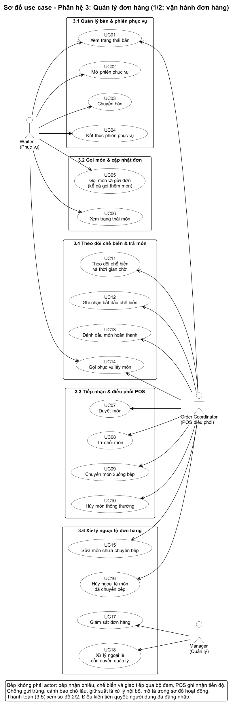

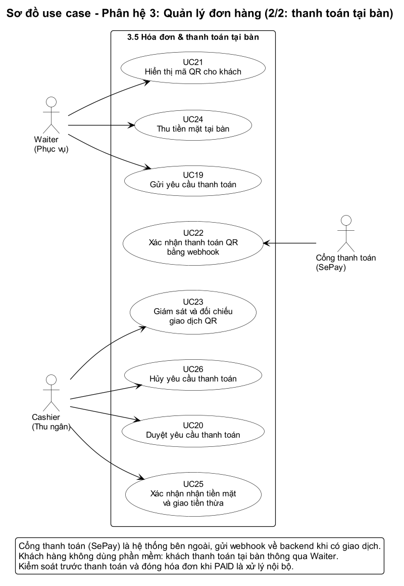

| Mã | Use case | Actor | Mô tả |
| --- | --- | --- | --- |
| UC01 | Xem trạng thái bàn | Waiter, Order Coordinator | Xem các bàn và trạng thái từng bàn |
| UC02 | Mở phiên phục vụ | Waiter | Mở phiên cho bàn trống; mỗi bàn chỉ một phiên đang mở (ORD-01) |
| UC03 | Chuyển bàn | Waiter | Chuyển phiên sang bàn trống khi chưa có yêu cầu thanh toán đang hoạt động; giữ nguyên đơn và lịch sử món, cập nhật POS (ORD-15) |
| UC04 | Kết thúc phiên phục vụ | Waiter | Đóng phiên khi hóa đơn `PAID`, hoặc khi không có khoản phải thanh toán và mọi món đã hủy / từ chối hợp lệ (đơn `CANCELLED`); thanh toán thành công thì hệ thống tự kết thúc phiên (ORD-17) |
| UC05 | Gọi món và gửi đơn | Waiter | Chọn, sửa, xóa món trong danh sách nháp rồi gửi; hệ thống kiểm tra `request_key` chống gửi trùng và giữ tạm suất (ORD-13). Luồng mở rộng – gọi thêm món: trong cùng phiên, mỗi lần gửi tạo một đợt gọi món mới thuộc đơn tổng đang mở, không tạo đơn mới (ORD-02) |
| UC06 | Xem trạng thái món | Waiter | Xem trạng thái từng dòng món theo thời gian thực |
| UC07 | Duyệt món | Order Coordinator | Duyệt từng dòng; hệ thống đặt giữ nguyên liệu: `PENDING` → `ACCEPTED` |
| UC08 | Từ chối món | Order Coordinator | `PENDING` → `REJECTED`, bắt buộc lý do; hệ thống hoàn suất giữ tạm |
| UC09 | Chuyển món xuống bếp | Order Coordinator | Chuyển nhiều món `ACCEPTED` cùng lúc, tạo phiếu bếp: → `IN_KITCHEN` |
| UC10 | Hủy món thông thường | Order Coordinator | `PENDING` hoặc `ACCEPTED` → `CANCELLED`; hoàn suất, giải phóng nguyên liệu (ORD-05) |
| UC11 | Theo dõi chế biến và thời gian chờ | Order Coordinator | Xem trạng thái và thời gian chờ; món quá ngưỡng được hệ thống làm nổi bật |
| UC12 | Ghi nhận bắt đầu chế biến | Order Coordinator | Khi bếp báo bắt đầu: `IN_KITCHEN` → `COOKING`, kho ghi nhận tiêu hao (ORD-06). Nếu kho không cấp đủ nguyên liệu: dòng món giữ `IN_KITCHEN`, đánh dấu ngoại lệ, POS hỏi bếp qua bộ đàm (ORD-18) |
| UC13 | Đánh dấu món hoàn thành | Order Coordinator | `COOKING` → `READY`, từng món hoặc nhóm món |
| UC14 | Gọi phục vụ lấy món | Order Coordinator, Waiter | Gọi qua bộ đàm; Waiter nhận thông tin và mang món ra bàn |
| UC15 | Sửa món chưa chuyển bếp | Order Coordinator | Sửa số lượng hoặc ghi chú khi món còn `PENDING` hoặc `ACCEPTED`; hệ thống kiểm tra lại suất và nguyên liệu (ORD-16) |
| UC16 | Hủy ngoại lệ món đã chuyển bếp | Order Coordinator | Món `IN_KITCHEN`, chỉ khi bếp xác nhận món chưa chế biến và phiếu đã được xử lý; lưu lý do và `kitchen_confirmed` (ORD-11) |
| UC17 | Giám sát đơn hàng | Manager | Theo dõi các đơn đang hoạt động |
| UC18 | Xử lý ngoại lệ cần quyền quản lý | Manager | Ví dụ khách muốn hủy món đã `COOKING` hoặc `READY`; xử lý ngoài Core, không hoàn tiền hay tái nhập kho tự động (ORD-12) |
| UC19 | Gửi yêu cầu thanh toán | Waiter | Tạo yêu cầu `REQUESTED`, hóa đơn `PAYMENT_PENDING`; hệ thống kiểm tra món còn chờ và khóa sửa đơn âm thầm (ORD-09, ORD-10) |
| UC20 | Duyệt yêu cầu thanh toán | Cashier | Kiểm tra hóa đơn: `REQUESTED` → `APPROVED` |
| UC21 | Hiển thị mã QR cho khách | Waiter | Backend tạo QR đúng số tiền và mã tham chiếu hóa đơn: `WAITING_TRANSFER` |
| UC22 | Xác nhận thanh toán QR bằng webhook | Cổng thanh toán (SePay) | Backend xác thực webhook rồi tự cập nhật `PAID`, đồng bộ POS và điện thoại Waiter (PAY-02) |
| UC23 | Giám sát và đối chiếu giao dịch QR | Cashier | Theo dõi giao dịch đang chờ; đối chiếu webhook `MISMATCH`, `AFTER_CANCEL`; không xác nhận thủ công (PAY-08) |
| UC24 | Thu tiền mặt tại bàn | Waiter | Thu tiền, nhập số tiền khách đưa, mang toàn bộ tiền về quầy: `WAITING_CASH_HANDOVER` |
| UC25 | Xác nhận nhận tiền mặt và giao tiền thừa | Cashier | Kiểm đếm, đưa tiền thừa cho Waiter, xác nhận: → `PAID` (PAY-03) |
| UC26 | Hủy yêu cầu thanh toán | Cashier | Chỉ khi chưa `PAID` và chưa có tiền thực nhận hoặc giao dịch thành công, bắt buộc lý do: → `CANCELLED`, hóa đơn về `DRAFT` (PAY-06) |

Hai sơ đồ không dùng quan hệ «include» hay «extend»: chống gửi trùng, giữ suất, cảnh báo chờ lâu, kiểm soát trước thanh toán và đóng hóa đơn khi `PAID` là xử lý nội bộ của hệ thống, được mô tả trong cột mô tả ở trên và trong sơ đồ hoạt động.

## 4. Sơ đồ hoạt động

| Nhóm chức năng | Sơ đồ |
| --- | --- |
| Tổng thể | 4.1 |
| 3.1 Bàn & phiên phục vụ | 4.2 |
| 3.2 Gọi món & cập nhật đơn | 4.3 (gồm chống gửi trùng) |
| 3.3 Tiếp nhận & điều phối POS | 4.4 (hủy, sửa món: 4.8) |
| 3.4 Chế biến & trả món | 4.5 (gồm cảnh báo chờ lâu) |
| 3.5 Hóa đơn & thanh toán | 4.6 (QR), 4.7 (tiền mặt) |
| 3.6 Xử lý ngoại lệ | 4.8 (hủy, sửa theo trạng thái), 4.9 (kiểm soát trước thanh toán) |

### 4.1 Luồng vận hành tổng thể

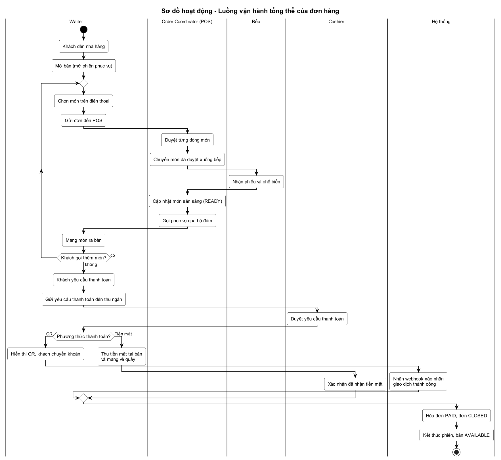

- Từ khi khách đến, mở bàn, gọi món, chế biến, trả món đến thanh toán và kết thúc phiên.
- Vòng lặp "khách gọi thêm món" tạo một đợt gọi món mới trong cùng phiên.
- Thanh toán rẽ nhánh: QR do webhook xác nhận, tiền mặt do thu ngân xác nhận.

### 4.2 Quản lý bàn và phiên phục vụ

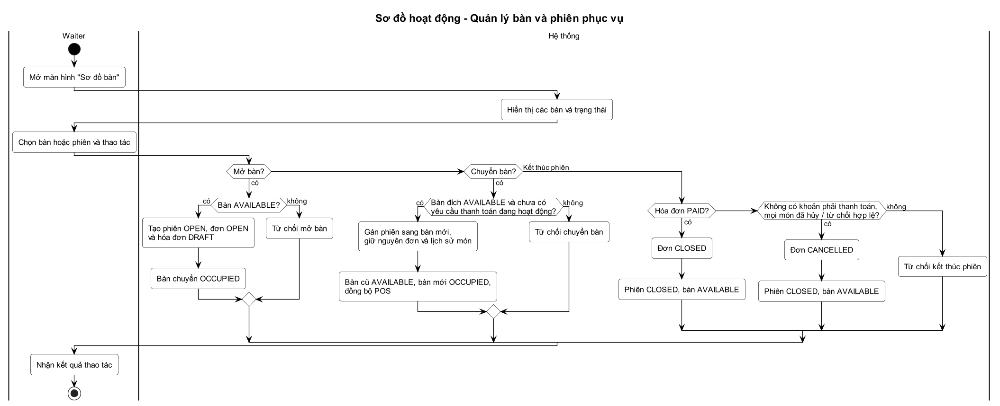

- Mở bàn: chỉ khi bàn `AVAILABLE` (ORD-01); tạo phiên `OPEN`, đơn `OPEN`, hóa đơn `DRAFT`, bàn `OCCUPIED`.
- Chuyển bàn: chỉ sang bàn `AVAILABLE` và khi chưa có yêu cầu thanh toán đang hoạt động; giữ nguyên đơn, lịch sử món và đồng bộ POS (ORD-15).
- Kết thúc phiên: hóa đơn `PAID` thì đơn `CLOSED`; không có khoản phải thanh toán và mọi món đã hủy / từ chối hợp lệ thì đơn `CANCELLED`; phiên `CLOSED`, bàn `AVAILABLE` (ORD-17).

### 4.3 Gọi món và gửi đơn

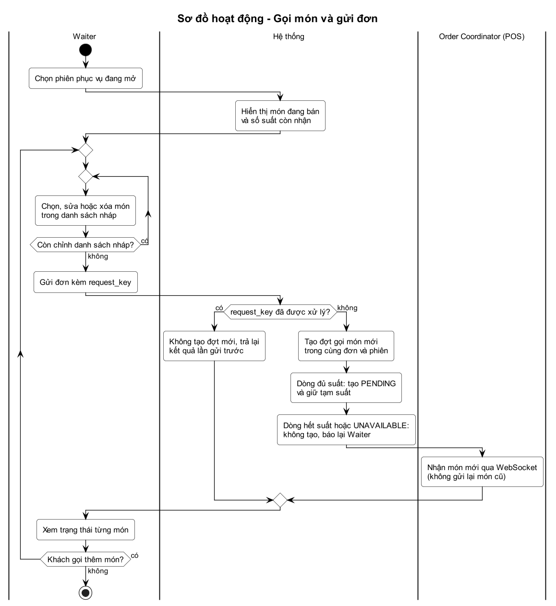

- Waiter chọn, sửa, xóa món trong danh sách nháp trước khi gửi (ORD-16).
- Mỗi lần gửi mang `request_key`; nếu đã xử lý thì trả lại kết quả cũ, không tạo đợt mới (ORD-13).
- Dòng đủ suất được tạo `PENDING` và giữ tạm suất; dòng hết suất hoặc `UNAVAILABLE` không được tạo và báo lại Waiter.
- POS nhận món mới qua WebSocket, không nhận lại món cũ; gọi thêm món là một đợt mới (ORD-02).

### 4.4 Tiếp nhận và điều phối tại POS

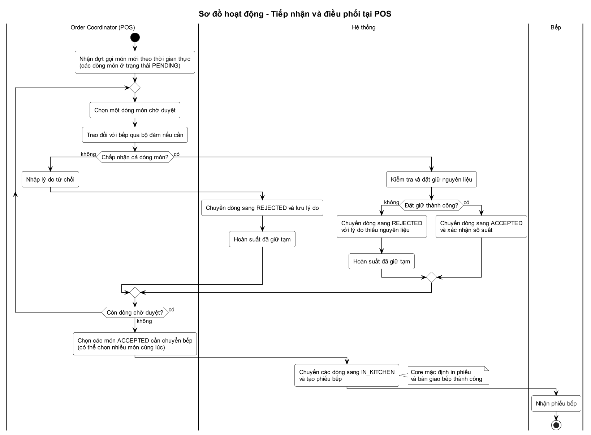

- POS duyệt từng dòng: từ chối thì nhập lý do, chuyển `REJECTED` và hoàn suất giữ tạm.
- Chấp nhận thì kho đặt giữ nguyên liệu; thành công chuyển `ACCEPTED`, thất bại chuyển `REJECTED` với lý do thiếu nguyên liệu và hoàn suất.
- Chuyển nhiều món `ACCEPTED` xuống bếp cùng lúc: các dòng sang `IN_KITCHEN` và tạo phiếu bếp.

### 4.5 Theo dõi chế biến và trả món

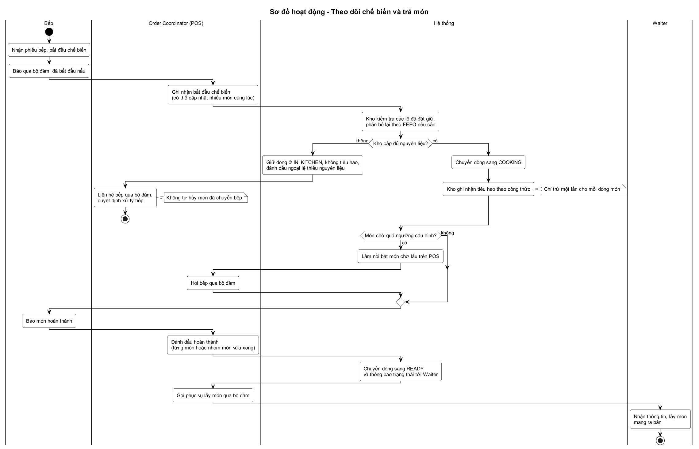

- Bếp báo qua bộ đàm; POS ghi nhận bắt đầu chế biến. Kho kiểm tra các lô đã đặt giữ, phân bổ lại theo FEFO nếu cần; đủ nguyên liệu thì dòng sang `COOKING` và kho ghi nhận tiêu hao một lần (ORD-06, ORD-07).
- Kho không cấp đủ: dòng món giữ `IN_KITCHEN`, được đánh dấu ngoại lệ thiếu nguyên liệu; POS liên hệ bếp qua bộ đàm quyết định, không tự hủy món (ORD-18).
- Món chờ quá ngưỡng được làm nổi bật trên POS để hỏi bếp.
- Bếp báo hoàn thành, POS đánh dấu `READY` rồi gọi phục vụ lấy món qua bộ đàm.

### 4.6 Thanh toán QR tự động

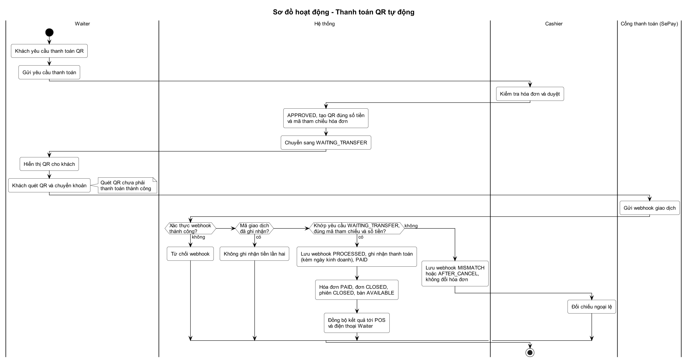

- Cashier duyệt; backend tạo QR đúng số tiền và mã tham chiếu hóa đơn, yêu cầu sang `WAITING_TRANSFER`.
- Webhook không xác thực được thì bị từ chối; mã giao dịch đã ghi nhận thì không ghi nhận tiền lần hai (PAY-05).
- Khớp yêu cầu `WAITING_TRANSFER`, đúng mã tham chiếu và số tiền: lưu webhook `PROCESSED`, ghi nhận thanh toán, `PAID`, đóng hóa đơn, kết thúc phiên và đồng bộ tới POS, điện thoại Waiter.
- Sai số tiền, sai mã hoặc yêu cầu đã `CANCELLED`: lưu webhook `MISMATCH` / `AFTER_CANCEL`, không đổi hóa đơn; Cashier đối chiếu ngoại lệ, không xác nhận thủ công (PAY-08).

### 4.7 Thanh toán tiền mặt tại bàn

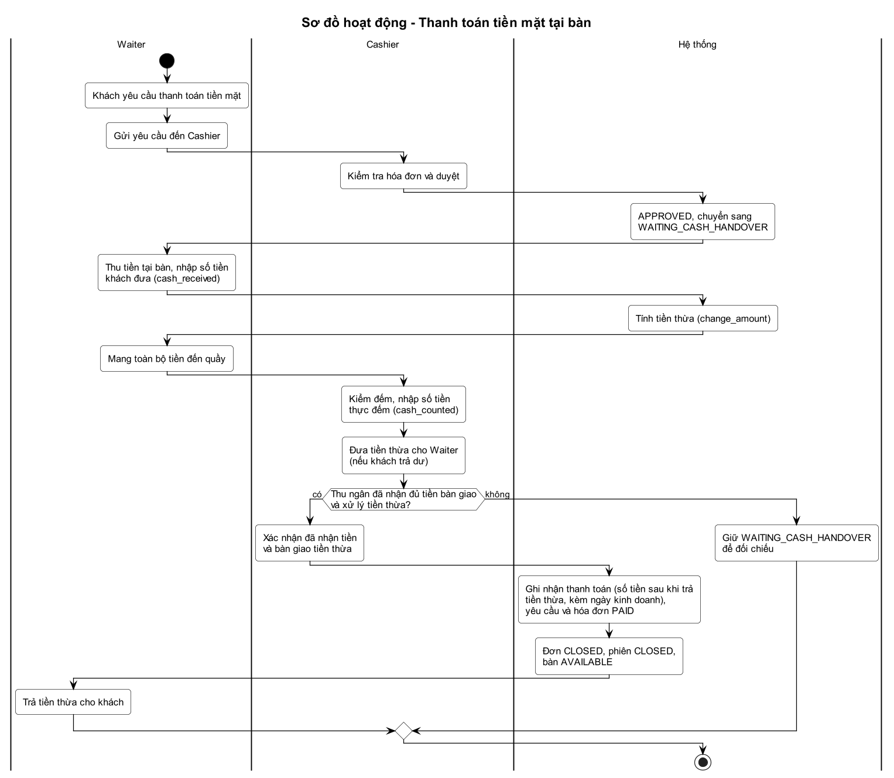

- Theo đúng 11 bước của luồng chuẩn ở mục 2.4.
- Điều kiện "Thu ngân đã nhận đủ tiền bàn giao và xử lý tiền thừa?": có thì Cashier xác nhận, hệ thống mới `PAID`, đóng hóa đơn, ghi nhận doanh thu, đóng phiên; không thì giữ `WAITING_CASH_HANDOVER` để đối chiếu (PAY-03).

### 4.8 Hủy hoặc sửa món theo trạng thái

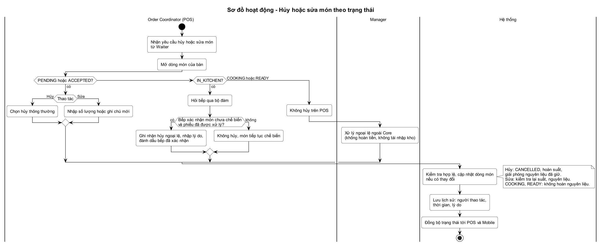

- `PENDING` hoặc `ACCEPTED`: hủy thông thường hoặc sửa số lượng, ghi chú.
- `IN_KITCHEN`: hỏi bếp qua bộ đàm; chỉ ghi nhận hủy ngoại lệ khi bếp xác nhận món chưa chế biến và phiếu đã được xử lý (`kitchen_confirmed`).
- `COOKING` hoặc `READY`: không hủy trên POS, không hoàn nguyên liệu; Manager xử lý ngoại lệ ngoài Core.
- Hệ thống kiểm tra hợp lệ, cập nhật dòng món, lưu lịch sử (người thao tác, thời gian, lý do) và đồng bộ.

### 4.9 Kiểm soát trước thanh toán

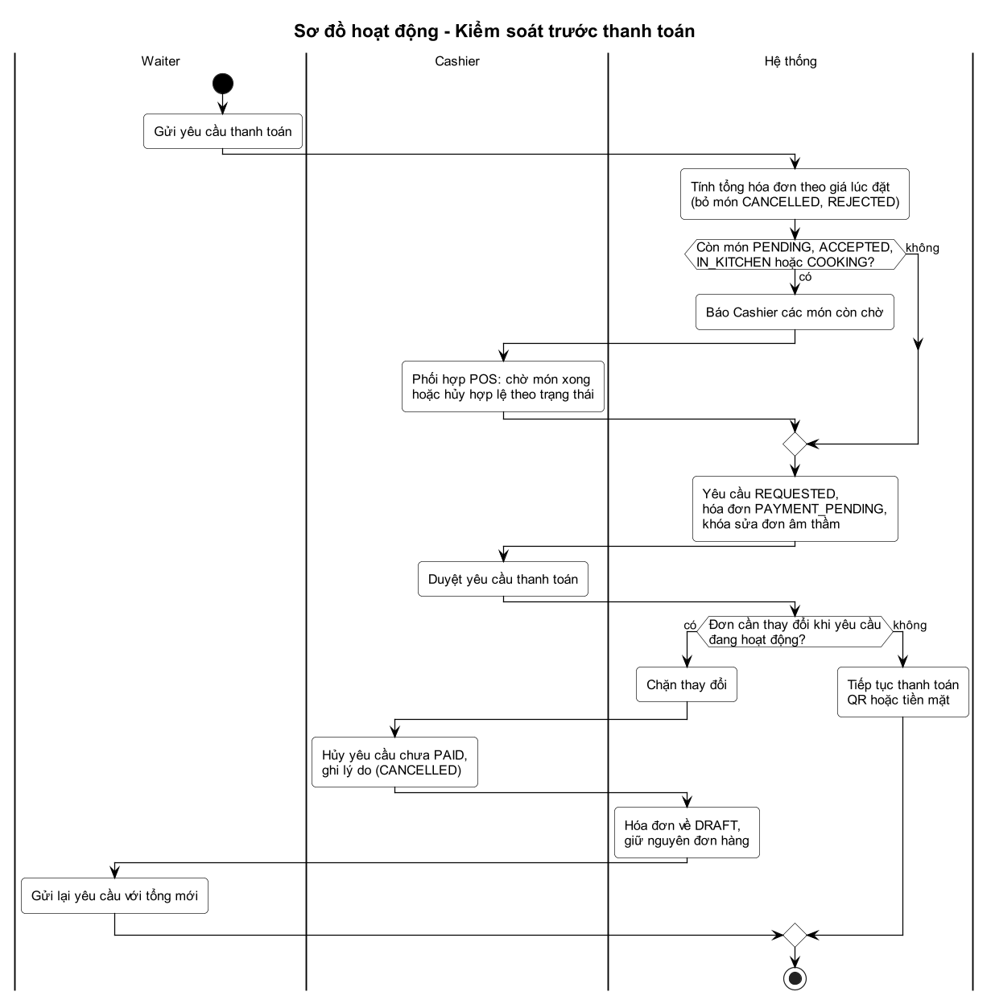

- Hệ thống tính tổng theo giá lúc đặt, bỏ món `CANCELLED` và `REJECTED`.
- Còn món chưa xong thì báo Cashier phối hợp POS giải quyết trước khi hoàn tất hóa đơn (ORD-10).
- Khi yêu cầu đang hoạt động, hóa đơn `PAYMENT_PENDING` và mọi thay đổi đơn bị chặn; Cashier hủy yêu cầu chưa `PAID` có ghi lý do, hóa đơn về `DRAFT`, Waiter gửi lại với tổng mới (ORD-09, PAY-06).

## 5. ERD

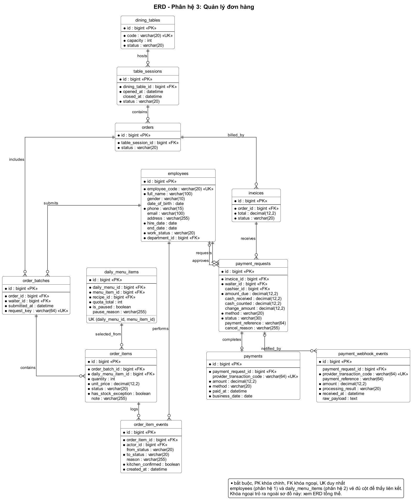

Phân hệ sở hữu 10 bảng. `employees` (phân hệ 1) và `daily_menu_items` (phân hệ 2) được vẽ đủ cột để thấy rõ liên kết; đó là cùng một bảng trong cơ sở dữ liệu chung, định nghĩa gốc nằm ở phân hệ sở hữu. Khóa ngoại trỏ ra ngoài sơ đồ này (ví dụ `daily_menu_items.daily_menu_id`) xem ở [ERD tổng thể](../erd-tong-the.png). Đây là ERD mức nghiệp vụ, chưa phải toàn bộ schema triển khai.

**Quy ước toàn hệ thống:** tên bảng và cột `snake_case`, tên bảng số nhiều; khóa chính `id BIGINT`; khóa ngoại `<thực thể>_id BIGINT` (ví dụ `order_batch_id`), không dùng lẫn `INT` cho khóa liên kết; chỉ khóa ngoại mới có hậu tố `_id` (mã giao dịch SePay là `provider_transaction_code`). Cột chỉ người thực hiện mang tên vai trò (`waiter_id`, `cashier_id`, `actor_id`) và tham chiếu `employees.id` của phân hệ 1. Thời điểm dùng `TIMESTAMPTZ`; tiền dùng `DECIMAL(12,2)`, không dùng `FLOAT` hay `DOUBLE`.

**Quan hệ giữa các bảng:**

| Quan hệ | Khóa ngoại | Nhãn |
| --- | --- | --- |
| dining_tables 1 – N table_sessions | `table_sessions.dining_table_id` | hosts |
| table_sessions 1 – N orders | `orders.table_session_id` | contains |
| orders 1 – N order_batches | `order_batches.order_id` | includes |
| order_batches 1 – N order_items | `order_items.order_batch_id` | contains |
| daily_menu_items 1 – N order_items | `order_items.daily_menu_item_id` | selected_from |
| order_items 1 – N order_item_events | `order_item_events.order_item_id` | logs |
| orders 1 – N invoices | `invoices.order_id` | billed_by |
| invoices 1 – N payment_requests | `payment_requests.invoice_id` | receives |
| payment_requests 1 – 0..1 payments | `payments.payment_request_id` | completes |
| payment_requests 0..1 – N payment_webhook_events | `payment_webhook_events.payment_request_id` | notified_by |
| employees 1 – N order_batches | `order_batches.waiter_id` | submits |
| employees 1 – N payment_requests | `payment_requests.waiter_id` | requests |
| employees 0..1 – N payment_requests | `payment_requests.cashier_id` | approves |
| employees 1 – N order_item_events | `order_item_events.actor_id` | performs |

`order_items` chỉ liên kết với đơn qua `order_batch_id`, không có thêm cột `order_id`.

**Ràng buộc dữ liệu:**

- `dining_tables.code` duy nhất; mỗi bàn tối đa một phiên `OPEN` (ORD-01).
- `order_batches.request_key` duy nhất (ORD-13).
- Mỗi hóa đơn tối đa một yêu cầu thanh toán đang hoạt động; mỗi yêu cầu tối đa một khoản thanh toán.
- `payments.provider_transaction_code` và `payment_webhook_events.provider_transaction_code` duy nhất: webhook gửi lại không ghi nhận tiền hai lần (PAY-05).
- INDEX (`payments.business_date`, `payments.method`) phục vụ tổng hợp thu theo ngày kinh doanh và phương thức (phân hệ 5).

### Từ điển dữ liệu

Kiểu dữ liệu và độ dài ở mức tổng quát, chọn lại khi triển khai.

**dining_tables** – Bàn

| Cột | Kiểu | Ràng buộc | Ý nghĩa |
| --- | --- | --- | --- |
| id | bigint | PK | Mã bàn |
| code | varchar(20) | UK, bắt buộc | Mã hiển thị, ví dụ B05 |
| capacity | int | bắt buộc | Sức chứa |
| status | varchar(20) | bắt buộc | AVAILABLE, OCCUPIED |

**table_sessions** – Phiên phục vụ

| Cột | Kiểu | Ràng buộc | Ý nghĩa |
| --- | --- | --- | --- |
| id | bigint | PK | Mã phiên |
| dining_table_id | bigint | FK → dining_tables, bắt buộc | Bàn đang phục vụ; mỗi bàn chỉ một phiên mở (ORD-01) |
| opened_at | timestamptz | bắt buộc | Thời điểm mở phiên |
| closed_at | timestamptz | | Thời điểm kết thúc phiên |
| status | varchar(20) | bắt buộc | OPEN, CLOSED |

**orders** – Đơn tổng của phiên

| Cột | Kiểu | Ràng buộc | Ý nghĩa |
| --- | --- | --- | --- |
| id | bigint | PK | Mã đơn |
| table_session_id | bigint | FK → table_sessions, bắt buộc | Phiên phục vụ |
| status | varchar(20) | bắt buộc | OPEN, CLOSED, CANCELLED |

**order_batches** – Đợt gọi món

| Cột | Kiểu | Ràng buộc | Ý nghĩa |
| --- | --- | --- | --- |
| id | bigint | PK | Mã đợt gọi món |
| order_id | bigint | FK → orders, bắt buộc | Đơn tổng |
| waiter_id | bigint | FK → employees, bắt buộc | Nhân viên gửi đợt gọi món |
| submitted_at | timestamptz | bắt buộc | Thời điểm gửi |
| request_key | varchar(64) | UK, bắt buộc | Mã yêu cầu chống gửi trùng (ORD-13) |

**order_items** – Dòng món

| Cột | Kiểu | Ràng buộc | Ý nghĩa |
| --- | --- | --- | --- |
| id | bigint | PK | Mã dòng món |
| order_batch_id | bigint | FK → order_batches, bắt buộc | Đợt gọi món |
| daily_menu_item_id | bigint | FK → daily_menu_items, bắt buộc | Món trong thực đơn ngày (phân hệ 2) |
| quantity | int | bắt buộc | Số lượng; duyệt hoặc hủy theo cả dòng |
| unit_price | decimal(12,2) | bắt buộc | Giá tại lúc đặt (ORD-08) |
| status | varchar(20) | bắt buộc | PENDING, ACCEPTED, IN_KITCHEN, COOKING, READY, CANCELLED, REJECTED |
| has_stock_exception | boolean | bắt buộc, mặc định false | `true` khi kho không cấp đủ nguyên liệu cho dòng món `ACCEPTED` hoặc `IN_KITCHEN` (lô đã giữ hỏng, hết hạn hoặc không còn khả dụng và không phân bổ lại đủ); POS xử lý (ORD-18). Do kho ghi cùng transaction với đặt giữ, về `false` khi dòng món sang `COOKING`, được đặt giữ lại đủ hoặc bị hủy |
| note | varchar(255) | | Ghi chú món |

**order_item_events** – Lịch sử trạng thái dòng món

| Cột | Kiểu | Ràng buộc | Ý nghĩa |
| --- | --- | --- | --- |
| id | bigint | PK | Mã sự kiện |
| order_item_id | bigint | FK → order_items, bắt buộc | Dòng món |
| actor_id | bigint | FK → employees, bắt buộc | Người thao tác |
| from_status | varchar(20) | | Trạng thái trước (trống khi tạo mới) |
| to_status | varchar(20) | bắt buộc | Trạng thái sau |
| reason | varchar(255) | | Lý do từ chối, hủy và ngoại lệ; bắt buộc khi `REJECTED` và khi hủy ngoại lệ |
| kitchen_confirmed | boolean | bắt buộc, mặc định false | Chỉ dùng cho hủy ngoại lệ `IN_KITCHEN`: `true` là POS đã liên hệ bếp, được xác nhận món chưa chế biến và phiếu đã được xử lý; do POS ghi nhận, không phải xác thực điện tử của đầu bếp. Người và thời điểm xác nhận là `actor_id`, `created_at` của sự kiện |
| created_at | timestamptz | bắt buộc | Thời điểm thay đổi |

**invoices** – Hóa đơn

| Cột | Kiểu | Ràng buộc | Ý nghĩa |
| --- | --- | --- | --- |
| id | bigint | PK | Mã hóa đơn |
| order_id | bigint | FK → orders, bắt buộc | Đơn tổng |
| total | decimal(12,2) | bắt buộc | Tổng tiền |
| status | varchar(20) | bắt buộc | DRAFT, PAYMENT_PENDING, PAID |

**payment_requests** – Yêu cầu thanh toán

| Cột | Kiểu | Ràng buộc | Ý nghĩa |
| --- | --- | --- | --- |
| id | bigint | PK | Mã yêu cầu |
| invoice_id | bigint | FK → invoices, bắt buộc | Hóa đơn |
| waiter_id | bigint | FK → employees, bắt buộc | Người gửi yêu cầu |
| cashier_id | bigint | FK → employees | Thu ngân duyệt (trống cho đến khi duyệt) |
| amount_due | decimal(12,2) | bắt buộc | Số tiền phải thu |
| cash_received | decimal(12,2) | | Số tiền phục vụ khai báo đã nhận từ khách (tiền mặt) |
| cash_counted | decimal(12,2) | | Số tiền thu ngân thực tế đếm được (tiền mặt) |
| change_amount | decimal(12,2) | | Số tiền phải trả lại khách (tiền mặt) |
| method | varchar(20) | bắt buộc | QR hoặc CASH |
| status | varchar(30) | bắt buộc | REQUESTED, APPROVED, WAITING_TRANSFER, WAITING_CASH_HANDOVER, PAID, CANCELLED |
| payment_reference | varchar(64) | | Mã tham chiếu hóa đơn gắn trong QR để khớp webhook |
| cancel_reason | varchar(255) | | Lý do hủy; bắt buộc khi hủy yêu cầu đang hoạt động (PAY-06) |

**payments** – Khoản thanh toán thành công

| Cột | Kiểu | Ràng buộc | Ý nghĩa |
| --- | --- | --- | --- |
| id | bigint | PK | Mã thanh toán |
| payment_request_id | bigint | FK → payment_requests, bắt buộc | Yêu cầu thanh toán |
| provider_transaction_code | varchar(64) | UK | Mã giao dịch của SePay (trống với tiền mặt, PAY-05) |
| amount | decimal(12,2) | bắt buộc | Số tiền nhà hàng thực giữ lại, đã trừ tiền thừa (bằng `amount_due`, không phải số khách đưa) |
| method | varchar(20) | bắt buộc | QR hoặc CASH |
| paid_at | timestamptz | bắt buộc | Thời điểm thanh toán thành công |
| business_date | date | bắt buộc | Ngày kinh doanh của khoản thanh toán (PAY-09); dùng để tổng hợp thu theo ngày kinh doanh, không đổi sau khi ghi nhận |

**payment_webhook_events** – Webhook giao dịch QR đã nhận

| Cột | Kiểu | Ràng buộc | Ý nghĩa |
| --- | --- | --- | --- |
| id | bigint | PK | Mã bản ghi webhook |
| payment_request_id | bigint | FK → payment_requests | Yêu cầu khớp theo mã tham chiếu (trống nếu không khớp) |
| provider_transaction_code | varchar(64) | UK, bắt buộc | Mã giao dịch của SePay; webhook gửi lại cùng mã không được xử lý lần hai |
| payment_reference | varchar(64) | | Mã tham chiếu trong nội dung chuyển khoản |
| amount | decimal(12,2) | bắt buộc | Số tiền chuyển khoản |
| processing_result | varchar(20) | bắt buộc | PROCESSED (đã ghi nhận thanh toán), MISMATCH (sai số tiền, sai mã hoặc yêu cầu không chờ chuyển khoản), AFTER_CANCEL (yêu cầu đã hủy) |
| received_at | timestamptz | bắt buộc | Thời điểm nhận webhook |
| raw_payload | text | | Nội dung webhook gốc để đối chiếu |

## 6. Kịch bản demo

Demo trọn vòng đời đơn hàng, không cần POS vật lý. Thiết bị: 1–2 laptop, 1–2 điện thoại; giao tiếp bếp bằng lời mô phỏng bộ đàm.

1. Nhân viên phục vụ mở bàn B05 và gọi 2 phở bò, 1 cơm rang trên điện thoại.
2. POS nhận đơn qua WebSocket, duyệt riêng từng món.
3. Khách báo nhầm cơm rang, POS hủy trước khi chuyển bếp.
4. POS chuyển phở bò cho bếp, ghi nhận bắt đầu chế biến và hệ thống trừ nguyên liệu.
5. Khách gọi thêm nước cam; POS nhận đợt gọi mới.
6. Nước cam hoàn thành trước phở bò; POS cập nhật riêng và gọi phục vụ lấy món.
7. Khách yêu cầu thanh toán; phục vụ gửi yêu cầu đến thu ngân.
8. Demo QR: thu ngân duyệt, QR xuất hiện, webhook thử nghiệm xác nhận và hệ thống tự đóng hóa đơn.
9. Demo tiền mặt ở bàn khác: khách đưa tiền thừa, phục vụ bàn giao tại quầy, thu ngân xác nhận rồi hệ thống mới đóng hóa đơn.
10. Kiểm tra dữ liệu doanh thu và tồn kho sau các giao dịch.

## 7. Giả định còn lại

1. Core không chia hóa đơn nên mỗi phiên có một đơn tổng và một hóa đơn, dù quan hệ được vẽ 1 – N theo bản gốc. Đơn và hóa đơn `DRAFT` được tạo ngay khi mở phiên.
2. Core chỉ tích hợp một cổng thanh toán (SePay) nên `provider_transaction_code` duy nhất trên toàn bảng; khi thêm cổng khác, ràng buộc mở rộng thành (cổng, mã giao dịch).
3. Webhook `MISMATCH` hoặc `AFTER_CANCEL` chỉ được lưu để đối chiếu; hoàn tiền cho khách nằm ngoài Core.

## 8. Render lại sơ đồ

Cần Java và Graphviz. `plantuml.jar` có sẵn trong extension VS Code `jebbs.plantuml` (thư mục `%USERPROFILE%\.vscode\extensions\jebbs.plantuml-<phiên bản>\`). Chạy từ thư mục gốc dự án:

```powershell
java "-DPLANTUML_LIMIT_SIZE=8192" -jar "<đường dẫn plantuml.jar>" -charset UTF-8 -failfast2 -tpng docs\03-quan-ly-don-hang\*.puml
```

Hoặc mở file `.puml` trong VS Code và nhấn Alt+D để xem trước. Style đen trắng dùng chung nằm ở `docs/_style.puml`.
