# Phân hệ 4 – Quản lý kho & nguyên liệu (RMS Core)

Tài liệu phân tích phân hệ 4 của hệ thống quản lý nhà hàng (RMS): sơ đồ use case, sơ đồ hoạt động và ERD. Nguồn sơ đồ là các file `.puml` (PlantUML) cùng thư mục; ảnh `.png` được render từ các file đó. Phân hệ 4 là nguồn chuẩn của dữ liệu kho; công thức định lượng thuộc phân hệ 2, dòng món thuộc phân hệ 3 và chỉ được tham chiếu, không sao chép.

Công nghệ dự kiến: Spring Boot REST API, WebSocket, Web responsive. Demo bằng 1 laptop và 1–2 điện thoại, không cần máy in, máy quét hay thiết bị kho chuyên dụng.

## 1. Mục tiêu và phạm vi

**Mục tiêu:**

1. Biết lượng nguyên liệu hiện có và khả dụng.
2. Nhập nguyên liệu theo lô.
3. Tự động đặt giữ nguyên liệu khi POS chấp nhận món.
4. Ghi nhận tiêu hao khi bếp bắt đầu chế biến.
5. Kiểm kê và điều chỉnh chênh lệch.
6. Cảnh báo thiếu nguyên liệu, tồn thấp, hết hạn và đồng bộ với thực đơn.

**Actor:**

| Actor | Vai trò trong phân hệ |
| --- | --- |
| Manager – Quản lý | Chịu trách nhiệm quản lý kho: danh mục nguyên liệu, nhập kho, kiểm kê, điều chỉnh, đánh dấu lô không đạt; xem tồn, lịch sử và cảnh báo |
| Order Coordinator – POS điều phối | Thao tác ở phân hệ 3 (duyệt món, ghi nhận bắt đầu chế biến, hủy, sửa món) làm kho tự động đặt giữ, tiêu hao, giải phóng; xem cảnh báo thiếu nguyên liệu |

Không tạo actor Nhân viên kho riêng. Bếp trưởng và đầu bếp không thao tác phần mềm: bếp hỗ trợ kiểm tra thực tế và báo thông tin qua bộ đàm. Waiter không gọi chức năng kho, chỉ thấy món khả dụng qua phân hệ 2. Xử lý tự động của hệ thống là xử lý nội bộ, không vẽ thành actor. Không có hệ thống bên ngoài tương tác trực tiếp với kho nên không có actor ngoài.

**Sáu nhóm chức năng:**

| STT | Nhóm chức năng | Nghiệp vụ triển khai |
| --- | --- | --- |
| 4.1 | Danh mục nguyên liệu | Thêm, sửa, tìm kiếm; đơn vị cơ sở; ngưỡng tồn tối thiểu; có theo dõi hạn dùng hay không; bật / tắt sử dụng |
| 4.2 | Nhập kho | Phiếu nhập nhiều dòng theo lô, quy đổi đơn vị nhập, hạn sử dụng; `DRAFT` → `CONFIRMED` |
| 4.3 | Theo dõi tồn kho | Tồn sổ sách, đặt giữ, tồn sử dụng được, khả dụng; theo nguyên liệu và theo lô; lịch sử biến động |
| 4.4 | Đặt giữ và tiêu hao | Tự động đặt giữ khi POS duyệt món (FEFO), tiêu hao khi bắt đầu chế biến, giải phóng khi hủy hoặc sửa món |
| 4.5 | Kiểm kê và điều chỉnh | Kiểm kê theo lô, ghi chênh lệch có lý do, điều chỉnh tồn kèm lịch sử; đánh dấu lô không đạt |
| 4.6 | Cảnh báo nguyên liệu | Tồn thấp, không đủ một suất, gần hết hạn, hết hạn, chênh lệch kiểm kê, lô không dùng được; đồng bộ thực đơn |

Giới hạn Core: xem mục 9.

## 2. Mô hình tồn kho và quy tắc nghiệp vụ

### 2.1 Khái niệm và công thức

Mọi số lượng lưu theo đơn vị cơ sở của nguyên liệu. Tồn được quản lý theo lô.

| Khái niệm | Ý nghĩa |
| --- | --- |
| `quantity_on_hand` | Tồn thực tế theo sổ sách của một lô |
| `reserved_quantity` | Lượng đã đặt giữ (đặt giữ `ACTIVE`) của một lô |
| Lô sử dụng được | `is_usable = true` và chưa hết hạn (`expiry_date` trống hoặc không nhỏ hơn ngày hiện tại); nguyên liệu không theo dõi hạn dùng không bao giờ hết hạn |
| `usable_on_hand` | Tổng `quantity_on_hand` của các lô sử dụng được, theo nguyên liệu |
| `active_reserved_quantity` | Tổng `reserved_quantity` các lô của nguyên liệu |

```text
available_quantity = usable_on_hand - active_reserved_quantity
```

- Lô hết hạn hoặc bị đánh dấu không đạt chất lượng không được tính là khả dụng.
- `available_quantity` nhỏ hơn 0 nghĩa là lượng đã đặt giữ không còn được đảm bảo (thiếu so với đặt giữ, INV-15). Khi hiển thị đặt món, lấy `max(0, available_quantity)`.
- Phân hệ 2 dùng `max(0, available_quantity)` làm `A_i` trong công thức `Q_kho` (xem README phân hệ 2).

Ví dụ nhiều món dùng chung nguyên liệu: kho còn 500 g thịt bò; Phở bò 100 g/suất, Bò lúc lắc 200 g/suất. POS nhận 2 phở bò (giữ 200 g) và 1 bò lúc lắc (giữ 200 g) thì còn khả dụng 100 g; POS không nhận thêm một suất bò lúc lắc.

### 2.2 Trạng thái

**Phiếu nhập kho (`stock_receipts.status`) và phiếu kiểm kê (`stock_counts.status`):**

| Trạng thái | Ý nghĩa |
| --- | --- |
| `DRAFT` | Đang lập, chưa ảnh hưởng tồn kho; còn sửa được |
| `CONFIRMED` | Đã xác nhận và ghi sổ; không xác nhận lần hai, không sửa trực tiếp |

**Đặt giữ (`stock_reservations.status`):**

| Trạng thái | Ý nghĩa |
| --- | --- |
| `ACTIVE` | Đang giữ nguyên liệu cho dòng món `ACCEPTED` hoặc `IN_KITCHEN` |
| `CONSUMED` | Đã chuyển thành tiêu hao khi dòng món sang `COOKING` |
| `RELEASED` | Đã giải phóng, không tiêu hao; kèm lý do `release_reason` |

| Từ | Sang | Khi nào |
| --- | --- | --- |
| (tạo) | `ACTIVE` | POS duyệt dòng món, đủ mọi nguyên liệu (UC10); hoặc đặt giữ lại từ lô khác theo FEFO (UC11, UC12, xử lý lô không dùng được) |
| `ACTIVE` | `CONSUMED` | Dòng món sang `COOKING` (UC11) |
| `ACTIVE` | `RELEASED` | Hủy thông thường `PENDING` / `ACCEPTED`, hủy ngoại lệ `IN_KITCHEN` đã được bếp xác nhận (`ITEM_CANCELLED`); sửa số lượng (`ITEM_EDITED`); lô bị đánh dấu không đạt chất lượng hoặc hết hạn (`LOT_UNAVAILABLE`) |

`CONSUMED` và `RELEASED` là trạng thái cuối; đặt giữ `CONSUMED` không bao giờ bị hoàn lại. Dòng món `PENDING` chưa có đặt giữ. Lý do giải phóng (`release_reason`): `ITEM_CANCELLED`, `ITEM_EDITED`, `LOT_UNAVAILABLE`.

**Biến động kho (`stock_movements.movement_type`):**

| Loại | Dấu của `quantity_delta` | Nguồn nghiệp vụ |
| --- | --- | --- |
| `RECEIPT` | dương | Dòng phiếu nhập tạo ra lô (`inventory_batches.stock_receipt_item_id`) |
| `CONSUMPTION` | âm | Dòng món bắt đầu chế biến (`order_item_id`) |
| `ADJUSTMENT` | dương hoặc âm | Dòng kiểm kê có chênh lệch (`stock_count_item_id`) |

Tình trạng lô (còn dùng được, hết hạn, không đạt chất lượng) được suy ra từ `expiry_date` và `is_usable`, không lưu thành trạng thái riêng. Trạng thái dòng món (`order_items.status`) theo phân hệ 3.

### 2.3 Liên kết với phân hệ 1, 2, 3 và 5

| Sự kiện | Quản lý thực đơn (phân hệ 2) | Quản lý kho (phân hệ 4) |
| --- | --- | --- |
| Manager lập, công bố thực đơn | Chỉ tính nhu cầu dự kiến | Không đặt giữ nguyên liệu cho kế hoạch ngày |
| Waiter gửi món (`PENDING`) | Giữ tạm suất | Chưa đặt giữ |
| POS duyệt, đủ nguyên liệu (`ACCEPTED`) | Xác nhận suất | Đặt giữ theo công thức, FEFO (UC10) |
| POS duyệt, thiếu một nguyên liệu | `REJECTED`, hoàn suất | Không đặt giữ phần nào |
| Hủy thông thường (`PENDING`, `ACCEPTED`) | Hoàn suất | Giải phóng đặt giữ (UC12) |
| Hủy ngoại lệ `IN_KITCHEN` đã được bếp xác nhận | Hoàn suất | Giải phóng đặt giữ (UC12) |
| Sửa số lượng (`PENDING`, `ACCEPTED`) | Kiểm tra lại suất | Giải phóng và đặt giữ lại; thiếu thì giữ nguyên số cũ (UC12) |
| Bắt đầu chế biến (`COOKING`), kho cấp đủ | Không trừ thêm suất | Chuyển đặt giữ thành tiêu hao, giảm tồn lô đúng một lần (UC11); nếu lô đã giữ không dùng được thì phân bổ lại theo FEFO trước |
| Bắt đầu chế biến, kho không cấp đủ | Không đổi | Không tiêu hao, không tồn âm; dòng món giữ `IN_KITCHEN`, đánh dấu `has_stock_exception`; POS hỏi bếp, không tự hủy (INV-20, ORD-18) |
| Hoàn thành (`READY`) | Không đổi | Không tiêu hao thêm |
| Hủy món hoặc đổi thanh toán sau `COOKING` | Không tự hoàn | Không hoàn nguyên liệu tự động |
| Lô bị đánh dấu không đạt chất lượng hoặc hết hạn còn đặt giữ | Tính lại số suất, đồng bộ POS / Mobile | Giải phóng đặt giữ trên lô, đặt giữ lại từ lô khác theo FEFO, thiếu thì đánh dấu ngoại lệ (INV-19) |
| Kho thay đổi (nhập, kiểm kê, đánh dấu lô, lô hết hạn) | Tính lại số suất, mã lý do `OUT_OF_STOCK`, đồng bộ POS / Mobile | Cảnh báo (UC16) |

- **Phân hệ 1:** `employees` ghi người xác nhận phiếu nhập, người xác nhận kiểm kê (điều chỉnh tồn) và người đánh dấu lô không đạt. RBAC kiểm tra ở backend: chỉ tài khoản có quyền Manager gọi chức năng quản lý kho (UC01 đến UC09, UC13 đến UC15).
- **Phân hệ 2:** công thức nằm ở `recipe_ingredients`; kho đọc qua `daily_menu_items.recipe_id`, không có bản sao công thức trong kho.
- **Phân hệ 3:** UC10 đến UC12 chỉ do dịch vụ đơn hàng gọi nội bộ khi POS thao tác, không mở trực tiếp cho thiết bị client. Kích hoạt từ: UC07 (duyệt món) cho UC10; UC12 (bắt đầu chế biến) cho UC11; UC10, UC15, UC16 (hủy, sửa món) cho UC12 của phân hệ 3. Kho ghi cờ `order_items.has_stock_exception` cùng transaction với đặt giữ để POS thấy ngoại lệ thiếu nguyên liệu.
- **Phân hệ 5:** có thể ghi khoản chi liên kết `stock_receipts`, mỗi phiếu tối đa một khoản chi còn hiệu lực (FIN-04); xác nhận phiếu nhập không tự sinh khoản chi đã thanh toán (giá trị hàng nhập khác tiền thực chi). Phân hệ 5 chỉ đọc `stock_receipts`, `stock_receipt_items`, `stock_movements`, `ingredients`, `inventory_batches` để báo cáo, không sửa dữ liệu kho.

### 2.4 Quy tắc nghiệp vụ

| Mã | Quy tắc |
| --- | --- |
| INV-01 | Mỗi nguyên liệu có một đơn vị cơ sở (g, ml, cái…) dùng chung cho tồn, công thức, đặt giữ và tiêu hao; số lượng lưu theo đơn vị cơ sở. Đơn vị nhập kho được quy đổi về đơn vị cơ sở, ví dụ 5 kg thịt bò thành 5.000 g |
| INV-02 | Không xóa vật lý nguyên liệu đã có lịch sử nhập kho hoặc đang dùng trong công thức, chỉ tắt sử dụng. Không đổi đơn vị cơ sở khi đã có lô, phiếu nhập hoặc công thức. Nguyên liệu đã tắt không chọn được cho phiếu nhập và công thức mới; tồn hiện có và đặt giữ đang hoạt động không bị ảnh hưởng. Đổi cờ theo dõi hạn dùng chỉ áp dụng cho phiếu nhập từ sau đó; lô đã có hạn dùng vẫn bị kiểm tra hết hạn |
| INV-03 | Phiếu nhập có nhiều dòng; mỗi dòng gồm nguyên liệu, số lượng và đơn vị nhập, hệ số quy đổi, đơn giá, số lô và hạn sử dụng. Một phiếu có thể có nhiều dòng cùng nguyên liệu khi khác số lô hoặc hạn dùng, mỗi dòng thành một lô riêng khi xác nhận; không cho hai dòng cùng nguyên liệu, cùng số lô và cùng hạn dùng (UNIQUE `NULLS NOT DISTINCT`, số lô hoặc hạn trống cũng tính là trùng). Hệ thống kiểm tra: nguyên liệu đang sử dụng; số lượng lớn hơn 0; đơn vị nhập tương thích với đơn vị cơ sở của nguyên liệu (cùng nhóm đơn vị: khối lượng g – kg, thể tích ml – l, đếm như cái, quả, hộp; danh sách nhóm là cấu hình chung, không có bảng quy đổi riêng); hệ số quy đổi lớn hơn 0 (hệ thống gợi ý hệ số chuẩn, ví dụ kg → g là 1.000). Nguyên liệu được cấu hình theo dõi hạn dùng (`is_expiry_tracked`) bắt buộc có hạn sử dụng chưa qua; nguyên liệu không theo dõi hạn dùng (ví dụ gạo) không bắt buộc |
| INV-04 | Phiếu `DRAFT` không làm tăng tồn. Khi xác nhận, mỗi dòng tạo một lô, cộng tồn và ghi biến động `RECEIPT` trong cùng transaction. Phiếu `CONFIRMED` không được xác nhận lần hai và không được sửa trực tiếp; nhập sai thì điều chỉnh bằng kiểm kê có lý do. Số liệu quy đổi lịch sử của dòng đã xác nhận (`input_quantity`, `input_unit`, `conversion_factor`, `quantity`) được giữ nguyên, thay đổi cấu hình về sau không làm đổi số lượng đã ghi nhận |
| INV-05 | Không có đơn mua hàng, hợp đồng, công nợ nhà cung cấp hay duyệt nhiều cấp. Đơn giá chỉ lưu tham khảo, Core không hạch toán giá vốn |
| INV-06 | Một kho duy nhất. Tồn sử dụng được và khả dụng tính theo công thức mục 2.1; lô hết hạn hoặc không đạt chất lượng không được tính |
| INV-07 | `quantity_on_hand` không bao giờ âm. Tồn chỉ thay đổi bằng nhập, tiêu hao hoặc điều chỉnh kiểm kê, và mỗi thay đổi đều ghi `stock_movements`; không sửa tồn mà không có lịch sử |
| INV-08 | Chỉ khi POS duyệt dòng món, kho mới đặt giữ nguyên liệu. Gửi đơn và lập thực đơn không đặt giữ |
| INV-09 | Đặt giữ theo công thức của món trong thực đơn ngày: nhu cầu = định lượng × số lượng dòng món. Phải đủ mọi nguyên liệu, nếu thiếu dù một nguyên liệu thì không đặt giữ phần nào, dòng món `REJECTED` và hoàn suất giữ tạm |
| INV-10 | Phân bổ theo FEFO: lô có hạn sớm dùng trước, lô không có hạn dùng sau cùng; cùng hạn thì lô nhập trước. Không dùng lô hết hạn hoặc không đạt chất lượng. Một dòng món có thể lấy từ nhiều lô |
| INV-11 | Chỉ khi dòng món sang `COOKING` mới tiêu hao: đặt giữ `ACTIVE` thành `CONSUMED`, giảm `quantity_on_hand` và `reserved_quantity` của lô, ghi `CONSUMPTION`. Mỗi (dòng món, lô) tiêu hao một lần. `READY` không tiêu hao thêm |
| INV-12 | Hủy hợp lệ trước `COOKING` (kể cả hủy ngoại lệ `IN_KITCHEN` đã được bếp xác nhận) và sửa số lượng thì giải phóng đặt giữ (`ITEM_CANCELLED`, `ITEM_EDITED`), không tạo tiêu hao. Từ `COOKING` không tự hoàn nguyên liệu, kể cả khi hủy món hoặc thanh toán bị thay đổi (ORD-12) |
| INV-13 | Mọi thao tác ảnh hưởng suất, đặt giữ và tiêu hao nhất quán trong một transaction. Gọi lại API hoặc nhiều thiết bị cùng gửi không đặt giữ, giải phóng hay trừ kho hai lần (ORD-07) |
| INV-14 | Kiểm kê khi Manager cần, theo từng lô, không bắt buộc kiểm toàn bộ mỗi ngày. Chênh lệch khác 0 bắt buộc có lý do. Xác nhận kiểm kê ghi điều chỉnh `ADJUSTMENT` và cập nhật tồn lô |
| INV-15 | Nếu điều chỉnh kiểm kê giảm khiến tồn sử dụng được nhỏ hơn lượng đã đặt giữ (lô vẫn dùng được): cảnh báo, ngừng nhận thêm món bị ảnh hưởng (`Q_kho` bằng 0), thông báo POS xử lý các món đã chấp nhận. Không âm thầm hủy đơn và không tự xóa đặt giữ. Lô không đạt chất lượng hoặc hết hạn xử lý theo INV-19 |
| INV-16 | Cảnh báo gồm: khả dụng thấp hơn ngưỡng tối thiểu; không đủ nguyên liệu cho một suất; lô gần hết hạn; lô hết hạn; chênh lệch kiểm kê; lô không sử dụng được; thiếu so với đặt giữ; dòng món ngoại lệ thiếu nguyên liệu. Lô gần hết hạn khi còn không quá N ngày, N là cấu hình chung của hệ thống (mặc định 3 ngày), không viết cứng trong logic, chỉ áp dụng cho nguyên liệu theo dõi hạn dùng. Khi khả dụng thay đổi, phân hệ 2 tính lại số suất và đồng bộ POS / Mobile |
| INV-17 | Khi bếp phát hiện nguyên liệu hỏng: bếp báo POS qua bộ đàm, POS có thể tạm ngừng bán món (`PAUSED`, phân hệ 2), Manager kiểm tra rồi đánh dấu lô không đạt (xử lý đặt giữ theo INV-19) hoặc kiểm kê ghi giảm |
| INV-18 | Quản lý kho chỉ do Manager thực hiện; không có actor Nhân viên kho. Đặt giữ, tiêu hao, giải phóng chỉ do dịch vụ đơn hàng gọi nội bộ |
| INV-19 | Lô không còn sử dụng được (đánh dấu không đạt chất lượng hoặc hết hạn) không được tiếp tục bị đặt giữ `ACTIVE` chiếm dụng. Ngay khi đánh dấu, hoặc khi hệ thống phát hiện lô hết hạn còn đặt giữ `ACTIVE` (lúc tính lại khả dụng hoặc lúc kiểm tra ở bước bắt đầu chế biến), mọi đặt giữ `ACTIVE` trên lô chuyển `RELEASED` (`LOT_UNAVAILABLE`) và lượng đặt giữ của lô giảm tương ứng. Với từng dòng món bị ảnh hưởng (theo thứ tự thời điểm chấp nhận), hệ thống thử đặt giữ lại phần nguyên liệu vừa mất từ các lô hợp lệ khác theo FEFO, tất cả hoặc không: đủ thì tạo đặt giữ `ACTIVE` mới; không đủ thì không giữ một phần và đánh dấu dòng món ngoại lệ thiếu nguyên liệu (`has_stock_exception`). Không tự hủy món, không tự hủy đơn; đặt giữ `CONSUMED` (nguyên liệu đã thực sự tiêu hao) không bị hoàn lại; tồn của lô hỏng được ghi giảm bằng kiểm kê khi bỏ đi |
| INV-20 | Khi POS ghi nhận bắt đầu chế biến, backend kiểm tra các lô đã đặt giữ cho dòng món `IN_KITCHEN`: (1) không dùng lô hỏng, hết hạn hoặc không còn khả dụng, dọn đặt giữ trên các lô đó theo INV-19; (2) phần nguyên liệu còn thiếu (do bước 1, hoặc do lô còn dùng được nhưng tồn nhỏ hơn lượng đã giữ sau kiểm kê giảm) được thử phân bổ lại theo FEFO từ các lô hợp lệ khác; (3) đủ thì chuyển đặt giữ và ghi tiêu hao trong một transaction, dòng món `COOKING`, bỏ cờ ngoại lệ; (4) không đủ thì không chuyển `COOKING`, không ghi tiêu hao, không làm tồn âm, dòng món giữ `IN_KITCHEN` và được đánh dấu ngoại lệ thiếu nguyên liệu. POS liên hệ bếp qua bộ đàm để quyết định chờ nguyên liệu bổ sung rồi ghi nhận lại, hoặc hủy ngoại lệ (ORD-11). Không tự hủy món đã chuyển xuống bếp (ORD-18). Phần giải phóng ở bước 1 vẫn được lưu kể cả khi xảy ra bước 4 |

## 3. Sơ đồ use case

Phân hệ có 16 use case; Manager là actor chính. Điều kiện tiên quyết của mọi use case: người dùng đã đăng nhập. UC10 đến UC12 là xử lý tự động trong một transaction, kích hoạt khi POS thao tác ở phân hệ 3; chúng được vẽ với Order Coordinator là bên kích hoạt chứ không vẽ actor "Hệ thống".

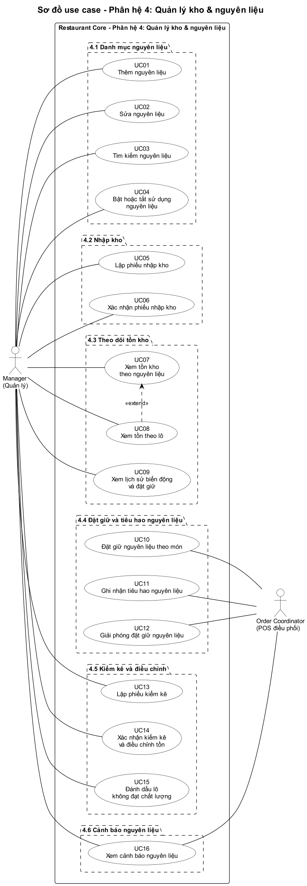

| Mã | Use case | Actor | Mô tả |
| --- | --- | --- | --- |
| UC01 | Thêm nguyên liệu | Manager | Nhập tên (duy nhất), đơn vị cơ sở, ngưỡng tồn tối thiểu, có theo dõi hạn dùng hay không; mặc định đang sử dụng (INV-01) |
| UC02 | Sửa nguyên liệu | Manager | Sửa tên, ngưỡng, cờ theo dõi hạn dùng; không đổi đơn vị cơ sở khi đã có lô, phiếu nhập hoặc công thức (INV-02) |
| UC03 | Tìm kiếm nguyên liệu | Manager | Tìm theo tên, trạng thái sử dụng; kèm tồn khả dụng |
| UC04 | Bật hoặc tắt sử dụng nguyên liệu | Manager | Cảnh báo nếu nguyên liệu có trong công thức hiện hành; không xóa vật lý (INV-02) |
| UC05 | Lập phiếu nhập kho | Manager | Tạo phiếu `DRAFT`, thêm nhiều dòng: nguyên liệu, số lượng, đơn vị nhập, hệ số quy đổi, đơn giá, số lô, hạn sử dụng; kiểm tra đơn vị tương thích, hệ số lớn hơn 0, hạn dùng của nguyên liệu theo dõi hạn; quy đổi về đơn vị cơ sở (INV-03) |
| UC06 | Xác nhận phiếu nhập kho | Manager | `DRAFT` → `CONFIRMED`: mỗi dòng tạo lô, cộng tồn, ghi `RECEIPT`, giữ nguyên số liệu quy đổi lịch sử; phân hệ 2 tính lại khả dụng (INV-04) |
| UC07 | Xem tồn kho theo nguyên liệu | Manager | Tồn sổ sách, tồn sử dụng được, đang đặt giữ, khả dụng; đánh dấu nguyên liệu dưới ngưỡng hoặc thiếu so với đặt giữ (INV-06) |
| UC08 | Xem tồn theo lô | Manager | Mở rộng UC07: từng lô theo FEFO với tồn, đặt giữ, hạn dùng, tình trạng (dùng được, hết hạn, không đạt) |
| UC09 | Xem lịch sử biến động và đặt giữ | Manager | Nhập, tiêu hao theo dòng món, điều chỉnh kiểm kê; đặt giữ theo trạng thái (INV-07) |
| UC10 | Đặt giữ nguyên liệu theo món | Order Coordinator | Kích hoạt khi POS duyệt dòng món: tính nhu cầu theo công thức, kiểm tra mọi nguyên liệu, đặt giữ theo FEFO rồi `ACCEPTED`; thiếu thì không đặt giữ phần nào và `REJECTED` (INV-08 đến INV-10) |
| UC11 | Ghi nhận tiêu hao nguyên liệu | Order Coordinator | Kích hoạt khi POS ghi nhận `COOKING`: kiểm tra lô đã giữ, phân bổ lại theo FEFO nếu lô không dùng được; đủ thì đặt giữ → tiêu hao, giảm tồn lô, ghi `CONSUMPTION`, đúng một lần; không đủ thì giữ `IN_KITCHEN` và đánh dấu ngoại lệ (INV-11, INV-19, INV-20) |
| UC12 | Giải phóng đặt giữ nguyên liệu | Order Coordinator | Kích hoạt khi hủy hợp lệ trước `COOKING` hoặc sửa số lượng: `ACTIVE` → `RELEASED`; sửa thì đặt giữ lại, thiếu thì giữ số cũ (INV-12) |
| UC13 | Lập phiếu kiểm kê | Manager | Chọn nguyên liệu hoặc lô, xem tồn sổ sách, nhập số thực tế, hệ thống tính chênh lệch, nhập lý do (INV-14) |
| UC14 | Xác nhận kiểm kê và điều chỉnh tồn | Manager | `DRAFT` → `CONFIRMED`: ghi `ADJUSTMENT`, cập nhật tồn; cảnh báo nếu thiếu so với đặt giữ (INV-14, INV-15) |
| UC15 | Đánh dấu lô không đạt chất lượng | Manager | Đặt `is_usable = false` kèm lý do, lưu người và thời điểm; lô bị loại khỏi tồn sử dụng được; hệ thống giải phóng đặt giữ trên lô và đặt giữ lại từ lô khác theo FEFO (INV-06, INV-17, INV-19) |
| UC16 | Xem cảnh báo nguyên liệu | Manager, Order Coordinator | Các cảnh báo ở INV-16, kể cả dòng món ngoại lệ thiếu nguyên liệu; POS xem để xử lý món đã chấp nhận hoặc đã chuyển bếp khi thiếu nguyên liệu |

Chỉ có một quan hệ UC08 «extend» UC07 vì xem chi tiết theo lô là phần mở rộng tùy chọn của xem tồn tổng. Các xử lý khác (tính lại khả dụng, đồng bộ POS / Mobile) là xử lý nội bộ, mô tả trong sơ đồ hoạt động.

**Ranh giới hệ thống:** khung nét liền "Restaurant Core – Phân hệ 4" là ranh giới hệ thống; các khung nét đứt chỉ nhóm use case theo chức năng, không phải hệ thống riêng. Actor đứng ngoài khung và nối với use case bằng đường liên kết không mũi tên. Tên UC10 đến UC12 mô tả việc kho làm; thời điểm kích hoạt (POS duyệt món, bắt đầu chế biến, hủy hoặc sửa món) nằm ở cột mô tả.

## 4. Sơ đồ hoạt động

| Nghiệp vụ | Sơ đồ |
| --- | --- |
| Quản lý danh mục nguyên liệu | 4.1 |
| Nhập kho | 4.2 |
| Theo dõi tồn kho và khả dụng | 4.3 |
| Đặt giữ và tiêu hao theo đơn hàng | 4.4 (đặt giữ), 4.5 (tiêu hao), 4.6 (giải phóng, đặt giữ lại), 4.10 (lô không còn sử dụng được) |
| Kiểm kê và điều chỉnh | 4.7, 4.8 (nguyên liệu hỏng) |
| Cảnh báo nguyên liệu và đồng bộ thực đơn | 4.9 |

Đặt giữ và tiêu hao được tách thành bốn sơ đồ để dễ đọc; xử lý chung khi lô không còn sử dụng được vẽ một lần ở 4.10 và được gọi từ 4.5, 4.8, 4.9. Swimlane phân biệt Manager, POS (Order Coordinator), Bếp và xử lý nội bộ (Hệ thống).

### 4.1 Quản lý danh mục nguyên liệu

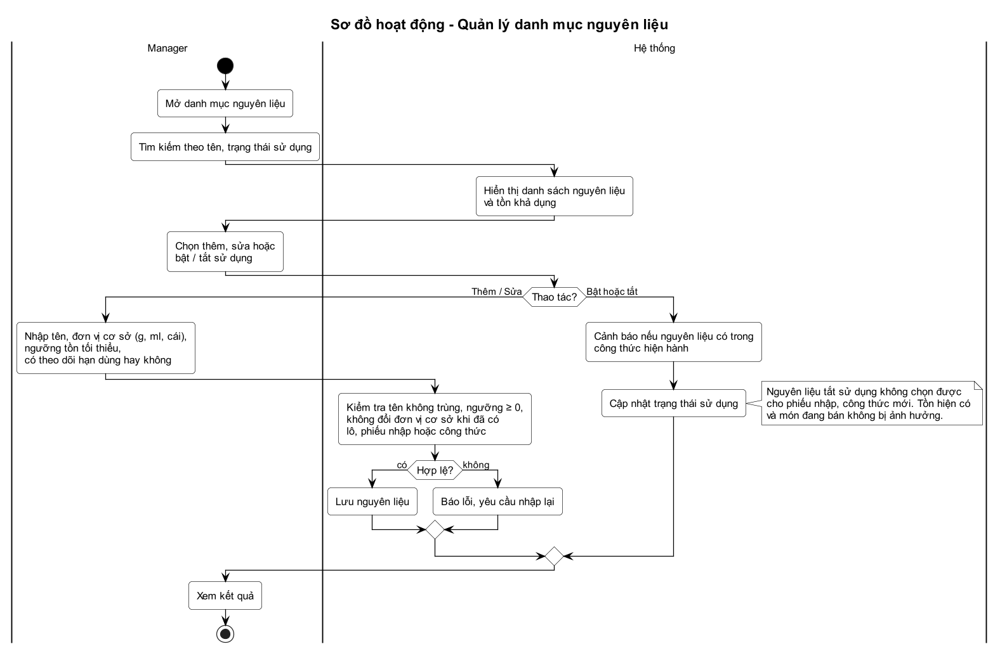

- Thêm và sửa dùng chung biểu mẫu: tên, đơn vị cơ sở, ngưỡng tồn tối thiểu, có theo dõi hạn dùng hay không; kiểm tra tên không trùng, ngưỡng không âm, không đổi đơn vị cơ sở khi đã có lô, phiếu nhập hoặc công thức.
- Bật hoặc tắt sử dụng chỉ đổi trạng thái; có cảnh báo nếu nguyên liệu nằm trong công thức hiện hành (INV-02).

### 4.2 Nhập kho theo lô

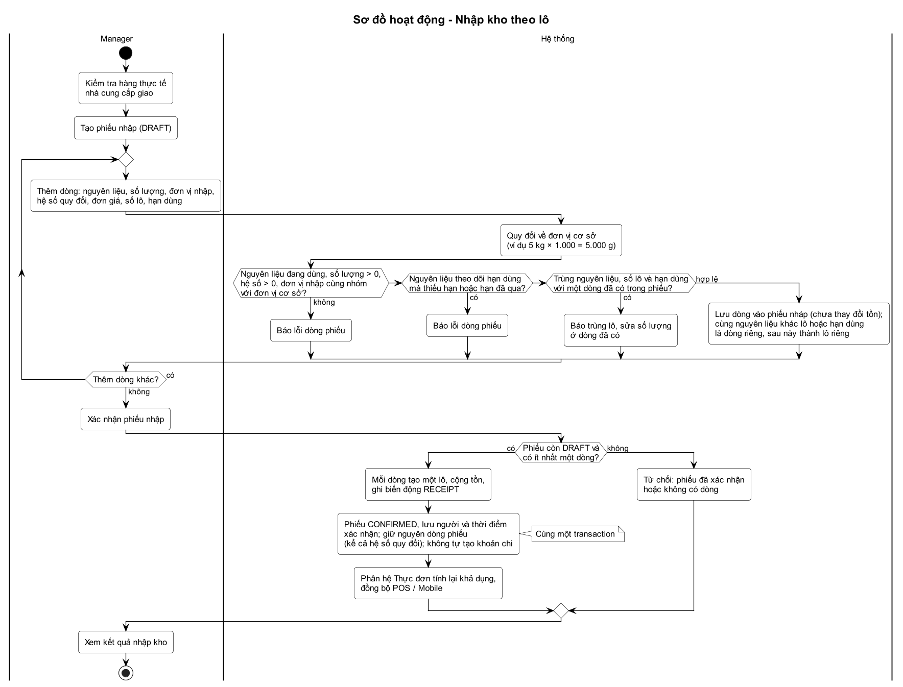

- Manager kiểm tra hàng thực tế, lập phiếu `DRAFT`, thêm nhiều dòng; hệ thống quy đổi về đơn vị cơ sở (ví dụ 5 kg × 1.000 = 5.000 g). Phiếu nháp chưa thay đổi tồn.
- Kiểm tra dòng: nguyên liệu đang dùng, số lượng và hệ số lớn hơn 0, đơn vị nhập cùng nhóm với đơn vị cơ sở; nguyên liệu theo dõi hạn dùng phải có hạn chưa qua, nguyên liệu không theo dõi hạn dùng không bắt buộc (INV-03).
- Một phiếu được có nhiều dòng cùng nguyên liệu khi khác số lô hoặc hạn dùng, mỗi dòng sau này là một lô riêng; dòng trùng nguyên liệu, số lô và hạn dùng với dòng đã có bị báo trùng, Manager sửa số lượng ở dòng đã có (INV-03).
- Xác nhận: phiếu còn `DRAFT` và có ít nhất một dòng thì mỗi dòng tạo một lô, cộng tồn, ghi `RECEIPT` và phiếu `CONFIRMED` trong cùng transaction, giữ nguyên số liệu quy đổi lịch sử; sau đó phân hệ 2 tính lại khả dụng.
- Phiếu đã xác nhận bị từ chối khi xác nhận lại (INV-04).

### 4.3 Theo dõi tồn kho và khả dụng

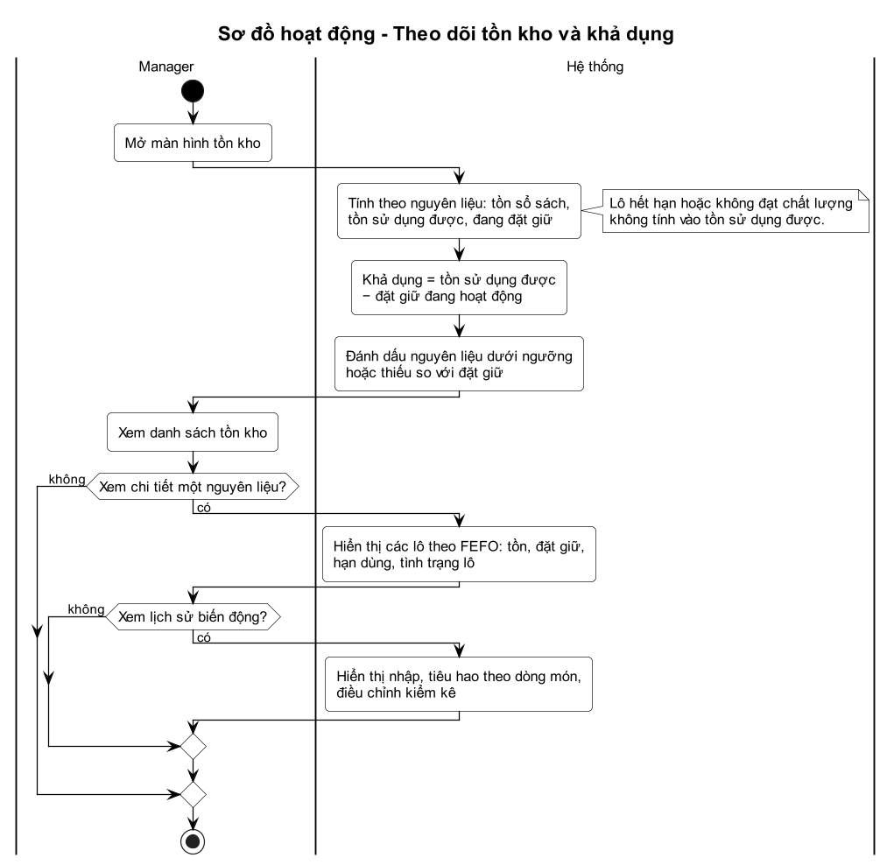

- Hệ thống tính tồn sổ sách, tồn sử dụng được, đang đặt giữ và khả dụng theo nguyên liệu; đánh dấu nguyên liệu dưới ngưỡng hoặc thiếu so với đặt giữ.
- Manager xem chi tiết từng lô theo FEFO và lịch sử biến động khi cần.

### 4.4 Đặt giữ nguyên liệu khi POS chấp nhận món

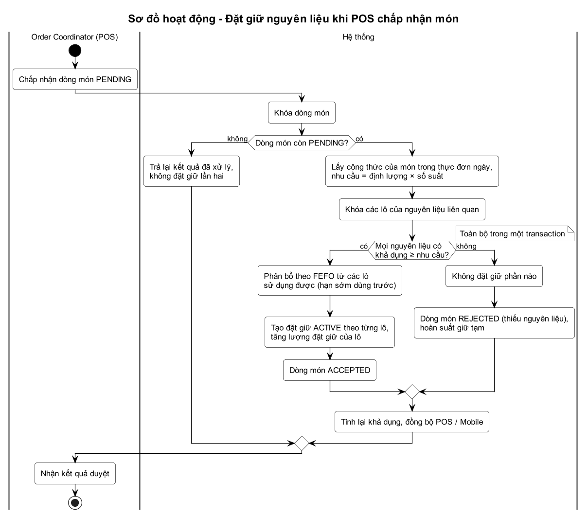

- Khóa dòng món; nếu không còn `PENDING` thì trả lại kết quả đã xử lý, không đặt giữ lần hai.
- Lấy công thức của món trong thực đơn ngày, tính nhu cầu từng nguyên liệu, khóa các lô liên quan rồi kiểm tra khả dụng của tất cả nguyên liệu.
- Đủ: phân bổ theo FEFO, tạo đặt giữ `ACTIVE` theo từng lô, dòng món `ACCEPTED`. Thiếu: không đặt giữ phần nào, dòng món `REJECTED`, hoàn suất giữ tạm. Toàn bộ trong một transaction.

### 4.5 Ghi nhận tiêu hao khi bắt đầu chế biến

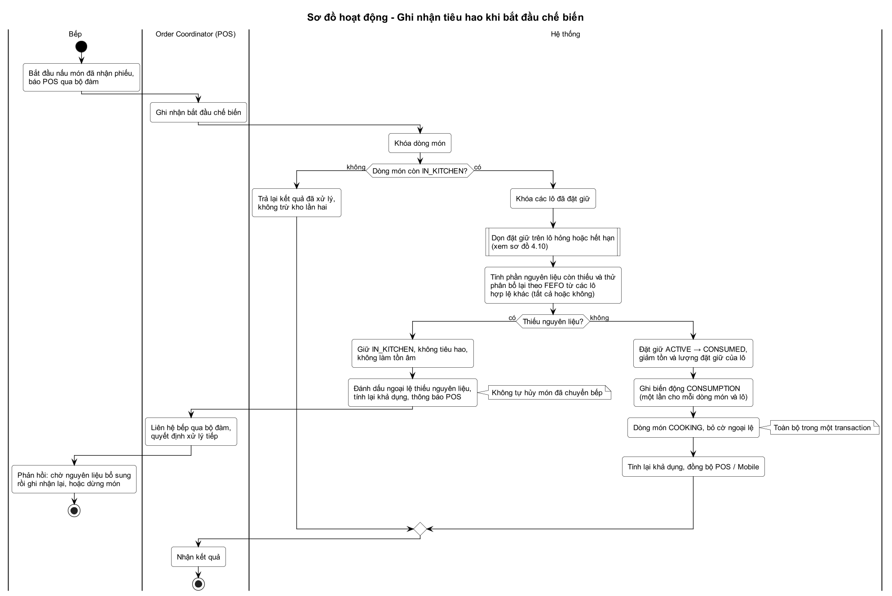

- Bếp bắt đầu nấu và báo POS qua bộ đàm; POS ghi nhận. Dòng món phải còn `IN_KITCHEN`, nếu không thì trả lại kết quả cũ, không trừ kho lần hai.
- Backend khóa các lô đã đặt giữ, dọn đặt giữ trên lô hỏng hoặc hết hạn (sơ đồ 4.10), rồi tính phần nguyên liệu còn thiếu và thử phân bổ lại theo FEFO từ các lô hợp lệ khác, tất cả hoặc không.
- Đủ nguyên liệu: đặt giữ `ACTIVE` thành `CONSUMED`, giảm tồn và lượng đặt giữ của lô, ghi `CONSUMPTION`, dòng món `COOKING`, bỏ cờ ngoại lệ, trong một transaction.
- Không đủ: không chuyển `COOKING`, không tiêu hao, không làm tồn âm; dòng món giữ `IN_KITCHEN` và được đánh dấu ngoại lệ thiếu nguyên liệu; POS liên hệ bếp qua bộ đàm quyết định chờ bổ sung rồi ghi nhận lại hoặc hủy ngoại lệ. Không tự hủy món đã chuyển bếp (INV-20, ORD-18).

### 4.6 Giải phóng hoặc đặt giữ lại khi hủy, sửa món

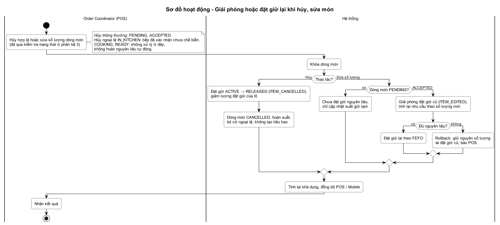

- Chỉ nhận thao tác đã qua kiểm tra trạng thái ở phân hệ 3 (hủy thông thường `PENDING` / `ACCEPTED`, hủy ngoại lệ `IN_KITCHEN` đã được bếp xác nhận, sửa số lượng).
- Hủy: đặt giữ `ACTIVE` thành `RELEASED` (`ITEM_CANCELLED`), dòng món `CANCELLED`, hoàn suất, bỏ cờ ngoại lệ, không tạo tiêu hao.
- Sửa số lượng: `PENDING` chỉ cập nhật suất giữ tạm; `ACCEPTED` giải phóng đặt giữ cũ (`ITEM_EDITED`) rồi đặt giữ lại theo số lượng mới, không đủ thì rollback giữ nguyên.
- `COOKING`, `READY` không xử lý ở đây, không hoàn nguyên liệu tự động (INV-12).

### 4.7 Kiểm kê và điều chỉnh hao hụt

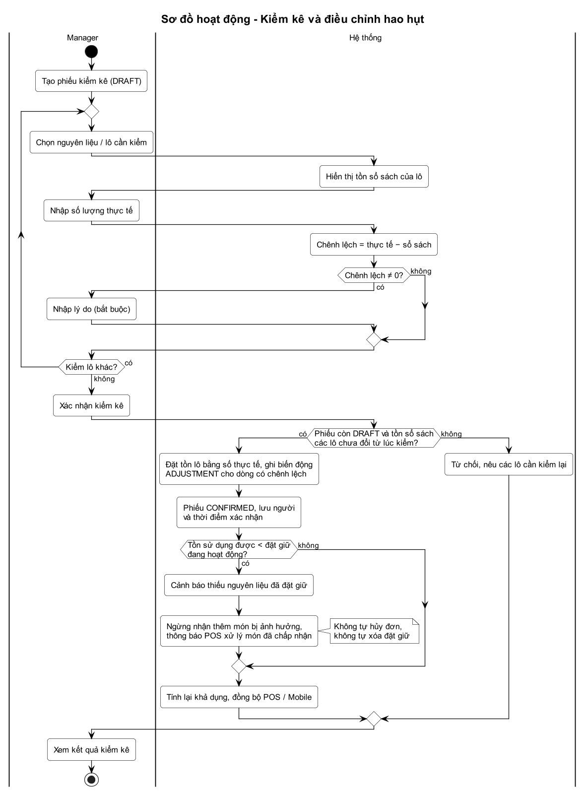

- Manager tạo phiếu `DRAFT`, chọn nguyên liệu / lô, hệ thống hiển thị tồn sổ sách; Manager nhập số thực tế, hệ thống tính chênh lệch và bắt buộc lý do nếu khác 0.
- Xác nhận: nếu tồn sổ sách các lô chưa đổi từ lúc kiểm thì đặt tồn lô bằng số thực tế, ghi `ADJUSTMENT`, phiếu `CONFIRMED`; nếu đã đổi (có tiêu hao xen giữa) thì từ chối và nêu lô cần kiểm lại.
- Nếu điều chỉnh khiến tồn sử dụng được nhỏ hơn lượng đã đặt giữ (lô vẫn dùng được): cảnh báo, ngừng nhận thêm món bị ảnh hưởng, thông báo POS xử lý món đã chấp nhận; không tự hủy đơn, không tự xóa đặt giữ (INV-15).

### 4.8 Xử lý nguyên liệu hỏng

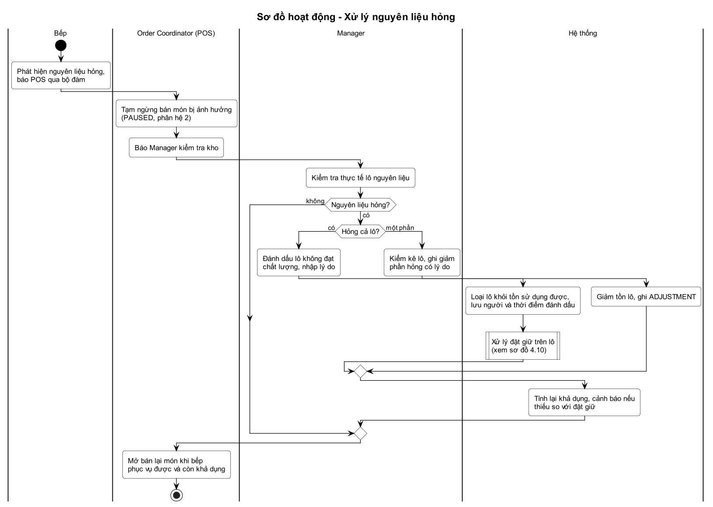

- Bếp báo POS qua bộ đàm; POS tạm ngừng bán món bị ảnh hưởng (`PAUSED`, phân hệ 2) và báo Manager.
- Manager kiểm tra thực tế: hỏng cả lô thì đánh dấu lô không đạt kèm lý do, hệ thống loại lô khỏi tồn sử dụng được và xử lý đặt giữ trên lô (sơ đồ 4.10); hỏng một phần thì kiểm kê ghi giảm phần hỏng có lý do; không hỏng thì không điều chỉnh.
- Hệ thống tính lại khả dụng; POS mở bán lại món khi bếp phục vụ được và còn khả dụng (INV-17).

### 4.9 Cảnh báo nguyên liệu và đồng bộ thực đơn

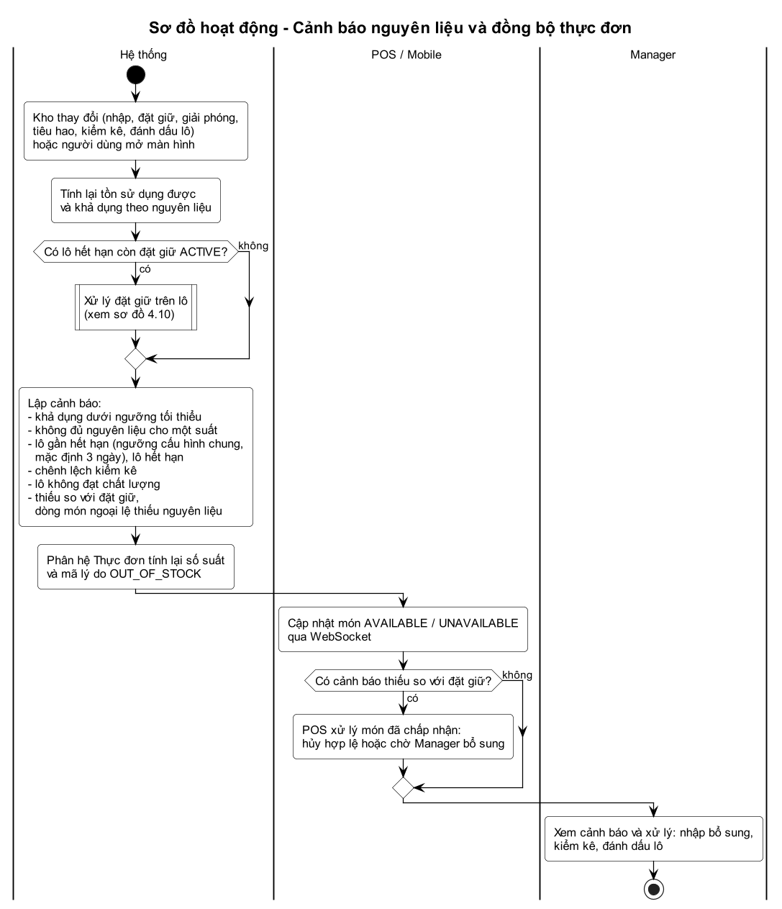

- Mỗi thay đổi kho (nhập, đặt giữ, giải phóng, tiêu hao, kiểm kê, đánh dấu lô) hoặc khi mở màn hình, hệ thống tính lại tồn sử dụng được, khả dụng; nếu phát hiện lô hết hạn còn đặt giữ `ACTIVE` thì xử lý theo 4.10, rồi lập các cảnh báo ở INV-16 (ngưỡng gần hết hạn là cấu hình chung, mặc định 3 ngày).
- Phân hệ 2 tính lại số suất và mã lý do `OUT_OF_STOCK`; POS / Mobile cập nhật món `AVAILABLE` / `UNAVAILABLE` qua WebSocket. Khi kho bổ sung đủ, món đủ điều kiện (còn hạn mức, không bị tạm ngừng) tự được mở bán lại.
- Có cảnh báo thiếu so với đặt giữ hoặc dòng món ngoại lệ thì POS xử lý (hủy hợp lệ hoặc chờ Manager bổ sung); Manager nhập bổ sung, kiểm kê hoặc đánh dấu lô.

### 4.10 Xử lý đặt giữ khi lô không còn sử dụng được

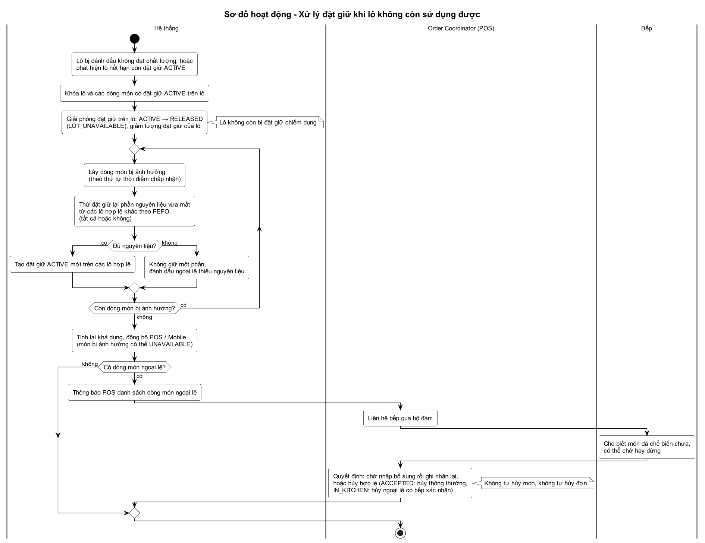

- Kích hoạt khi Manager đánh dấu lô không đạt chất lượng (UC15), khi hệ thống phát hiện lô hết hạn còn đặt giữ `ACTIVE`, hoặc ở bước kiểm tra lô lúc POS ghi nhận bắt đầu chế biến.
- Khóa lô và các dòng món có đặt giữ `ACTIVE` trên lô; giải phóng các đặt giữ đó (`RELEASED`, `LOT_UNAVAILABLE`) và giảm lượng đặt giữ của lô, nên lô hỏng không còn bị chiếm dụng.
- Với từng dòng món bị ảnh hưởng, thử đặt giữ lại phần nguyên liệu vừa mất từ các lô hợp lệ khác theo FEFO, tất cả hoặc không. Đủ thì tạo đặt giữ `ACTIVE` mới; không đủ thì không giữ một phần và đánh dấu dòng món ngoại lệ thiếu nguyên liệu.
- Tính lại khả dụng (món bị ảnh hưởng có thể `UNAVAILABLE`) và thông báo POS. POS liên hệ bếp qua bộ đàm: chờ nhập bổ sung rồi ghi nhận lại, hoặc hủy hợp lệ. Không tự hủy món, không tự hủy đơn, không hoàn lại nguyên liệu đã thực sự tiêu hao (INV-19).

## 5. ERD

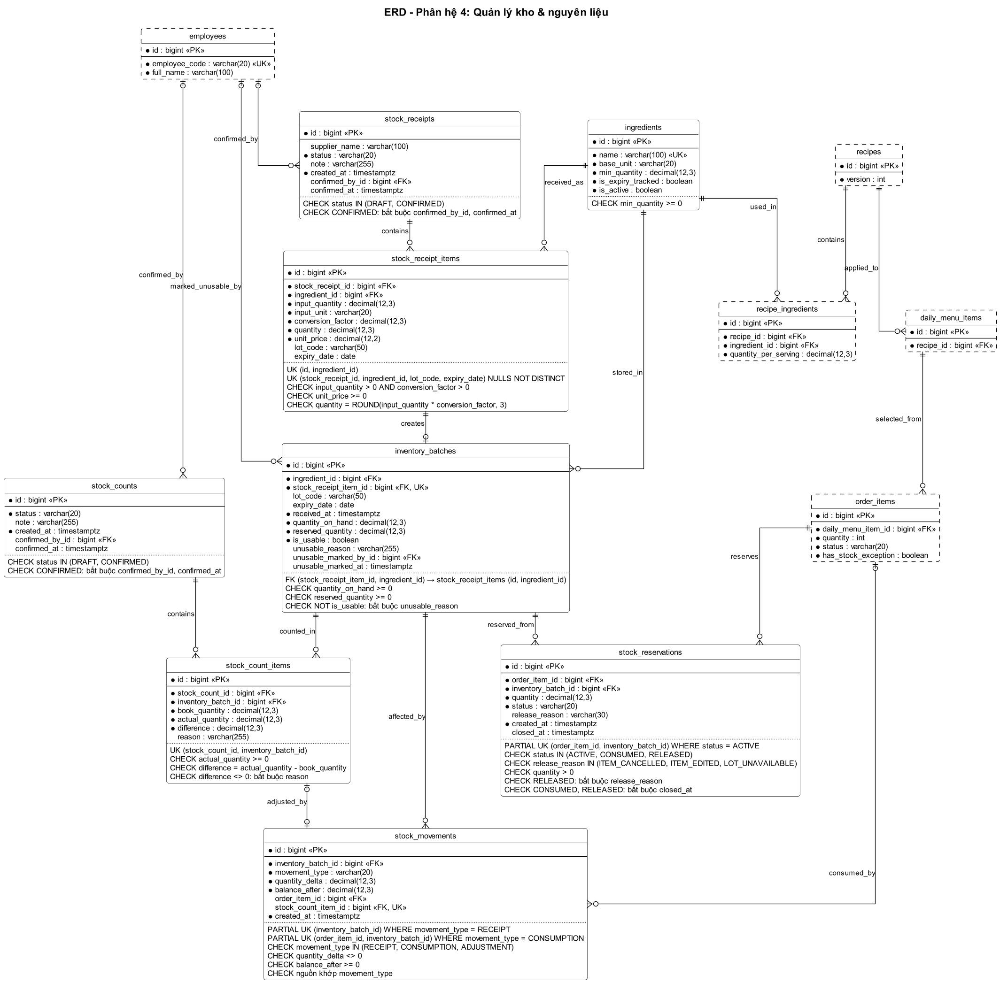

Phân hệ sở hữu 8 bảng, vẽ viền liền, đủ cột và ràng buộc. Bảng của phân hệ 1, 2, 3 liên kết với kho vẽ viền nét đứt và chỉ hiện khóa cùng các cột phân hệ 4 dùng; đó là cùng một bảng trong cơ sở dữ liệu chung, định nghĩa đầy đủ ở README phân hệ sở hữu và [ERD tổng thể](../erd-tong-the.png); phân hệ 4 không tạo bảng mới. Mọi đường nối có chân chim là khóa ngoại thật, bản số theo NOT NULL và UNIQUE của cột khóa ngoại.

**Quy ước toàn hệ thống:** tên bảng và cột `snake_case`, tên bảng số nhiều; khóa chính `id BIGINT`; khóa ngoại `<thực thể>_id BIGINT`; chỉ khóa ngoại mới có hậu tố `_id`. Cột chỉ người thực hiện mang tên vai trò (`confirmed_by_id`, `unusable_marked_by_id`) và tham chiếu `employees.id`. Thời điểm dùng `TIMESTAMPTZ`, ngày dùng `DATE`; tiền dùng `DECIMAL(12,2)`, số lượng dùng `DECIMAL(12,3)`, không dùng `FLOAT` hay `DOUBLE`.

**Bảng của phân hệ khác trong ERD:**

| Bảng | Phân hệ sở hữu | Vai trò đối với kho | Cột hiện trong ERD |
| --- | --- | --- | --- |
| employees | 1 – Nhân viên | Người xác nhận phiếu nhập, phiếu kiểm kê, người đánh dấu lô | `id`, `employee_code`, `full_name` |
| recipes | 2 – Thực đơn | Công thức áp dụng cho món trong thực đơn ngày | `id`, `version` |
| recipe_ingredients | 2 – Thực đơn | Định lượng nguyên liệu cho một suất, nguồn tính nhu cầu đặt giữ | `id`, `recipe_id`, `ingredient_id`, `quantity_per_serving` |
| daily_menu_items | 2 – Thực đơn | Từ dòng món tìm công thức (`recipe_id`) | `id`, `recipe_id` |
| order_items | 3 – Đơn hàng | Dòng món được đặt giữ, tiêu hao; số lượng, trạng thái; cờ ngoại lệ thiếu nguyên liệu `has_stock_exception` do kho ghi | `id`, `daily_menu_item_id`, `quantity`, `status`, `has_stock_exception` |

Từ điển dữ liệu đầy đủ của các bảng này nằm ở README phân hệ sở hữu.

**Quan hệ giữa các bảng của phân hệ:**

| Quan hệ | Khóa ngoại | Nhãn |
| --- | --- | --- |
| ingredients 1 – N stock_receipt_items | `stock_receipt_items.ingredient_id` | received_as |
| ingredients 1 – N inventory_batches | `inventory_batches.ingredient_id` | stored_in |
| stock_receipts 1 – N stock_receipt_items | `stock_receipt_items.stock_receipt_id` | contains |
| stock_receipt_items 1 – 0..1 inventory_batches | `inventory_batches.stock_receipt_item_id` | creates |
| inventory_batches 1 – N stock_movements | `stock_movements.inventory_batch_id` | affected_by |
| inventory_batches 1 – N stock_reservations | `stock_reservations.inventory_batch_id` | reserved_from |
| order_items 1 – N stock_reservations | `stock_reservations.order_item_id` | reserves |
| order_items 0..1 – N stock_movements | `stock_movements.order_item_id` | consumed_by |
| stock_counts 1 – N stock_count_items | `stock_count_items.stock_count_id` | contains |
| inventory_batches 1 – N stock_count_items | `stock_count_items.inventory_batch_id` | counted_in |
| stock_count_items 0..1 – 0..1 stock_movements | `stock_movements.stock_count_item_id` | adjusted_by |
| employees 0..1 – N stock_receipts | `stock_receipts.confirmed_by_id` | confirmed_by |
| employees 0..1 – N stock_counts | `stock_counts.confirmed_by_id` | confirmed_by |
| employees 0..1 – N inventory_batches | `inventory_batches.unusable_marked_by_id` | marked_unusable_by |

Quan hệ giữa các bảng của phân hệ khác cũng được vẽ, giữ nguyên nhãn của phân hệ sở hữu: `recipes` – `recipe_ingredients` (contains), `recipes` – `daily_menu_items` (applied_to), `ingredients` – `recipe_ingredients` (used_in), `daily_menu_items` – `order_items` (selected_from).

**Ràng buộc và chỉ mục:**

| Bảng | Ràng buộc và chỉ mục |
| --- | --- |
| ingredients | UNIQUE (`name`); CHECK `min_quantity` ≥ 0; INDEX (`is_active`) |
| stock_receipts | CHECK `status` thuộc (`DRAFT`, `CONFIRMED`); `confirmed_by_id` và `confirmed_at` bắt buộc khi `CONFIRMED`; INDEX (`status`, `created_at`) |
| stock_receipt_items | CHECK `input_quantity` > 0, `conversion_factor` > 0, `unit_price` ≥ 0; CHECK `quantity` = ROUND(`input_quantity` × `conversion_factor`, 3) (tích của hai số 3 chữ số thập phân có 6 chữ số, phải làm tròn về `decimal(12,3)` thì CHECK mới đúng); UNIQUE (`id`, `ingredient_id`) làm đích khóa ngoại ghép của `inventory_batches`; UNIQUE NULLS NOT DISTINCT (`stock_receipt_id`, `ingredient_id`, `lot_code`, `expiry_date`): nhiều lô cùng nguyên liệu trong một phiếu được, nhưng không lặp cùng một lô (PostgreSQL 15 trở lên); `expiry_date` bắt buộc và chưa qua khi nguyên liệu có `is_expiry_tracked` (kiểm tra ở backend lúc thêm dòng); đơn vị nhập cùng nhóm đơn vị với `base_unit` (kiểm tra ở backend theo danh sách nhóm cấu hình chung); INDEX (`stock_receipt_id`), INDEX (`ingredient_id`) |
| inventory_batches | UNIQUE (`stock_receipt_item_id`); FK ghép (`stock_receipt_item_id`, `ingredient_id`) → `stock_receipt_items` (`id`, `ingredient_id`): lô cùng nguyên liệu với dòng phiếu tạo ra nó; CHECK `quantity_on_hand` ≥ 0 và `reserved_quantity` ≥ 0; INDEX (`ingredient_id`, `expiry_date`, `received_at`) cho FEFO; INDEX (`expiry_date`) cho cảnh báo hạn dùng |
| stock_movements | CHECK `movement_type` thuộc (`RECEIPT`, `CONSUMPTION`, `ADJUSTMENT`); CHECK `quantity_delta` ≠ 0 và `balance_after` ≥ 0; CHECK nguồn khớp loại (`CONSUMPTION` có `order_item_id` và `quantity_delta` < 0; `ADJUSTMENT` có `stock_count_item_id`; `RECEIPT` không có hai nguồn này); UNIQUE (`order_item_id`, `inventory_batch_id`) khi `CONSUMPTION`; UNIQUE (`stock_count_item_id`); UNIQUE (`inventory_batch_id`) khi `RECEIPT`; INDEX (`inventory_batch_id`, `created_at`) |
| stock_reservations | CHECK `quantity` > 0; CHECK `status` thuộc (`ACTIVE`, `CONSUMED`, `RELEASED`); `closed_at` bắt buộc khi `CONSUMED` hoặc `RELEASED`; `release_reason` bắt buộc khi `RELEASED` và thuộc (`ITEM_CANCELLED`, `ITEM_EDITED`, `LOT_UNAVAILABLE`); UNIQUE (`order_item_id`, `inventory_batch_id`) khi `ACTIVE`; INDEX (`order_item_id`, `status`), INDEX (`inventory_batch_id`, `status`) |
| stock_counts | CHECK `status` thuộc (`DRAFT`, `CONFIRMED`); `confirmed_by_id` và `confirmed_at` bắt buộc khi `CONFIRMED` |
| stock_count_items | UNIQUE (`stock_count_id`, `inventory_batch_id`); CHECK `actual_quantity` ≥ 0; CHECK `difference` = `actual_quantity` − `book_quantity`; `reason` bắt buộc khi `difference` ≠ 0 |

- Không có CHECK `reserved_quantity` ≤ `quantity_on_hand`: sau khi kiểm kê giảm, lượng đã đặt giữ trên lô còn dùng được có thể lớn hơn tồn; đó là tình huống "thiếu so với đặt giữ" cần cảnh báo (INV-15). Lô không đạt chất lượng hoặc hết hạn không giữ đặt giữ `ACTIVE` (INV-19).
- Ràng buộc "khi ..." là chỉ mục duy nhất một phần của PostgreSQL (`CREATE UNIQUE INDEX ... WHERE ...`); ERD ghi dạng `PARTIAL UK (...) WHERE ...`.
- Chống ghi trùng: một dòng phiếu nhập chỉ tạo một lô (UNIQUE `stock_receipt_item_id`), một lô chỉ một biến động `RECEIPT`; một lần bắt đầu chế biến chỉ trừ kho một lần cho mỗi lô (UNIQUE `order_item_id`, `inventory_batch_id`); một dòng kiểm kê chỉ điều chỉnh một lần (UNIQUE `stock_count_item_id`).

### Từ điển dữ liệu

**ingredients** – Nguyên liệu

| Cột | Kiểu | Ràng buộc | Ý nghĩa |
| --- | --- | --- | --- |
| id | bigint | PK | Mã nguyên liệu |
| name | varchar(100) | UK, bắt buộc | Tên nguyên liệu |
| base_unit | varchar(20) | bắt buộc | Đơn vị cơ sở (g, ml, cái…); không đổi khi đã có lô, phiếu nhập hoặc công thức |
| min_quantity | decimal(12,3) | bắt buộc, ≥ 0 | Ngưỡng tồn tối thiểu theo đơn vị cơ sở |
| is_expiry_tracked | boolean | bắt buộc | Có theo dõi hạn dùng: `true` thì dòng phiếu nhập bắt buộc có hạn dùng chưa qua và lô được cảnh báo gần hết hạn; `false` (ví dụ gạo) thì không bắt buộc và lô không hết hạn |
| is_active | boolean | bắt buộc | Đang sử dụng |

**stock_receipts** – Phiếu nhập kho

| Cột | Kiểu | Ràng buộc | Ý nghĩa |
| --- | --- | --- | --- |
| id | bigint | PK | Mã phiếu nhập |
| supplier_name | varchar(100) | | Tên nhà cung cấp (văn bản tự do, không có danh mục nhà cung cấp) |
| status | varchar(20) | bắt buộc, CHECK | DRAFT, CONFIRMED |
| note | varchar(255) | | Ghi chú |
| created_at | timestamptz | bắt buộc | Thời điểm lập phiếu |
| confirmed_by_id | bigint | FK → employees | Người xác nhận nhập kho (trống khi DRAFT) |
| confirmed_at | timestamptz | | Thời điểm xác nhận |

**stock_receipt_items** – Chi tiết phiếu nhập

| Cột | Kiểu | Ràng buộc | Ý nghĩa |
| --- | --- | --- | --- |
| id | bigint | PK | Mã dòng phiếu nhập |
| stock_receipt_id | bigint | FK → stock_receipts, bắt buộc | Phiếu nhập |
| ingredient_id | bigint | FK → ingredients, bắt buộc | Nguyên liệu nhập |
| input_quantity | decimal(12,3) | bắt buộc, > 0 | Số lượng theo đơn vị nhập, ví dụ 5 |
| input_unit | varchar(20) | bắt buộc | Đơn vị nhập, ví dụ kg; cùng nhóm đơn vị với đơn vị cơ sở của nguyên liệu |
| conversion_factor | decimal(12,3) | bắt buộc, > 0 | Hệ số quy đổi sang đơn vị cơ sở, ví dụ 1.000; lưu trên từng dòng, giữ nguyên làm lịch sử sau khi phiếu `CONFIRMED` |
| quantity | decimal(12,3) | bắt buộc | Số lượng theo đơn vị cơ sở = ROUND(`input_quantity` × `conversion_factor`, 3), ví dụ 5.000 g |
| unit_price | decimal(12,2) | bắt buộc, ≥ 0 | Đơn giá theo đơn vị nhập; giá trị dòng = `input_quantity` × `unit_price` (giá trị hàng nhập, không phải tiền đã chi); chỉ lưu tham khảo, không hạch toán giá vốn |
| lot_code | varchar(50) | | Số lô của nhà cung cấp |
| expiry_date | date | | Hạn sử dụng; bắt buộc khi nguyên liệu có `is_expiry_tracked`, trống nếu không có |
| (id, ingredient_id) | | UK | Đích của khóa ngoại ghép từ `inventory_batches`; `id` đã duy nhất nên không giới hạn thêm dữ liệu |
| (stock_receipt_id, ingredient_id, lot_code, expiry_date) | | UK, NULLS NOT DISTINCT | Một phiếu nhiều lô cùng nguyên liệu được, nhưng không lặp cùng một lô; giá trị trống cũng tính là trùng |

**inventory_batches** – Lô nguyên liệu

| Cột | Kiểu | Ràng buộc | Ý nghĩa |
| --- | --- | --- | --- |
| id | bigint | PK | Mã lô |
| ingredient_id | bigint | FK → ingredients, bắt buộc | Nguyên liệu; trùng nguyên liệu của dòng phiếu tạo ra lô (khóa ngoại ghép bên dưới) |
| stock_receipt_item_id | bigint | FK → stock_receipt_items, UK, bắt buộc | Dòng phiếu nhập tạo ra lô (một dòng một lô) |
| lot_code | varchar(50) | | Số lô, sao từ dòng phiếu khi xác nhận |
| expiry_date | date | | Hạn sử dụng, sao từ dòng phiếu khi xác nhận để truy vấn FEFO và cảnh báo không cần nối bảng |
| received_at | timestamptz | bắt buộc | Thời điểm nhập (xác nhận phiếu); xếp thứ tự khi cùng hạn dùng |
| quantity_on_hand | decimal(12,3) | bắt buộc, ≥ 0 | Tồn thực tế theo sổ sách |
| reserved_quantity | decimal(12,3) | bắt buộc, ≥ 0 | Tổng đặt giữ `ACTIVE` của lô |
| is_usable | boolean | bắt buộc | `false` khi bị đánh dấu không đạt chất lượng |
| unusable_reason | varchar(255) | | Lý do đánh dấu; bắt buộc khi `is_usable = false` |
| unusable_marked_by_id | bigint | FK → employees | Người đánh dấu |
| unusable_marked_at | timestamptz | | Thời điểm đánh dấu |
| (stock_receipt_item_id, ingredient_id) | | FK → stock_receipt_items (id, ingredient_id) | Khóa ngoại ghép: lô cùng nguyên liệu với dòng phiếu tạo ra nó |

**stock_movements** – Lịch sử biến động kho

| Cột | Kiểu | Ràng buộc | Ý nghĩa |
| --- | --- | --- | --- |
| id | bigint | PK | Mã biến động |
| inventory_batch_id | bigint | FK → inventory_batches, bắt buộc | Lô bị biến động |
| movement_type | varchar(20) | bắt buộc, CHECK | RECEIPT, CONSUMPTION, ADJUSTMENT |
| quantity_delta | decimal(12,3) | bắt buộc, ≠ 0 | Biến động có dấu: dương nhập, âm tiêu hao, dương hoặc âm điều chỉnh |
| balance_after | decimal(12,3) | bắt buộc, ≥ 0 | Tồn của lô sau biến động |
| order_item_id | bigint | FK → order_items | Nguồn của `CONSUMPTION`: dòng món bắt đầu chế biến |
| stock_count_item_id | bigint | FK → stock_count_items, UK | Nguồn của `ADJUSTMENT`: dòng kiểm kê |
| created_at | timestamptz | bắt buộc | Thời điểm ghi sổ |

Nguồn của `RECEIPT` là dòng phiếu nhập của lô (`inventory_batches.stock_receipt_item_id`).

**stock_reservations** – Đặt giữ nguyên liệu

| Cột | Kiểu | Ràng buộc | Ý nghĩa |
| --- | --- | --- | --- |
| id | bigint | PK | Mã đặt giữ |
| order_item_id | bigint | FK → order_items, bắt buộc | Dòng món được đặt giữ |
| inventory_batch_id | bigint | FK → inventory_batches, bắt buộc | Lô bị giữ |
| quantity | decimal(12,3) | bắt buộc, > 0 | Lượng giữ theo đơn vị cơ sở |
| status | varchar(20) | bắt buộc, CHECK | ACTIVE, CONSUMED, RELEASED |
| release_reason | varchar(30) | CHECK; bắt buộc khi đã giải phóng | Lý do giải phóng: ITEM_CANCELLED, ITEM_EDITED, LOT_UNAVAILABLE |
| created_at | timestamptz | bắt buộc | Thời điểm đặt giữ |
| closed_at | timestamptz | bắt buộc khi tiêu hao hoặc giải phóng | Thời điểm tiêu hao hoặc giải phóng |

**stock_counts** – Phiếu kiểm kê

| Cột | Kiểu | Ràng buộc | Ý nghĩa |
| --- | --- | --- | --- |
| id | bigint | PK | Mã phiếu kiểm kê |
| status | varchar(20) | bắt buộc, CHECK | DRAFT, CONFIRMED |
| note | varchar(255) | | Ghi chú |
| created_at | timestamptz | bắt buộc | Thời điểm lập phiếu |
| confirmed_by_id | bigint | FK → employees | Người xác nhận kiểm kê và điều chỉnh (trống khi DRAFT) |
| confirmed_at | timestamptz | | Thời điểm xác nhận |

**stock_count_items** – Chi tiết kiểm kê

| Cột | Kiểu | Ràng buộc | Ý nghĩa |
| --- | --- | --- | --- |
| id | bigint | PK | Mã dòng kiểm kê |
| stock_count_id | bigint | FK → stock_counts, bắt buộc | Phiếu kiểm kê |
| inventory_batch_id | bigint | FK → inventory_batches, bắt buộc | Lô được kiểm |
| book_quantity | decimal(12,3) | bắt buộc | Tồn sổ sách lúc kiểm |
| actual_quantity | decimal(12,3) | bắt buộc, ≥ 0 | Số lượng thực tế đếm được |
| difference | decimal(12,3) | bắt buộc | Chênh lệch = `actual_quantity` − `book_quantity` |
| reason | varchar(255) | | Lý do chênh lệch; bắt buộc khi `difference` ≠ 0 |

### Chuẩn hóa và khóa ngoại

- **1NF, 2NF:** mọi cột một giá trị; mọi bảng có khóa chính một cột `id`. Các quan hệ nhiều – nhiều đi qua bảng có thuộc tính riêng: `stock_receipt_items` (phiếu nhập – nguyên liệu), `stock_reservations` (dòng món – lô), `stock_count_items` (phiếu kiểm kê – lô).
- **3NF:** dữ liệu của thực thể khác chỉ tham chiếu bằng khóa ngoại. Các cột dưới đây là số tính sẵn, bản chụp hoặc bản sao có kiểm soát; không coi là vi phạm vì có lý do nghiệp vụ và cơ chế giữ nhất quán:

| Thuộc tính | Loại | Vì sao giữ | Kiểm soát |
| --- | --- | --- | --- |
| `inventory_batches.quantity_on_hand` | Số dư tính sẵn | Bằng tổng `quantity_delta` của `stock_movements` của lô; lưu để khóa dòng và kiểm tra tồn trong transaction mà không cộng lại lịch sử | Mọi thay đổi tồn ghi biến động trong cùng transaction (INV-07); CHECK ≥ 0; đối chiếu được bằng truy vấn tổng |
| `inventory_batches.reserved_quantity` | Số dư tính sẵn | Bằng tổng `quantity` của đặt giữ `ACTIVE` trên lô | Cập nhật cùng transaction với đặt giữ, tiêu hao, giải phóng (INV-13); CHECK ≥ 0 |
| `stock_movements.balance_after` | Bản chụp | Tồn của lô ngay sau biến động, để tra lịch sử | CHECK ≥ 0; biến động không sửa |
| `stock_receipt_items.quantity` | Suy ra | = `input_quantity` × `conversion_factor` theo đơn vị cơ sở; lưu vì cấu hình quy đổi về sau không được làm đổi số đã nhập (INV-04) | CHECK `quantity` = ROUND(`input_quantity` × `conversion_factor`, 3) |
| `stock_count_items.book_quantity`, `difference` | Bản chụp, suy ra | Tồn sổ sách lúc kiểm và chênh lệch | CHECK `difference` = `actual_quantity` − `book_quantity` |
| `inventory_batches.ingredient_id` | Bản sao | Trùng nguyên liệu của dòng phiếu (phụ thuộc bắc cầu qua `stock_receipt_item_id`); giữ cho chỉ mục FEFO (`ingredient_id`, `expiry_date`, `received_at`) | Khóa ngoại ghép (`stock_receipt_item_id`, `ingredient_id`) → `stock_receipt_items` (`id`, `ingredient_id`) |
| `inventory_batches.lot_code`, `expiry_date` | Bản sao | Sao từ dòng phiếu khi xác nhận để truy vấn FEFO không cần nối bảng | Dòng phiếu `CONFIRMED` không sửa được (INV-04) nên bản sao không lệch |

- Mọi khóa ngoại `ON DELETE RESTRICT`: nguyên liệu, lô, phiếu đã phát sinh không bị xóa cứng (INV-02); nhập sai thì điều chỉnh bằng kiểm kê có lý do.

```sql
-- Khóa ngoại ghép và CHECK số lượng quy đổi (PostgreSQL)
ALTER TABLE stock_receipt_items ADD CONSTRAINT uq_stock_receipt_items_id_ingredient UNIQUE (id, ingredient_id);
ALTER TABLE stock_receipt_items ADD CONSTRAINT ck_stock_receipt_items_quantity
  CHECK (quantity = ROUND(input_quantity * conversion_factor, 3));
ALTER TABLE inventory_batches ADD CONSTRAINT fk_inventory_batches_receipt_item_ingredient
  FOREIGN KEY (stock_receipt_item_id, ingredient_id) REFERENCES stock_receipt_items (id, ingredient_id) ON DELETE RESTRICT;
-- Một phiếu nhiều lô cùng nguyên liệu, nhưng không lặp cùng một lô (INV-03; PostgreSQL 15 trở lên)
ALTER TABLE stock_receipt_items ADD CONSTRAINT uq_stock_receipt_items_lot
  UNIQUE NULLS NOT DISTINCT (stock_receipt_id, ingredient_id, lot_code, expiry_date);
```

### FEFO và chống trừ kho hai lần

Thứ tự lô khi đặt giữ hoặc phân bổ lại cho một nguyên liệu (INV-10): hạn sớm dùng trước, lô không theo dõi hạn dùng sau cùng, cùng hạn thì lô nhập trước; bỏ lô hết hạn, lô không đạt và lô không còn khả dụng. Truy vấn dùng chỉ mục (`ingredient_id`, `expiry_date`, `received_at`) và khóa dòng theo đúng thứ tự này (mục 6).

```sql
SELECT b.id, b.expiry_date, b.received_at, b.quantity_on_hand - b.reserved_quantity AS kha_dung
FROM inventory_batches b
WHERE b.ingredient_id = :nguyen_lieu
  AND b.is_usable
  AND (b.expiry_date IS NULL OR b.expiry_date >= :ngay_hien_tai)
  AND b.quantity_on_hand - b.reserved_quantity > 0
ORDER BY b.expiry_date ASC NULLS LAST, b.received_at, b.id
FOR UPDATE;
```

Không trừ kho hai lần cho cùng một dòng món (INV-11, INV-13), bằng ba lớp:

- Đặt giữ: chỉ mục duy nhất một phần (`order_item_id`, `inventory_batch_id`) khi `status` = `ACTIVE`; tiêu hao chỉ chuyển đặt giữ `ACTIVE` sang `CONSUMED`, đặt giữ đã `CONSUMED` không bị dùng lại.
- Tiêu hao: chỉ mục duy nhất một phần (`order_item_id`, `inventory_batch_id`) khi `movement_type` = `CONSUMPTION`, nên gọi lại API hay hai thiết bị cùng bấm không tạo được biến động tiêu hao thứ hai trên cùng lô.
- Tồn: CHECK `quantity_on_hand` ≥ 0 và khóa dòng món, lô trong transaction (mục 6).

## 6. Transaction và đồng thời

Mọi thao tác ảnh hưởng suất, đặt giữ và tiêu hao chạy trong một transaction ngắn; khi lỗi hoặc không đủ nguyên liệu thì không ghi đặt giữ mới hay tiêu hao. Ngoại lệ có chủ đích: ở UC11, phần giải phóng đặt giữ trên lô hỏng hoặc hết hạn và cờ ngoại lệ vẫn được lưu để lô hỏng không còn bị chiếm dụng (INV-19, INV-20). Thông báo WebSocket gửi sau khi commit. Khóa dòng theo thứ tự cố định (nguyên liệu, hạn dùng, thời điểm nhập, mã lô) để tránh deadlock.

| Thao tác | Khóa | Chống trùng và vượt tồn |
| --- | --- | --- |
| Đặt giữ (UC10) | `order_items` của dòng món, rồi các lô của nguyên liệu liên quan | Dòng món phải còn `PENDING`; kiểm khả dụng sau khi khóa lô; UNIQUE đặt giữ `ACTIVE` (dòng món, lô) |
| Tiêu hao (UC11) | `order_items`, rồi các lô đã đặt giữ và các lô hợp lệ khác khi cần phân bổ lại | Dòng món phải còn `IN_KITCHEN`; UNIQUE (`order_item_id`, `inventory_batch_id`) của biến động; CHECK `quantity_on_hand` ≥ 0; không đủ nguyên liệu thì không chuyển `COOKING` |
| Giải phóng (UC12) | `order_items`, rồi các lô | Chỉ đặt giữ `ACTIVE`; gọi lại khi không còn `ACTIVE` thì không làm gì |
| Xử lý lô không dùng được (UC15, hết hạn, UC11) | Lô, các dòng món có đặt giữ `ACTIVE` trên lô, rồi các lô hợp lệ khác | Chỉ đặt giữ `ACTIVE`; đặt giữ lại tất cả hoặc không cho từng dòng món; gọi lại khi lô không còn đặt giữ `ACTIVE` thì không làm gì |
| Xác nhận phiếu nhập (UC06) | `stock_receipts` | Chỉ `DRAFT`; UNIQUE `inventory_batches.stock_receipt_item_id` |
| Xác nhận kiểm kê (UC14) | `stock_counts`, rồi các lô được kiểm | Chỉ `DRAFT`; tồn sổ sách phải bằng `book_quantity`; UNIQUE `stock_count_item_id` của biến động |

Hai đơn dùng chung nguyên liệu cùng duyệt: khóa lô khiến hai yêu cầu chạy tuần tự, yêu cầu sau thấy khả dụng đã giảm nên có thể bị `REJECTED`; tổng đặt giữ không vượt tồn sử dụng được. Số suất khả dụng hiển thị cho từng món chỉ là khả năng bán tại thời điểm xem, không phải nguyên liệu đã dành riêng cho món đó.

## 7. Tình huống nghiệp vụ và ngoại lệ

### 7.1 Tình huống nghiệp vụ

| Tình huống | Xử lý |
| --- | --- |
| Nhiều món dùng chung nguyên liệu | Kho 500 g thịt bò: duyệt 2 phở bò giữ 200 g, duyệt 1 bò lúc lắc giữ 200 g, khả dụng còn 100 g. Một suất bò lúc lắc nữa cần 200 g nên bị `REJECTED`, không đặt giữ phần nào (INV-09) |
| Hủy món trước khi chế biến | Đã giữ 300 g, khách hủy hợp lệ: đặt giữ `RELEASED`, `quantity_on_hand` không đổi, không ghi `CONSUMPTION`; khả dụng tăng 300 g, phân hệ 2 tính lại số suất (INV-12) |
| Nguyên liệu theo nhiều lô | LOT001 300 g hạn sớm, LOT002 500 g hạn muộn; cần 400 g: giữ 300 g từ LOT001 và 100 g từ LOT002 (hai dòng đặt giữ). Lô hết hạn không dùng cho đơn mới (INV-10) |
| Chênh lệch kiểm kê | Sổ sách 500 g, thực tế 450 g: chênh lệch −50 g, bắt buộc lý do, ghi `ADJUSTMENT` −50 g, tồn lô còn 450 g, phân hệ 2 tính lại; nếu thấp hơn lượng đã đặt giữ thì cảnh báo (INV-14, INV-15) |
| Lô đã đặt giữ bị hỏng trước khi bắt đầu chế biến | Đặt giữ trên lô chuyển `RELEASED` (`LOT_UNAVAILABLE`); thử đặt giữ lại theo FEFO từ lô hợp lệ khác; đủ thì dòng món tiêu hao bình thường; không đủ thì giữ `IN_KITCHEN`, đánh dấu ngoại lệ, POS hỏi bếp, không tự hủy món (INV-19, INV-20) |
| Nguyên liệu đã sơ chế trước | Giới hạn của Core, xem mục 9 (giả định 10) |

### 7.2 Ngoại lệ

| Ngoại lệ | Xử lý |
| --- | --- |
| Duyệt món thiếu một nguyên liệu | Không đặt giữ phần nào; dòng món `REJECTED` kèm lý do thiếu nguyên liệu, hoàn suất giữ tạm |
| POS duyệt hoặc ghi nhận bắt đầu chế biến hai lần, hoặc gọi lại API | Dòng món không còn ở trạng thái yêu cầu nên trả lại kết quả đã xử lý; không đặt giữ hay trừ kho lần hai (INV-13) |
| Hai thiết bị cùng thao tác trên nguyên liệu dùng chung | Khóa lô chạy tuần tự; không đặt giữ vượt tồn (mục 6) |
| Lô đã giữ hỏng hoặc hết hạn, đặt giữ lại đủ từ lô khác | Giải phóng đặt giữ trên lô (`LOT_UNAVAILABLE`), tạo đặt giữ mới theo FEFO; dòng món không bị ảnh hưởng (INV-19) |
| Lô đã giữ hỏng hoặc hết hạn, không đặt giữ lại đủ | Không giữ một phần; dòng món giữ `ACCEPTED` hoặc `IN_KITCHEN` và đánh dấu `has_stock_exception`; bắt đầu chế biến bị từ chối: không `COOKING`, không tiêu hao, không tồn âm; POS hỏi bếp qua bộ đàm, không tự hủy món (INV-20) |
| Nhập thêm nguyên liệu sau khi có dòng món ngoại lệ | Dòng món ngoại lệ chưa giữ chỗ nguyên liệu; khi POS ghi nhận lại bắt đầu chế biến, backend kiểm tra và phân bổ theo FEFO; nguyên liệu mới nhập có thể bị món khác đặt giữ trước |
| Kiểm kê giảm khiến tồn lô còn dùng được nhỏ hơn lượng đã đặt giữ | Cảnh báo; `Q_kho` bằng 0 nên ngừng nhận món bị ảnh hưởng; POS xử lý món đã chấp nhận; không tự hủy đơn, không tự xóa đặt giữ (INV-15) |
| Xác nhận kiểm kê khi tồn lô đã đổi từ lúc kiểm | Từ chối, nêu lô cần kiểm lại; phiếu giữ `DRAFT` |
| Dòng phiếu nhập có đơn vị không tương thích, hệ số nhỏ hơn hoặc bằng 0, hoặc thiếu hạn dùng của nguyên liệu theo dõi hạn dùng | Từ chối dòng phiếu, báo lỗi (INV-03) |
| Xác nhận phiếu nhập lần hai, hoặc phiếu không có dòng | Từ chối; không tạo lô thứ hai |
| Phát hiện nhập sai (kể cả sai hệ số quy đổi) sau khi phiếu `CONFIRMED` | Không sửa hoặc xóa phiếu; điều chỉnh bằng kiểm kê có lý do (INV-04) |
| Hủy món hoặc đổi thanh toán sau `COOKING` | Không hoàn nguyên liệu tự động (INV-12) |
| Xóa nguyên liệu đã có lịch sử hoặc đang trong công thức | Từ chối; chỉ tắt sử dụng (INV-02) |
| Nguyên liệu hỏng | Bếp báo POS, POS tạm ngừng bán, Manager đánh dấu lô hoặc kiểm kê (sơ đồ 4.8, 4.10) |

## 8. Kịch bản demo

Thiết bị: 1 laptop, 1–2 điện thoại; giao tiếp bếp bằng lời mô phỏng bộ đàm. Không cần máy in, máy quét hay thiết bị kho chuyên dụng.

**Dữ liệu chuẩn bị:**

| Dữ liệu | Giá trị |
| --- | --- |
| Phở bò | 100 g thịt bò mỗi suất; hạn mức 6 suất/ngày |
| Bò lúc lắc | 200 g thịt bò mỗi suất; hạn mức 4 suất/ngày |
| LOT001 thịt bò | 300 g, hạn dùng sớm |
| LOT002 thịt bò | 500 g, hạn dùng muộn |
| Thịt bò | Có theo dõi hạn dùng |
| Cơm rang (chỉ thêm dữ liệu demo) | 2 quả trứng và 150 g gạo mỗi suất; có trong thực đơn ngày, hạn mức 10 suất |
| Trứng gà | Tồn 20 quả (đơn vị cơ sở: quả); có theo dõi hạn dùng |
| Gạo | Nhập 3 kg, hệ số quy đổi 1.000, tồn 3.000 g; không theo dõi hạn dùng |

| Bước | Thực hiện | Kết quả mong đợi |
| --- | --- | --- |
| 1 | Manager nhập hai lô thịt bò (800 g), trứng gà 20 quả và gạo 3 kg | Các phiếu `CONFIRMED`, các lô và biến động `RECEIPT`; thịt bò 800 g, trứng 20 quả, gạo 3.000 g (3 kg × 1.000) |
| 2 | Manager xem tồn kho, kiểm tra thực đơn và nhu cầu nguyên liệu | Thịt bò khả dụng 800 g; nhu cầu kế hoạch cả ngày 6 × 100 + 4 × 200 = 1.400 g nên cảnh báo thiếu 600 g, vẫn công bố được (phân hệ 2); trứng và gạo đủ cho 10 suất cơm rang |
| 3 | Waiter gửi 3 phở bò bằng điện thoại | Dòng món `PENDING`, giữ tạm 3 suất (còn 3); kho chưa đặt giữ |
| 4 | POS duyệt | `ACCEPTED`; đặt giữ 300 g từ LOT001 theo FEFO; khả dụng thịt bò 500 g |
| 5 | POS ghi nhận bắt đầu chế biến | `COOKING`; tiêu hao 300 g: LOT001 còn 0 g, LOT002 500 g; đặt giữ `CONSUMED`; biến động `CONSUMPTION` −300 g |
| 6 | Waiter gửi tiếp 2 bò lúc lắc | `PENDING`, giữ tạm 2 suất (còn 2 trong hạn mức 4) |
| 7 | POS duyệt rồi ghi nhận bắt đầu chế biến | Đặt giữ 400 g từ LOT002, sau đó `COOKING` tiêu hao thêm 400 g; LOT002 còn 100 g |
| 8 | Xem tồn kho | Thịt bò còn 100 g, khả dụng 100 g |
| 9 | Waiter gửi 1 phở bò nữa (phở bò thứ 4), POS duyệt, ghi nhận bắt đầu chế biến | Giữ rồi tiêu hao 100 g; LOT002 còn 0 g. Đã chế biến 4 phở bò và 2 bò lúc lắc, tổng tiêu hao 800 g |
| 10 | Xem thực đơn | Thịt bò khả dụng 0 g; phở bò còn 2 suất hạn mức, bò lúc lắc còn 2 suất hạn mức nhưng cả hai món `UNAVAILABLE` với mã `OUT_OF_STOCK`; kho cảnh báo hết thịt bò |
| 11 | Manager nhập bổ sung 500 g thịt bò (LOT003) | Hệ thống tính lại: phở bò `min(2, 5)` = 2 suất, bò lúc lắc `min(2, 2)` = 2 suất; cả hai món tự mở bán (`AVAILABLE`). Bán đủ 2 phở bò và 2 bò lúc lắc cần 600 g, hơn 500 g, nên suất cuối có thể bị `REJECTED` khi duyệt (xem lưu ý) |
| 12 | Waiter gửi 1 cơm rang, POS duyệt rồi khách hủy trước khi chuyển bếp | Duyệt: đặt giữ 2 quả trứng và 150 g gạo. Hủy: cả hai `RELEASED` (`ITEM_CANCELLED`), không ghi `CONSUMPTION`; tồn trứng 20 quả và gạo 3.000 g không đổi |
| 13 | Manager kiểm kê trứng: sổ sách 20 quả, thực tế 18 quả, lý do "trứng vỡ" | Phiếu `CONFIRMED`; `ADJUSTMENT` −2 quả; tồn trứng 18 quả; lịch sử ghi người và thời điểm; `Q_kho` cơm rang = `min(3.000 / 150, 18 / 2)` = `min(20, 9)` = 9 suất |

Lưu ý ở bước 11: phở bò và bò lúc lắc dùng chung thịt bò, nên khả năng bán hiển thị của từng món không có nghĩa tồn kho đã được dành riêng cho cả hai kế hoạch cùng lúc. Backend vẫn kiểm tra lại khi tiếp nhận và đặt giữ.

**Kiểm thử bổ sung:**

1. **Đồng thời hai đơn dùng chung nguyên liệu.** Chuẩn bị khả dụng thịt bò 300 g, hạn mức đủ lớn, hai dòng bò lúc lắc (mỗi dòng 1 suất, 200 g) đang `PENDING`. Hai thiết bị hoặc hai luồng kiểm thử (JUnit với `ExecutorService` và `CountDownLatch`) cùng gọi duyệt. Kết quả: đúng một dòng `ACCEPTED` (đặt giữ 200 g) và một dòng `REJECTED` (khả dụng 100 g nhỏ hơn 200 g); `reserved_quantity` bằng 200 g; không có tồn âm; lặp lại nhiều lần đều cùng kết quả.
2. **Gọi lại API.** Gọi lại cùng một yêu cầu duyệt hoặc ghi nhận bắt đầu chế biến: kết quả không đổi, không đặt giữ hoặc trừ kho lần hai.
3. **Lô đã đặt giữ không còn sử dụng được.** Sau bước 11, Waiter gửi 2 bò lúc lắc, POS duyệt (đặt giữ 400 g trên LOT003) rồi chuyển bếp (`IN_KITCHEN`).
   - Manager đánh dấu LOT003 là hỏng: đặt giữ trên LOT003 `RELEASED` (`LOT_UNAVAILABLE`), `reserved_quantity` của LOT003 về 0; không còn lô hợp lệ khác nên không đặt giữ lại; hai dòng món vẫn `IN_KITCHEN` và có `has_stock_exception = true`; POS nhận thông báo; thịt bò `OUT_OF_STOCK`.
   - POS ghi nhận bắt đầu chế biến: bị từ chối do thiếu nguyên liệu; không `COOKING`, không `CONSUMPTION`, không tồn âm; dòng món giữ `IN_KITCHEN` kèm cờ; POS liên hệ bếp qua bộ đàm.
   - Manager nhập bổ sung LOT004 500 g, POS ghi nhận lại: phân bổ theo FEFO từ LOT004, đặt giữ chuyển `CONSUMED` 400 g, dòng món `COOKING`, cờ về `false`; LOT003 không bị trừ. Phần tồn còn lại của LOT003 vẫn nằm trên sổ sách cho đến khi Manager ghi giảm bằng kiểm kê khi bỏ đi.
4. **Ngưỡng gần hết hạn là cấu hình.** Lô thịt bò còn 4 ngày hạn dùng: với cấu hình mặc định 3 ngày không cảnh báo; đổi cấu hình thành 5 ngày thì cảnh báo gần hết hạn mà không sửa code.
5. **Quy đổi đơn vị nhập.** Nhập 5 kg thịt bò với hệ số 1.000 thì tồn tăng 5.000 g. Bị từ chối: đơn vị lít cho nguyên liệu có đơn vị cơ sở g; hệ số 0 hoặc âm; thịt bò (theo dõi hạn dùng) thiếu hạn hoặc hạn đã qua. Gạo không có hạn dùng được chấp nhận. Sau khi phiếu `CONFIRMED`, số liệu quy đổi trên dòng phiếu không đổi dù hệ số gợi ý sau này khác.

## 9. Giả định và giới hạn Core

Đã chốt: hệ số quy đổi lưu trên từng dòng phiếu nhập; ngưỡng gần hết hạn mặc định 3 ngày là cấu hình chung; đặt giữ lại theo FEFO có điều kiện khi lô không còn sử dụng được; dữ liệu demo (hạn mức 6 phở bò và 4 bò lúc lắc, cơm rang). Các giả định còn lại:

1. Chỉ một kho; lô là đơn vị tồn; mọi số lượng theo đơn vị cơ sở.
2. Quy đổi đơn vị nhập khai báo ngay trên dòng phiếu, không có bảng quy đổi riêng. Đơn vị nhập tương thích khi cùng nhóm đơn vị (khối lượng g – kg, thể tích ml – l, đếm như cái, quả, hộp); danh sách nhóm là cấu hình chung, Core chưa hỗ trợ quy đổi khác nhóm.
3. Lô hết hạn khi `expiry_date` nhỏ hơn ngày hiện tại (dùng được đến hết ngày ghi hạn). Ngưỡng gần hết hạn (mặc định 3 ngày) là tham số cấu hình chung của hệ thống, không viết cứng trong logic. Lô hết hạn còn đặt giữ được phát hiện khi tính lại khả dụng và khi POS ghi nhận bắt đầu chế biến; Core không có bộ lập lịch.
4. `reserved_quantity` là cột tổng hợp, cập nhật cùng transaction với đặt giữ; có thể đối chiếu bằng tổng `stock_reservations` `ACTIVE` của lô.
5. Sau kiểm kê giảm, `reserved_quantity` của lô còn dùng được có thể lớn hơn tồn; đó là cảnh báo "thiếu so với đặt giữ", không phải lỗi dữ liệu. Lô không đạt chất lượng hoặc hết hạn không giữ đặt giữ `ACTIVE`.
6. Dòng món có ngoại lệ thiếu nguyên liệu chưa giữ chỗ nguyên liệu cho đến khi được đặt giữ lại thành công lúc POS ghi nhận lại; Core không tự đặt giữ bù theo hàng đợi khi có hàng mới.
7. Core không có thao tác bỏ đánh dấu lô không đạt chất lượng; phần tồn còn lại của lô bỏ đi được ghi giảm qua kiểm kê.
8. Kiểm kê theo lô; nên thực hiện ngoài giờ cao điểm vì xác nhận bị từ chối nếu tồn lô đã đổi từ lúc kiểm.
9. Đơn giá nhập tính theo đơn vị nhập và chỉ lưu tham khảo; Core không hạch toán giá vốn. Tên nhà cung cấp là văn bản tự do.
10. **Nguyên liệu đã sơ chế trước (giới hạn của Core):** chưa quản lý bán thành phẩm hoặc sơ chế nhiều cấp. Tiêu hao theo công thức được ghi khi POS xác nhận bắt đầu chế biến; đây là mức tiêu hao định mức trên hệ thống, không đại diện chính xác thời điểm bếp dùng từng gram nguyên liệu thực tế. Kho không có phiếu xuất sơ chế nên không ghi nhận trùng nguyên liệu đã xuất sơ chế với nguyên liệu tự động trừ theo đơn; chênh lệch giữa định mức và thực tế được xử lý bằng kiểm kê (hao hụt có lý do).
11. Cờ `has_stock_exception` nằm trên `order_items` (phân hệ 3) nhưng do kho ghi cùng transaction với đặt giữ; đây là cột bổ sung ở phân hệ 3 để thực hiện quyết định ngoại lệ thiếu nguyên liệu.

**Không triển khai ở Core:**

| Chức năng | Phạm vi |
| --- | --- |
| Quản lý nhiều kho, điều chuyển giữa kho | Phiên bản sau |
| Phiếu xuất kho riêng từ kho tổng sang bếp | Phiên bản sau |
| Mua hàng, đơn mua, hợp đồng, công nợ nhà cung cấp | Phiên bản sau |
| Tự động đặt nguyên liệu từ nhà cung cấp | Phiên bản sau |
| Quét barcode bằng thiết bị chuyên dụng | Phiên bản sau |
| Dự báo nguyên liệu bằng AI | Phiên bản sau |
| Sản xuất bán thành phẩm nhiều cấp | Phiên bản sau |
| Hạch toán giá vốn, kế toán kho chuyên sâu | Phiên bản sau |
| Quy trình phê duyệt nhiều cấp | Không cần ở Core |

## 10. Render lại sơ đồ

Cần Java và Graphviz. `plantuml.jar` có sẵn trong extension VS Code `jebbs.plantuml` (thư mục `%USERPROFILE%\.vscode\extensions\jebbs.plantuml-<phiên bản>\`). Chạy từ thư mục gốc dự án:

```powershell
java "-DPLANTUML_LIMIT_SIZE=8192" -jar "<đường dẫn plantuml.jar>" -charset UTF-8 -failfast2 -tpng docs\04-quan-ly-kho\*.puml
```

Hoặc mở file `.puml` trong VS Code và nhấn Alt+D để xem trước. Style đen trắng dùng chung nằm ở `docs/_style.puml`.
