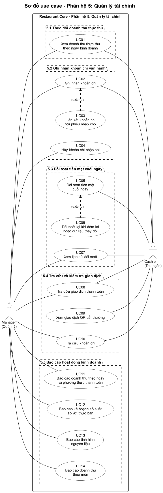
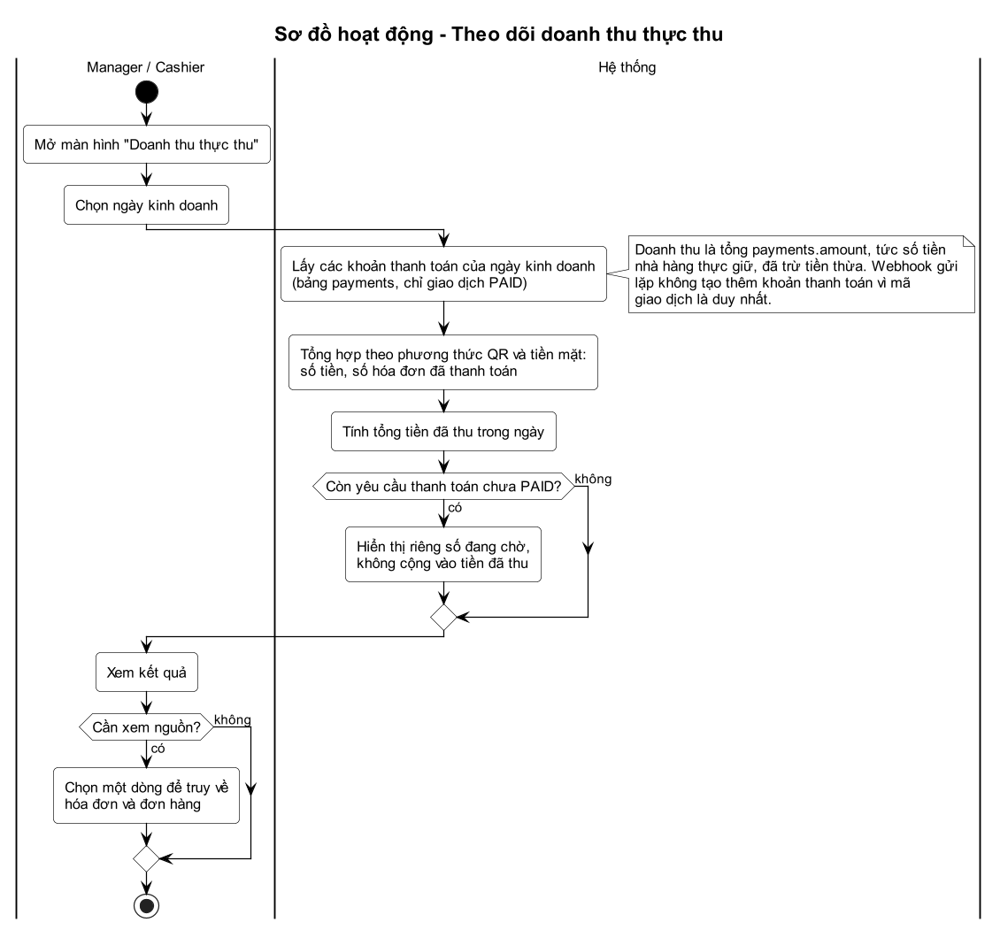
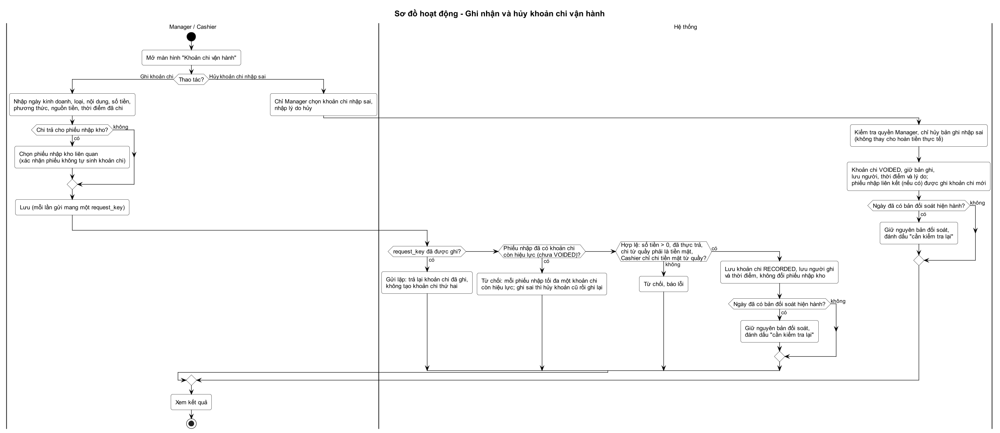
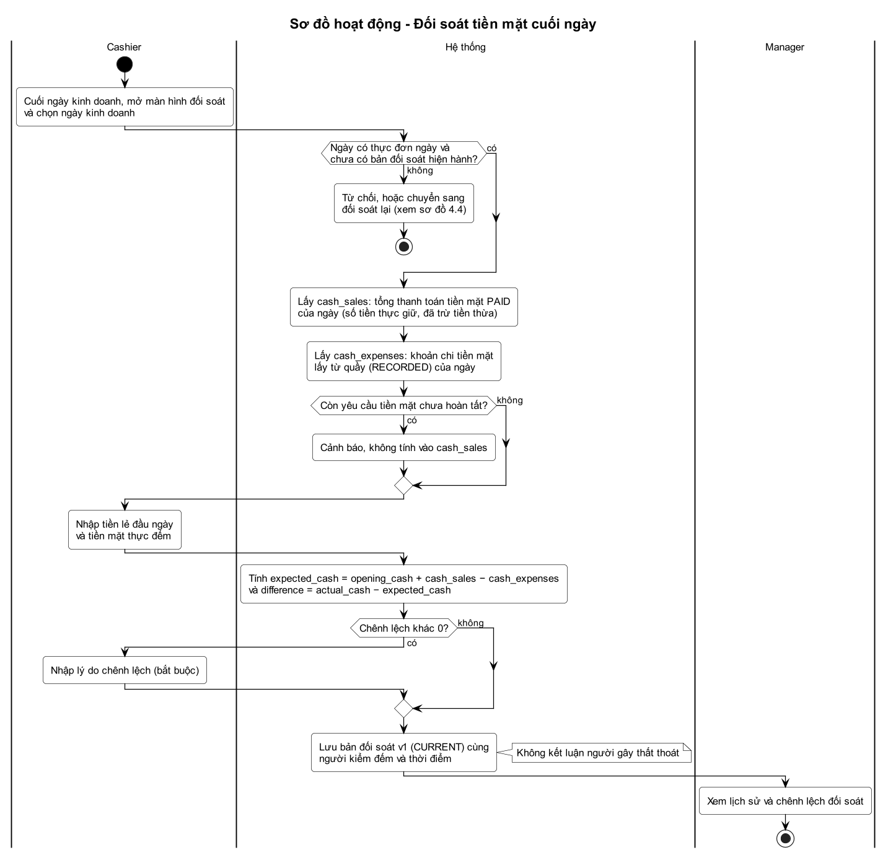
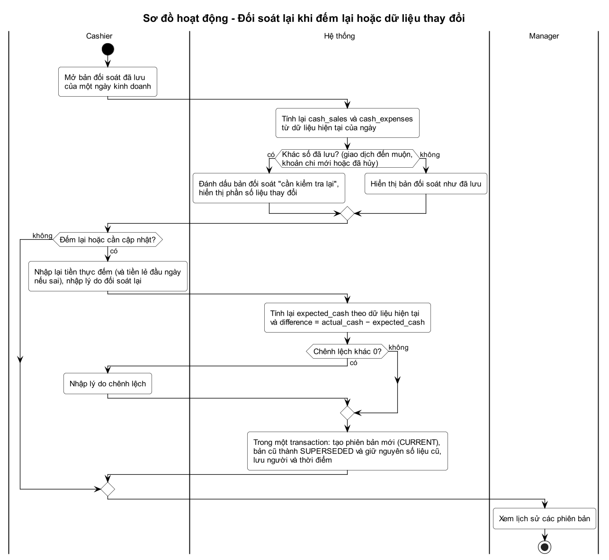
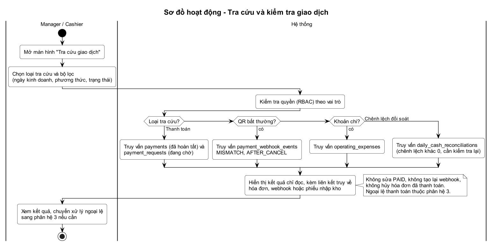
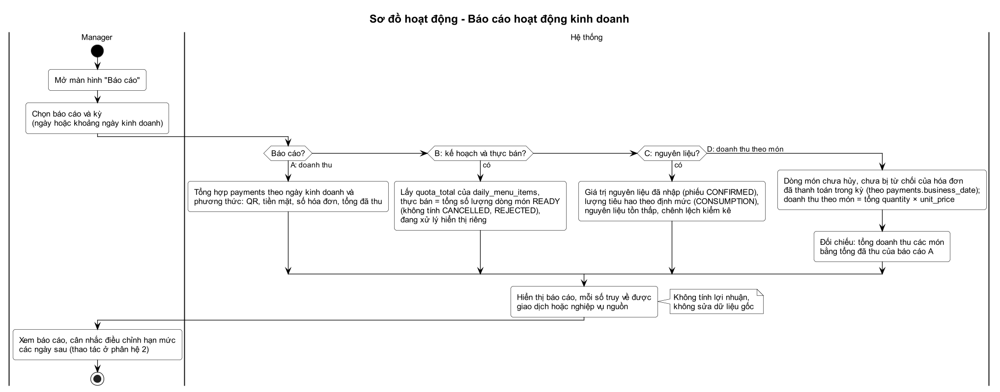
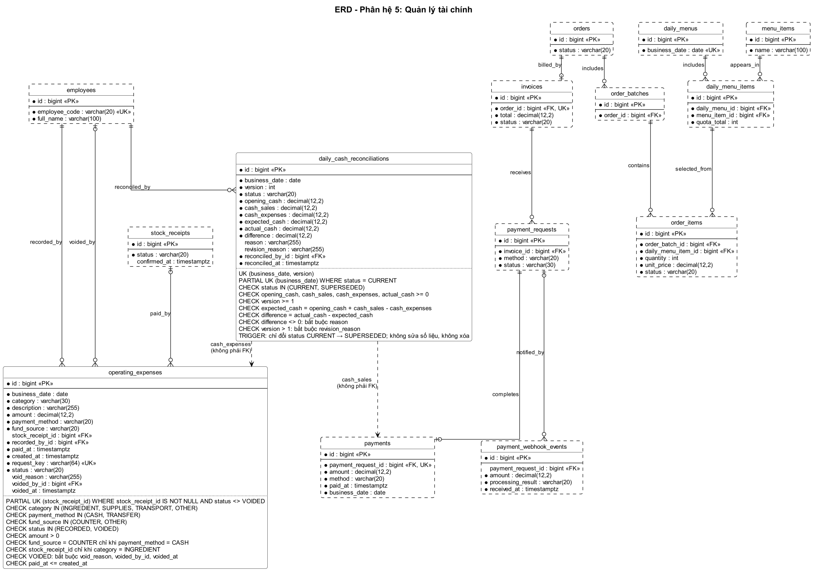

# Phân hệ 5 – Quản lý tài chính (RMS Core)

Tên chính thức: **Quản lý tài chính (Financial Management)**: theo dõi doanh thu thực thu, ghi nhận khoản chi vận hành, đối soát tiền mặt cuối ngày, tra cứu giao dịch và báo cáo hoạt động kinh doanh. Tài liệu phân tích gồm sơ đồ use case, sơ đồ hoạt động và ERD; nguồn sơ đồ là các file `.puml` (PlantUML) cùng thư mục, ảnh `.png` được render từ các file đó. Phân hệ 5 không tạo module thanh toán hay kho mới: doanh thu, tra cứu và báo cáo đọc dữ liệu của phân hệ 2, 3, 4; chỉ hai bảng nghiệp vụ mới là `operating_expenses` và `daily_cash_reconciliations`.

Công nghệ dự kiến: Spring Boot REST API, WebSocket, Web responsive. Demo bằng 1 laptop và 1–2 điện thoại, không cần thiết bị chuyên dụng.

## 1. Mục tiêu và phạm vi

**Mục tiêu:**

1. Biết chính xác số tiền đã thu từ hoạt động bán hàng.
2. Ghi nhận các khoản tiền thực sự đã chi.
3. Kiểm tra tiền mặt tại quầy vào cuối ngày kinh doanh.
4. Phát hiện và truy vết sai lệch.
5. Phân tích tình hình bán món và sử dụng nguyên liệu để hỗ trợ quyết định vận hành.

Phạm vi ở mức Core, không phải hệ thống kế toán.

**Actor và phân quyền:**

| Actor | Vai trò trong phân hệ |
| --- | --- |
| Manager – Quản lý | Xem toàn bộ dữ liệu và báo cáo; ghi mọi khoản chi, liên kết phiếu nhập, hủy khoản chi nhập sai; xem lịch sử đối soát |
| Cashier – Thu ngân | Xem doanh thu và giao dịch; ghi khoản chi tiền mặt lấy từ quầy (khi được cấp quyền); thực hiện và đối soát lại tiền mặt cuối ngày |

Không có actor ngoài và không vẽ actor "Hệ thống": tổng hợp, kiểm tra dữ liệu đổi sau đối soát và tính báo cáo là xử lý nội bộ. Waiter và Order Coordinator không dùng phân hệ này. Backend kiểm tra quyền (RBAC, phân hệ 1) ở mọi thao tác và lưu nhân viên thực hiện.

| Mã quyền (seed ở phân hệ 1) | Chức năng | Manager | Cashier |
| --- | --- | --- | --- |
| `FIN_REVENUE_VIEW` | Xem doanh thu thực thu (UC01) | có | có |
| `FIN_TXN_VIEW` | Tra cứu giao dịch thanh toán, giao dịch QR bất thường (UC08, UC09) | có | có |
| `FIN_EXPENSE_VIEW` | Tra cứu khoản chi (UC10) | có | có |
| `FIN_EXPENSE_RECORD` | Ghi mọi khoản chi, liên kết phiếu nhập, hủy khoản chi (UC02 đến UC04) | có | không |
| `FIN_EXPENSE_RECORD_COUNTER_CASH` | Ghi khoản chi tiền mặt lấy từ quầy (UC02, UC03) | có | có (được cấp) |
| `FIN_RECONCILE` | Thực hiện và đối soát lại tiền mặt (UC05, UC06) | không | có |
| `FIN_RECONCILE_VIEW` | Xem lịch sử và chênh lệch đối soát (UC07) | có | có |
| `FIN_REPORT_VIEW` | Báo cáo hoạt động kinh doanh (UC11 đến UC14) | có | không |

Một tài khoản có thể có nhiều vai trò (phân hệ 1), nên người vừa là Manager vừa là Cashier có quyền của cả hai.

**Năm nhóm chức năng:**

| STT | Nhóm chức năng | Nghiệp vụ triển khai |
| --- | --- | --- |
| 5.1 | Theo dõi doanh thu thực thu | Tự tổng hợp từ `payments` (chỉ `PAID`): QR, tiền mặt, số hóa đơn, tổng đã thu theo ngày kinh doanh |
| 5.2 | Ghi nhận khoản chi vận hành | Ghi khoản tiền đã thực trả; phân biệt giá trị phiếu nhập và tiền thực chi; liên kết phiếu nhập nếu có |
| 5.3 | Đối soát tiền mặt cuối ngày | Theo ngày kinh doanh, không theo ca: tiền dự kiến so với tiền thực đếm, lưu chênh lệch, lý do, người kiểm đếm |
| 5.4 | Tra cứu và kiểm tra giao dịch | Chỉ đọc: giao dịch hoàn tất, đang chờ, QR bất thường, khoản chi, chênh lệch đối soát |
| 5.5 | Báo cáo hoạt động kinh doanh | Doanh thu theo ngày và phương thức; kế hoạch số suất so với thực bán; tình hình nguyên liệu; doanh thu theo món |

Giới hạn Core: xem mục 9.

## 2. Quy tắc dữ liệu và nghiệp vụ

### 2.1 Khái niệm

| Khái niệm | Ý nghĩa |
| --- | --- |
| Ngày kinh doanh | `business_date` của thực đơn ngày (phân hệ 2), có thể kéo dài qua nửa đêm, không mặc định trùng ngày lịch. Mỗi khoản thanh toán mang ngày kinh doanh `payments.business_date` (phân hệ 3, PAY-09) |
| Doanh thu thực thu | Tổng `payments.amount` của giao dịch `PAID`: số tiền nhà hàng thực giữ lại, đã trừ tiền thừa |
| Khoản chi vận hành | Khoản tiền đã thực trả, ghi trong `operating_expenses`; khác với giá trị phiếu nhập kho |
| Khoản chi tiền mặt từ quầy | `payment_method = CASH` và `fund_source = COUNTER`, chưa hủy; chỉ loại này làm giảm tiền mặt dự kiến |
| Đối soát tiền mặt | So tiền mặt dự kiến với tiền thực đếm của một ngày kinh doanh |
| Cần kiểm tra lại | Bản đối soát mà số tiền bán bằng tiền mặt hoặc chi từ quầy hiện tại của ngày đó khác số đã lưu (suy ra khi xem, không lưu cờ) |

### 2.2 Công thức và quy tắc tổng hợp

```text
cash_sales (D)    = tổng payments.amount với business_date = D và method = CASH
cash_expenses (D) = tổng operating_expenses.amount với business_date = D, payment_method = CASH,
                    fund_source = COUNTER và status = RECORDED
expected_cash     = opening_cash + cash_sales - cash_expenses
difference        = actual_cash - expected_cash
```

- `opening_cash` là tiền lẻ đầu ngày do Cashier nhập; `actual_cash` là số tiền thực đếm.
- Tiền mặt từ hóa đơn chỉ tính phần nhà hàng thực giữ lại sau khi trả tiền thừa (`payments.amount`), không dùng số khách đưa (`cash_received`) hay số Cashier đếm khi nhận bàn giao (`cash_counted`).
- Doanh thu theo phương thức: QR là `method = QR`, tiền mặt là `method = CASH`; tổng số hóa đơn đã thanh toán bằng số khoản thanh toán của ngày (mỗi hóa đơn `PAID` có đúng một khoản thanh toán).
- Chỉ tổng hợp từ `payments`, không tạo bản ghi doanh thu riêng cho từng hóa đơn nên không có nguy cơ ghi nhận trùng; webhook gửi lặp không tạo thêm khoản thanh toán (phân hệ 3, PAY-05).

Ví dụ: tiền đầu ngày 500.000đ, bán tiền mặt 2.500.000đ, chi vật tư từ quầy 200.000đ thì tiền dự kiến là 500.000 + 2.500.000 − 200.000 = 2.800.000đ; thực đếm 2.780.000đ thì chênh lệch là −20.000đ, bắt buộc có lý do.

### 2.3 Trạng thái

**Khoản chi (`operating_expenses.status`):**

| Trạng thái | Ý nghĩa |
| --- | --- |
| `RECORDED` | Khoản chi đã ghi nhận, được tính vào tổng hợp |
| `VOIDED` | Hủy vì ghi sai, có lý do, người hủy, thời điểm; giữ bản ghi, không tính vào tổng hợp |

**Bản đối soát (`daily_cash_reconciliations.status`):**

| Trạng thái | Ý nghĩa |
| --- | --- |
| `CURRENT` | Phiên bản hiện hành của ngày kinh doanh, mỗi ngày tối đa một |
| `SUPERSEDED` | Đã bị phiên bản mới thay thế, giữ nguyên số liệu cũ để tra cứu lịch sử |

Bản đối soát đã lưu là bất biến: chỉ cột `status` được đổi (từ `CURRENT` sang `SUPERSEDED` khi có phiên bản mới). Khoản chi bất biến, chỉ chuyển `RECORDED` sang `VOIDED`.

### 2.4 Liên kết với phân hệ 1, 2, 3, 4

| Phân hệ | Dữ liệu sử dụng | Cách dùng |
| --- | --- | --- |
| 1 – Nhân viên | `employees`, RBAC | Phân quyền theo vai trò; lưu người ghi chi, người hủy, người đối soát. Không có lương hoặc bảng lương |
| 2 – Thực đơn | `daily_menus`, `daily_menu_items`, `menu_items` | Ngày kinh doanh, số suất giới hạn (`quota_total`), tên món; báo cáo không thay đổi hạn mức |
| 3 – Đơn hàng | `payments`, `payment_requests`, `invoices`, `orders`, `order_items`, `payment_webhook_events` | Nguồn doanh thu chính (`payments`, chỉ `PAID`); dòng món cho báo cáo thực bán; webhook cho tra cứu QR bất thường. Không tạo module thanh toán mới, không sửa dữ liệu giao dịch gốc |
| 4 – Kho | `stock_receipts`, `stock_receipt_items`, `stock_movements`, `ingredients`, `inventory_batches`, `stock_count_items` | Khoản chi có thể liên kết `stock_receipts`; báo cáo nguyên liệu đọc giá trị nhập, tiêu hao, tồn thấp, chênh lệch kiểm kê. Không tạo lại bảng kho; phiếu nhập không mặc định là một khoản tiền đã trả |

### 2.5 Quy tắc nghiệp vụ

| Mã | Quy tắc |
| --- | --- |
| FIN-01 | Chỉ tính doanh thu đã thu từ giao dịch `PAID`. Yêu cầu thanh toán chưa `PAID` (`REQUESTED`, `APPROVED`, `WAITING_TRANSFER`, `WAITING_CASH_HANDOVER`, `CANCELLED`) không cộng vào tiền đã thu. QR chỉ được ghi nhận khi webhook hợp lệ xử lý thành công; tiền mặt chỉ sau khi Cashier xác nhận đã nhận tiền và xử lý tiền thừa (phân hệ 3) |
| FIN-02 | Doanh thu tổng hợp trực tiếp từ `payments`, không tạo bản ghi doanh thu độc lập cho mỗi hóa đơn. Mỗi khoản thanh toán chỉ tính một lần; webhook gửi lặp không làm doanh thu tăng hai lần |
| FIN-03 | Phân hệ 5 không thay đổi trực tiếp trạng thái thanh toán và dữ liệu giao dịch gốc: không sửa `PAID`, không tạo lại webhook, không hủy hóa đơn đã thanh toán. Ngoại lệ thanh toán thuộc quyền sở hữu của phân hệ 3 |
| FIN-04 | Phiếu nhập kho không tự sinh khoản chi đã thanh toán: xác nhận phiếu ở phân hệ 4 không tạo khoản chi. Giá trị phiếu nhập (`input_quantity` × `unit_price`) khác tiền thực chi; chỉ tạo khoản chi khi thực sự phát sinh thanh toán và có thể liên kết `stock_receipts`. Mỗi phiếu nhập liên kết tối đa một khoản chi còn hiệu lực (chưa `VOIDED`), bảo đảm bằng chỉ mục duy nhất một phần; khoản chi `VOIDED` giữ nguyên làm lịch sử nên phiếu được ghi lại khoản chi mới. Core không quản lý công nợ hay thanh toán nhiều đợt cho một phiếu |
| FIN-05 | Mỗi khoản chi là khoản đã thực trả: số tiền lớn hơn 0, thời điểm trả không ở tương lai. Không có công nợ, trả góp, tạm ứng, lương, duyệt chi nhiều cấp |
| FIN-06 | Chỉ khoản chi tiền mặt lấy từ quầy (`CASH` và `COUNTER`, chưa hủy) làm giảm tiền mặt dự kiến. Chi chuyển khoản hoặc chi từ nguồn khác quầy không làm giảm |
| FIN-07 | Tiền khách đưa và tiền thừa không làm sai doanh thu thực giữ lại: doanh thu tiền mặt là `payments.amount`, không phải `cash_received` hay `cash_counted` |
| FIN-08 | Đối soát chỉ theo ngày kinh doanh, không theo ca: không quản lý phiên quỹ, không đối soát khi đổi ca, không yêu cầu nhà hàng dừng phục vụ để kiểm tiền |
| FIN-09 | Mỗi ngày kinh doanh có tối đa một bản đối soát hiện hành. Chênh lệch khác 0 bắt buộc có lý do; lưu người kiểm đếm và thời điểm. Hệ thống không tự kết luận nhân viên gây thất thoát |
| FIN-10 | Bản đối soát đã lưu không bị sửa âm thầm. Khi có giao dịch đến muộn hoặc dữ liệu thay đổi sau đối soát (khoản chi mới hoặc bị hủy), bản đối soát được đánh dấu "cần kiểm tra lại". Cập nhật bằng phiên bản mới có lý do, bản cũ chuyển `SUPERSEDED` và giữ nguyên số liệu |
| FIN-11 | Khoản chi không bị xóa; ghi sai thì Manager hủy (`VOIDED`) kèm lý do, người, thời điểm, rồi ghi lại khoản đúng |
| FIN-12 | Mọi tổng hợp thu, chi, đối soát theo ngày kinh doanh (`payments.business_date`, `operating_expenses.business_date`), không theo ngày lịch của `paid_at` |
| FIN-13 | Báo cáo thực bán chỉ tính dòng món đã hoàn thành (`READY`); món `REJECTED`, `CANCELLED` không được tính là đã bán; món đang xử lý hiển thị riêng, món `PENDING` không tính |
| FIN-14 | Không tính lợi nhuận chính thức khi chưa có mô hình chi phí đầy đủ. Không gọi tổng doanh thu trừ tiền mua nguyên liệu là lợi nhuận; thu và chi hiển thị riêng |
| FIN-15 | Mọi số liệu báo cáo truy xuất được về giao dịch hoặc nghiệp vụ nguồn (khoản thanh toán, hóa đơn, khoản chi, phiếu nhập, dòng món, biến động kho) |
| FIN-16 | Báo cáo và tra cứu chỉ đọc, không sửa dữ liệu gốc của phân hệ khác và không thay đổi số suất của thực đơn |
| FIN-17 | Backend kiểm tra quyền ở mọi thao tác; Cashier chỉ ghi khoản chi tiền mặt lấy từ quầy; Manager không thực hiện đối soát; mọi thao tác ghi lưu nhân viên thực hiện |
| FIN-18 | Không ghi trùng khoản chi: mỗi lần lưu khoản chi mang một `request_key` do giao diện sinh; `operating_expenses.request_key` duy nhất nên bấm lưu hai lần hoặc mạng gửi lại không tạo khoản chi thứ hai, backend trả lại khoản chi đã ghi |
| FIN-19 | Doanh thu theo món tính từ dòng món chưa `CANCELLED`, chưa `REJECTED` của các hóa đơn có khoản thanh toán trong kỳ (theo `payments.business_date`): số lượng × giá lúc đặt (`order_items.unit_price`). Core không có giảm giá nên tổng doanh thu các món bằng tổng đã thu của báo cáo A cùng kỳ; lệch là dấu hiệu dữ liệu sai cần kiểm tra |

## 3. Sơ đồ use case

Phân hệ có 14 use case. Manager và Cashier là hai actor; không có actor ngoài. Điều kiện tiên quyết của mọi use case: đã đăng nhập và có quyền tương ứng.



| Mã | Use case | Actor | Mô tả |
| --- | --- | --- | --- |
| UC01 | Xem doanh thu thực thu theo ngày kinh doanh | Manager, Cashier | Chọn ngày kinh doanh; hệ thống tổng hợp từ `payments` (chỉ `PAID`): tiền đã thu bằng QR, bằng tiền mặt, số hóa đơn đã thanh toán, tổng tiền đã thu; yêu cầu chưa `PAID` hiển thị riêng, không cộng (FIN-01, FIN-02, FIN-07, FIN-12) |
| UC02 | Ghi nhận khoản chi | Manager, Cashier | Nhập ngày kinh doanh, loại, nội dung, số tiền, phương thức (`CASH`, `TRANSFER`), nguồn tiền (`COUNTER`, `OTHER`), thời điểm đã chi; lưu `RECORDED` kèm người ghi. Cashier chỉ ghi chi tiền mặt lấy từ quầy (FIN-05, FIN-06, FIN-17) |
| UC03 | Liên kết khoản chi với phiếu nhập kho | (theo UC02) | Mở rộng UC02: chọn phiếu nhập liên quan khi khoản chi trả cho nguyên liệu; không đổi trạng thái hay giá trị phiếu nhập; mỗi phiếu tối đa một khoản chi còn hiệu lực, khoản chi đã hủy giữ làm lịch sử (FIN-04) |
| UC04 | Hủy khoản chi nhập sai | Manager | Hủy khoản chi ghi sai: `VOIDED` kèm lý do, người, thời điểm; giữ bản ghi (FIN-11) |
| UC05 | Đối soát tiền mặt cuối ngày | Cashier | Chọn ngày kinh doanh; hệ thống lấy `cash_sales` và `cash_expenses`; Cashier nhập tiền lẻ đầu ngày và tiền thực đếm; hệ thống tính tiền dự kiến và chênh lệch; nhập lý do nếu khác 0; lưu bản đối soát phiên bản 1 (FIN-08, FIN-09) |
| UC06 | Đối soát lại khi đếm lại hoặc dữ liệu thay đổi | (theo UC05) | Mở rộng UC05: khi bản đối soát "cần kiểm tra lại" hoặc cần đếm lại, nhập tiền thực đếm và lý do; tạo phiên bản mới, bản cũ `SUPERSEDED` (FIN-10) |
| UC07 | Xem lịch sử đối soát | Manager, Cashier | Các bản đối soát theo ngày và phiên bản: người, thời điểm, chênh lệch, lý do; bản cần kiểm tra lại được đánh dấu |
| UC08 | Tra cứu giao dịch thanh toán | Manager, Cashier | Lọc ngày kinh doanh, phương thức, trạng thái (hoàn tất `PAID` hoặc đang chờ); truy về hóa đơn và đơn hàng; chỉ xem (FIN-03) |
| UC09 | Xem giao dịch QR bất thường | Manager, Cashier | Webhook `MISMATCH`, `AFTER_CANCEL` từ `payment_webhook_events`; chỉ xem, việc đối chiếu xử lý ở phân hệ 3 (UC23) |
| UC10 | Tra cứu khoản chi | Manager, Cashier | Lọc ngày kinh doanh, loại, phương thức, nguồn tiền, trạng thái; xem phiếu nhập liên kết |
| UC11 | Báo cáo doanh thu theo ngày và phương thức thanh toán | Manager | Báo cáo A: QR, tiền mặt, tổng, số hóa đơn theo từng ngày kinh doanh |
| UC12 | Báo cáo kế hoạch số suất so với thực bán | Manager | Báo cáo B: số suất kế hoạch, thực bán, đang xử lý, tỷ lệ theo món và ngày (FIN-13) |
| UC13 | Báo cáo tình hình nguyên liệu | Manager | Báo cáo C: giá trị nguyên liệu đã nhập, lượng tiêu hao theo định mức, nguyên liệu tồn thấp, chênh lệch kiểm kê (FIN-14) |
| UC14 | Báo cáo doanh thu theo món | Manager | Báo cáo D: số lượng đã bán và doanh thu của từng món trong các hóa đơn đã thanh toán, tỷ trọng doanh thu; tổng khớp báo cáo A (FIN-19) |

Chỉ có hai quan hệ «extend»: UC03 mở rộng UC02 và UC06 mở rộng UC05, vì liên kết phiếu nhập và đối soát lại đều là phần tùy chọn của luồng chính. Chống thống kê trùng, kiểm tra dữ liệu đổi sau đối soát và tính tổng hợp là xử lý nội bộ, mô tả trong sơ đồ hoạt động.

**Ranh giới hệ thống:** khung nét liền "Restaurant Core – Phân hệ 5" là ranh giới hệ thống; các khung nét đứt chỉ nhóm use case theo chức năng, không phải hệ thống riêng. Actor đứng ngoài khung và nối với use case bằng đường liên kết không mũi tên. UC03 và UC06 do cùng actor của UC02 và UC05 thực hiện nên không vẽ thêm đường nối actor.

## 4. Sơ đồ hoạt động

| Chức năng | Sơ đồ |
| --- | --- |
| 5.1 Theo dõi doanh thu thực thu | 4.1 |
| 5.2 Ghi nhận khoản chi vận hành | 4.2 |
| 5.3 Đối soát tiền mặt cuối ngày | 4.3 (có hoặc không chênh lệch), 4.4 (đối soát lại) |
| 5.4 Tra cứu và kiểm tra giao dịch | 4.5 |
| 5.5 Báo cáo hoạt động kinh doanh | 4.6 |

### 4.1 Theo dõi doanh thu thực thu



- Chọn ngày kinh doanh; hệ thống lấy khoản thanh toán của ngày từ `payments` (chỉ `PAID`), tổng hợp theo QR và tiền mặt, tính số hóa đơn và tổng đã thu.
- Yêu cầu chưa `PAID` hiển thị riêng, không cộng vào tiền đã thu. Mỗi dòng truy về được hóa đơn và đơn hàng.

### 4.2 Ghi nhận và hủy khoản chi



- Ghi khoản chi: nhập các trường bắt buộc, có thể chọn phiếu nhập liên quan; mỗi lần lưu mang một `request_key`. Mã đã được ghi thì đây là lần gửi lặp, hệ thống trả lại khoản chi cũ (FIN-18). Phiếu nhập đã có khoản chi còn hiệu lực thì từ chối (FIN-04). Ngược lại hệ thống kiểm tra số tiền, đã thực trả, chi từ quầy phải là tiền mặt, Cashier chỉ chi tiền mặt từ quầy rồi lưu `RECORDED` cùng người ghi. Phiếu nhập không đổi.
- Hủy khoản chi nhập sai (Manager): `VOIDED` kèm lý do, giữ bản ghi; phiếu nhập liên kết (nếu có) được ghi lại khoản chi đúng.
- Nếu ngày đã có bản đối soát hiện hành, bản đó giữ nguyên và được đánh dấu "cần kiểm tra lại" (FIN-10).

### 4.3 Đối soát tiền mặt cuối ngày



- Cashier mở màn hình đối soát cuối ngày kinh doanh; hệ thống kiểm tra ngày có thực đơn ngày và chưa có bản hiện hành, rồi lấy `cash_sales`, `cash_expenses`; cảnh báo nếu còn yêu cầu tiền mặt chưa hoàn tất.
- Cashier nhập tiền lẻ đầu ngày và tiền thực đếm; hệ thống tính `expected_cash` và `difference`.
- Có chênh lệch: Cashier nhập lý do bắt buộc. Không có chênh lệch: lưu ngay. Lưu bản phiên bản 1 (`CURRENT`) cùng người kiểm đếm và thời điểm; hệ thống không kết luận người gây thất thoát. Manager xem lịch sử.

### 4.4 Đối soát lại khi đếm lại hoặc dữ liệu thay đổi



- Khi mở bản đã lưu, hệ thống tính lại `cash_sales`, `cash_expenses` từ dữ liệu hiện tại; khác số đã lưu (giao dịch đến muộn, khoản chi mới hoặc đã hủy) thì đánh dấu "cần kiểm tra lại" và hiển thị phần thay đổi.
- Cashier nhập lại tiền thực đếm và lý do đối soát lại; hệ thống tính lại tiền dự kiến và chênh lệch theo dữ liệu hiện tại, tạo phiên bản mới (`CURRENT`), bản cũ thành `SUPERSEDED` và giữ nguyên số liệu cũ.

### 4.5 Tra cứu và kiểm tra giao dịch



- Chọn loại tra cứu (thanh toán, QR bất thường, khoản chi, chênh lệch đối soát) và bộ lọc; backend kiểm tra quyền rồi truy vấn chỉ đọc.
- Kết quả có liên kết truy về hóa đơn, webhook hoặc phiếu nhập kho. Không sửa `PAID`, không tạo lại webhook, không hủy hóa đơn đã thanh toán; ngoại lệ thanh toán chuyển sang xử lý ở phân hệ 3 (FIN-03).

### 4.6 Báo cáo hoạt động kinh doanh



- Manager chọn báo cáo A, B, C hoặc D và kỳ (ngày hoặc khoảng ngày kinh doanh); hệ thống tính theo quy tắc ở mục 6, hiển thị kèm truy xuất nguồn. Báo cáo D đối chiếu tổng doanh thu các món với tổng đã thu của báo cáo A (FIN-19).
- Báo cáo không tính lợi nhuận và không sửa dữ liệu gốc; Manager có thể dùng kết quả để điều chỉnh hạn mức các ngày sau ở phân hệ 2.

## 5. ERD



Phân hệ sở hữu 2 bảng, vẽ viền liền, đủ cột và ràng buộc. Bảng của phân hệ 1, 2, 3, 4 vẽ viền nét đứt và chỉ hiện khóa cùng các cột phân hệ 5 dùng; đó là cùng một bảng trong cơ sở dữ liệu chung, định nghĩa đầy đủ ở README phân hệ sở hữu và [ERD tổng thể](../erd-tong-the.png); phân hệ 5 không tạo bảng mới nào khác. Tra cứu 5.4 và báo cáo 5.5 không có bảng riêng, đọc trực tiếp bảng của phân hệ 2, 3, 4.

ERD có ba loại liên kết, phân biệt rõ:

1. **Khóa ngoại thật** (đường chân chim): `operating_expenses` → `employees`, `stock_receipts`; `daily_cash_reconciliations` → `employees`.
2. **Đường truy xuất qua bảng trung gian** (mỗi đoạn là khóa ngoại thật giữa các bảng của phân hệ 2, 3): `payments` → `payment_requests` → `invoices` → `orders` ← `order_batches` ← `order_items` → `daily_menu_items` → `daily_menus`, `menu_items`; `payment_webhook_events` → `payment_requests`. Đường này cho phân hệ 5 tổng hợp giao dịch `PAID`, truy từ khoản thanh toán về hóa đơn và các món đã bán (UC08, FIN-15), tính thực bán theo món (UC12), doanh thu theo món (UC14, FIN-19) và lấy ngày kinh doanh của thực đơn. Không có khóa ngoại trực tiếp giữa `order_items` và `payments`: hai bảng đã nối gián tiếp qua đơn và hóa đơn.
3. **Liên kết tổng hợp** (mũi tên nét đứt, nhãn ghi "không phải FK"): `daily_cash_reconciliations.cash_sales` tổng hợp từ `payments`, `cash_expenses` tổng hợp từ `operating_expenses` theo `business_date`. Đây là phụ thuộc số liệu, không có cột khóa ngoại.

Báo cáo C (tình hình nguyên liệu) đọc bảng kho `stock_receipt_items`, `stock_movements`, `inventory_batches`, `ingredients`, `stock_counts`, `stock_count_items` theo đường khóa ngoại của phân hệ 4; các bảng này không vẽ lại ở đây, xem [ERD phân hệ 4](../04-quan-ly-kho/erd.png).

**Quy ước toàn hệ thống:** tên bảng và cột `snake_case`, tên bảng số nhiều; khóa chính `id BIGINT`; khóa ngoại `<thực thể>_id BIGINT`; chỉ khóa ngoại mới có hậu tố `_id`. Cột chỉ người thực hiện mang tên vai trò và tham chiếu `employees.id`: dùng `recorded_by_id`, `voided_by_id`, `reconciled_by_id` (không dùng `recorded_by`, `reconciled_by`). Thời điểm dùng `TIMESTAMPTZ`, ngày dùng `DATE`; tiền dùng `DECIMAL(12,2)`, không dùng `FLOAT` hay `DOUBLE`.

**Bảng của phân hệ khác trong ERD:**

| Bảng | Phân hệ sở hữu | Vai trò đối với phân hệ 5 | Cột hiện trong ERD |
| --- | --- | --- | --- |
| employees | 1 – Nhân viên | Người ghi chi, người hủy chi, người đối soát | `id`, `employee_code`, `full_name` |
| stock_receipts | 4 – Kho | Phiếu nhập liên kết với khoản chi | `id`, `status`, `confirmed_at` |
| payments | 3 – Đơn hàng | Nguồn doanh thu và `cash_sales` | `id`, `payment_request_id`, `amount`, `method`, `paid_at`, `business_date` |
| payment_requests | 3 – Đơn hàng | Yêu cầu chưa `PAID` hiển thị riêng; nối khoản thanh toán với hóa đơn | `id`, `invoice_id`, `method`, `status` |
| payment_webhook_events | 3 – Đơn hàng | Giao dịch QR bất thường (`MISMATCH`, `AFTER_CANCEL`) cho UC09 | `id`, `payment_request_id`, `amount`, `processing_result`, `received_at` |
| invoices | 3 – Đơn hàng | Hóa đơn của khoản thanh toán; số hóa đơn đã thanh toán | `id`, `order_id`, `total`, `status` |
| orders | 3 – Đơn hàng | Đơn tổng nối hóa đơn với các đợt gọi món | `id`, `status` |
| order_batches | 3 – Đơn hàng | Đợt gọi món nối đơn với dòng món | `id`, `order_id` |
| order_items | 3 – Đơn hàng | Số suất thực bán, đang xử lý cho báo cáo B; số lượng và giá lúc đặt của món đã bán cho báo cáo D | `id`, `order_batch_id`, `daily_menu_item_id`, `quantity`, `unit_price`, `status` |
| daily_menu_items | 2 – Thực đơn | Số suất kế hoạch (`quota_total`) cho báo cáo B | `id`, `daily_menu_id`, `menu_item_id`, `quota_total` |
| daily_menus | 2 – Thực đơn | Ngày kinh doanh của thực đơn | `id`, `business_date` |
| menu_items | 2 – Thực đơn | Tên món trong báo cáo | `id`, `name` |

Từ điển dữ liệu đầy đủ của các bảng này nằm ở README phân hệ sở hữu. Cột khóa ngoại không dùng ở phân hệ 5 (ví dụ `order_batches.waiter_id`, `payment_requests.cashier_id`) không hiện trong ERD này.

**Quan hệ:**

| Quan hệ | Khóa ngoại | Nhãn |
| --- | --- | --- |
| employees 1 – N operating_expenses | `operating_expenses.recorded_by_id` | recorded_by |
| employees 0..1 – N operating_expenses | `operating_expenses.voided_by_id` | voided_by |
| stock_receipts 0..1 – N operating_expenses | `operating_expenses.stock_receipt_id` | paid_by |
| employees 1 – N daily_cash_reconciliations | `daily_cash_reconciliations.reconciled_by_id` | reconciled_by |

Khóa ngoại giữa các bảng tham chiếu vẽ trong ERD (giữ nhãn của phân hệ sở hữu):

| Quan hệ | Khóa ngoại | Nhãn |
| --- | --- | --- |
| payment_requests 1 – 0..1 payments | `payments.payment_request_id` | completes |
| payment_requests 0..1 – N payment_webhook_events | `payment_webhook_events.payment_request_id` | notified_by |
| invoices 1 – N payment_requests | `payment_requests.invoice_id` | receives |
| orders 1 – 0..1 invoices | `invoices.order_id` | billed_by |
| orders 1 – N order_batches | `order_batches.order_id` | includes |
| order_batches 1 – N order_items | `order_items.order_batch_id` | contains |
| daily_menu_items 1 – N order_items | `order_items.daily_menu_item_id` | selected_from |
| daily_menus 1 – N daily_menu_items | `daily_menu_items.daily_menu_id` | includes |
| menu_items 1 – N daily_menu_items | `daily_menu_items.menu_item_id` | appears_in |

Liên kết tổng hợp (không phải khóa ngoại): `daily_cash_reconciliations.cash_sales` lấy từ `payments` theo `business_date` và `method = CASH`; `daily_cash_reconciliations.cash_expenses` lấy từ `operating_expenses` theo `business_date`, `CASH`, `COUNTER`, `RECORDED`.

**Ràng buộc và chỉ mục:**

| Bảng | Ràng buộc và chỉ mục |
| --- | --- |
| operating_expenses | CHECK `amount` > 0; CHECK `payment_method` thuộc (`CASH`, `TRANSFER`); CHECK `fund_source` thuộc (`COUNTER`, `OTHER`); `fund_source = COUNTER` chỉ khi `payment_method = CASH`; CHECK `category` thuộc (`INGREDIENT`, `SUPPLIES`, `TRANSPORT`, `OTHER`); `stock_receipt_id` chỉ khi `category = INGREDIENT`; CHECK `status` thuộc (`RECORDED`, `VOIDED`); khi `VOIDED` bắt buộc `void_reason`, `voided_by_id`, `voided_at`; CHECK `paid_at` ≤ `created_at` (đã thực trả); UNIQUE (`request_key`) chống ghi trùng khi gửi lặp (FIN-18); UNIQUE (`stock_receipt_id`) khi `stock_receipt_id` có giá trị và `status` ≠ `VOIDED`: mỗi phiếu nhập tối đa một khoản chi còn hiệu lực (FIN-04); INDEX (`business_date`, `payment_method`, `fund_source`, `status`) cho tổng hợp tiền mặt; INDEX (`stock_receipt_id`) |
| daily_cash_reconciliations | UNIQUE (`business_date`, `version`); UNIQUE (`business_date`) khi `status = CURRENT`; CHECK `version` ≥ 1; CHECK `status` thuộc (`CURRENT`, `SUPERSEDED`); CHECK `opening_cash`, `cash_sales`, `cash_expenses`, `actual_cash` ≥ 0; CHECK `expected_cash` = `opening_cash` + `cash_sales` − `cash_expenses`; CHECK `difference` = `actual_cash` − `expected_cash`; `reason` bắt buộc khi `difference` ≠ 0; `revision_reason` bắt buộc khi `version` > 1; trigger giữ bản đối soát bất biến: chỉ được đổi `status` từ `CURRENT` sang `SUPERSEDED`, không sửa số liệu, không xóa (FIN-10) |

- Ngăn bản đối soát trùng: UNIQUE (`business_date`, `version`) không cho hai bản cùng phiên bản; UNIQUE một bản `CURRENT` mỗi ngày không cho hai bản hiện hành. Hai Cashier đối soát lại cùng lúc thì chỉ một bản mới được tạo.
- Ngăn ghi sai ngày kinh doanh: backend chỉ nhận ngày có thực đơn ngày (`daily_menus.business_date`) và không ở tương lai cho đối soát; ngày kinh doanh của khoản chi không ở tương lai.
- Ràng buộc "khi ..." là chỉ mục duy nhất một phần hoặc kiểm tra có điều kiện của PostgreSQL; ERD ghi dạng `PARTIAL UK (...) WHERE ...`.
- Bản đối soát bất biến: ứng dụng chỉ được cập nhật cột `status` của bản cũ khi tạo phiên bản mới, trong cùng transaction.

### Từ điển dữ liệu

**operating_expenses** – Khoản chi vận hành

| Cột | Kiểu | Ràng buộc | Ý nghĩa |
| --- | --- | --- | --- |
| id | bigint | PK | Mã khoản chi |
| business_date | date | bắt buộc | Ngày kinh doanh mà khoản chi được tính |
| category | varchar(30) | bắt buộc, CHECK | INGREDIENT (nguyên liệu), SUPPLIES (vật tư tiêu hao), TRANSPORT (vận chuyển), OTHER (khác) |
| description | varchar(255) | bắt buộc | Nội dung khoản chi |
| amount | decimal(12,2) | bắt buộc, > 0 | Số tiền thực trả |
| payment_method | varchar(20) | bắt buộc, CHECK | CASH (tiền mặt), TRANSFER (chuyển khoản) |
| fund_source | varchar(20) | bắt buộc, CHECK | COUNTER (tiền mặt lấy từ quầy), OTHER (nguồn khác) |
| stock_receipt_id | bigint | FK → stock_receipts | Phiếu nhập kho liên quan, nếu có; mỗi phiếu tối đa một khoản chi chưa hủy (FIN-04) |
| recorded_by_id | bigint | FK → employees, bắt buộc | Người ghi khoản chi |
| paid_at | timestamptz | bắt buộc | Thời điểm thực trả |
| created_at | timestamptz | bắt buộc | Thời điểm ghi vào hệ thống |
| request_key | varchar(64) | UK, bắt buộc | Mã của lần lưu do giao diện sinh; gửi lặp cùng mã không tạo khoản chi thứ hai (FIN-18) |
| status | varchar(20) | bắt buộc, CHECK | RECORDED, VOIDED |
| void_reason | varchar(255) | | Lý do hủy, bắt buộc khi VOIDED |
| voided_by_id | bigint | FK → employees | Người hủy khoản chi |
| voided_at | timestamptz | | Thời điểm hủy |

**daily_cash_reconciliations** – Đối soát tiền mặt cuối ngày

| Cột | Kiểu | Ràng buộc | Ý nghĩa |
| --- | --- | --- | --- |
| id | bigint | PK | Mã bản đối soát |
| business_date | date | bắt buộc | Ngày kinh doanh được đối soát |
| version | int | bắt buộc | Số phiên bản, bắt đầu từ 1; (business_date, version) duy nhất |
| status | varchar(20) | bắt buộc, CHECK | CURRENT, SUPERSEDED |
| opening_cash | decimal(12,2) | bắt buộc, ≥ 0 | Tiền lẻ đầu ngày do Cashier nhập |
| cash_sales | decimal(12,2) | bắt buộc, ≥ 0 | Doanh thu tiền mặt của ngày tại thời điểm đối soát (số nhà hàng thực giữ, sau khi trả tiền thừa) |
| cash_expenses | decimal(12,2) | bắt buộc, ≥ 0 | Tổng khoản chi tiền mặt lấy từ quầy của ngày tại thời điểm đối soát |
| expected_cash | decimal(12,2) | bắt buộc | Tiền dự kiến = opening_cash + cash_sales − cash_expenses |
| actual_cash | decimal(12,2) | bắt buộc, ≥ 0 | Tiền mặt thực đếm |
| difference | decimal(12,2) | bắt buộc | Chênh lệch = actual_cash − expected_cash |
| reason | varchar(255) | | Lý do chênh lệch, bắt buộc khi difference khác 0 |
| revision_reason | varchar(255) | | Lý do đối soát lại, bắt buộc khi version lớn hơn 1 |
| reconciled_by_id | bigint | FK → employees, bắt buộc | Người kiểm đếm |
| reconciled_at | timestamptz | bắt buộc | Thời điểm lưu bản đối soát |

Các cột `status`, `void_reason`, `voided_by_id`, `voided_at` của `operating_expenses` và `version`, `status`, `revision_reason` của `daily_cash_reconciliations` là phần bổ sung ngoài danh sách dự kiến, để hủy khoản chi nhập sai và đối soát lại có lưu vết mà không tạo hệ thống quản lý quỹ; `operating_expenses.request_key` bổ sung để chống ghi trùng khoản chi (FIN-18).

### Chuẩn hóa và khóa ngoại

- **1NF, 2NF:** mọi cột một giá trị; hai bảng có khóa chính một cột `id`.
- **3NF:** không có bảng doanh thu riêng (FIN-02): doanh thu luôn tổng hợp từ `payments`, nên không lưu trùng dữ liệu giao dịch. Các cột dưới đây là bản chụp hoặc giá trị suy ra có kiểm soát:

| Thuộc tính | Vì sao giữ | Kiểm soát |
| --- | --- | --- |
| `daily_cash_reconciliations.cash_sales`, `cash_expenses` | Bản chụp tổng hợp tại lúc đối soát; cần để so với dữ liệu hiện tại, phát hiện "cần kiểm tra lại" (FIN-10) và giữ số liệu của từng phiên bản | Ghi một lần; bản đối soát bất biến, thay đổi bằng phiên bản mới |
| `daily_cash_reconciliations.expected_cash`, `difference` | Suy ra từ các cột cùng dòng; lưu để lịch sử đối soát hiện đúng số đã chốt | CHECK `expected_cash` = `opening_cash` + `cash_sales` − `cash_expenses`; CHECK `difference` = `actual_cash` − `expected_cash` |
| `operating_expenses.business_date` | Không suy ra từ `paid_at`: ngày kinh doanh có thể kéo dài qua nửa đêm (FIN-12) | Backend chỉ nhận ngày có thực đơn ngày, không ở tương lai |

- `operating_expenses.stock_receipt_id` là khóa ngoại tùy chọn, không UNIQUE trên toàn bảng vì khoản chi `VOIDED` vẫn giữ liên kết làm lịch sử (nên bản số trong ERD là 0..1 – N); chỉ mục duy nhất một phần bảo đảm mỗi phiếu tối đa một khoản chi còn hiệu lực (FIN-04). Khoản chi không phải nguyên liệu để trống (CHECK theo `category`).
- `operating_expenses.request_key` là khóa duy nhất kỹ thuật cho mỗi lần lưu, không phụ thuộc cột nào khác; không dùng tổ hợp (ngày, số tiền, nội dung) làm khóa vì hai khoản chi thật có thể trùng các giá trị này.
- Phiên bản đối soát lưu bằng nhiều dòng cùng `business_date`, phân biệt bởi `version`; chỉ một dòng `CURRENT` mỗi ngày. Trigger giữ các phiên bản đã lưu bất biến.
- Mọi khóa ngoại `ON DELETE RESTRICT`; khoản chi không xóa mà chuyển `VOIDED` (FIN-11).

Đoạn SQL dưới đây trích các ràng buộc cần giải thích; toàn bộ lược đồ (kể cả CHECK tập giá trị trạng thái) ở [schema-phan-he-2-5.sql](../database/schema-phan-he-2-5.sql), sinh từ ERD bằng `docs/tools/gen-schema.js`.

```sql
-- Mỗi phiếu nhập tối đa một khoản chi còn hiệu lực; khoản chi VOIDED giữ làm lịch sử, cho phép ghi lại (FIN-04)
CREATE UNIQUE INDEX ux_operating_expenses_stock_receipt ON operating_expenses (stock_receipt_id)
  WHERE stock_receipt_id IS NOT NULL AND status <> 'VOIDED';

-- Bản đối soát bất biến (FIN-10): chỉ được đổi status CURRENT → SUPERSEDED, không sửa số liệu, không xóa
CREATE FUNCTION fn_reconciliations_immutable() RETURNS trigger LANGUAGE plpgsql AS $$
BEGIN
    IF TG_OP = 'DELETE' THEN
        RAISE EXCEPTION 'Không được xóa bản đối soát %', OLD.id;
    END IF;
    IF (to_jsonb(NEW) - 'status') IS DISTINCT FROM (to_jsonb(OLD) - 'status')
       OR NOT (OLD.status = 'CURRENT' AND NEW.status IN ('CURRENT', 'SUPERSEDED')) THEN
        RAISE EXCEPTION 'Bản đối soát % chỉ được chuyển CURRENT sang SUPERSEDED', OLD.id;
    END IF;
    RETURN NEW;
END;
$$;
CREATE TRIGGER trg_daily_cash_reconciliations_immutable BEFORE UPDATE OR DELETE ON daily_cash_reconciliations
FOR EACH ROW EXECUTE FUNCTION fn_reconciliations_immutable();
```

### Truy vấn mẫu theo đường truy xuất

Ba truy vấn PostgreSQL dưới đây chỉ dùng khóa ngoại có trong ERD, minh họa cách phân hệ 5 đọc dữ liệu của phân hệ 2, 3 mà không cần bảng hay khóa ngoại mới (tham số dạng `:tên`).

```sql
-- Báo cáo B: kế hoạch số suất so với thực bán theo món và ngày kinh doanh (FIN-13)
SELECT dm.business_date, mi.name AS mon, dmi.quota_total AS ke_hoach,
       COALESCE(SUM(oi.quantity) FILTER (WHERE oi.status = 'READY'), 0) AS thuc_ban,
       COALESCE(SUM(oi.quantity) FILTER (WHERE oi.status IN ('ACCEPTED', 'IN_KITCHEN', 'COOKING')), 0) AS dang_xu_ly
FROM daily_menu_items dmi
JOIN daily_menus dm ON dm.id = dmi.daily_menu_id
JOIN menu_items mi ON mi.id = dmi.menu_item_id
LEFT JOIN order_items oi ON oi.daily_menu_item_id = dmi.id
WHERE dm.business_date BETWEEN :tu_ngay AND :den_ngay
GROUP BY dm.business_date, mi.name, dmi.quota_total
ORDER BY dm.business_date, mi.name;

-- Báo cáo D: doanh thu theo món của các hóa đơn đã thanh toán trong kỳ (FIN-19);
-- tổng cột doanh_thu bằng tổng đã thu của báo cáo A cùng kỳ
SELECT mi.name AS mon, SUM(oi.quantity) AS so_luong, SUM(oi.quantity * oi.unit_price) AS doanh_thu,
       ROUND(100 * SUM(oi.quantity * oi.unit_price) / SUM(SUM(oi.quantity * oi.unit_price)) OVER (), 1) AS ty_trong
FROM payments p
JOIN payment_requests pr ON pr.id = p.payment_request_id
JOIN invoices i ON i.id = pr.invoice_id
JOIN order_batches ob ON ob.order_id = i.order_id
JOIN order_items oi ON oi.order_batch_id = ob.id
JOIN daily_menu_items dmi ON dmi.id = oi.daily_menu_item_id
JOIN menu_items mi ON mi.id = dmi.menu_item_id
WHERE p.business_date BETWEEN :tu_ngay AND :den_ngay
  AND oi.status NOT IN ('CANCELLED', 'REJECTED')
GROUP BY mi.name
ORDER BY doanh_thu DESC, mi.name;

-- Truy xuất khoản thanh toán của một ngày về hóa đơn và các món đã bán (FIN-15);
-- tổng thanh_tien của một hóa đơn bằng invoices.total và payments.amount
SELECT p.business_date, p.method, i.id AS invoice_id, mi.name AS mon,
       SUM(oi.quantity) AS so_luong, SUM(oi.quantity * oi.unit_price) AS thanh_tien
FROM payments p
JOIN payment_requests pr ON pr.id = p.payment_request_id
JOIN invoices i ON i.id = pr.invoice_id
JOIN order_batches ob ON ob.order_id = i.order_id
JOIN order_items oi ON oi.order_batch_id = ob.id
JOIN daily_menu_items dmi ON dmi.id = oi.daily_menu_item_id
JOIN menu_items mi ON mi.id = dmi.menu_item_id
WHERE p.business_date = :ngay
  AND oi.status NOT IN ('CANCELLED', 'REJECTED')
GROUP BY p.business_date, p.method, i.id, mi.name
ORDER BY i.id, mi.name;
```

## 6. Quy tắc tổng hợp báo cáo

Kỳ báo cáo là một ngày hoặc khoảng ngày kinh doanh. Báo cáo chỉ đọc (FIN-16).

**A. Doanh thu theo ngày và phương thức thanh toán:**

| Cột | Cách tính | Nguồn |
| --- | --- | --- |
| Doanh thu QR | Tổng `payments.amount` với `method = QR` theo `business_date` | `payments` |
| Doanh thu tiền mặt | Tổng `payments.amount` với `method = CASH` theo `business_date` | `payments` |
| Tổng đã thu | QR + tiền mặt | `payments` |
| Số hóa đơn đã thanh toán | Số khoản thanh toán của ngày | `payments`, `invoices` |

**B. Kế hoạch số suất so với thực bán** (theo món và ngày kinh doanh):

| Cột | Cách tính | Nguồn |
| --- | --- | --- |
| Kế hoạch | `daily_menu_items.quota_total` | `daily_menu_items`, `daily_menus` |
| Thực bán | Tổng `order_items.quantity` của dòng món `READY`; không tính `CANCELLED`, `REJECTED` | `order_items` |
| Đang xử lý | Tổng số lượng dòng món `ACCEPTED`, `IN_KITCHEN`, `COOKING`; hiển thị riêng, `PENDING` không tính | `order_items` |
| Tỷ lệ | Thực bán / Kế hoạch | tính từ hai cột trên |

Ví dụ: Phở bò kế hoạch 30 suất, thực bán 12 suất; Cơm rang kế hoạch 20 suất, thực bán 18 suất. Thực bán tính theo dòng món đã hoàn thành, không phụ thuộc hóa đơn đã thanh toán nên có thể lệch tạm thời với doanh thu của cùng ngày; đó không phải lỗi.

**C. Tình hình nguyên liệu:**

| Chỉ số | Cách tính | Nguồn |
| --- | --- | --- |
| Giá trị nguyên liệu đã nhập | Tổng `input_quantity` × `unit_price` của dòng phiếu `CONFIRMED`, theo ngày xác nhận phiếu. Là giá trị hàng nhập, không phải tiền đã chi | `stock_receipts`, `stock_receipt_items` |
| Tiền đã chi cho nguyên liệu | Tổng khoản chi `INGREDIENT` chưa hủy, hiển thị riêng bên cạnh giá trị nhập | `operating_expenses` |
| Lượng tiêu hao theo định mức | Tổng −`quantity_delta` của biến động `CONSUMPTION` theo nguyên liệu, theo ngày kinh doanh của dòng món | `stock_movements`, `inventory_batches`, `order_items` |
| Nguyên liệu tồn thấp | Khả dụng hiện tại nhỏ hơn `min_quantity`, tính tại thời điểm xem | `ingredients`, `inventory_batches` |
| Chênh lệch kiểm kê | Tổng `difference` của dòng kiểm kê phiếu `CONFIRMED`, kèm lý do, theo ngày xác nhận phiếu | `stock_count_items`, `stock_counts` |

**D. Doanh thu theo món** (theo món, trong kỳ):

| Cột | Cách tính | Nguồn |
| --- | --- | --- |
| Số lượng đã bán | Tổng `order_items.quantity` của dòng món chưa `CANCELLED`, chưa `REJECTED` thuộc hóa đơn có khoản thanh toán với `business_date` trong kỳ | `payments`, `payment_requests`, `invoices`, `order_batches`, `order_items` |
| Doanh thu | Tổng `quantity` × `unit_price` (giá lúc đặt) của các dòng trên | `order_items` |
| Tỷ trọng | Doanh thu của món / tổng doanh thu các món | tính từ cột trên |
| Đối chiếu | Tổng doanh thu các món = tổng đã thu của báo cáo A cùng kỳ (FIN-19) | `payments` |

Khác báo cáo B: B đếm suất đã hoàn thành (`READY`) dù chưa thanh toán; D chỉ tính món của hóa đơn đã thanh toán, theo ngày kinh doanh của khoản thanh toán.

- Phân hệ 5 chỉ hiển thị và phân tích dữ liệu sẵn có, không tạo nghiệp vụ kho mới. Không có chỉ số lợi nhuận (FIN-14).
- Truy xuất nguồn (FIN-15): tổng ngày → danh sách `payments` → `payment_requests`, `invoices`, `orders`; thực bán → dòng `order_items`; giá trị nhập → `stock_receipts` và khoản chi liên kết; tiêu hao → `stock_movements` theo `order_item_id`; chênh lệch kiểm kê → `stock_count_items`.

## 7. Tình huống ngoại lệ

| Tình huống | Xử lý |
| --- | --- |
| Yêu cầu thanh toán chưa `PAID` | Không cộng vào tiền đã thu; hiển thị riêng số đang chờ (FIN-01) |
| Webhook QR gửi lặp | Mã giao dịch duy nhất ở phân hệ 3 nên không tạo thêm khoản thanh toán; doanh thu không tăng (FIN-02) |
| Webhook sai số tiền hoặc nhận sau khi yêu cầu đã hủy | Lưu ở phân hệ 3 (`MISMATCH`, `AFTER_CANCEL`), không vào doanh thu; hiển thị ở UC09; đối chiếu xử lý ở phân hệ 3 |
| Giao dịch tiền mặt hoàn tất sau khi đã đối soát | Bản đối soát giữ nguyên, hiển thị "cần kiểm tra lại"; Cashier đối soát lại, tạo phiên bản mới (FIN-10) |
| Khoản chi ghi mới hoặc hủy sau khi đã đối soát | Tương tự: đánh dấu cần kiểm tra lại, đối soát lại bằng phiên bản mới |
| Hai Cashier đối soát lại cùng lúc | Ràng buộc duy nhất chỉ cho một phiên bản mới; người thứ hai được báo đã có bản mới hơn |
| Đối soát ngày không có thực đơn ngày hoặc ngày tương lai | Từ chối |
| Tiền thực đếm lệch tiền dự kiến | Lưu chênh lệch, lý do, người kiểm đếm; không kết luận thất thoát (FIN-09) |
| Còn yêu cầu tiền mặt chưa hoàn tất lúc đối soát | Cảnh báo; không tính vào `cash_sales` vì chưa `PAID` |
| Cashier ghi chi chuyển khoản hoặc chi từ nguồn khác quầy | Từ chối (FIN-17) |
| Phiếu nhập kho đã xác nhận nhưng chưa trả tiền | Không có khoản chi; báo cáo C hiển thị giá trị nhập và tiền đã chi riêng, không lập công nợ (FIN-04) |
| Ghi thêm khoản chi cho phiếu nhập đã có khoản chi còn hiệu lực | Từ chối (chỉ mục duy nhất một phần, FIN-04); Core không quản lý công nợ hay trả nhiều đợt. Số đã chi hiển thị bên cạnh giá trị phiếu, phần chưa chi không phải công nợ |
| Khoản chi ghi sai | Manager hủy (`VOIDED`) kèm lý do rồi ghi lại khoản đúng, kể cả khoản liên kết phiếu nhập; bản `VOIDED` giữ làm lịch sử (FIN-04, FIN-11) |
| Bấm lưu khoản chi hai lần hoặc mạng gửi lại | Cùng `request_key` nên không tạo khoản chi thứ hai; trả lại khoản đã ghi (FIN-18) |
| Sửa hoặc xóa bản đối soát đã lưu | Trigger từ chối; muốn thay đổi thì đối soát lại bằng phiên bản mới (FIN-10) |
| Webhook QR đến sau khi đã đối soát | Khoản thanh toán QR không thuộc `cash_sales` nên bản đối soát tiền mặt không đổi; doanh thu và báo cáo A, D của ngày kinh doanh đó tăng tương ứng (PAY-10) |
| Đơn có món thuộc nhiều thực đơn ngày | Lấy ngày kinh doanh nhỏ nhất theo PAY-09; Core không xử lý phiên xuyên hai thực đơn |

## 8. Kịch bản demo

Thiết bị: 1 laptop, 1–2 điện thoại. Dữ liệu chuẩn bị từ bốn phân hệ trước: tài khoản Manager, Cashier, Waiter; thực đơn ngày D đã công bố; kho có thịt bò; tiền lẻ đầu ngày 500.000đ.

| Bước | Thực hiện | Kết quả mong đợi |
| --- | --- | --- |
| 1 | Waiter gửi yêu cầu thanh toán QR cho đơn 185.000đ; Cashier duyệt, hệ thống tạo QR | Yêu cầu `WAITING_TRANSFER` |
| 2 | Hệ thống nhận webhook hợp lệ (đúng mã tham chiếu, số tiền 185.000đ) | `PAID`; `payments`: 185.000đ, QR, `business_date` = D, trỏ tới webhook có mã giao dịch duy nhất |
| 3 | Waiter thực hiện đơn tiền mặt 120.000đ: khách đưa 150.000đ, tiền thừa 30.000đ | Yêu cầu `WAITING_CASH_HANDOVER` |
| 4 | Cashier nhận 150.000đ, đưa 30.000đ tiền thừa và xác nhận | `PAID`; `payments`: 120.000đ, tiền mặt (không phải 150.000đ) |
| 5 | Mở UC01 cho ngày D | Tổng đã thu 305.000đ = QR 185.000đ + tiền mặt 120.000đ; 2 hóa đơn |
| 6 | Manager mở và xác nhận phiếu nhập 5 kg thịt bò, đơn giá 200.000đ/kg (phân hệ 4) | Giá trị phiếu 1.000.000đ; kho tăng 5.000 g; phân hệ 5 chưa có khoản chi nào |
| 7 | Manager ghi khoản chi đã trả: 300.000đ tiền mặt lấy từ quầy, loại nguyên liệu, liên kết phiếu nhập; ghi thêm khoản chi chuyển khoản 150.000đ phí vận chuyển | Khoản 1 (`CASH`, `COUNTER`) giảm tiền mặt dự kiến; khoản 2 (`TRANSFER`) không giảm. Phiếu nhập vẫn trị giá 1.000.000đ, tiền đã chi liên kết 300.000đ, phần chưa chi không phải công nợ |
| 8 | Cashier mở đối soát: nhập tiền lẻ đầu ngày 500.000đ, thực đếm 310.000đ | `cash_sales` 120.000đ, `cash_expenses` 300.000đ; tiền dự kiến 500.000 + 120.000 − 300.000 = 320.000đ |
| 9 | Hệ thống phát hiện chênh lệch giả lập −10.000đ; Cashier nhập lý do | Lưu phiên bản 1 `CURRENT`: `difference` −10.000đ, lý do, người, thời điểm; không kết luận thất thoát |
| 10 | Manager xem báo cáo A, B, C, D | A: 305.000đ (QR 185.000đ, tiền mặt 120.000đ, 2 hóa đơn). B: kế hoạch so với thực bán theo món (ví dụ kết quả demo phân hệ 4: phở bò 4/6, bò lúc lắc 2/4). C: giá trị nhập 1.000.000đ và tiền đã chi cho nguyên liệu 300.000đ hiển thị riêng, tiêu hao thịt bò 800 g theo định mức, nguyên liệu tồn thấp, chênh lệch kiểm kê (ví dụ trứng −2 quả). D: số lượng và doanh thu từng món của hai hóa đơn đã thanh toán, tổng 305.000đ khớp A |

**Kiểm thử bổ sung:**

1. **Giao dịch chưa `PAID` không được cộng.** Tạo yêu cầu QR 99.000đ ở `WAITING_TRANSFER` chưa có webhook: UC01 vẫn 305.000đ, mục đang chờ hiển thị 1.
2. **Webhook trùng không làm doanh thu tăng hai lần.** Gửi lại webhook của bước 2: không có khoản thanh toán mới, doanh thu vẫn 305.000đ.
3. **Chi chuyển khoản không làm giảm tiền mặt.** Khoản chi `TRANSFER` 150.000đ không đổi `cash_expenses` (300.000đ) và tiền dự kiến (320.000đ). Cashier thử ghi chi chuyển khoản bị từ chối.
4. **Phiếu nhập chưa thanh toán không phải khoản chi.** Xác nhận một phiếu nhập 500.000đ mà chưa ghi khoản chi: tổng chi không đổi; báo cáo C tăng giá trị nhập 500.000đ nhưng tiền đã chi cho nguyên liệu không đổi.
5. **Điều chỉnh số thực đếm tính lại chênh lệch chính xác.** Cashier đối soát lại với số đếm 320.000đ và lý do "đếm lại": phiên bản 2 `CURRENT` có `difference` 0, phiên bản 1 `SUPERSEDED` giữ −10.000đ. Nhập lại 315.000đ thì phiên bản 3 có `difference` −5.000đ.
6. **Giao dịch đến muộn.** Sau khi lưu bản đối soát, hoàn tất thêm đơn tiền mặt 50.000đ cùng ngày kinh doanh: bản hiện hành hiển thị "cần kiểm tra lại" (`cash_sales` hiện tại 170.000đ khác 120.000đ đã lưu), số liệu đã lưu không đổi; đối soát lại cho tiền dự kiến 500.000 + 170.000 − 300.000 = 370.000đ.
7. **Phân quyền.** Cashier không xem được báo cáo B, C, D; Manager không thực hiện đối soát; Cashier chỉ ghi chi tiền mặt từ quầy.
8. **Không ghi trùng khoản chi.** Gửi lại đúng yêu cầu lưu khoản chi 300.000đ (cùng `request_key`): vẫn một khoản chi, `cash_expenses` vẫn 300.000đ.
9. **Phiên bản đối soát bất biến.** Thử sửa `actual_cash` của phiên bản 1 hoặc xóa nó: bị từ chối; đối soát lại tạo phiên bản 2, phiên bản 1 chỉ đổi sang `SUPERSEDED`.
10. **Doanh thu theo món khớp tổng đã thu.** Tổng cột doanh thu của báo cáo D bằng tổng đã thu của báo cáo A cùng kỳ (305.000đ).
11. **Một phiếu nhập một khoản chi còn hiệu lực.** Ghi khoản chi thứ hai (`request_key` khác) liên kết phiếu nhập của bước 6: bị từ chối. Manager hủy khoản 300.000đ (`VOIDED`, có lý do) rồi ghi lại 320.000đ cho cùng phiếu: được nhận; phiếu có hai khoản chi trong lịch sử, chỉ một `RECORDED`.

Các ràng buộc cơ sở dữ liệu liên quan (khoản chi trùng, khoản chi `VOIDED`, tiền thừa, trạng thái không hợp lệ) có ca kiểm thử chạy lại được trong [test-lien-phan-he.sql](../database/test-lien-phan-he.sql).

## 9. Giả định và giới hạn Core

1. Ngày kinh doanh của khoản thanh toán là cột `payments.business_date` (bổ sung ở phân hệ 3, PAY-09), gán lúc ghi nhận thanh toán từ thực đơn ngày của đơn; Core giả định một đơn chỉ gồm món của một thực đơn ngày. Cột này để tổng hợp thu và phát hiện giao dịch đến muộn theo ngày kinh doanh thay vì ngày lịch.
2. Đối soát cho ngày có thực đơn ngày, đã đóng hay chưa, không ở tương lai; không bắt buộc đóng thực đơn hoặc dừng phục vụ trước khi đối soát. Giao dịch đến muộn xử lý bằng "cần kiểm tra lại".
3. Tiền lẻ đầu ngày do Cashier nhập. Tiền mặt dự kiến tính trước khi nộp hoặc cất tiền cuối ngày; việc nộp ngân hàng và các khoản lấy tiền khác ngoài khoản chi từ quầy không thuộc Core.
4. Loại chi (4 loại), phương thức chi (`CASH`, `TRANSFER`) và nguồn tiền (`COUNTER`, `OTHER`) là danh sách cố định của Core.
5. Cột bổ sung ngoài danh sách dự kiến: `status`, `void_reason`, `voided_by_id`, `voided_at`, `request_key` của `operating_expenses`; `version`, `status`, `revision_reason` của `daily_cash_reconciliations`. Khóa ngoại người thực hiện đặt tên `recorded_by_id`, `reconciled_by_id` theo quy ước chung.
6. Trạng thái "cần kiểm tra lại" suy ra khi xem bằng cách so tổng hợp hiện tại với số đã lưu, không lưu cờ riêng.
7. Thực bán là dòng món `READY`, không phụ thuộc hóa đơn đã thanh toán.
8. Báo cáo C: giá trị nhập và chênh lệch kiểm kê theo ngày xác nhận phiếu, tiêu hao theo ngày kinh doanh của dòng món; hai nguồn này không có cột ngày kinh doanh riêng.
9. Manager chỉ xem đối soát để tách quyền với Cashier; một tài khoản có thể mang cả hai vai trò theo phân hệ 1.
10. Quyền Cashier ghi khoản chi tiền mặt lấy từ quầy được cấp sẵn cho vai trò Cashier trong dữ liệu khởi tạo; nhóm có thể không cấp.
11. Core không đối soát QR với sao kê ngân hàng; doanh thu QR dựa trên webhook hợp lệ đã xử lý ở phân hệ 3.
12. Báo cáo không phải kế toán: không giá vốn, lợi nhuận, thuế.
13. Doanh thu theo món tính theo giá lúc đặt (`order_items.unit_price`); Core không có giảm giá, phụ thu hay thanh toán một phần nên tổng doanh thu các món bằng tổng đã thu.

**Không triển khai ở Core:**

| Chức năng | Phạm vi |
| --- | --- |
| Tính lương, thưởng, phụ cấp | Phiên bản sau |
| Thuế, bảo hiểm | Phiên bản sau |
| Công nợ và kế toán tổng hợp | Phiên bản sau |
| Giá vốn và lợi nhuận theo chuẩn kế toán | Phiên bản sau |
| Quản lý phiên quỹ theo ca | Không triển khai |
| Kiểm quỹ khi đổi ca | Không triển khai |
| Tự động quyết toán ngân hàng | Phiên bản sau |
| Phân tích tài chính bằng AI | Phiên bản sau |
| Hệ thống ngân sách, phê duyệt chi nhiều cấp | Không cần ở Core |

## 10. Render lại sơ đồ

Cần Java và Graphviz. `plantuml.jar` có sẵn trong extension VS Code `jebbs.plantuml` (thư mục `%USERPROFILE%\.vscode\extensions\jebbs.plantuml-<phiên bản>\`). Chạy từ thư mục gốc dự án:

```powershell
java "-DPLANTUML_LIMIT_SIZE=8192" -jar "<đường dẫn plantuml.jar>" -charset UTF-8 -failfast2 -tpng docs\05-quan-ly-tai-chinh\*.puml
```

Hoặc mở file `.puml` trong VS Code và nhấn Alt+D để xem trước. Style đen trắng dùng chung nằm ở `docs/_style.puml`.
