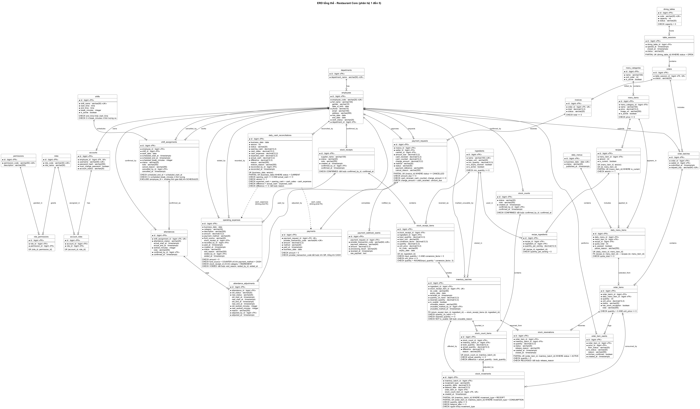

# Restaurant Core (RMS) – Tài liệu phân tích

Hệ thống quản lý nhà hàng bản Core: Spring Boot REST API, WebSocket, Web responsive. Tài liệu gồm 5 phân hệ, mỗi phân hệ có sơ đồ use case, sơ đồ hoạt động, ERD và README; cả 5 dùng chung một cơ sở dữ liệu.

| STT | Phân hệ | Thư mục |
| --- | --- | --- |
| 1 | Quản lý nhân viên | [01-quan-ly-nhan-vien](01-quan-ly-nhan-vien/README.md) |
| 2 | Quản lý thực đơn | [02-quan-ly-thuc-don](02-quan-ly-thuc-don/README.md) |
| 3 | Quản lý đơn hàng | [03-quan-ly-don-hang](03-quan-ly-don-hang/README.md) |
| 4 | Quản lý kho & nguyên liệu | [04-quan-ly-kho](04-quan-ly-kho/README.md) |
| 5 | Quản lý tài chính | [05-quan-ly-tai-chinh](05-quan-ly-tai-chinh/README.md) |

**Báo cáo tổng hợp:** [bao-cao-tong-hop.md](bao-cao-tong-hop.md) gộp toàn bộ sơ đồ trong một tài liệu theo thứ tự: bảng xác định actor, [sơ đồ phân cấp chức năng](phan-cap-chuc-nang.png), sơ đồ theo từng nhóm chức năng (use case, hoạt động, ERD), ERD tổng thể.

## ERD tổng thể



Toàn bộ 37 bảng và 52 khóa ngoại của 5 phân hệ trên một sơ đồ, cộng hai liên kết tổng hợp (mũi tên nét đứt) của đối soát tiền mặt. Mỗi bảng thuộc đúng một phân hệ sở hữu: từ điển dữ liệu đầy đủ nằm ở README phân hệ đó; ERD từng phân hệ vẽ lại bảng của phân hệ khác ở dạng tham chiếu (viền nét đứt, chỉ khóa và cột liên quan) khi cần thể hiện liên kết.

| Phân hệ | Bảng sở hữu |
| --- | --- |
| 1 – Nhân viên | `departments`, `employees`, `accounts`, `roles`, `permissions`, `account_roles`, `role_permissions`, `shifts`, `shift_assignments`, `attendances`, `attendance_adjustments` |
| 2 – Thực đơn | `menu_categories`, `menu_items`, `recipes`, `recipe_ingredients`, `daily_menus`, `daily_menu_items` |
| 3 – Đơn hàng | `dining_tables`, `table_sessions`, `orders`, `order_batches`, `order_items`, `order_item_events`, `invoices`, `payment_requests`, `payments`, `payment_webhook_events` |
| 4 – Kho | `ingredients`, `stock_receipts`, `stock_receipt_items`, `inventory_batches`, `stock_movements`, `stock_reservations`, `stock_counts`, `stock_count_items` |
| 5 – Tài chính | `operating_expenses`, `daily_cash_reconciliations` |

**Quy ước chung:** cơ sở dữ liệu PostgreSQL; tên bảng và cột `snake_case`, tên bảng số nhiều; khóa chính `id BIGINT`; khóa ngoại `<thực thể>_id BIGINT`; chỉ khóa ngoại mới có hậu tố `_id`; thời điểm `TIMESTAMPTZ` (múi giờ vận hành `Asia/Ho_Chi_Minh`), ngày `DATE`, giờ `TIME`; tiền `DECIMAL(12,2)`, số lượng `DECIMAL(12,3)`, không dùng `FLOAT` hay `DOUBLE`.

**Quy ước sơ đồ:**

- Use case: khung nét liền là ranh giới hệ thống (actor đứng ngoài); khung nét đứt chỉ nhóm chức năng, không phải hệ thống riêng; actor nối use case bằng đường liên kết không mũi tên; chỉ dùng «include» khi bước chung luôn được thực hiện và «extend» khi hành vi thêm xảy ra có điều kiện.
- Activity: làn bơi theo actor và "Hệ thống"; dữ liệu sai thì báo lỗi để người dùng sửa, chỉ lưu khi hợp lệ.
- ERD: bảng của phân hệ đang mô tả vẽ viền liền, đủ cột và ràng buộc; bảng của phân hệ khác vẽ viền nét đứt, chỉ hiện khóa và các cột phân hệ đó dùng (định nghĩa đầy đủ ở phân hệ sở hữu và ERD tổng thể). `*` là cột bắt buộc; `PK`, `FK`, `UK` là khóa chính, khóa ngoại, duy nhất; ràng buộc nằm dưới đường chấm trong bảng, ghi dạng `UK (...)`, `PARTIAL UK (...) WHERE ...`, `FK (...) → bảng (...)` (khóa ngoại ghép), `CHECK ...`. Đường nối có chân chim là khóa ngoại thật, bản số theo NOT NULL và UNIQUE của cột khóa ngoại; mũi tên nét đứt là nguồn tổng hợp số liệu, nhãn ghi "không phải FK". Mọi khóa ngoại `ON DELETE RESTRICT`.
- Sơ đồ không có khung chú giải ở cuối; ký hiệu giải thích ở mục này, ghi chú nghiệp vụ nằm ở README phân hệ.

**Lược đồ PostgreSQL:** phân hệ 1 có [schema-postgresql.sql](01-quan-ly-nhan-vien/schema-postgresql.sql) và bộ kiểm thử [test-postgresql.sql](01-quan-ly-nhan-vien/test-postgresql.sql); phạm vi đã chạy thử ghi ở mục 7 của [README phân hệ 1](01-quan-ly-nhan-vien/README.md). Phân hệ 2 đến 5 mô tả ràng buộc ở ERD và README (kèm đoạn SQL cho khóa ngoại ghép), chưa có file DDL đầy đủ.

## Kiểm tra ERD

Chạy từ thư mục gốc dự án (cần Node.js 18 trở lên, không cài thêm gói):

```powershell
node docs\tools\check-erd.js
```

Công cụ [check-erd.js](tools/check-erd.js) đọc 5 ERD phân hệ, ERD tổng thể và README, kiểm tra: mỗi bảng thuộc đúng một phân hệ, ERD tổng thể khớp định nghĩa gốc; khóa chính, khóa ngoại và khóa ngoại ghép trỏ tới bảng, cột có thật và cùng kiểu; mỗi đường chân chim ứng với một khóa ngoại thật và bản số khớp NOT NULL, UNIQUE; mũi tên nét đứt ghi rõ không phải FK; từ điển dữ liệu README khớp ERD; ảnh `.png` render từ đúng nguồn `.puml` hiện tại (so nguồn nhúng trong ảnh, không dựa vào giờ sửa tệp); tên bảng, cột, trạng thái dùng trong sơ đồ hoạt động có thật. Công cụ còn tìm cụm bảng rời trong từng ERD và phân loại: thiếu liên kết khóa ngoại thật (lỗi), nối bằng liên kết tổng hợp hoặc khai báo độc lập hợp lệ (`' check-erd: doc-lap bang_a, bang_b : lý do` trong `.puml`), hoặc chỉ nối được qua bảng chưa vẽ (cảnh báo kèm đường gợi ý). Lệnh trả mã 1 khi có lỗi.

## Render lại sơ đồ

Cần Java và Graphviz. `plantuml.jar` có sẵn trong extension VS Code `jebbs.plantuml` (thư mục `%USERPROFILE%\.vscode\extensions\jebbs.plantuml-<phiên bản>\`). Chạy từ thư mục gốc dự án:

```powershell
java "-DPLANTUML_LIMIT_SIZE=8192" -jar "<đường dẫn plantuml.jar>" -charset UTF-8 -failfast2 -tpng "docs\*\*.puml" docs\erd-tong-the.puml docs\phan-cap-chuc-nang.puml
```

Một lệnh render toàn bộ 50 sơ đồ (48 sơ đồ phân hệ, ERD tổng thể và sơ đồ phân cấp chức năng); `-DPLANTUML_LIMIT_SIZE=8192` cần cho ERD tổng thể vì ảnh rộng hơn giới hạn mặc định. Style đen trắng dùng chung nằm ở `_style.puml`; mọi ảnh `.png` phải render lại sau khi sửa `.puml` hoặc style.
