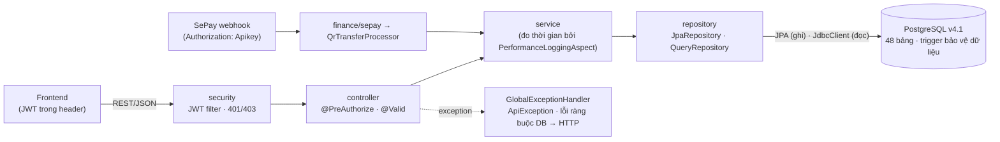
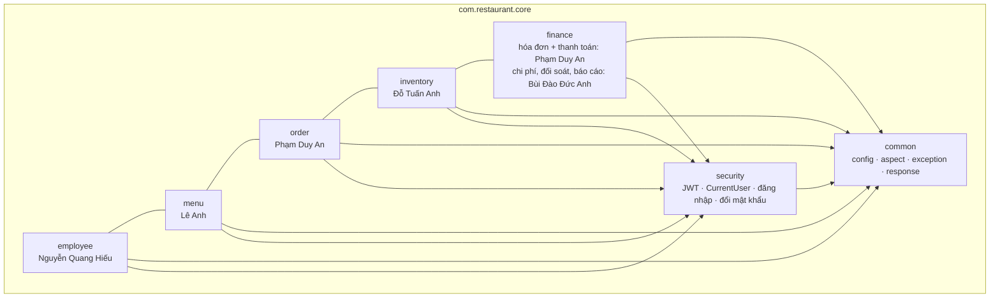

# Kiến trúc backend — Restaurant Core

**Modular Monolith theo Spring Modulith + Layered trong từng module (Controller → Service → Repository) + Spring AOP (1 aspect) + Strategy (thanh toán).**
Một ứng dụng Spring Boot, một database PostgreSQL v4.1. Không microservice, không message broker, không cache.

| Thành phần | Lựa chọn | Phiên bản (pom.xml) |
| --- | --- | --- |
| Ngôn ngữ / build | Java 25 (LTS), Maven (wrapper `./mvnw`) | Java 25, Maven 3.10 |
| Framework | Spring Boot (`spring-boot-starter-parent`) | 4.1.2 (Spring Framework 7, Security 7.1, Jackson 3) |
| Truy cập DB | Spring Data JPA (Entity + `JpaRepository`) cho mọi thao tác ghi; `JdbcClient` chỉ cho truy vấn CHỈ ĐỌC ghép nhiều bảng (`…QueryRepository`) và báo cáo | Hibernate 7, driver 42.7 |
| Lombok | `@Getter/@Setter` cho Entity, `@RequiredArgsConstructor` cho Service | |
| Migration | Flyway (`spring-boot-starter-flyway`, `flyway-database-postgresql`) | 12.4 |
| Bảo mật | Spring Security, JWT HS256 qua `spring-boot-starter-oauth2-resource-server` (Nimbus), BCrypt | 7.1 |
| Module | Spring Modulith (`spring-modulith-api`, test: `spring-modulith-starter-test`) | 2.1.2 |
| AOP | `spring-boot-starter-aspectj` — chỉ `PerformanceLoggingAspect` | |
| Health | Actuator, chỉ mở `/actuator/health` | |
| Test | JUnit 5, Spring Boot Test, MockMvc, Testcontainers (PostgreSQL 17) | Testcontainers 2.0 |
| Triển khai | Dockerfile + `compose.yaml` (db + app) | postgres:17 |

## Sơ đồ

## Module và phân hệ ERD

Mỗi module là một cụm nghiệp vụ, sở hữu một nhóm bảng (danh sách đủ: [MODULE_BOUNDARIES](MODULE_BOUNDARIES.md)). ERD trong `docs/erd` vẽ theo 5 phân hệ của bản phân tích database; bảng của phân hệ 3 chia cho hai module:

| Phân hệ ERD | Module | Bảng |
| --- | --- | --- |
| P1 Nhân viên • tài khoản • ca • chấm công | `employee` (đăng nhập ở `security`) | 11 bảng |
| P2 Thực đơn • món • công thức • thực đơn ngày | `menu` | 6 bảng |
| P3 Bàn • đơn hàng • hóa đơn • thanh toán | `order`: bàn, phiên, đơn, lượt gọi, món, nhật ký món | 6 bảng |
| | `finance`: hóa đơn, dòng hóa đơn, yêu cầu thanh toán, thanh toán, webhook | 5 bảng |
| P4 Kho RAW • bếp • sơ chế • kiểm kê | `inventory` | 18 bảng |
| P5 Chi phí • báo cáo • đối soát | `finance` | 2 bảng |

Hóa đơn và thanh toán nằm ở `finance` (không ở `order`) vì đây là phần tiền: chiến lược thanh toán (Strategy CASH/QR), webhook ngân hàng, đối soát tiền mặt và báo cáo doanh thu cùng đọc ghi các bảng này. `finance` gọi `order` qua `OrderBillingApi`: khóa đơn, lấy món đã phục vụ để lập hóa đơn, đóng đơn và trả bàn khi thu xong.

## Module (Spring Modulith)

Mỗi package con trực tiếp của `com.restaurant.core` là một **module**, khai báo trong `package-info.java` bằng `@ApplicationModule`.

- **API của module** = các lớp ở package gốc của module (ví dụ `security.CurrentUser`). Package con `controller`, `service`, `repository`, `dto` là **nội bộ**: module khác không được import.
- **Phụ thuộc được phép** ghi trong `allowedDependencies`: module nghiệp vụ → `common`, `security`; `security` → `common`; `common` → không gì. `common` là module mở (`Type.OPEN`).
- **Không phụ thuộc vòng.** Đăng nhập, đổi mật khẩu và `CredentialQueryRepository`, `UserCredentialRepository` nằm trong `security` (không ở `employee`) để tránh vòng `employee` ↔ `security`.
- Phụ thuộc giữa các module nghiệp vụ (không vòng): `order` → `menu`, `inventory`; `inventory` → `menu`; `finance` → `order`.
  Mỗi module chỉ gọi API ở package gốc của module kia (`DailyMenuLookup`, `KitchenStockAllocator`, `OrderBillingApi`).
- Khi module A cần dữ liệu của module B nhưng B đã phụ thuộc A, A khai báo **interface** và B cài đặt (đảo phụ thuộc):
  `menu.QuotaUsageCounter` (order cài), `inventory.OrderItemStockFlags` (order cài), `order.OrderInvoiceAccess` (finance cài).
- `ModularityTest` kiểm tra các luật trên mỗi lần `mvn verify` (không cần database), và sinh sơ đồ PlantUML vào `target/spring-modulith-docs`. Vi phạm → build đỏ, pipeline dừng.

## Nguyên tắc cốt lõi

1. **Nghiệp vụ nằm ở tầng Service (Java).** Kiểm tồn kho, giữ/trừ nguyên liệu theo FEFO, hạn mức suất, tính tổng hóa đơn, thanh toán, chuyển trạng thái món/chứng từ đều viết trong `…ServiceImpl` với `@Transactional`. Database chỉ giữ ràng buộc dữ liệu (CHECK, FK, UNIQUE) và trigger bảo vệ (máy trạng thái, bảng chỉ-thêm, số dư khớp sổ kho) làm **lưới an toàn cuối**; Service phải tự kiểm trước để trả lỗi rõ ràng. Các hàm nghiệp vụ `rc_*` và hàm báo cáo `rpt_*` cũ đã bị xóa khỏi DB (migration `V3`); chỉ còn các hàm phục vụ trigger. Báo cáo: truy vấn đọc trong `…ReportRepository`, quy tắc (ngày kinh doanh, phân loại, tỷ lệ) trong Service.
2. **Đồng thời và thứ tự khóa.** Ghi đồng thời dùng khóa dòng (`…ForUpdate` = `@Lock(PESSIMISTIC_WRITE)`), luôn theo một thứ tự chung để không deadlock: **đơn → hóa đơn → yêu cầu thanh toán → phiên → bàn → món → lô bếp (theo loại, id)**; với kho: **lô kho chính → dòng xuất (WIP) → lô bếp**. Khóa trước, nạp entity sau (Hibernate không làm mới entity đã nạp). Thao tác gửi lặp được chống trùng bằng `requestKey` (khóa `pg_advisory_xact_lock` theo khóa yêu cầu).
3. **Ranh giới tin cậy.** Spring Security xác thực JWT; người thao tác (`actorId`) luôn là `CurrentUser.employeeId()` (claim `sub`). Mỗi request đọc lại trạng thái tài khoản, nhân viên và vai trò trong DB (`AccountStateJwtConverter`); vai trò trong token chỉ để frontend hiển thị. Không nhận `actorId`/`employeeId` từ body hay query. `@PreAuthorize` là lớp kiểm vai trò (ma trận ở [docs/07 §10](../07-kiem-toan-ham-rc.md)).
   Ứng dụng chạy bằng tài khoản thuộc role `rc_app` (không phải superuser): đọc/ghi bảng nghiệp vụ (migration `V2`), không có quyền DDL, không ghi được bảng `roles`.
4. **Một định dạng phản hồi** `ApiResponse` và **một chỗ xử lý lỗi** `GlobalExceptionHandler` (+ `RestSecurityErrorHandler` cho 401/403 ở tầng filter).
5. **Cấu trúc chuẩn trong module** (cả 5 module và `security` giống nhau): `controller` → `service` (interface) → `service/impl` (`…ServiceImpl`) → `repository` (interface `JpaRepository`) → `entity`; `dto/request` (dữ liệu client gửi lên, có Bean Validation) và `dto/response` (dữ liệu trả ra) là `record`. Entity không bao giờ trả thẳng ra API. Hibernate chỉ `ddl-auto: validate`, không tự sửa bảng.
   Chuyển dữ liệu ra DTO: màn hình đọc qua `…QueryRepository` (`JdbcClient.query(XxxResponse.class)`), cột SQL tự khớp field của `record`, không cần lớp chuyển đổi. Chỉ khi Service tự dựng DTO từ Entity mới đặt lớp `mapper` (hiện có `employee/mapper/EmployeeMapper`).
6. **Quan hệ giữa các Entity theo đúng khóa ngoại trong schema.** Khóa ngoại tới bảng **cùng module** ánh xạ thành quan hệ JPA, luôn `LAZY`: cột có `UNIQUE` là `@OneToOne` (1-1, ví dụ `Attendance` → `ShiftAssignment`, `CustomerOrder` → `TableSession`, `Payment` → `Invoice`), cột thường là `@ManyToOne` (n-1, ví dụ `OrderBatch` → `CustomerOrder`, `InvoiceItem` → `Invoice`), bảng nối là `@ManyToMany` (`Account` ↔ `Role` qua `account_roles`) hoặc Entity riêng khi bảng nối có thêm cột (`RecipeIngredient` có `quantity_per_serving`, `DailyMenuItem` có hạn mức suất). Entity vẫn có `getXxxId()` để đọc id mà không nạp bảng cha. Khóa ngoại **sang module khác** (người thao tác `…_by_id` → `employees`, `invoices.order_id` → `orders`, `order_items.daily_menu_item_id` → `daily_menu_items`…) giữ dạng id: module không import Entity của module khác (luật Spring Modulith), ràng buộc vẫn do FK trong database giữ.

## Thành phần đã có

| Thành phần | Vị trí | Người phụ trách |
| --- | --- | --- |
| Phản hồi + lỗi thống nhất, SQLSTATE → HTTP | `common/response`, `common/exception` ([API_CONVENTIONS](API_CONVENTIONS.md#mã-lỗi)) | Phạm Duy An (duyệt) |
| AOP | `common/aspect/PerformanceLoggingAspect` — mọi method public trong `..service..` | Phạm Duy An (duyệt) |
| CORS | `common/config/CorsConfig` (`CORS_ALLOWED_ORIGINS`) | Phạm Duy An (duyệt) |
| Bảo mật, đăng nhập | `security/*` (gồm `controller/AuthController`: `POST /api/auth/login`, `GET /api/auth/me`, đổi mật khẩu) | Nguyễn Quang Hiếu |
| Vòng đời đơn hàng | `order/*`: bàn, phiên, đơn, gọi món, bếp, phục vụ, hủy, bỏ về | Phạm Duy An |
| Hóa đơn, thanh toán | `finance`: `Invoice*`, `Payment*`, `strategy/` (Strategy CASH/QR), `sepay/` (webhook) | Phạm Duy An |

Danh sách endpoint và trạng thái: [API_CONTRACT](API_CONTRACT.md).

## Database và migration

- **Baseline (version 1)** = `docs/04-schema-v4.1.sql` → `docs/09-acl-v4.1.sql` → `docs/10-bao-cao-v4.1.sql`. Compose và Testcontainers nạp đúng thứ tự này qua `/docker-entrypoint-initdb.d` — chỉ chạy khi volume trống, không bao giờ chạy lại trên dữ liệu có sẵn. `docker/db-init/40-app-logins.sh` tạo login của app trong `rc_app`.
- **Flyway** quản lý thay đổi **sau** baseline (`src/main/resources/db/migration/V2__…`). Flyway dùng tài khoản quản trị riêng (`FLYWAY_USER`), vì `rc_app` không có quyền DDL. Cách baseline cho từng loại database: [DEVELOPMENT_GUIDE §Migration](DEVELOPMENT_GUIDE.md#migration-flyway).
