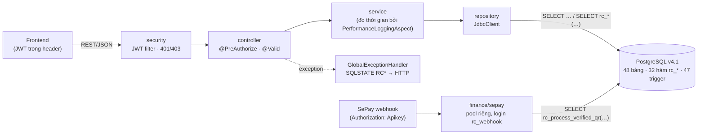
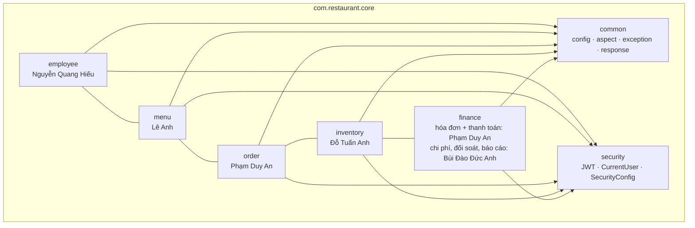

# Kiến trúc backend — Restaurant Core

**Modular Monolith nhẹ + Layered (Controller → Service → Repository) + Spring AOP (1 aspect) + Strategy (thanh toán).**
Một ứng dụng Spring Boot, một database PostgreSQL v4.1. Không microservice, không message broker, không cache, không JPA.

| Thành phần | Lựa chọn | Phiên bản (pom.xml) |
| --- | --- | --- |
| Ngôn ngữ / build | Java 21, Maven (wrapper `./mvnw`) | Java 21, Maven 3.10 |
| Framework | Spring Boot (`spring-boot-starter-parent`) | 4.1.2 (Spring Framework 7, Security 7.1, Jackson 3) |
| Truy cập DB | `JdbcClient` (spring-boot-starter-jdbc) + driver PostgreSQL | 42.7 |
| Migration | Flyway (`spring-boot-starter-flyway`, `flyway-database-postgresql`) | 12.4 |
| Bảo mật | Spring Security, JWT HS256 qua `spring-boot-starter-oauth2-resource-server` (Nimbus), BCrypt | 7.1 |
| AOP | `spring-boot-starter-aspectj` — chỉ `PerformanceLoggingAspect` | |
| Health | Actuator, chỉ mở `/actuator/health` | |
| Test | JUnit 5, Spring Boot Test, MockMvc, Testcontainers (PostgreSQL 17) | Testcontainers 2.0 |
| Triển khai | Dockerfile + `compose.yaml` (db + app) | postgres:17 |

## Sơ đồ

## Nguyên tắc cốt lõi

1. **Database là nơi giữ nghiệp vụ tiền/tồn/trạng thái.** Mọi thao tác chạm số dư, tiền, trạng thái món/hóa đơn/chứng từ đi qua **một lời gọi hàm `rc_*`** — hàm tự khóa theo thứ tự chung và chạy nguyên tử. Java không tái hiện logic đó, không chia một hàm `rc_*` thành nhiều bước Java, không bọc thêm `@Transactional` cho một lời gọi đơn.
2. **Ranh giới tin cậy.** Spring Security xác thực JWT; `p_actor` của mọi hàm `rc_*` = `CurrentUser.employeeId()` (claim `sub`). Không nhận `actorId`/`employeeId` từ body hay query. `@PreAuthorize` lọc vai trò ở API; DB kiểm lại vai trò trong mỗi hàm (`rc_authorize`) — ma trận ở [docs/07 §10](../07-kiem-toan-ham-rc.md).
3. **Ứng dụng chạy bằng tài khoản thuộc role `rc_app`** ([docs/09-acl-v4.1.sql](../09-acl-v4.1.sql)): đọc mọi bảng; ghi trực tiếp chỉ danh mục, nhân sự, thực đơn, nháp chứng từ (theo cột); bảng nhạy cảm chỉ ghi được qua hàm. **Webhook SePay** dùng một pool kết nối nhỏ riêng bằng login thuộc `rc_webhook` (chỉ được `EXECUTE rc_process_verified_qr`) — không mở thêm quyền cho `rc_app`.
4. **Một định dạng phản hồi** `ApiResponse` và **một chỗ xử lý lỗi** `GlobalExceptionHandler` (+ `RestSecurityErrorHandler` cho 401/403 ở tầng filter).
5. **Đơn giản trước**: không interface cho service nếu chỉ có một cài đặt; không repository/service chung chung; DTO là `record` riêng của từng module.

## Thành phần đã có

| Thành phần | Vị trí | Người phụ trách |
| --- | --- | --- |
| Phản hồi + lỗi thống nhất, SQLSTATE → HTTP | `common/response`, `common/exception` ([API_CONVENTIONS](API_CONVENTIONS.md#mã-lỗi)) | Phạm Duy An (duyệt) |
| AOP | `common/aspect/PerformanceLoggingAspect` — mọi method public trong `..service..` | Phạm Duy An (duyệt) |
| CORS | `common/config/CorsConfig` (`CORS_ALLOWED_ORIGINS`) | Phạm Duy An (duyệt) |
| Bảo mật, đăng nhập | `security/*`; `employee`: `POST /api/auth/login`, `GET /api/auth/me` | Nguyễn Quang Hiếu |
| Vòng đời đơn hàng | `order/*`: bàn, phiên, đơn, gọi món, bếp, phục vụ, hủy, bỏ về | Phạm Duy An |
| Hóa đơn, thanh toán | `finance`: `Invoice*`, `Payment*`, `strategy/` (Strategy CASH/QR), `sepay/` (webhook) | Phạm Duy An |

Danh sách endpoint và trạng thái: [API_CONTRACT](API_CONTRACT.md).

## Database và migration

- **Baseline (version 1)** = `docs/04-schema-v4.1.sql` → `docs/09-acl-v4.1.sql` → `docs/10-bao-cao-v4.1.sql`. Compose và Testcontainers nạp đúng thứ tự này qua `/docker-entrypoint-initdb.d` — chỉ chạy khi volume trống, không bao giờ chạy lại trên dữ liệu có sẵn. `docker/db-init/40-app-logins.sh` tạo login của app trong `rc_app`.
- **Flyway** quản lý thay đổi **sau** baseline (`src/main/resources/db/migration/V2__…`). Flyway dùng tài khoản quản trị riêng (`FLYWAY_USER`), vì `rc_app` không có quyền DDL. Cách baseline cho từng loại database: [DEVELOPMENT_GUIDE §Migration](DEVELOPMENT_GUIDE.md#migration-flyway).
