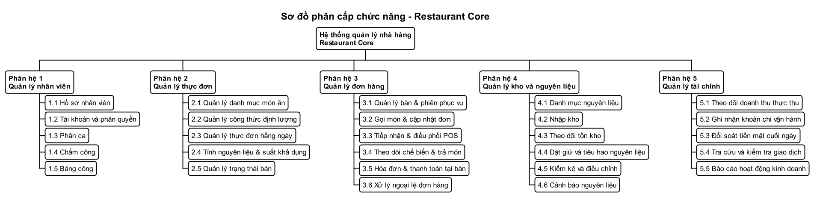
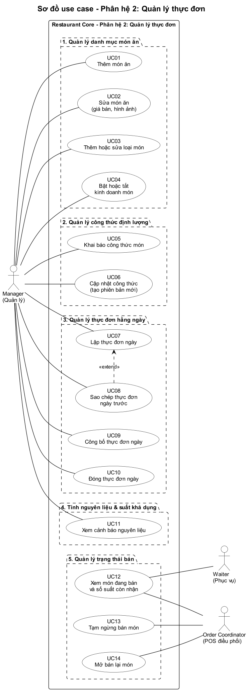
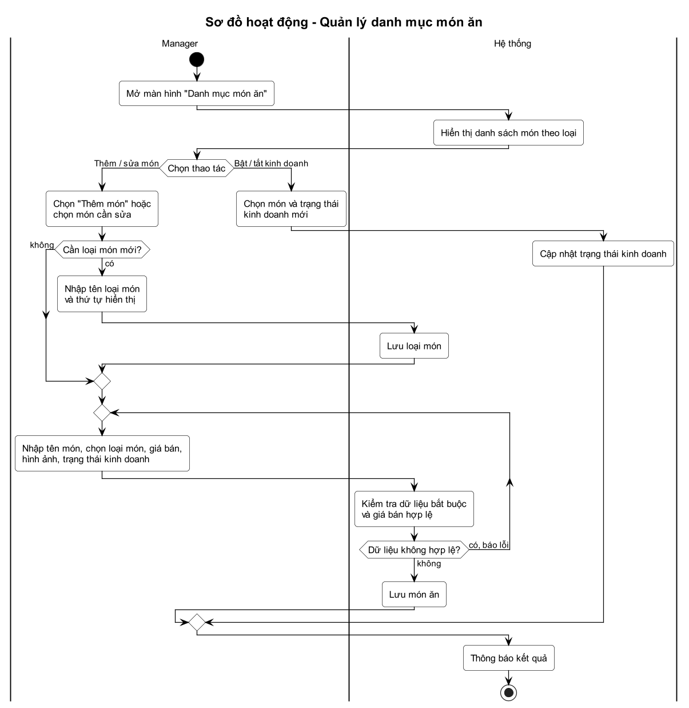
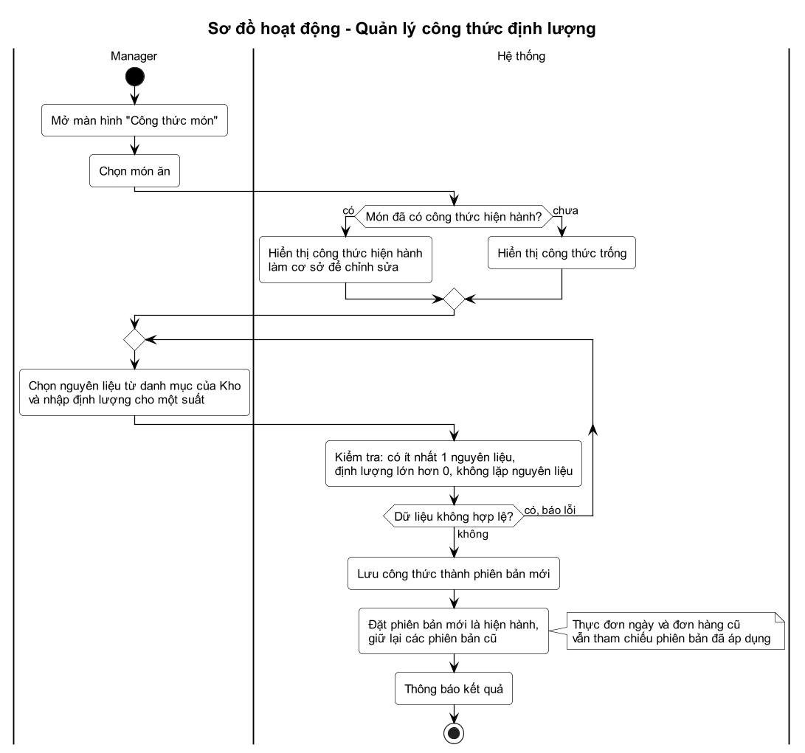
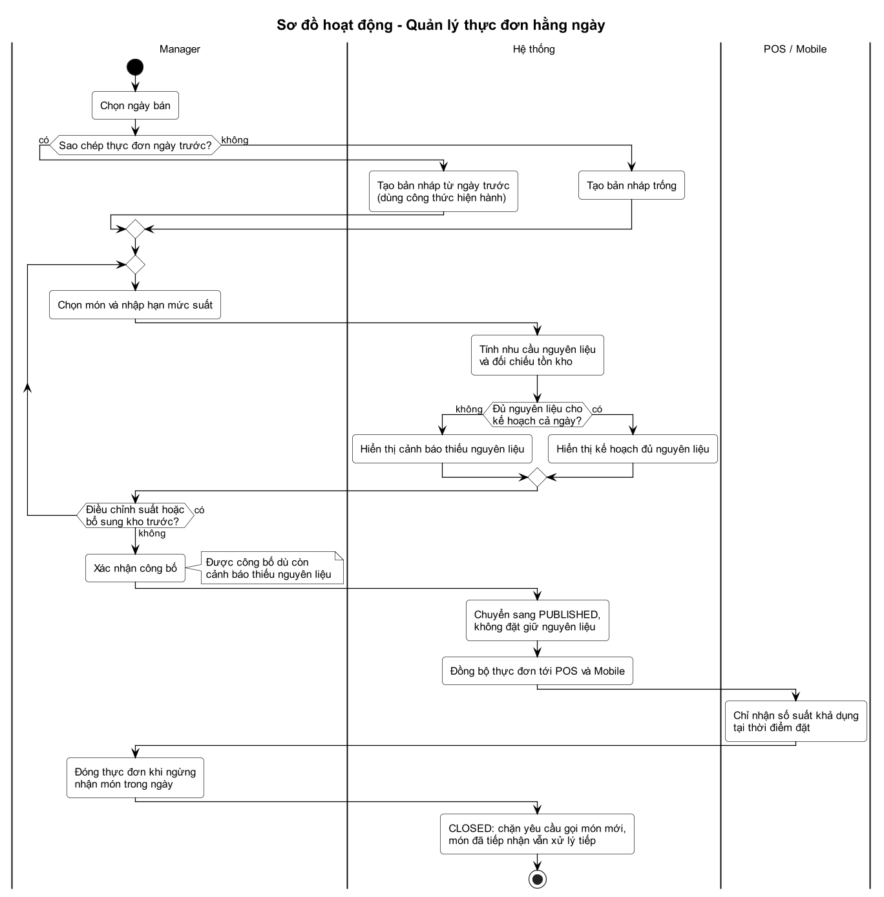
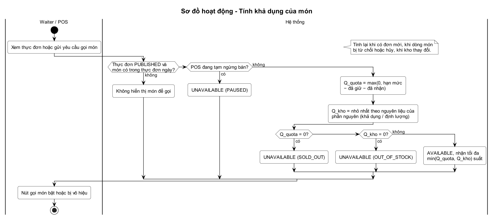
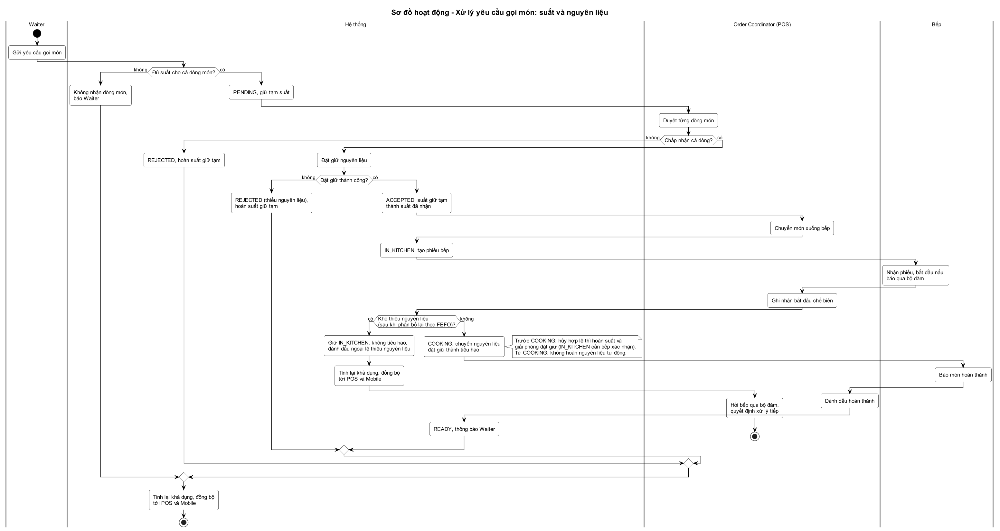
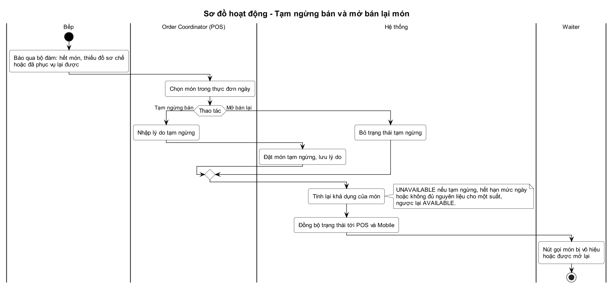
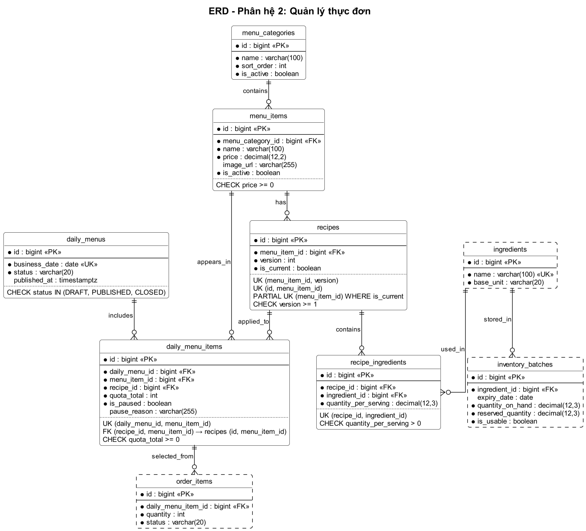

# Báo cáo tổng hợp sơ đồ phân tích – Restaurant Core (RMS)

Tài liệu tổng hợp toàn bộ sơ đồ phân tích của hệ thống quản lý nhà hàng Restaurant Core (bản Core): Spring Boot REST API, WebSocket, web responsive, cơ sở dữ liệu PostgreSQL. Hệ thống gồm **5 phân hệ** (chức năng lớn), chia thành **27 nhóm chức năng** và **88 use case**.

Thứ tự trình bày: (1) bảng xác định actor, (2) sơ đồ phân cấp chức năng, (3) sơ đồ use case, sơ đồ hoạt động và ERD theo từng nhóm chức năng, (4) ERD tổng thể. Quy tắc nghiệp vụ, từ điển dữ liệu và kịch bản demo đầy đủ nằm ở README của từng phân hệ.

| Phân hệ | Nhóm chức năng | Use case | Sơ đồ use case | Sơ đồ hoạt động | Bảng dữ liệu |
| --- | --- | --- | --- | --- | --- |
| 1 – Quản lý nhân viên | 5 | 19 | 1 | 6 | 11 |
| 2 – Quản lý thực đơn | 5 | 14 | 1 | 6 | 6 |
| 3 – Quản lý đơn hàng | 6 | 25 | 2 | 9 | 10 |
| 4 – Quản lý kho và nguyên liệu | 6 | 16 | 1 | 10 | 8 |
| 5 – Quản lý tài chính | 5 | 14 | 1 | 6 | 2 |
| **Tổng** | **27** | **88** | **6** | **37** | **37** |

Ngoài ra có 1 sơ đồ phân cấp chức năng, 5 ERD phân hệ và 1 ERD tổng thể: tổng cộng 50 sơ đồ.

**Cách đọc sơ đồ**

- Use case: khung nét liền là ranh giới hệ thống, khung nét đứt chỉ nhóm chức năng (không phải hệ thống riêng); actor đứng ngoài khung, nối với use case bằng đường không mũi tên; «include» và «extend» chỉ dùng khi có lý do rõ ràng.
- Hoạt động: mỗi làn bơi là một actor hoặc "Hệ thống"; hình thoi là điều kiện; vòng lặp "báo lỗi, người dùng sửa lại" nghĩa là không lưu cho đến khi dữ liệu hợp lệ.
- ERD: `*` là cột bắt buộc; `PK`, `FK`, `UK` là khóa chính, khóa ngoại, duy nhất; phần dưới đường chấm ghi ràng buộc (`UK`, `PARTIAL UK ... WHERE`, `FK (...) → bảng (...)` cho khóa ngoại ghép, `CHECK`). Bảng của phân hệ đang mô tả viền liền, đủ cột; bảng của phân hệ khác viền nét đứt, chỉ hiện khóa và cột liên quan. Đường chân chim là khóa ngoại thật, bản số theo NOT NULL và UNIQUE; mũi tên nét đứt là nguồn tổng hợp số liệu, không phải khóa ngoại. Mọi khóa ngoại `ON DELETE RESTRICT`.

**Mục lục**

- [1. Bảng xác định actor của hệ thống](#1-bảng-xác-định-actor-của-hệ-thống)
- [2. Sơ đồ phân cấp chức năng](#2-sơ-đồ-phân-cấp-chức-năng)
- [3. Sơ đồ theo nhóm chức năng](#3-sơ-đồ-theo-nhóm-chức-năng)
  - [Phân hệ 1 – Quản lý nhân viên](#phân-hệ-1--quản-lý-nhân-viên)
  - [Phân hệ 2 – Quản lý thực đơn](#phân-hệ-2--quản-lý-thực-đơn)
  - [Phân hệ 3 – Quản lý đơn hàng](#phân-hệ-3--quản-lý-đơn-hàng)
  - [Phân hệ 4 – Quản lý kho và nguyên liệu](#phân-hệ-4--quản-lý-kho-và-nguyên-liệu)
  - [Phân hệ 5 – Quản lý tài chính](#phân-hệ-5--quản-lý-tài-chính)
- [4. ERD tổng thể](#4-erd-tổng-thể)
- [Phụ lục. Danh mục sơ đồ và tệp nguồn](#phụ-lục-danh-mục-sơ-đồ-và-tệp-nguồn)

## 1. Bảng xác định actor của hệ thống

Hệ thống có **4 actor người dùng** (Manager, Waiter, Order Coordinator, Cashier) và **1 actor hệ thống bên ngoài** (Cổng thanh toán SePay). Cột "Use case sử dụng" tổng hợp từ các sơ đồ use case (PH = phân hệ).

### 1.1 Actor

| STT | Actor | Loại | Vai trò | Kênh sử dụng | Use case sử dụng | Giới hạn quyền |
| --- | --- | --- | --- | --- | --- | --- |
| 1 | **Manager – Quản lý** | Người dùng | Quản lý nhà hàng: nhân sự và ca làm, thực đơn và công thức, kho, giám sát đơn hàng, theo dõi tài chính | Web trên laptop | PH1: UC01–UC19 PH2: UC01–UC11 PH3: UC17–UC18 PH4: UC01–UC09, UC13–UC16 PH5: UC01–UC04, UC07–UC14 | Không xóa cứng dữ liệu (chỉ đổi trạng thái hoặc hủy kèm lý do); không tính lương; mọi điều chỉnh công phải có lý do; không khóa hay gỡ vai trò của Manager đang hoạt động cuối cùng; ở phân hệ 5 chỉ xem lịch sử đối soát, việc đối soát do Cashier thực hiện; xử lý ngoại lệ món đã chế biến ngoài Core |
| 2 | **Waiter – Nhân viên phục vụ** | Người dùng | Mở bàn, gọi món và gọi thêm món, gửi yêu cầu thanh toán, hiển thị QR, thu tiền mặt tại bàn | Điện thoại hoặc tablet (Mobile) | PH2: UC12 PH3: UC01, UC02, UC04–UC06, UC14, UC19, UC21, UC24 | Chỉ chọn món đang `AVAILABLE`; không duyệt món, không hủy món đã gửi (POS xử lý); không xác nhận thanh toán; không dùng chức năng kho |
| 3 | **Order Coordinator – POS điều phối** | Người dùng | Duyệt hoặc từ chối món, chuyển bếp, ghi nhận chế biến, gọi phục vụ, tạm ngừng hoặc mở bán lại món, sửa hoặc hủy món hợp lệ | POS trên laptop | PH2: UC12–UC14 PH3: UC01, UC07–UC16 PH4: UC10–UC12, UC16 | Không hủy món `COOKING` hoặc `READY` trên POS; hủy ngoại lệ món `IN_KITCHEN` chỉ khi bếp xác nhận; không thao tác thanh toán. Thao tác ở phân hệ 3 kích hoạt kho tự động đặt giữ, tiêu hao, giải phóng |
| 4 | **Cashier – Thu ngân** | Người dùng | Duyệt yêu cầu thanh toán, nhận tiền mặt và giao tiền thừa, giám sát giao dịch QR, ghi chi tiền mặt từ quầy, đối soát tiền mặt cuối ngày | Web tại quầy (laptop) | PH3: UC20, UC23, UC25–UC26 PH5: UC01–UC03, UC05–UC10 | Không xác nhận thủ công thanh toán QR (webhook tự xác nhận); chỉ hủy yêu cầu chưa `PAID` và chưa có tiền thực nhận; chỉ ghi khoản chi tiền mặt lấy từ quầy, không hủy khoản chi; không xem báo cáo hoạt động kinh doanh |
| 5 | **Cổng thanh toán (SePay)** | Hệ thống bên ngoài | Gửi webhook khi có giao dịch chuyển khoản QR | Webhook HTTPS về backend | PH3: UC22 | Chỉ gửi thông báo giao dịch; backend xác thực webhook, đối chiếu mã tham chiếu và số tiền, bỏ qua mã giao dịch đã ghi nhận; sai số tiền, sai mã hoặc yêu cầu đã hủy thì không tự đóng hóa đơn |

### 1.2 Đối tượng không phải actor

| Đối tượng | Lý do không vẽ thành actor |
| --- | --- |
| Bếp trưởng, đầu bếp | Nhận phiếu in và giao tiếp bằng bộ đàm; POS ghi nhận tiến độ thay bếp. Có hồ sơ, phân ca và chấm công do Manager xác nhận (phân hệ 1) nhưng không bắt buộc có tài khoản. Xuất hiện ở làn "Bếp" trong sơ đồ hoạt động. |
| Khách hàng | Không dùng phần mềm; gọi món và thanh toán thông qua Waiter. |
| Hệ thống Restaurant Core | Là hệ thống đang được thiết kế nên không vẽ thành actor; các xử lý tự động (tính khả dụng, đặt giữ, tiêu hao, tổng hợp, kiểm tra dữ liệu) nằm ở làn "Hệ thống" trong sơ đồ hoạt động. |

### 1.3 Phân quyền theo vai trò (RBAC)

- Một tài khoản có một hoặc nhiều vai trò; quyền của tài khoản là hợp quyền các vai trò. Backend kiểm tra quyền ở mọi thao tác.
- Dữ liệu khởi tạo: `MANAGER` có 13 mã quyền (6 nhân sự, 7 tài chính), `CASHIER` có 6 mã tài chính; `WAITER` và `ORDER_COORDINATOR` chưa có mã quyền riêng (chức năng ở phân hệ 2, 3, 4 do các phân hệ đó mô tả theo vai trò).
- Nhân viên bếp không có tài khoản nên không có quyền nào, nhưng vẫn có lịch làm và công.

## 2. Sơ đồ phân cấp chức năng

Hệ thống chia thành 5 chức năng lớn (phân hệ); mỗi phân hệ chia thành các nhóm chức năng nhỏ.

| Chức năng lớn (phân hệ) | Nhóm chức năng |
| --- | --- |
| **Phân hệ 1 – Quản lý nhân viên** | 1.1 Hồ sơ nhân viên 1.2 Tài khoản và phân quyền 1.3 Phân ca 1.4 Chấm công 1.5 Bảng công |
| **Phân hệ 2 – Quản lý thực đơn** | 2.1 Quản lý danh mục món ăn 2.2 Quản lý công thức định lượng 2.3 Quản lý thực đơn hằng ngày 2.4 Tính nguyên liệu & suất khả dụng 2.5 Quản lý trạng thái bán |
| **Phân hệ 3 – Quản lý đơn hàng** | 3.1 Quản lý bàn & phiên phục vụ 3.2 Gọi món & cập nhật đơn 3.3 Tiếp nhận & điều phối POS 3.4 Theo dõi chế biến & trả món 3.5 Hóa đơn & thanh toán tại bàn 3.6 Xử lý ngoại lệ đơn hàng |
| **Phân hệ 4 – Quản lý kho và nguyên liệu** | 4.1 Danh mục nguyên liệu 4.2 Nhập kho 4.3 Theo dõi tồn kho 4.4 Đặt giữ và tiêu hao nguyên liệu 4.5 Kiểm kê và điều chỉnh 4.6 Cảnh báo nguyên liệu |
| **Phân hệ 5 – Quản lý tài chính** | 5.1 Theo dõi doanh thu thực thu 5.2 Ghi nhận khoản chi vận hành 5.3 Đối soát tiền mặt cuối ngày 5.4 Tra cứu và kiểm tra giao dịch 5.5 Báo cáo hoạt động kinh doanh |

## 3. Sơ đồ theo nhóm chức năng

Mỗi phân hệ trình bày theo thứ tự: sơ đồ use case của phân hệ, rồi từng nhóm chức năng (danh sách use case và sơ đồ hoạt động của nhóm), cuối cùng là ERD của phân hệ.

### Phân hệ 1 – Quản lý nhân viên

Quản lý hồ sơ nhân viên, tài khoản và phân quyền RBAC, phân ca, chấm công và bảng công. Manager là actor duy nhất; bộ phận Bếp có hồ sơ, phân ca và chấm công nhưng không bắt buộc có tài khoản. Core không tính lương. Chi tiết: [README phân hệ 1](01-quan-ly-nhan-vien/README.md).

**Sơ đồ use case**

#### Nhóm 1.1 – Hồ sơ nhân viên

Thêm, sửa, tìm kiếm hồ sơ; cập nhật trạng thái làm việc (Đang làm, Tạm nghỉ, Đã nghỉ việc).

| Mã | Use case | Actor |
| --- | --- | --- |
| UC01 | Thêm nhân viên | Manager |
| UC02 | Sửa hồ sơ nhân viên | Manager |
| UC03 | Tìm kiếm nhân viên | Manager |
| UC04 | Cập nhật trạng thái làm việc | Manager |

**Sơ đồ hoạt động – Quản lý hồ sơ nhân viên (UC01, UC02, UC03)**

Tìm kiếm, thêm mới và sửa hồ sơ dùng chung một biểu mẫu. Dữ liệu thiếu, sai định dạng hoặc trùng mã nhân viên thì báo lỗi và giữ dữ liệu đã nhập; chỉ lưu khi hợp lệ.

**Sơ đồ hoạt động – Cập nhật trạng thái làm việc và tài khoản (UC04)**

Trạng thái làm việc tách khỏi trạng thái tài khoản. Nghỉ việc vô hiệu hóa tài khoản và hủy phân ca chưa chấm công từ ngày hiệu lực; chỉ tài khoản tạm vô hiệu hóa do tạm nghỉ được tự mở lại, tài khoản khóa tay giữ nguyên.

#### Nhóm 1.2 – Tài khoản và phân quyền

Cấp tài khoản, khóa hoặc mở khóa, đặt lại mật khẩu, gán vai trò (một tài khoản có thể có nhiều vai trò).

| Mã | Use case | Actor |
| --- | --- | --- |
| UC05 | Cấp tài khoản | Manager |
| UC06 | Khóa hoặc mở khóa tài khoản | Manager |
| UC07 | Đặt lại mật khẩu | Manager |
| UC08 | Gán vai trò cho tài khoản | Manager |

**Sơ đồ hoạt động – Cấp tài khoản và gán vai trò (UC05, UC08)**

Cấp tài khoản cho nhân viên "Đang làm": tên đăng nhập duy nhất, ít nhất một vai trò, mật khẩu tạm băm BCrypt hiển thị một lần và bắt buộc đổi ở lần đăng nhập đầu. Khóa hoặc mở khóa, đặt lại mật khẩu, đổi vai trò (UC06 đến UC08) mô tả ở README phân hệ 1, mục 4.7.

#### Nhóm 1.3 – Phân ca

Cấu hình mẫu ca, phân lịch tuần, xem lịch, sửa hoặc hủy phân ca chưa diễn ra.

| Mã | Use case | Actor |
| --- | --- | --- |
| UC09 | Cấu hình ca làm việc | Manager |
| UC10 | Phân lịch làm việc theo tuần | Manager |
| UC11 | Xem lịch làm việc theo tuần | Manager |
| UC12 | Sửa hoặc hủy phân ca | Manager |

**Sơ đồ hoạt động – Quản lý phân ca (UC09, UC10, UC11, UC12)**

Cấu hình mẫu ca, phân ca theo tuần (lưu giờ bắt đầu, kết thúc, khoảng nghỉ đã lên lịch theo múi giờ Asia/Ho_Chi_Minh), chặn trùng và chồng giờ kể cả ca qua đêm; chỉ sửa hoặc hủy phân ca chưa diễn ra.

#### Nhóm 1.4 – Chấm công

Danh sách ca cần chấm công; xác nhận có mặt hàng loạt, vắng mặt, làm khác giờ.

| Mã | Use case | Actor |
| --- | --- | --- |
| UC13 | Xem danh sách ca cần chấm công | Manager |
| UC14 | Xác nhận có mặt (hàng loạt) | Manager |
| UC15 | Xác nhận vắng mặt | Manager |
| UC16 | Xác nhận làm khác giờ | Manager |

**Sơ đồ hoạt động – Chấm công (xác nhận có mặt hàng loạt) (UC13, UC14, UC15, UC16)**

Xác nhận có mặt hàng loạt: Manager tick từng dòng, hệ thống kiểm tra cả lô (một dòng sai thì không lưu dòng nào) rồi lưu trong một transaction. Vắng mặt và làm khác giờ xử lý riêng; dòng chưa chọn không bị coi là có mặt.

#### Nhóm 1.5 – Bảng công

Tổng hợp công theo kỳ, điều chỉnh công có lý do, xuất Excel.

| Mã | Use case | Actor |
| --- | --- | --- |
| UC17 | Xem bảng công tổng hợp | Manager |
| UC18 | Điều chỉnh công | Manager |
| UC19 | Xuất bảng công ra Excel | Manager |

**Sơ đồ hoạt động – Quản lý bảng công (UC17, UC18, UC19)**

Bảng công tổng hợp từ chấm công theo kỳ. Điều chỉnh công bắt buộc có lý do, ghi nhật ký giá trị cũ → mới và tính lại; xuất Excel.

**Sơ đồ ERD – Phân hệ 1**

Phân hệ sở hữu 11 bảng:

| Bảng | Ý nghĩa |
| --- | --- |
| `departments` | Bộ phận |
| `employees` | Nhân viên |
| `accounts` | Tài khoản |
| `roles` | Vai trò |
| `permissions` | Quyền |
| `account_roles` | Gán vai trò cho tài khoản |
| `role_permissions` | Quyền của vai trò |
| `shifts` | Mẫu ca làm việc |
| `shift_assignments` | Phân ca |
| `attendances` | Chấm công |
| `attendance_adjustments` | Nhật ký điều chỉnh công |

Lược đồ PostgreSQL của phân hệ 1 (DDL, ràng buộc chống chồng lịch bằng `EXCLUDE`) và bộ kiểm thử nằm ở [schema-postgresql.sql](01-quan-ly-nhan-vien/schema-postgresql.sql) và [test-postgresql.sql](01-quan-ly-nhan-vien/test-postgresql.sql).

### Phân hệ 2 – Quản lý thực đơn

Quản lý món ăn, công thức định lượng theo phiên bản, thực đơn hằng ngày kèm hạn mức suất, tính nguyên liệu và suất khả dụng, trạng thái bán thời gian thực. Chi tiết: [README phân hệ 2](02-quan-ly-thuc-don/README.md).

**Sơ đồ use case**

#### Nhóm 2.1 – Quản lý danh mục món ăn

Thêm, sửa, phân loại món; giá bán, hình ảnh, trạng thái kinh doanh.

| Mã | Use case | Actor |
| --- | --- | --- |
| UC01 | Thêm món ăn | Manager |
| UC02 | Sửa món ăn (giá bán, hình ảnh) | Manager |
| UC03 | Thêm hoặc sửa loại món | Manager |
| UC04 | Bật hoặc tắt kinh doanh món | Manager |

**Sơ đồ hoạt động – Quản lý danh mục món ăn**

Thêm và sửa món dùng chung biểu mẫu (tạo loại món mới ngay nếu cần); bật hoặc tắt kinh doanh là thao tác riêng.

#### Nhóm 2.2 – Quản lý công thức định lượng

Khai báo nguyên liệu và số lượng cho một suất; chỉ chỉnh sửa khi công thức thay đổi.

| Mã | Use case | Actor |
| --- | --- | --- |
| UC05 | Khai báo công thức món | Manager |
| UC06 | Cập nhật công thức (tạo phiên bản mới) | Manager |

**Sơ đồ hoạt động – Quản lý công thức định lượng**

Khai báo công thức lần đầu hoặc cập nhật khi công thức thay đổi: lưu thành phiên bản mới, đặt hiện hành và giữ các phiên bản cũ cho thực đơn, đơn hàng cũ.

#### Nhóm 2.3 – Quản lý thực đơn hằng ngày

Chọn món được bán, nhập hạn mức suất, sao chép thực đơn ngày trước, công bố và đóng thực đơn.

| Mã | Use case | Actor |
| --- | --- | --- |
| UC07 | Lập thực đơn ngày | Manager |
| UC08 | Sao chép thực đơn ngày trước | Manager |
| UC09 | Công bố thực đơn ngày | Manager |
| UC10 | Đóng thực đơn ngày | Manager |

**Sơ đồ hoạt động – Quản lý thực đơn hằng ngày**

Lập thực đơn từ bản sao ngày trước hoặc bản nháp trống, kiểm tra món và hạn mức, đối chiếu nguyên liệu (cảnh báo nhưng vẫn được công bố), công bố rồi đóng thực đơn khi ngừng nhận món.

#### Nhóm 2.4 – Tính nguyên liệu & suất khả dụng

Tính nhu cầu nguyên liệu dự kiến, đối chiếu kho và số suất còn được nhận.

| Mã | Use case | Actor |
| --- | --- | --- |
| UC11 | Xem cảnh báo nguyên liệu | Manager |

**Sơ đồ hoạt động – Tính khả dụng của món**

Khả dụng của món là `AVAILABLE` hoặc `UNAVAILABLE` kèm lý do theo thứ tự `PAUSED`, `SOLD_OUT`, `OUT_OF_STOCK`; tính lại khi có đơn mới, hủy món hoặc kho thay đổi.

#### Nhóm 2.5 – Quản lý trạng thái bán

Tự động khóa món hết suất hoặc thiếu nguyên liệu; tạm ngừng bán theo thông báo của bếp; đồng bộ với POS và Mobile.

| Mã | Use case | Actor |
| --- | --- | --- |
| UC12 | Xem món đang bán và số suất còn nhận | Waiter, Order Coordinator |
| UC13 | Tạm ngừng bán món | Order Coordinator |
| UC14 | Mở bán lại món | Order Coordinator |

**Sơ đồ hoạt động – Xử lý yêu cầu gọi món: suất và nguyên liệu**

Vòng đời yêu cầu gọi món ở góc nhìn giữ suất và nguyên liệu: `PENDING` giữ tạm suất, `ACCEPTED` kho đặt giữ, `IN_KITCHEN`, `COOKING` kho tiêu hao, `READY`.

**Sơ đồ hoạt động – Tạm ngừng bán và mở bán lại món**

POS tạm ngừng bán món theo thông báo của bếp hoặc mở bán lại; hệ thống tính lại khả dụng và đồng bộ tới điện thoại Waiter.

**Sơ đồ ERD – Phân hệ 2**

Phân hệ sở hữu 6 bảng:

| Bảng | Ý nghĩa |
| --- | --- |
| `menu_categories` | Loại món |
| `menu_items` | Món ăn |
| `recipes` | Công thức (theo phiên bản) |
| `recipe_ingredients` | Định lượng nguyên liệu |
| `daily_menus` | Thực đơn ngày |
| `daily_menu_items` | Món trong thực đơn ngày |

### Phân hệ 3 – Quản lý đơn hàng

Phân hệ trung tâm, quản lý vòng đời đơn hàng từ khi khách ngồi vào bàn đến khi thanh toán thành công: bàn và phiên, gọi món, điều phối POS, chế biến, thanh toán QR hoặc tiền mặt, xử lý ngoại lệ. Chi tiết: [README phân hệ 3](03-quan-ly-don-hang/README.md).

**Sơ đồ use case**

**Sơ đồ hoạt động – Luồng vận hành tổng thể của đơn hàng**

Luồng tổng thể từ mở bàn, gọi món, duyệt và chế biến, trả món đến thanh toán QR hoặc tiền mặt và kết thúc phiên.

#### Nhóm 3.1 – Quản lý bàn & phiên phục vụ

Theo dõi bàn, mở phiên phục vụ (phiên gắn cố định một bàn), kết thúc phiên. Mã UC03 (chuyển bàn) đã bỏ khỏi phạm vi Core.

| Mã | Use case | Actor |
| --- | --- | --- |
| UC01 | Xem trạng thái bàn | Waiter, Order Coordinator |
| UC02 | Mở phiên phục vụ | Waiter |
| UC04 | Kết thúc phiên phục vụ | Waiter |

**Sơ đồ hoạt động – Quản lý bàn và phiên phục vụ**

Mở bàn (mỗi bàn một phiên `OPEN`, phiên gắn cố định với bàn đến khi đóng), kết thúc phiên trống; khi thanh toán thành công hệ thống tự đóng đơn và phiên.

#### Nhóm 3.2 – Gọi món & cập nhật đơn

Phục vụ gọi món bằng điện thoại hoặc tablet, gửi đơn, gọi thêm món, xem trạng thái.

| Mã | Use case | Actor |
| --- | --- | --- |
| UC05 | Gọi món và gửi đơn (kể cả gọi thêm món) | Waiter |
| UC06 | Xem trạng thái món | Waiter |

**Sơ đồ hoạt động – Gọi món và gửi đơn**

Waiter soạn danh sách nháp rồi gửi đơn; `request_key` chống gửi trùng, dòng đủ suất vào `PENDING`, dòng hết suất không được tạo; gọi thêm món là một đợt mới trong cùng phiên.

#### Nhóm 3.3 – Tiếp nhận & điều phối POS

Nhận đơn thời gian thực, duyệt từng dòng món, chuyển phiếu xuống bếp, hủy món trước khi chuyển bếp.

| Mã | Use case | Actor |
| --- | --- | --- |
| UC07 | Duyệt món | Order Coordinator |
| UC08 | Từ chối món | Order Coordinator |
| UC09 | Chuyển món xuống bếp | Order Coordinator |
| UC10 | Hủy món thông thường | Order Coordinator |

**Sơ đồ hoạt động – Tiếp nhận và điều phối tại POS**

POS duyệt hoặc từ chối từng dòng (kho đặt giữ nguyên liệu khi duyệt) rồi chuyển nhiều món `ACCEPTED` xuống bếp.

#### Nhóm 3.4 – Theo dõi chế biến & trả món

Theo dõi trạng thái từng món, cập nhật chế biến, đánh dấu hoàn thành, gọi phục vụ lấy món.

| Mã | Use case | Actor |
| --- | --- | --- |
| UC11 | Theo dõi chế biến và thời gian chờ | Order Coordinator |
| UC12 | Ghi nhận bắt đầu chế biến | Order Coordinator |
| UC13 | Đánh dấu món hoàn thành | Order Coordinator |
| UC14 | Gọi phục vụ lấy món | Waiter, Order Coordinator |

**Sơ đồ hoạt động – Theo dõi chế biến và trả món**

Bếp báo qua bộ đàm, POS ghi nhận `COOKING` (kho tiêu hao đúng một lần), đánh dấu `READY` và gọi phục vụ; kho không đủ nguyên liệu thì món giữ `IN_KITCHEN` kèm cờ ngoại lệ.

#### Nhóm 3.5 – Hóa đơn & thanh toán tại bàn

Gửi yêu cầu thanh toán, thu ngân duyệt, QR tự động xác nhận hoặc tiền mặt bàn giao tại quầy.

| Mã | Use case | Actor |
| --- | --- | --- |
| UC19 | Gửi yêu cầu thanh toán | Waiter |
| UC20 | Duyệt yêu cầu thanh toán | Cashier |
| UC21 | Hiển thị mã QR cho khách | Waiter |
| UC22 | Xác nhận thanh toán QR bằng webhook | Cổng thanh toán (SePay) |
| UC23 | Giám sát và đối chiếu giao dịch QR | Cashier |
| UC24 | Thu tiền mặt tại bàn | Waiter |
| UC25 | Xác nhận nhận tiền mặt và giao tiền thừa | Cashier |
| UC26 | Hủy yêu cầu thanh toán | Cashier |

**Sơ đồ hoạt động – Thanh toán QR tự động**

Cashier duyệt, hệ thống tạo QR đúng số tiền và mã tham chiếu; webhook được ghi nhật ký trước khi xử lý, mã giao dịch trùng thì không xử lý lại; webhook hợp lệ tạo đúng một khoản thanh toán và tự cập nhật `PAID`; webhook đến muộn (yêu cầu đã hủy hoặc đã `PAID`), sai số tiền hoặc sai mã được lưu để đối chiếu, không tạo khoản thanh toán.

**Sơ đồ hoạt động – Thanh toán tiền mặt tại bàn**

Waiter thu tiền và nhập tổng số tiền khách đưa; hệ thống tính tiền thừa = max(khách đưa − phải trả, 0), khách đưa thiếu thì tiền thừa 0 và yêu cầu chưa thể `PAID`. Waiter mang tiền về quầy; Cashier đếm, chỉ khi số đếm khớp số khai và đủ trả hóa đơn mới giao tiền thừa và xác nhận, hệ thống mới ghi nhận `PAID`.

#### Nhóm 3.6 – Xử lý ngoại lệ đơn hàng

Hủy món, sửa món chưa chuyển bếp, chống gửi trùng, cảnh báo chờ lâu, kiểm soát trước thanh toán.

| Mã | Use case | Actor |
| --- | --- | --- |
| UC15 | Sửa món chưa chuyển bếp | Order Coordinator |
| UC16 | Hủy ngoại lệ món đã chuyển bếp | Order Coordinator |
| UC17 | Giám sát đơn hàng | Manager |
| UC18 | Xử lý ngoại lệ cần quyền quản lý | Manager |

**Sơ đồ hoạt động – Hủy hoặc sửa món theo trạng thái**

Hủy hoặc sửa món theo trạng thái: thông thường trước `IN_KITCHEN`, hủy ngoại lệ khi bếp xác nhận, không hủy trên POS khi đã `COOKING` hoặc `READY`.

**Sơ đồ hoạt động – Kiểm soát trước thanh toán**

Tính tổng theo giá lúc đặt, giữ yêu cầu khi còn món chờ, khóa sửa đơn khi yêu cầu đang hoạt động, hủy yêu cầu để lập lại với tổng mới.

**Sơ đồ ERD – Phân hệ 3**

Phân hệ sở hữu 10 bảng:

| Bảng | Ý nghĩa |
| --- | --- |
| `dining_tables` | Bàn |
| `table_sessions` | Phiên phục vụ |
| `orders` | Đơn tổng của phiên |
| `order_batches` | Đợt gọi món |
| `order_items` | Dòng món |
| `order_item_events` | Lịch sử trạng thái dòng món |
| `invoices` | Hóa đơn |
| `payment_requests` | Yêu cầu thanh toán |
| `payments` | Khoản thanh toán thành công |
| `payment_webhook_events` | Webhook giao dịch QR đã nhận |

### Phân hệ 4 – Quản lý kho và nguyên liệu

Quản lý tồn kho theo lô: nhập kho, đặt giữ theo FEFO khi POS duyệt món, tiêu hao khi bắt đầu chế biến, kiểm kê và điều chỉnh, cảnh báo nguyên liệu. Chi tiết: [README phân hệ 4](04-quan-ly-kho/README.md).

**Sơ đồ use case**

#### Nhóm 4.1 – Danh mục nguyên liệu

Thêm, sửa, tìm kiếm nguyên liệu; đơn vị cơ sở, ngưỡng tồn tối thiểu, theo dõi hạn dùng; bật hoặc tắt sử dụng.

| Mã | Use case | Actor |
| --- | --- | --- |
| UC01 | Thêm nguyên liệu | Manager |
| UC02 | Sửa nguyên liệu | Manager |
| UC03 | Tìm kiếm nguyên liệu | Manager |
| UC04 | Bật hoặc tắt sử dụng nguyên liệu | Manager |

**Sơ đồ hoạt động – Quản lý danh mục nguyên liệu**

Thêm và sửa nguyên liệu dùng chung biểu mẫu (đơn vị cơ sở, ngưỡng tối thiểu, theo dõi hạn dùng); bật hoặc tắt sử dụng chỉ đổi trạng thái và cảnh báo nếu nguyên liệu nằm trong công thức hiện hành.

#### Nhóm 4.2 – Nhập kho

Phiếu nhập nhiều dòng theo lô, quy đổi đơn vị nhập, hạn sử dụng; `DRAFT` → `CONFIRMED`.

| Mã | Use case | Actor |
| --- | --- | --- |
| UC05 | Lập phiếu nhập kho | Manager |
| UC06 | Xác nhận phiếu nhập kho | Manager |

**Sơ đồ hoạt động – Nhập kho theo lô**

Lập phiếu nhập `DRAFT` nhiều dòng, quy đổi về đơn vị cơ sở; một phiếu được nhiều lô cùng nguyên liệu nhưng không lặp cùng số lô và hạn dùng; xác nhận thì mỗi dòng tạo một lô, cộng tồn, ghi `RECEIPT` trong một transaction.

#### Nhóm 4.3 – Theo dõi tồn kho

Tồn sổ sách, đặt giữ, tồn sử dụng được, khả dụng; theo nguyên liệu và theo lô; lịch sử biến động.

| Mã | Use case | Actor |
| --- | --- | --- |
| UC07 | Xem tồn kho theo nguyên liệu | Manager |
| UC08 | Xem tồn theo lô | Manager |
| UC09 | Xem lịch sử biến động và đặt giữ | Manager |

**Sơ đồ hoạt động – Theo dõi tồn kho và khả dụng**

Tính tồn sổ sách, tồn sử dụng được, đang đặt giữ và khả dụng theo nguyên liệu; xem theo lô (FEFO) và lịch sử biến động.

#### Nhóm 4.4 – Đặt giữ và tiêu hao nguyên liệu

Tự động đặt giữ khi POS duyệt món (FEFO), tiêu hao khi bắt đầu chế biến, giải phóng khi hủy hoặc sửa món.

| Mã | Use case | Actor |
| --- | --- | --- |
| UC10 | Đặt giữ nguyên liệu theo món | Order Coordinator |
| UC11 | Ghi nhận tiêu hao nguyên liệu | Order Coordinator |
| UC12 | Giải phóng đặt giữ nguyên liệu | Order Coordinator |

**Sơ đồ hoạt động – Đặt giữ nguyên liệu khi POS chấp nhận món**

Khi POS duyệt món: tính nhu cầu theo công thức, kiểm tra mọi nguyên liệu rồi đặt giữ theo FEFO (tất cả hoặc không); thiếu thì `REJECTED` và hoàn suất.

**Sơ đồ hoạt động – Ghi nhận tiêu hao khi bắt đầu chế biến**

Khi POS ghi nhận bắt đầu chế biến: dọn đặt giữ lô hỏng, phân bổ lại theo FEFO; đủ thì tiêu hao đúng một lần và `COOKING`, không đủ thì giữ `IN_KITCHEN` kèm cờ ngoại lệ.

**Sơ đồ hoạt động – Giải phóng hoặc đặt giữ lại khi hủy, sửa món**

Hủy hợp lệ hoặc sửa số lượng: đặt giữ `ACTIVE` chuyển `RELEASED`; sửa thì đặt giữ lại theo số lượng mới (thiếu thì giữ số cũ); `COOKING`, `READY` không hoàn nguyên liệu.

**Sơ đồ hoạt động – Xử lý đặt giữ khi lô không còn sử dụng được**

Xử lý chung khi lô không còn sử dụng được: giải phóng đặt giữ `LOT_UNAVAILABLE`, thử đặt giữ lại từ lô khác theo FEFO (tất cả hoặc không), không đủ thì đánh dấu ngoại lệ; được gọi từ các sơ đồ tiêu hao, nguyên liệu hỏng và cảnh báo.

#### Nhóm 4.5 – Kiểm kê và điều chỉnh

Kiểm kê theo lô, ghi chênh lệch có lý do, điều chỉnh tồn kèm lịch sử; đánh dấu lô không đạt.

| Mã | Use case | Actor |
| --- | --- | --- |
| UC13 | Lập phiếu kiểm kê | Manager |
| UC14 | Xác nhận kiểm kê và điều chỉnh tồn | Manager |
| UC15 | Đánh dấu lô không đạt chất lượng | Manager |

**Sơ đồ hoạt động – Kiểm kê và điều chỉnh hao hụt**

Lập phiếu kiểm kê, nhập số thực tế và lý do chênh lệch; xác nhận điều chỉnh tồn bằng `ADJUSTMENT` nếu tồn lô chưa đổi, cảnh báo khi tồn thấp hơn lượng đã đặt giữ.

**Sơ đồ hoạt động – Xử lý nguyên liệu hỏng**

Bếp báo nguyên liệu hỏng: POS tạm ngừng món, Manager đánh dấu lô không đạt hoặc ghi giảm phần hỏng; hệ thống xử lý đặt giữ và tính lại khả dụng.

#### Nhóm 4.6 – Cảnh báo nguyên liệu

Tồn thấp, không đủ một suất, gần hết hạn, hết hạn, chênh lệch kiểm kê, lô không dùng được; đồng bộ thực đơn.

| Mã | Use case | Actor |
| --- | --- | --- |
| UC16 | Xem cảnh báo nguyên liệu | Manager, Order Coordinator |

**Sơ đồ hoạt động – Cảnh báo nguyên liệu và đồng bộ thực đơn**

Mỗi thay đổi kho tính lại tồn và khả dụng, lập cảnh báo (tồn thấp, gần hết hạn, chênh lệch kiểm kê, thiếu so với đặt giữ) và đồng bộ trạng thái món tới POS, Mobile.

**Sơ đồ ERD – Phân hệ 4**

Phân hệ sở hữu 8 bảng:

| Bảng | Ý nghĩa |
| --- | --- |
| `ingredients` | Nguyên liệu |
| `stock_receipts` | Phiếu nhập kho |
| `stock_receipt_items` | Chi tiết phiếu nhập |
| `inventory_batches` | Lô nguyên liệu |
| `stock_movements` | Lịch sử biến động kho |
| `stock_reservations` | Đặt giữ nguyên liệu |
| `stock_counts` | Phiếu kiểm kê |
| `stock_count_items` | Chi tiết kiểm kê |

### Phân hệ 5 – Quản lý tài chính

Theo dõi doanh thu thực thu, ghi nhận khoản chi vận hành, đối soát tiền mặt cuối ngày, tra cứu giao dịch và báo cáo hoạt động kinh doanh; không phải hệ thống kế toán. Chi tiết: [README phân hệ 5](05-quan-ly-tai-chinh/README.md).

**Sơ đồ use case**

#### Nhóm 5.1 – Theo dõi doanh thu thực thu

Tổng hợp từ `payments` (chỉ `PAID`): QR, tiền mặt, số hóa đơn, tổng đã thu theo ngày kinh doanh.

| Mã | Use case | Actor |
| --- | --- | --- |
| UC01 | Xem doanh thu thực thu theo ngày kinh doanh | Manager, Cashier |

**Sơ đồ hoạt động – Theo dõi doanh thu thực thu**

Doanh thu thực thu theo ngày kinh doanh từ `payments` (chỉ `PAID`), tách QR và tiền mặt; yêu cầu chưa `PAID` hiển thị riêng.

#### Nhóm 5.2 – Ghi nhận khoản chi vận hành

Ghi khoản tiền đã thực trả; phân biệt giá trị phiếu nhập và tiền thực chi; liên kết phiếu nhập nếu có.

| Mã | Use case | Actor |
| --- | --- | --- |
| UC02 | Ghi nhận khoản chi | Manager, Cashier |
| UC03 | Liên kết khoản chi với phiếu nhập kho | Manager, Cashier |
| UC04 | Hủy khoản chi nhập sai | Manager |

**Sơ đồ hoạt động – Ghi nhận và hủy khoản chi vận hành**

Ghi khoản chi đã thực trả (Cashier chỉ chi tiền mặt lấy từ quầy), liên kết phiếu nhập nếu có; xác nhận phiếu nhập không tự sinh khoản chi và mỗi phiếu chỉ có tối đa một khoản chi còn hiệu lực; mỗi lần lưu mang `request_key` nên gửi lặp không tạo khoản chi thứ hai; Manager hủy khoản chi nhập sai kèm lý do, bản ghi được giữ và phiếu được ghi lại khoản chi đúng.

#### Nhóm 5.3 – Đối soát tiền mặt cuối ngày

Theo ngày kinh doanh, không theo ca: tiền dự kiến so với tiền thực đếm, lưu chênh lệch, lý do, người kiểm đếm.

| Mã | Use case | Actor |
| --- | --- | --- |
| UC05 | Đối soát tiền mặt cuối ngày | Cashier |
| UC06 | Đối soát lại khi đếm lại hoặc dữ liệu thay đổi | Cashier |
| UC07 | Xem lịch sử đối soát | Manager, Cashier |

**Sơ đồ hoạt động – Đối soát tiền mặt cuối ngày**

Tiền mặt dự kiến so với tiền thực đếm; có chênh lệch thì bắt buộc nhập lý do; lưu phiên bản 1 (`CURRENT`).

**Sơ đồ hoạt động – Đối soát lại khi đếm lại hoặc dữ liệu thay đổi**

Dữ liệu đổi sau đối soát thì bản đã lưu giữ nguyên và được đánh dấu "cần kiểm tra lại"; đối soát lại tạo phiên bản mới, bản cũ thành `SUPERSEDED`. Trigger giữ các phiên bản đã lưu bất biến: không sửa số liệu, không xóa.

#### Nhóm 5.4 – Tra cứu và kiểm tra giao dịch

Chỉ đọc: giao dịch hoàn tất, đang chờ, QR bất thường, khoản chi, chênh lệch đối soát.

| Mã | Use case | Actor |
| --- | --- | --- |
| UC08 | Tra cứu giao dịch thanh toán | Manager, Cashier |
| UC09 | Xem giao dịch QR bất thường | Manager, Cashier |
| UC10 | Tra cứu khoản chi | Manager, Cashier |

**Sơ đồ hoạt động – Tra cứu và kiểm tra giao dịch**

Tra cứu chỉ đọc giao dịch thanh toán, giao dịch QR bất thường, khoản chi, chênh lệch đối soát; kết quả truy về hóa đơn, webhook hoặc phiếu nhập.

#### Nhóm 5.5 – Báo cáo hoạt động kinh doanh

Doanh thu theo ngày và phương thức; kế hoạch số suất so với thực bán; tình hình nguyên liệu; doanh thu theo món.

| Mã | Use case | Actor |
| --- | --- | --- |
| UC11 | Báo cáo doanh thu theo ngày và phương thức thanh toán | Manager |
| UC12 | Báo cáo kế hoạch số suất so với thực bán | Manager |
| UC13 | Báo cáo tình hình nguyên liệu | Manager |
| UC14 | Báo cáo doanh thu theo món | Manager |

**Sơ đồ hoạt động – Báo cáo hoạt động kinh doanh**

Báo cáo doanh thu theo ngày và phương thức, kế hoạch số suất so với thực bán, tình hình nguyên liệu và doanh thu theo món (tổng khớp tổng đã thu); không tính lợi nhuận, không sửa dữ liệu gốc.

**Sơ đồ ERD – Phân hệ 5**

Phân hệ sở hữu 2 bảng:

| Bảng | Ý nghĩa |
| --- | --- |
| `operating_expenses` | Khoản chi vận hành |
| `daily_cash_reconciliations` | Đối soát tiền mặt cuối ngày |

## 4. ERD tổng thể

Toàn bộ 37 bảng và các khóa ngoại của 5 phân hệ trên một sơ đồ. Mỗi bảng thuộc đúng một phân hệ sở hữu; từ điển dữ liệu đầy đủ nằm ở README phân hệ đó.

| Phân hệ | Số bảng | Bảng sở hữu |
| --- | --- | --- |
| 1 – Quản lý nhân viên | 11 | `departments`, `employees`, `accounts`, `roles`, `permissions`, `account_roles`, `role_permissions`, `shifts`, `shift_assignments`, `attendances`, `attendance_adjustments` |
| 2 – Quản lý thực đơn | 6 | `menu_categories`, `menu_items`, `recipes`, `recipe_ingredients`, `daily_menus`, `daily_menu_items` |
| 3 – Quản lý đơn hàng | 10 | `dining_tables`, `table_sessions`, `orders`, `order_batches`, `order_items`, `order_item_events`, `invoices`, `payment_requests`, `payments`, `payment_webhook_events` |
| 4 – Quản lý kho và nguyên liệu | 8 | `ingredients`, `stock_receipts`, `stock_receipt_items`, `inventory_batches`, `stock_movements`, `stock_reservations`, `stock_counts`, `stock_count_items` |
| 5 – Quản lý tài chính | 2 | `operating_expenses`, `daily_cash_reconciliations` |

Ràng buộc ghi trên ERD là ràng buộc PostgreSQL thực thi được: mọi cột trạng thái, phương thức, loại có CHECK tập giá trị (khớp từ điển dữ liệu và enum Java dự kiến); lược đồ phân hệ 1 viết tay, lược đồ phân hệ 2–5 sinh từ ERD tổng thể; bộ kiểm thử PostgreSQL chạy lại được nằm trong thư mục `docs`.

**Tập giá trị trạng thái**

Mỗi cột trạng thái, phương thức, loại lưu `VARCHAR` kèm CHECK tập giá trị; backend Spring Boot ánh xạ bằng enum Java cùng tên giá trị (`@Enumerated(EnumType.STRING)`). Sơ đồ hoạt động và quy tắc nghiệp vụ chỉ dùng các giá trị dưới đây.

| Enum Java dự kiến | Cột | Giá trị |
| --- | --- | --- |
| `EmployeeWorkStatus` | `employees.work_status` | `ACTIVE`, `ON_LEAVE`, `RESIGNED` |
| `AccountStatus` | `accounts.account_status` | `ACTIVE`, `LOCKED`, `SUSPENDED`, `DISABLED` |
| `ShiftAssignmentStatus` | `shift_assignments.status` | `SCHEDULED`, `CANCELLED` |
| `AttendanceStatus` | `attendances.attendance_status`, `attendance_adjustments.old_status`, `attendance_adjustments.new_status` | `PRESENT`, `ABSENT`, `DIFFERENT_HOURS` |
| `DailyMenuStatus` | `daily_menus.status` | `DRAFT`, `PUBLISHED`, `CLOSED` |
| `DiningTableStatus` | `dining_tables.status` | `AVAILABLE`, `OCCUPIED` |
| `TableSessionStatus` | `table_sessions.status` | `OPEN`, `CLOSED` |
| `OrderStatus` | `orders.status` | `OPEN`, `CLOSED`, `CANCELLED` |
| `OrderItemStatus` | `order_items.status`, `order_item_events.from_status`, `order_item_events.to_status` | `PENDING`, `ACCEPTED`, `IN_KITCHEN`, `COOKING`, `READY`, `CANCELLED`, `REJECTED` |
| `InvoiceStatus` | `invoices.status` | `DRAFT`, `PAYMENT_PENDING`, `PAID` |
| `PaymentMethod` | `payment_requests.method`, `payments.method` | `QR`, `CASH` |
| `PaymentRequestStatus` | `payment_requests.status` | `REQUESTED`, `APPROVED`, `WAITING_TRANSFER`, `WAITING_CASH_HANDOVER`, `PAID`, `CANCELLED` |
| `WebhookProcessingResult` | `payment_webhook_events.processing_result` | `PROCESSED`, `MISMATCH`, `AFTER_CANCEL` |
| `StockReceiptStatus` | `stock_receipts.status` | `DRAFT`, `CONFIRMED` |
| `StockMovementType` | `stock_movements.movement_type` | `RECEIPT`, `CONSUMPTION`, `ADJUSTMENT` |
| `StockReservationStatus` | `stock_reservations.status` | `ACTIVE`, `CONSUMED`, `RELEASED` |
| `ReservationReleaseReason` | `stock_reservations.release_reason` | `ITEM_CANCELLED`, `ITEM_EDITED`, `LOT_UNAVAILABLE` |
| `StockCountStatus` | `stock_counts.status` | `DRAFT`, `CONFIRMED` |
| `ExpenseCategory` | `operating_expenses.category` | `INGREDIENT`, `SUPPLIES`, `TRANSPORT`, `OTHER` |
| `ExpensePaymentMethod` | `operating_expenses.payment_method` | `CASH`, `TRANSFER` |
| `FundSource` | `operating_expenses.fund_source` | `COUNTER`, `OTHER` |
| `ExpenseStatus` | `operating_expenses.status` | `RECORDED`, `VOIDED` |
| `ReconciliationStatus` | `daily_cash_reconciliations.status` | `CURRENT`, `SUPERSEDED` |
| `MenuAvailability` | suy ra khi đọc, không lưu (phân hệ 2) | `AVAILABLE`, `UNAVAILABLE` |
| `UnavailableReason` | suy ra khi đọc, không lưu (phân hệ 2) | `PAUSED`, `SOLD_OUT`, `OUT_OF_STOCK` |

**Liên kết dữ liệu giữa các phân hệ**

| Phân hệ | Bảng liên kết | Ý nghĩa |
| --- | --- | --- |
| 1 → 3, 4, 5 | `employees` | Người gọi món, duyệt thanh toán, xác nhận nhập kho và kiểm kê, ghi chi, đối soát; RBAC kiểm tra quyền mọi thao tác |
| 2 → 3 | `daily_menu_items` – `order_items` | Món bán trong ngày và hạn mức suất; dòng món tham chiếu `daily_menu_item_id` |
| 2 → 4 | `recipes`, `recipe_ingredients` | Kho đọc công thức qua `daily_menu_items.recipe_id` để đặt giữ và tiêu hao nguyên liệu |
| 3 ↔ 4 | `order_items` – `stock_reservations`, `stock_movements` | Đặt giữ khi POS duyệt, tiêu hao khi `COOKING`, giải phóng khi hủy hoặc sửa món |
| 3 → 5 | `payments` | Doanh thu thực thu và `cash_sales` của đối soát theo `business_date`, `method`, `amount` |
| 4 → 5 | `stock_receipts` – `operating_expenses` | Khoản chi trả cho phiếu nhập kho (`stock_receipt_id`); mỗi phiếu tối đa một khoản chi còn hiệu lực |

## Phụ lục. Danh mục sơ đồ và tệp nguồn

Mọi sơ đồ là file PlantUML (`.puml`) kèm ảnh `.png` cùng tên, dùng chung style đen trắng `_style.puml`.

| Phân hệ | Loại | Sơ đồ | Tệp nguồn |
| --- | --- | --- | --- |
| Toàn hệ thống | Phân cấp chức năng | Sơ đồ phân cấp chức năng | `phan-cap-chuc-nang.puml` |
| 1 | Use case | Phân hệ 1: Quản lý nhân viên | `01-quan-ly-nhan-vien/usecase.puml` |
| 1 | Hoạt động | Quản lý hồ sơ nhân viên | `01-quan-ly-nhan-vien/activity-1-ho-so.puml` |
| 1 | Hoạt động | Cập nhật trạng thái làm việc và tài khoản | `01-quan-ly-nhan-vien/activity-2-trang-thai.puml` |
| 1 | Hoạt động | Cấp tài khoản và gán vai trò | `01-quan-ly-nhan-vien/activity-3-tai-khoan.puml` |
| 1 | Hoạt động | Quản lý phân ca | `01-quan-ly-nhan-vien/activity-4-phan-ca.puml` |
| 1 | Hoạt động | Chấm công (xác nhận có mặt hàng loạt) | `01-quan-ly-nhan-vien/activity-5-cham-cong.puml` |
| 1 | Hoạt động | Quản lý bảng công | `01-quan-ly-nhan-vien/activity-6-bang-cong.puml` |
| 1 | ERD | ERD phân hệ 1 | `01-quan-ly-nhan-vien/erd.puml` |
| 2 | Use case | Phân hệ 2: Quản lý thực đơn | `02-quan-ly-thuc-don/usecase.puml` |
| 2 | Hoạt động | Quản lý danh mục món ăn | `02-quan-ly-thuc-don/activity-1-danh-muc.puml` |
| 2 | Hoạt động | Quản lý công thức định lượng | `02-quan-ly-thuc-don/activity-2-cong-thuc.puml` |
| 2 | Hoạt động | Quản lý thực đơn hằng ngày | `02-quan-ly-thuc-don/activity-3-thuc-don-ngay.puml` |
| 2 | Hoạt động | Tính khả dụng của món | `02-quan-ly-thuc-don/activity-4-suat-kha-dung.puml` |
| 2 | Hoạt động | Xử lý yêu cầu gọi món: suất và nguyên liệu | `02-quan-ly-thuc-don/activity-5-xu-ly-don.puml` |
| 2 | Hoạt động | Tạm ngừng bán và mở bán lại món | `02-quan-ly-thuc-don/activity-6-tam-ngung-ban.puml` |
| 2 | ERD | ERD phân hệ 2 | `02-quan-ly-thuc-don/erd.puml` |
| 3 | Use case | Phân hệ 3: Quản lý đơn hàng (1/2: vận hành đơn hàng) | `03-quan-ly-don-hang/usecase-1-van-hanh.puml` |
| 3 | Use case | Phân hệ 3: Quản lý đơn hàng (2/2: thanh toán tại bàn) | `03-quan-ly-don-hang/usecase-2-thanh-toan.puml` |
| 3 | Hoạt động | Luồng vận hành tổng thể của đơn hàng | `03-quan-ly-don-hang/activity-1-tong-the.puml` |
| 3 | Hoạt động | Quản lý bàn và phiên phục vụ | `03-quan-ly-don-hang/activity-2-ban-phien.puml` |
| 3 | Hoạt động | Gọi món và gửi đơn | `03-quan-ly-don-hang/activity-3-goi-mon.puml` |
| 3 | Hoạt động | Tiếp nhận và điều phối tại POS | `03-quan-ly-don-hang/activity-4-pos-dieu-phoi.puml` |
| 3 | Hoạt động | Theo dõi chế biến và trả món | `03-quan-ly-don-hang/activity-5-che-bien-tra-mon.puml` |
| 3 | Hoạt động | Thanh toán QR tự động | `03-quan-ly-don-hang/activity-6-thanh-toan-qr.puml` |
| 3 | Hoạt động | Thanh toán tiền mặt tại bàn | `03-quan-ly-don-hang/activity-7-thanh-toan-tien-mat.puml` |
| 3 | Hoạt động | Hủy hoặc sửa món theo trạng thái | `03-quan-ly-don-hang/activity-8-huy-sua-mon.puml` |
| 3 | Hoạt động | Kiểm soát trước thanh toán | `03-quan-ly-don-hang/activity-9-kiem-soat-thanh-toan.puml` |
| 3 | ERD | ERD phân hệ 3 | `03-quan-ly-don-hang/erd.puml` |
| 4 | Use case | Phân hệ 4: Quản lý kho & nguyên liệu | `04-quan-ly-kho/usecase.puml` |
| 4 | Hoạt động | Quản lý danh mục nguyên liệu | `04-quan-ly-kho/activity-1-danh-muc.puml` |
| 4 | Hoạt động | Nhập kho theo lô | `04-quan-ly-kho/activity-2-nhap-kho.puml` |
| 4 | Hoạt động | Theo dõi tồn kho và khả dụng | `04-quan-ly-kho/activity-3-ton-kho.puml` |
| 4 | Hoạt động | Đặt giữ nguyên liệu khi POS chấp nhận món | `04-quan-ly-kho/activity-4-dat-giu.puml` |
| 4 | Hoạt động | Ghi nhận tiêu hao khi bắt đầu chế biến | `04-quan-ly-kho/activity-5-tieu-hao.puml` |
| 4 | Hoạt động | Giải phóng hoặc đặt giữ lại khi hủy, sửa món | `04-quan-ly-kho/activity-6-giai-phong.puml` |
| 4 | Hoạt động | Xử lý đặt giữ khi lô không còn sử dụng được | `04-quan-ly-kho/activity-10-dat-giu-lai.puml` |
| 4 | Hoạt động | Kiểm kê và điều chỉnh hao hụt | `04-quan-ly-kho/activity-7-kiem-ke.puml` |
| 4 | Hoạt động | Xử lý nguyên liệu hỏng | `04-quan-ly-kho/activity-8-nguyen-lieu-hong.puml` |
| 4 | Hoạt động | Cảnh báo nguyên liệu và đồng bộ thực đơn | `04-quan-ly-kho/activity-9-canh-bao.puml` |
| 4 | ERD | ERD phân hệ 4 | `04-quan-ly-kho/erd.puml` |
| 5 | Use case | Phân hệ 5: Quản lý tài chính | `05-quan-ly-tai-chinh/usecase.puml` |
| 5 | Hoạt động | Theo dõi doanh thu thực thu | `05-quan-ly-tai-chinh/activity-1-doanh-thu.puml` |
| 5 | Hoạt động | Ghi nhận và hủy khoản chi vận hành | `05-quan-ly-tai-chinh/activity-2-khoan-chi.puml` |
| 5 | Hoạt động | Đối soát tiền mặt cuối ngày | `05-quan-ly-tai-chinh/activity-3-doi-soat.puml` |
| 5 | Hoạt động | Đối soát lại khi đếm lại hoặc dữ liệu thay đổi | `05-quan-ly-tai-chinh/activity-4-doi-soat-lai.puml` |
| 5 | Hoạt động | Tra cứu và kiểm tra giao dịch | `05-quan-ly-tai-chinh/activity-5-tra-cuu.puml` |
| 5 | Hoạt động | Báo cáo hoạt động kinh doanh | `05-quan-ly-tai-chinh/activity-6-bao-cao.puml` |
| 5 | ERD | ERD phân hệ 5 | `05-quan-ly-tai-chinh/erd.puml` |
| Toàn hệ thống | ERD | ERD tổng thể | `erd-tong-the.puml` |

Render lại toàn bộ sơ đồ: xem hướng dẫn trong [README](README.md).
